## **해시태그 검색 기능 고도화**

---

## **🤔 무엇을 해야할까?**

---

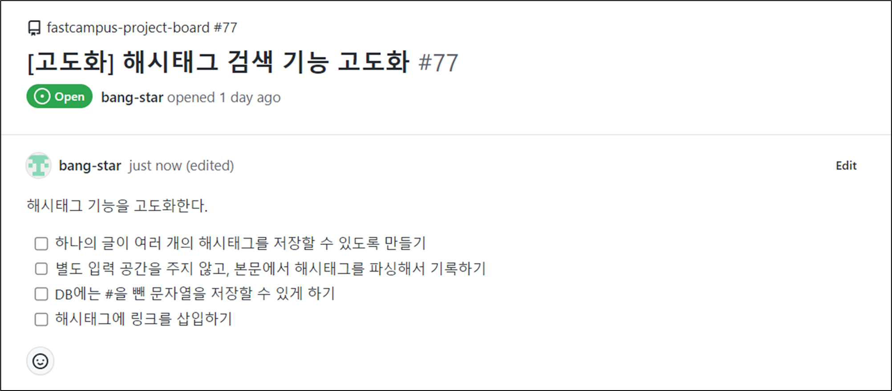

> **현재 도메인의 변동만 반영되어 있고 테스트만 조금 업데이트된 상황이다.**  
> **새로 구현할 기능에 대한 테스트만 정의되어 있고   
> 기능이 구현되어 있지 않아 테스트가 실패하는 상황이다.**

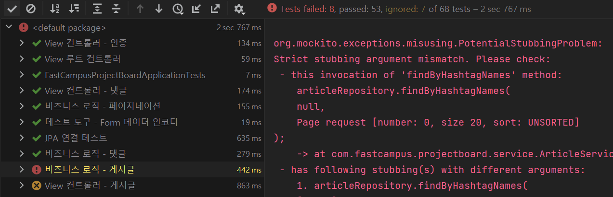

## **실패하는 테스트 코드 해결**

---

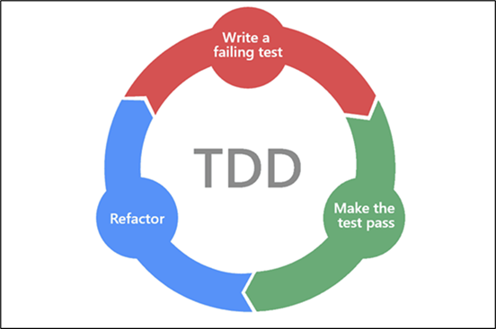

실패하는 테스트 코드를 성공하도록 구현해나갈 것이다.

### **View 컨트롤러**

---

#### **게시글 리스트 (게시판) 페이지 - 정상 호출**

**원인**

searchTypeHashtag라는 Model attribute가 있을 것이라 예상했지만 존재하지 않아 발생한 에러이다.

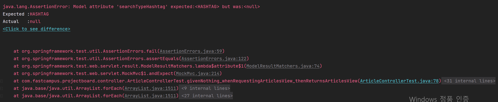

**해결 방법**

ArticleController에서 searchTypeHashtag 속성을 가진 애트리뷰트를 추가로 전달해주면된다.

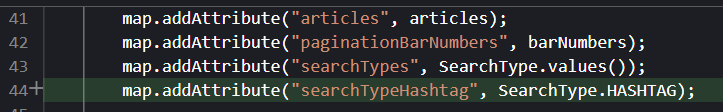

> searchType.values()를 통해 전체 SearchType을 리스트로 뽑아서 전달해주고 있어 중복 처리 되는 느낌이 든다.

---

#### **게시글 페이지 - 정상 호출, 인증된 사용자**

**원인**

searchTypeHashtag라는 Model attribute가 있을 것이라 예상했지만 존재하지 않아 발생한 에러이다.

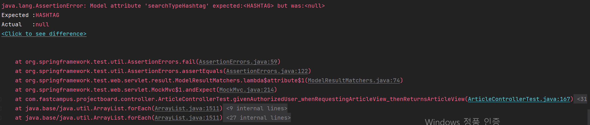

**해결 방법**

해결방법은 위와 동일하다. ArticleController에서 게시글 페이지에 searchTypeHashtag 속성을 가진 애트리뷰트를 추가로 전달해주면 된다.

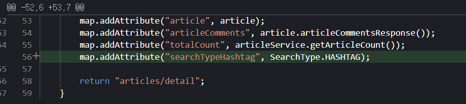

### **Service**

---

게시글 비즈니스 로직을 변경하기 위해서는 먼저 해시태그 비즈니스 로직이 구현이 되어야 한다.

#### **해시태그 서비스 테스트 구현**

```java
@DisplayName("비즈니스 로직 - 해시태그")
@ExtendWith(MockitoExtension.class)
class HashtagServiceTest {

    @InjectMocks private HashtagService sut;

    @Mock private HashtagRepository hashtagRepository;


    @DisplayName("본문을 파싱하면, 해시태그 이름들을 중복 없이 반환한다.")
    @MethodSource
    @ParameterizedTest(name = "[{index}] \"{0}\" => {1}")
    void givenContent_whenParsing_thenReturnsUniqueHashtagNames(String input, Set<String> expected){
        // Given

        // When
        Set<String> actual = sut.parseHashtagNames(input);

        //Then
        assertThat(actual).containsExactlyInAnyOrderElementsOf(expected);
        then(hashtagRepository).shouldHaveNoInteractions();
    }

    static Stream<Arguments> givenContent_whenParsing_thenReturnsUniqueHashtagNames(){
        return Stream.of(
                arguments(null, Set.of()),
                arguments("", Set.of()),
                arguments("   ", Set.of()),
                arguments("#", Set.of()),
                arguments("  #", Set.of()),
                arguments("#   ", Set.of()),
                arguments("java", Set.of()),
                arguments("java#", Set.of()),
                arguments("ja#va", Set.of("va")),
                arguments("#java", Set.of("java")),
                arguments("#java_spring", Set.of("java_spring")),
                arguments("#java-spring", Set.of("java")),
                arguments("#_java_spring", Set.of("_java_spring")),
                arguments("#-java-spring", Set.of()),
                arguments("#_java_spring__", Set.of("_java_spring__")),
                arguments("#java#spring", Set.of("java", "spring")),
                arguments("#java #spring", Set.of("java", "spring")),
                arguments("#java  #spring", Set.of("java", "spring")),
                arguments("#java   #spring", Set.of("java", "spring")),
                arguments("#java     #spring", Set.of("java", "spring")),
                arguments("  #java     #spring ", Set.of("java", "spring")),
                arguments("   #java     #spring   ", Set.of("java", "spring")),
                arguments("#java#spring#부트", Set.of("java", "spring", "부트")),
                arguments("#java #spring#부트", Set.of("java", "spring", "부트")),
                arguments("#java#spring #부트", Set.of("java", "spring", "부트")),
                arguments("#java,#spring,#부트", Set.of("java", "spring", "부트")),
                arguments("#java.#spring;#부트", Set.of("java", "spring", "부트")),
                arguments("#java|#spring:#부트", Set.of("java", "spring", "부트")),
                arguments("#java #spring  #부트", Set.of("java", "spring", "부트")),
                arguments("   #java,? #spring  ...  #부트 ", Set.of("java", "spring", "부트")),
                arguments("#java#java#spring#부트", Set.of("java", "spring", "부트")),
                arguments("#java#java#java#spring#부트", Set.of("java", "spring", "부트")),
                arguments("#java#spring#java#부트#java", Set.of("java", "spring", "부트")),
                arguments("#java#스프링 아주 긴 글~~~~~~~~~~~~~~~~~~~~~", Set.of("java", "스프링")),
                arguments("아주 긴 글~~~~~~~~~~~~~~~~~~~~~#java#스프링", Set.of("java", "스프링")),
                arguments("아주 긴 글~~~~~~#java#스프링~~~~~~~~~~~~~~~", Set.of("java", "스프링")),
                arguments("아주 긴 글~~~~~~#java~~~~~~~#스프링~~~~~~~~", Set.of("java", "스프링"))
        );
    }

    @DisplayName("해시태그 이름들을 입력하면, 저장된 해시태그 중 이름에 매칭하는 것들을 중복 없이 반환한다.")
    @Test
    void givenHashtagNames_whenFindingHashtags_thenReturnsHashtagSet() {
        // Given
        Set<String> hashtagNames = Set.of("java", "spring", "boots");
        given(hashtagRepository.findByHashtagNameIn(hashtagNames)).willReturn(List.of(
                Hashtag.of("java"),
                Hashtag.of("spring")
        ));

        // When
        Set<Hashtag> hashtags = sut.findHashtagsByNames(hashtagNames);

        // Then
        assertThat(hashtags).hasSize(2);
        then(hashtagRepository).should().findByHashtagNameIn(hashtagNames);
    }
}
```

* HashtagService는 HashtagRepository에 접근을 해야하므로 테스트에서 Mocking을 해주어야한다.  
  @Mock이 붙은 Mock객체를 @InjectMocks이 붙은 객체에 주입시킬 수 있다.
  + **@InjectMocks**: HashtagService
  + **@Mock**: HashtagRepository는 @Mock 어노테이션을 통해 의존성 주입을 해준다.
* **@ParameterizedTest**: 다양한 실험 값을 통해 연속적인 테스트를 하기 위한 어노테이션  
  + name 옵션을 통해 테스트에 이름을 임의로 설정하여 시각적으로 표현할 수 있다.
  + **@MethodSource** 어노테이션을 통해 다양한 실험 값을 주입할 수 있다.
* [참고] [해시태그](https://ko.wikipedia.org/wiki/%ED%95%B4%EC%8B%9C%ED%83%9C%EA%B7%B8)

---

#### **해시태그 서비스 구현**

```java
@RequiredArgsConstructor
@Service
public class HashtagService {

    private final HashtagRepository hashtagRepository;

    public Set<String> parseHashtagNames(String content) {
        if(content == null){
            return Set.of();
        }

        Pattern pattern = Pattern.compile("#[\\가-힣]+");
        Matcher matcher = pattern.matcher(content.strip());
        Set<String> result = new HashSet<>();

        while (matcher.find()){
            result.add(matcher.group().replace("#", ""));
        }

        return Set.copyOf(result);
    }

    public Set<Hashtag> findHashtagsByNames(Set<String> hashtagNames) {
        return new HashSet<>(hashtagRepository.findByHashtagNameIn(hashtagNames));
    }

    public void deleteHashtagWithoutArticles(Long hashtagId) {
        Hashtag hashtag = hashtagRepository.getReferenceById(hashtagId);
        if(hashtag.getArticles().isEmpty()){
            hashtagRepository.delete(hashtag);
        }
    }
}
```

* 테스트 코드가 통과할 수 있도록 구현
* 해시태그 패턴 - 알파벳 대소문자와 한글 혼용 가능하도록 설정
  + 해시태그 정규표현식
    - <https://do-dam.tistory.com/102>
    - <https://swyg.link/AMZBD>
  + 반환값에 불변성 강조
* 게시글과 해시태그가 ManyToMany 관계임을 유의하여 삭제 기능 구현

[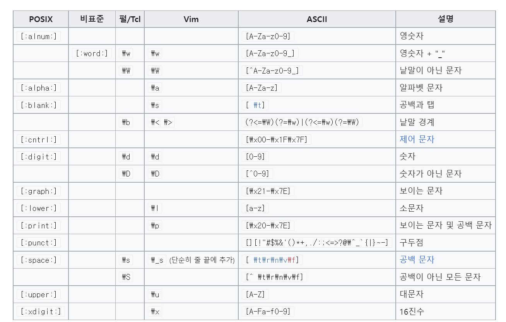](https://ko.wikipedia.org/wiki/%EC%A0%95%EA%B7%9C_%ED%91%9C%ED%98%84%EC%8B%9D#%ED%91%9C%EC%A4%80)

[참고] 위키피디아 - 정규 표현식

HashtagService가 정상적으로 동작함을 확인할 수 있다.

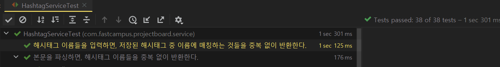

---

#### **게시글 비즈니스 로직**

게시글 서비스에서 HashtagRepository를 사용하였는데, 해시태그 서비스가 HashtagRepository를 가지고 있어 한번 더 노출될 이유가 없지만 게시글 서비스에서 사용하고 있다. 이는 리팩토링을 변경할 예정이다.

#### **게시글 생성**

**에러**

parseHashtagName("content")라는 메소드가 작동하길 원하였는데 작동하지 않았다는 에러이다.

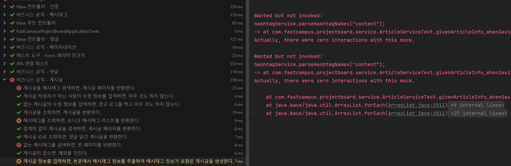

**해결**

게시글에서 해시태그가 분리되어 객체를 만드는 방식으로 변경되었으므로 그에 따른 서비스 로직을 변경시켜주면 된다.

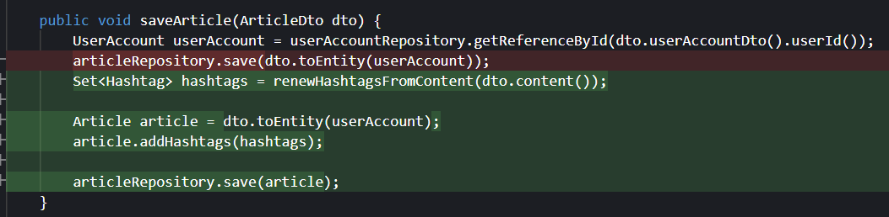
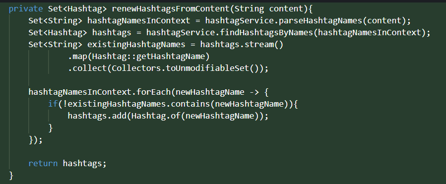

* **renewHashtagsFromContent 메소드**
  1. 본문에서 파싱할 해시태그 이름을 파싱한다.
  2. 본문에 있는 해시태그 이름을 데이터베이스에서 조회한다.
  3. 조회한 해시태그에 해시태그 이름을 받아 수정할 수 없는 Set Collection 형태로 캐스팅한다.
  4. 본문에서 파싱한 데이터를 대상으로 반복문을 돌면서 DB에 존재하지 않는 해시태그 이름을 저장한다.

---

#### **게시글 수정**

**에러**

결과물은 1개인데 어떠한 문제가 있어 결과가 2개로 출력되고 있다.

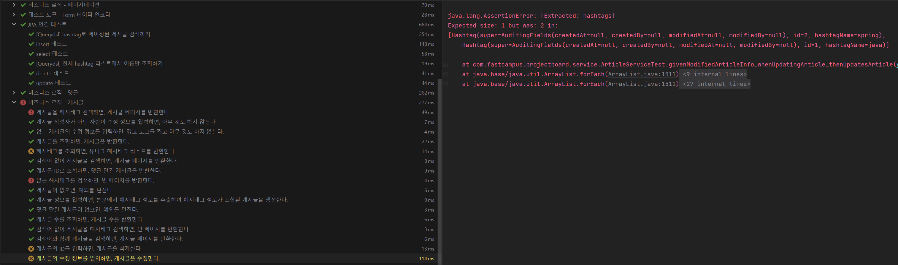

**해결 방법**

게시글을 수정하고 추가적인 해시태그를 저장할 경우, 중복되는 문제가 발생하고 있다. 게시글에 해당하는 모든 해시태그를 초기화하고 수정 작업 이후 해시태그를 다시 추가하는 과정을 통해 해결할 수 있다.

즉 해당 게시글에 해시태그를 전체 지우고, 새로 파싱해서 저장한다는 의미이다.

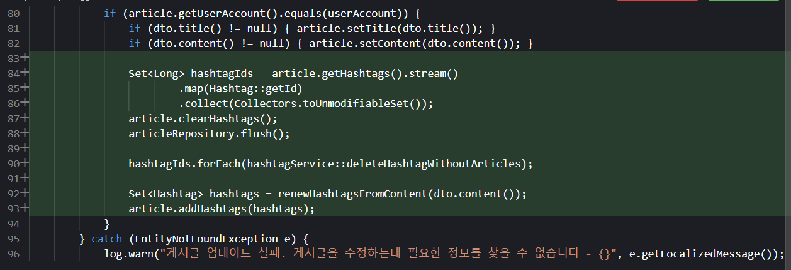

* updateArticle에 추가된 부분
  1. 게시글에 포함된 해시태그에 Id를 모두 가져와서 수정할 수 없는 상태로 Set 컬렉션으로 저장
  2. 해당 게시글에 모든 해시태그 삭제
  3. transaction에 의해 반영되지 않기 때문에 바로 삭제될 수 있도록 flush 처리
  4. 게시글에 없는 해시태그는 제거
  5. 본문을 통해 새로운 해시태그 생성
  6. 게시글에 해시태그를 저장

---

#### **해시태그 조회**

**에러**

해시태그 조회 시 아무것도 반환해주지 않고 있다.

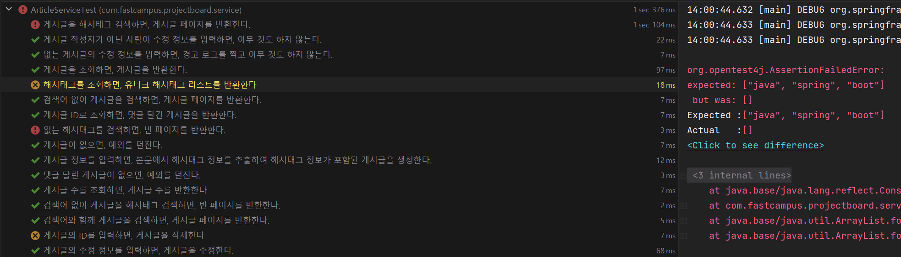

**해결**

기존 서비스 로직이 deprecated 하였기 때문에 발생하는 문제로 hashtagRepository를 통해 반환하도록 해야한다.

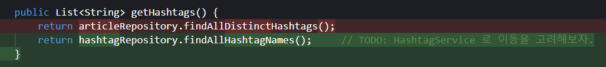

---

#### **게시글 삭제**

**에러**

기존 게시글 삭제는 게시글만 삭제하여 문제가 발생하고 있다.

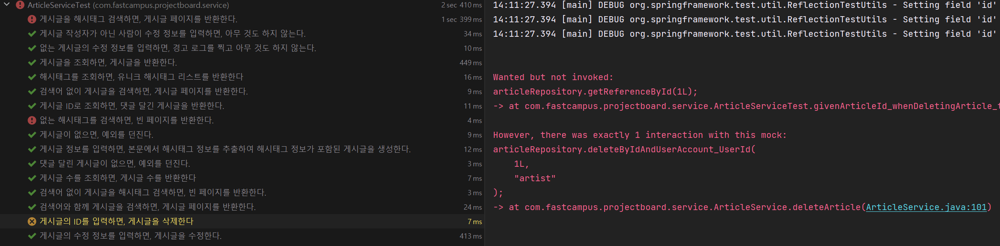

**해결**

게시글과 해시태그를 함께 관리해주어야 한다.

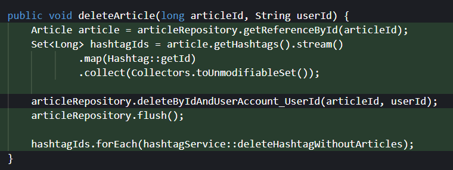

* **deleteArticle 메소드**
  1. **게시글 Id를 통해 게시글 조회**
  2. **해당 게시글에 모든 해시태그 Id를 가져와서 수정할 수 없는 Collection Set 상태로 저장**
  3. **게시글 Id를 통해 해당 게시글 삭제**
  4. **DB에 반영되도록 Flush**
  5. **게시글이 삭제되었으므로 게시글이 없는 해시태그 삭제**

---

#### **해시태그 조회 시, 페이지 반환**

**에러**

**없는 해시태그를 검색하는 경우**와 **해시태그가 존재하는 경우**에서 함께 에러가 발생하고 있다.

공통적으로 해시태그를 검색하는 경우는 현재 argument가 맞지 않다는 에러가 발생하고 있다.

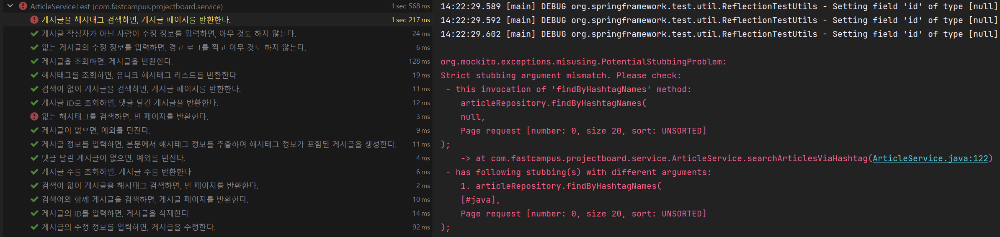

**해결**

argument 가 일치하지 않다는 에러가 발생하고 있으므로 간단하게 해결 가능하다.

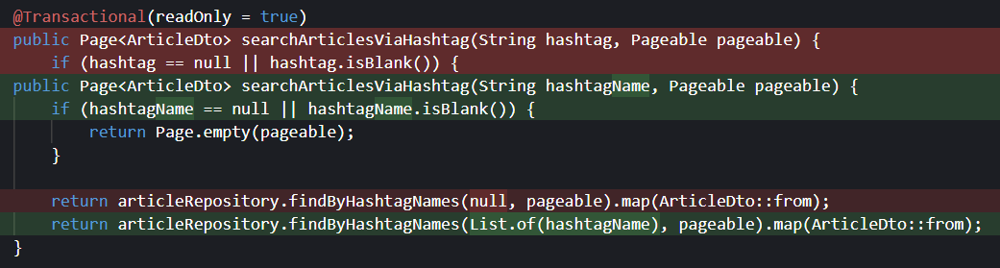

비즈니스 변경을 통해 다음과 같이 테스트가 전부 통과함을 확인할 수 있었다.

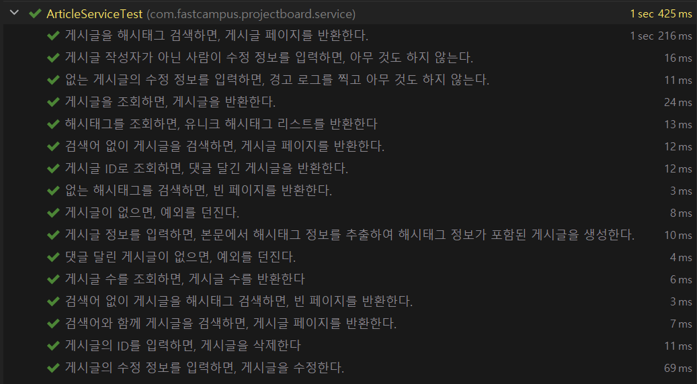

비즈니스 로직 - 게시글 테스트 실행 결과 : 성공

### **View**

---

도메인 변동과 함께 서비스 로직이 변동됨에 따라 뷰에 반영을 해주어야 한다.

#### **게시판 페이지에 해시태그에 링크 삽입하기**

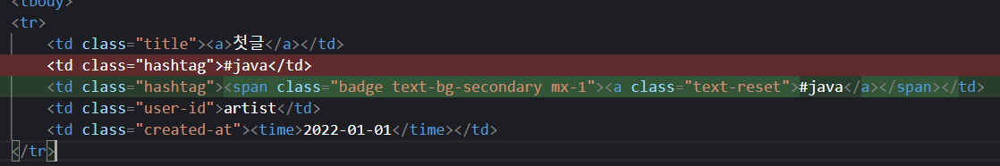

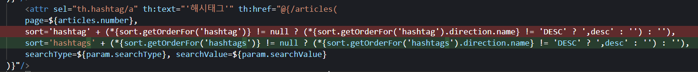

---

#### **게시글 생성 폼에서 해시태그 별도 입력 공간을 주지 않고, 본문에서 해시태그를 파싱해서 기록하기**

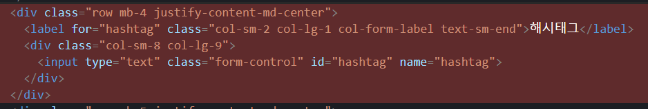
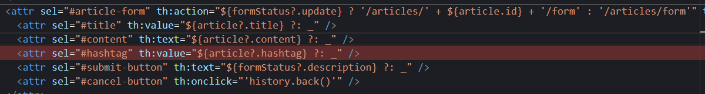

---

#### **하나의 글이 여러 개의 해스태그를 저장할 수 있도록 만들기**

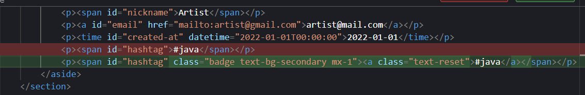
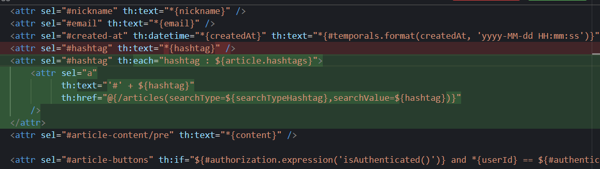

commit을 통해 바라본 작업 내용

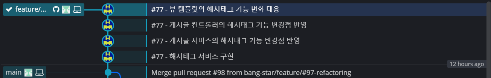
