## 대댓글

---

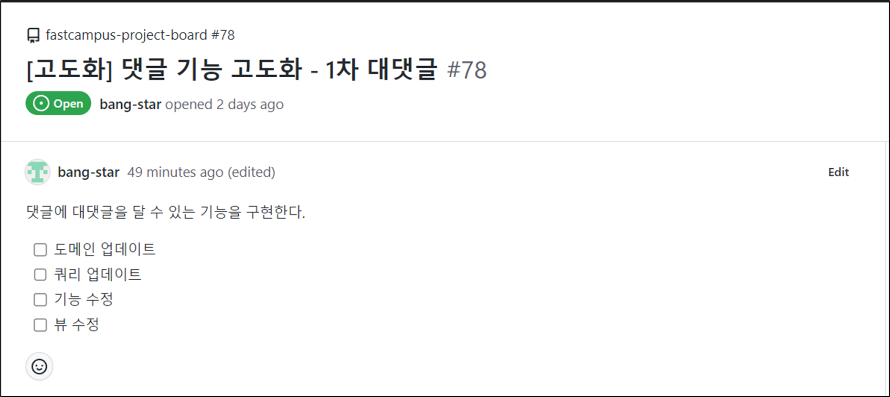

1. **도메인 업데이트**  
   우선 도메인 업데이트가 필요한다. **추가 도메인 설계**에서 작업을 진행해야 했지만,   
   소스코드에 변경점이 너무 커서 해시태그만 먼저 하고 대댓글은 분리하여 작업하기로 했었다.
2. **쿼리 업데이트**도메인이 변경됨에 따라 대댓글이 생길 것이고, 쿼리가 업데이트 될 것이다.
3. **기능 수정**도메인 변경을 바탕으로 기능 수정이 이뤄질 것이다.
4. **뷰 수정**  
   수정된 기능을 뷰에 반영하는 작업이 이뤄질 것이다.

### **도메인 업데이트**

---

[원문에서 이미지 보기](https://to-be-a-artist.tistory.com/277)

[추가 도메인 설계](tistory-269.html) 과정에서 대댓글에 대한 ERD까지는 디자인을 완료한 상태이다.

소스 코드에는 반영하지 않은 상태이다.

#### **Github Issue에서 Issue 생성**

대댓글 구현에 변경점이 많을 것으로 판단되어 최신 github 기술을 이용하여 이슈를 분리하여 작업하려 한다.

다음과 같이 [마크다운 언어에 Task list](https://docs.github.com/ko/get-started/writing-on-github/getting-started-with-writing-and-formatting-on-github/basic-writing-and-formatting-syntax#quoting-text) 기능을 만들면 이슈를 바로 생성 가능하게 되었다. 이를 이용하면 더 작은 단위로 작업을 분리할 수 있게 되었다.

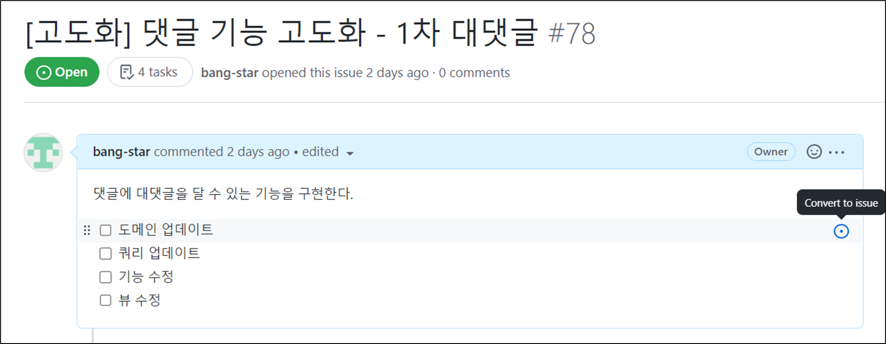

다음과 같이 해당 Task List에 작업이 이슈로 연동되는 것을 확인할 수 있다.

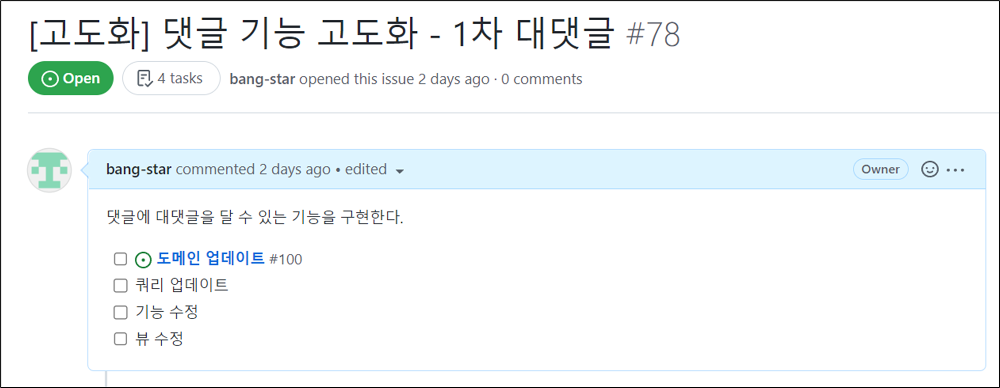

해당 이슈로 접근하게 되면 비어있는 것을 확인할 수 있는데, 해당 이슈에 맞게 설정을 하면 된다.

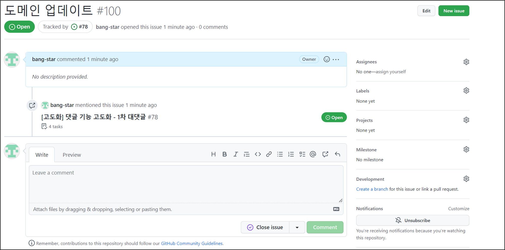

Github 프로젝트 기능과 연동되어 쉽게 설정이 가능하다.

**Tracked by**를 통해 현재 이슈가 어떤 이슈로부터 발행된 것인지 나타내고 있다.

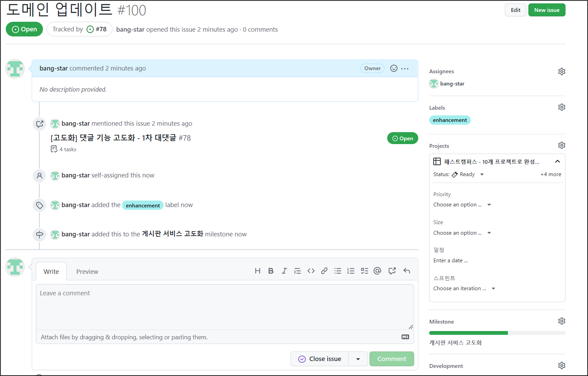

동일하게 작업을 반복하면 다음과 같이 만들 수 있고, 부모 Issue에서는 4task라는 표현을 통해 연관된 이슈를 확인할 수 있다.

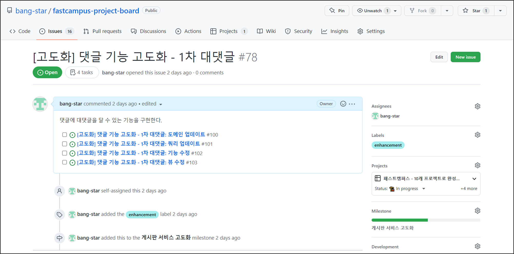

Feature 브랜치 또한 부모 브랜치와 자식 브랜치 관계로 형성하여 개발할 수 있다.

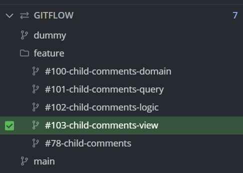

다음과 같이 #78-child-comments 브랜치를 부모 브랜치로 두고

#100, #101, #102, #103 이슈를 작업을 완료할 때마다 해당 작업 내용을 부모 브랜치로 Push And Merge 하여 변경점을 세분화하여 PR할 수 있게 되는 장점을 갖는다.

---

#### **도메인 업데이트**

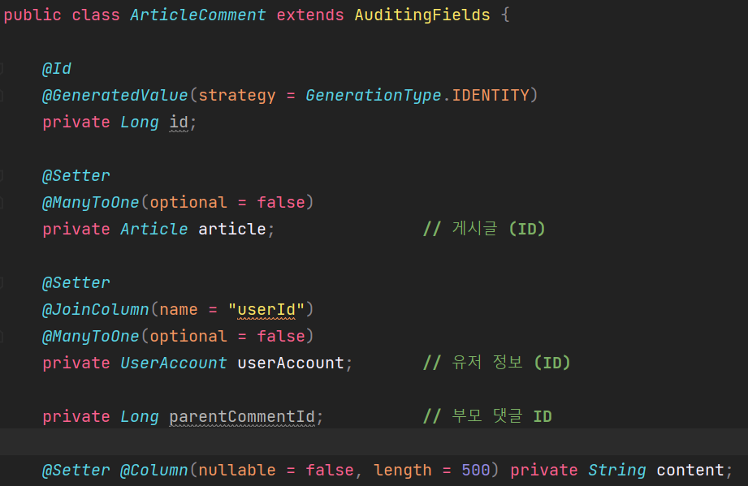

기존과 다르게 생각해야 할 것은 지금까지 JPA 특징을 이용해서 객체지향적인 연관관계를 추구했다. 

ArticleComment에 게시글, 유저 정보를 객체로 맵핑이 되어있는 상태이고 모두 양방향을 적극적으로 사용하고 있다.

그런데 관계 맵핑을 하다가 단방향으로 할지, 양방향으로 할지 고민을 하게 되는데

하지 않는 것도 가능하고, 단방향으로만 연관관계를 맵핑하는 것도 가능하다.

양방향 바인딩을 열심히 사용해왔고, 이번에 부모 댓글을 구현할 때는 단방향 바인딩을 사용하려 한다.

원래대로 한다면 다음과 같이 작성될 것이고, parentComment은 실제 데이터베이스에서 Id로 해석이 될것이고,

ArticleComment안에 ArticleComment가 있는 방식으로 디자인이 되었을 것이다.

```java
private ArticleComment parentComment;
```

위처럼 하지 않고 바로 아이디를 넣도록 설정하여 맵핑에 흐름을 한쪽 방향에서 끊도록 설정하겠다.

* 하나의 컬럼이 되고, 부모가 없는 댓글에 경우 해당 필드는 NULL이 될 수 있고 부모가 변동될 수 없도록 한다.
* 최초 생성 시 부모 댓글 ID가 정해지므로 Setter는 필요 없지만, 부모 댓글 ID를 바로 넣어주지 않는 상황에서 필요하므로 일단 Setter를 설정.
* 부모 입장에서는 자식에 댓글을 볼 수 있다(JPA 기능을 이용하여 가능)
* 부모 댓글  삭제 시, 자식 댓글도 삭제되도록 한다.
* 대댓글은 댓글과 다르게 작성시간을 기준으로 오름차순으로 정렬한다.

---

#### **🚨경고**

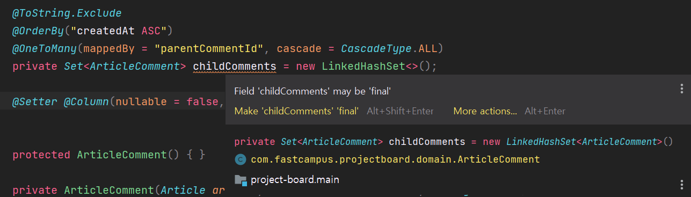

> Intellij에서 현재 final 키워드를 사용할 것을 권장해주고 있다.   
> 이유는 처음 new LinkedHashSet을 사용하고 생성자나 메소드에서 새로운 셋팅이나 변경을 하고 있지 않고 있어 변경이 총 1번만 이뤄지고 있기 때문에 final로 사용하는 것을 추천해주고 있다.  
>   
> 그런데 **Hibernate Spec**에 의하면 JPA 코드에서 final 키워드를 사용하지 않을 것을 권고하고 있다.  
> **이유는 Entity 클래스는 평범한 클래스랑 다르다.**   
> DTO 클래스는 데이터를 옮기기 위해 사용하는 클래스로 불변성을 유지하는 전략을 이어간다.  
> Entity 클래스는 하나의 데이터베이스 테이블과 쿼리를 대변하고 도메인 코드를 이용하여 Query를 작성한다.  
> Query는 기본적으로 CRUD 기능을 가지고 있어 Setter로 접근하여 필드 수정하면 변경점을 영속성 컨텍스트가 인지해서 업데이트 Query를 만들게 되는데, **final** 키워드를 사용하면 변경을 하지 않을 것이라는 의미가 된다.  
> 그러면 디자인 자체가 업데이트 Query를 사용하지 않겠다는 의미와 같아지고 Query를 사용하기 위해 만든 Entity 클래스의 성질과 달라지게 되므로 Entity 클래스에 **final**을 사용하지 않을 것을 권고하고 있다.

#### **🙋‍♀️ Why?**

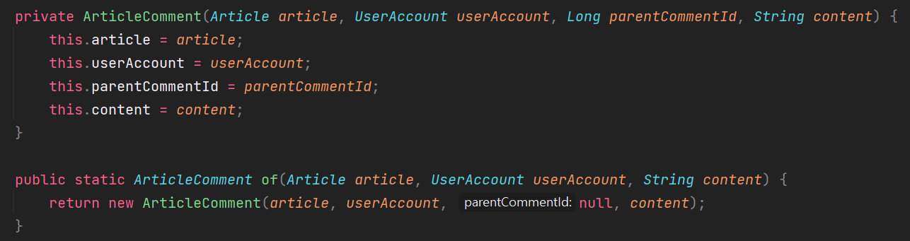

> 생성자는 모든 필드를 가져가는데 반해, 팩토리 메소드는 원래 스펙 그대로 가져가고 parentCommentId부분은 null로 설정해두었다. **왜 그랬을까?**  
> 생성자는 private로 팩토리 메소드는 public로 오픈하고 있다. 예하 모든 DTO들과 비즈니스 로직들이 새로운 도메인을 만들려고 할 때 생성자를 사용하지 않고 팩토리 메소드를 사용하기 있기 때문에 새로운 변경사항이 적용되지 않을 것이다.   
>   
> 이처럼 연결은 끊는 것에 장점은 도메인 코드의 변경사항 마저도 변경에 영향 범위를 최소화할 수 있기 때문이다.   
>   
> **그러면 null은 괜찮나요??**첫 댓글을 작성할 때에는 부모 댓글에 연관관계를 설정하지 않겠다는 의미이다.  
> 처음 작성한 댓글이 대댓글이라고 해서 바로 부모에 댓글 Id를 설정해야하는 것은 아니다. 우선 엔티티를 작성한 다음에 parentCommandId를 추가 정보로 넣어주면 된다. 그러면 생성자 스펙에 변경없이도 대댓글을 작성할 수 있다.

**ArticleComment**

```java
@Getter
@ToString(callSuper = true)
@Table(indexes = {
        @Index(columnList = "content"),
        @Index(columnList = "createdAt"),
        @Index(columnList = "createdBy")
})
@Entity
public class ArticleComment extends AuditingFields {

    @Id
    @GeneratedValue(strategy = GenerationType.IDENTITY)
    private Long id;

    @Setter
    @ManyToOne(optional = false)
    private Article article;               // 게시글 (ID)

    @Setter
    @JoinColumn(name = "userId")
    @ManyToOne(optional = false)
    private UserAccount userAccount;       // 유저 정보 (ID)

    @Setter
    @Column(updatable = false)
    private Long parentCommentId;          // 부모 댓글 ID

    @ToString.Exclude
    @OrderBy("createdAt ASC")
    @OneToMany(mappedBy = "parentCommentId", cascade = CascadeType.ALL)
    private Set<ArticleComment> childComments = new LinkedHashSet<>();

    @Setter @Column(nullable = false, length = 500) private String content;     // 본문


    protected ArticleComment() { }

    private ArticleComment(Article article, UserAccount userAccount, Long parentCommentId, String content) {
        this.article = article;
        this.userAccount = userAccount;
        this.parentCommentId = parentCommentId;
        this.content = content;
    }

    public static ArticleComment of(Article article, UserAccount userAccount, String content) {
        return new ArticleComment(article, userAccount, null, content);
    }

    public void addChildComment(ArticleComment child){
        child.setParentCommentId(this.getId());
        this.getChildComments().add(child);
    }

    @Override
    public boolean equals(Object o) {
        if (this == o) return true;
        if (!(o instanceof ArticleComment that)) return false;
        return this.getId() != null && this.getId().equals(that.getId());
    }

    @Override
    public int hashCode() {
        return Objects.hash(this.getId());
    }
}
```

---

#### **Check The Issue**

다음과 같이 이슈를 마무리 되면 체크박스가 형성되어 연동이 된다.

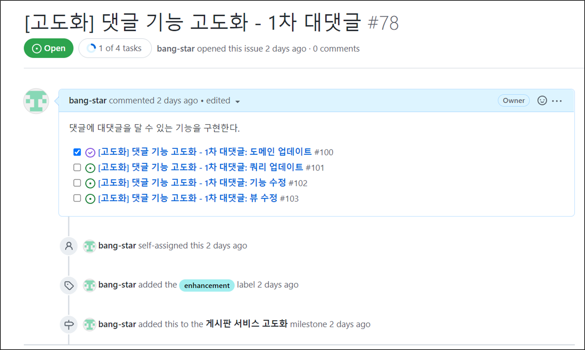

### **Query 업데이트**

---

#### **대댓글을 반영한 코드 data.sql 업데이트**

다음과 같이 수정되었다.

```sql
-- 300 댓글
insert into article_comment (article_id, user_id, parent_comment_id, content, created_at, modified_at, created_by, modified_by) values
(49, 'artist', null, 'Quisque id justo sit amet sapien dignissim vestibulum. Vestibulum ante ipsum primis in faucibus orci luctus et ultrices posuere cubilia Curae; Nulla dapibus dolor vel est. Donec odio justo, sollicitudin ut, suscipit a, feugiat et, eros.', '2021-03-02 22:40:04', '2021-04-27 15:38:09', 'Lind', 'Orv'),
(108, 'artist', null, 'Quisque id justo sit amet sapien dignissim vestibulum. Vestibulum ante ipsum primis in faucibus orci luctus et ultrices posuere cubilia Curae; Nulla dapibus dolor vel est. Donec odio justo, sollicitudin ut, suscipit a, feugiat et, eros.', '2021-06-08 04:36:02', '2022-01-25 15:35:42', 'Trstram', 'Loy'),
(31, 'artist2', null, 'Nam ultrices, libero non mattis pulvinar, nulla pede ullamcorper augue, a suscipit nulla elit ac nulla. Sed vel enim sit amet nunc viverra dapibus. Nulla suscipit ligula in lacus.', '2021-04-10 00:47:10', '2021-02-06 20:58:04', 'Duff', 'Early');

-- 대댓글
insert into article_comment (article_id, user_id, parent_comment_id, content, created_at, modified_at, created_by, modified_by) values
(49, 'artist', 1, '퍼가요~', '2021-03-02 22:40:04', '2021-04-27 15:38:09', 'artist', 'artist'),
(49, 'artist2', 1, '퍼가요~', '2021-03-03 22:40:04', '2021-04-27 15:38:09', 'artist2', 'artist2'),
(49, 'artist', 1, '또 퍼가요~', '2021-03-04 22:40:04', '2021-04-27 15:38:09', 'artist', 'artist'),
(49, 'artist', 1, '또또 퍼가요~', '2021-03-05 22:40:04', '2021-04-27 15:38:09', 'artist', 'artist');
```

---

#### **JPARepositoryTest**

Spring Boot를 실행을 통해 변경된 도메인이 반영됨을 확인할 수 있다.

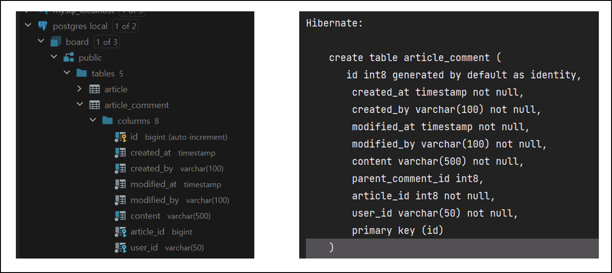

대댓글이 원하는 형식으로 만들어지는지 테스트를 하려 한다.

**대댓글 조회**

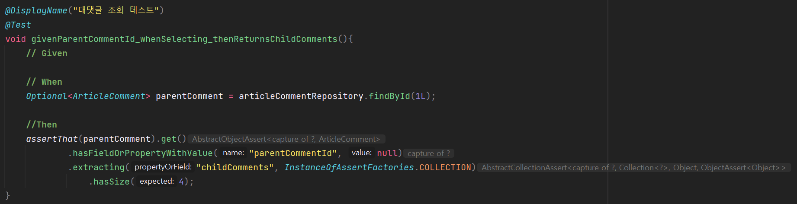

* **data.sql을 통해 삽입한 대댓글 구조를 바탕으로 댓글 아이디를 1L로 설정**  
  댓글 1번에 대하여 대댓글 4개를 갖도록 설정함.
* **get()**assertj에 get메소드는 Optional 안에 있는 데이터를 꺼내면서 NULL 체크를 한다.  
  즉 get 메소드 하나로 테스트에 의미를 갖는다.
* **hasFieldOrPropertyWithValue()**부모 댓글에 Id가 있는지 확인 → 부모 댓글은 부모가 없다.
* **extracting()**메소드를 통해 자식 댓글 정보와 타입을 확인할 수 있다.
* **hasSize()**  
  자식 댓글에 개수를 파악한다.

---

#### **댓글에 대댓글 삽입 테스트**

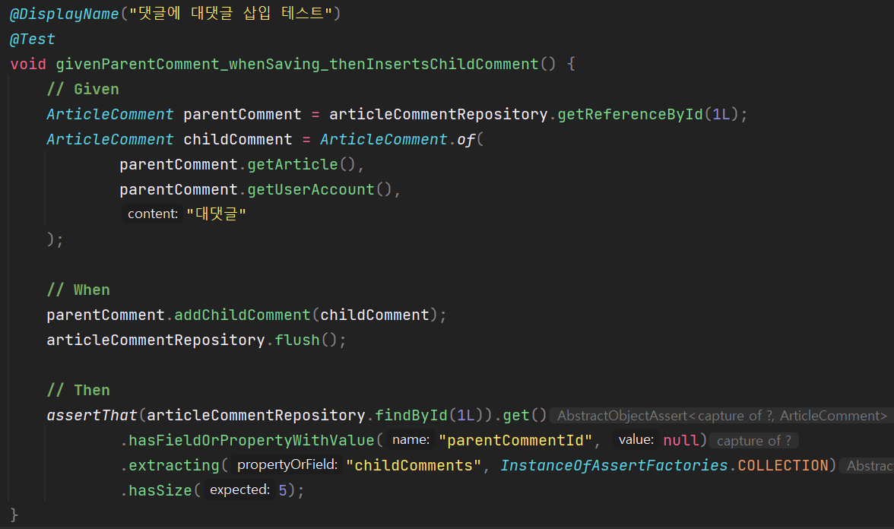

1. **댓글 Id가 1번인 댓글 조회**

2. **부모와 동일한 게시글에 동일한 사용자 계정으로 자식 댓글 생성**

3. **부모 댓글에 자식댓글 등록**

4. **flush 메소드를 통해 DB 반영**

5. **댓글 1번에 대댓글이 5개인지 조회(대댓글 조회와 동일)**

---

#### **댓글 삭제와 대댓글 전체 연동 삭제 테스트**

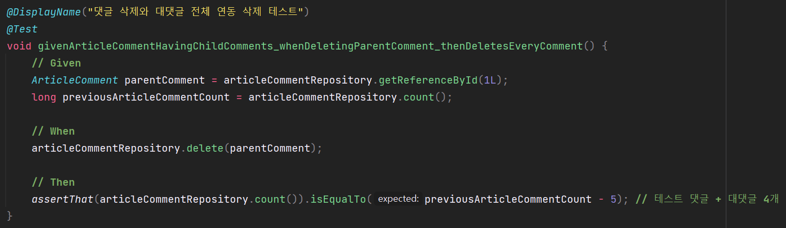

1. **댓글 Id가 1번인 부모 댓글 조회**

2. **전체 댓글의 개수 조회**

3. **부모 댓글 삭제**

4. **부모 댓글 삭제 후, 댓글의 총 개수와 삭제 전 댓글의 합 + 5(부모 1개, 대댓글 4개)가 동일한지 확인**

---

#### **댓글 삭제와 대댓글 전체 연동 삭제 테스트**

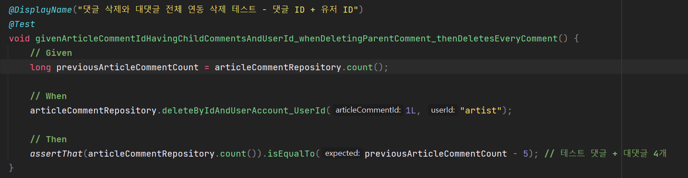

1. **전체 댓글의 개수 조회**

2. **댓글 아이디와 작성자 아이디를 통해 부모 댓글 삭제(실제 사용하는 비즈니스 로직 테스트)**

3. **부모 댓글 삭제 후, 댓글의 총 개수와 삭제 전 댓글의 합 + 5(부모 1개, 대댓글 4개)가 동일한지 확인**

**테스트 메소드 실행결과**

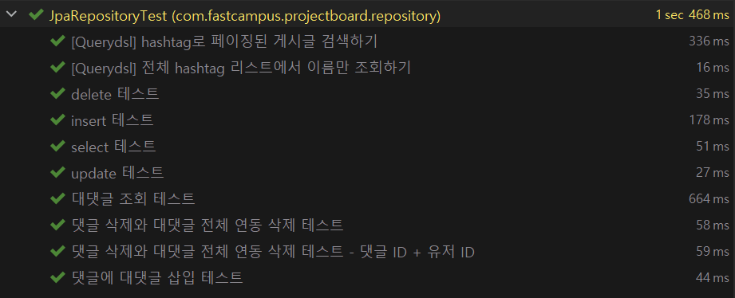

---

#### **Check the issue**

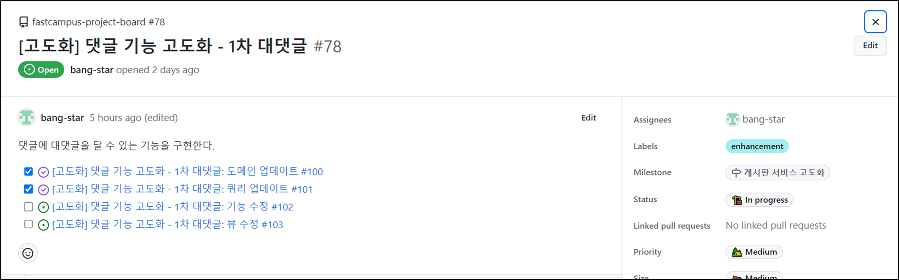
