## 기능 구현

---

### Controller

---

### 

#### ****대댓글 등록****

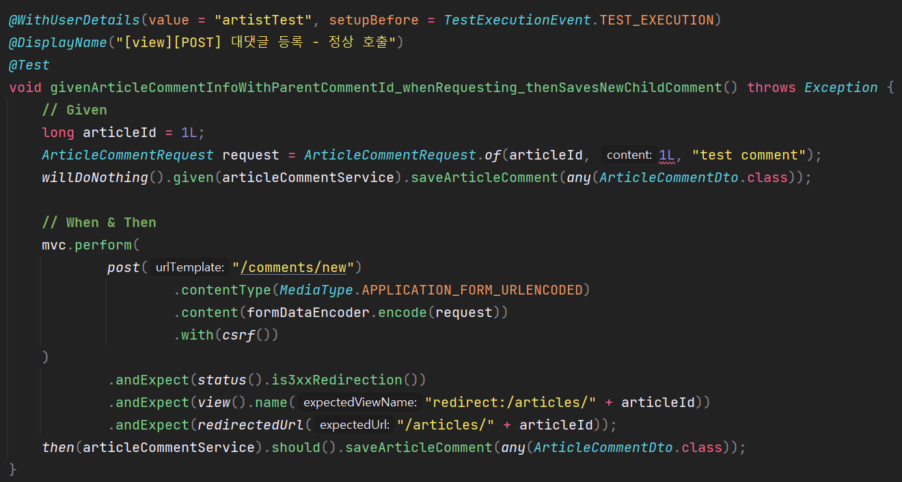

대댓글 요청 스펙에 맞도록 ArticleCommentRequest를 변경해주어야 한다.

API 요청을 받는 부분에서 대댓글에 관련된 정보가 들어오지 않고 있는데, 관련된 정보를 받을 수 있게 해주어야 한다.

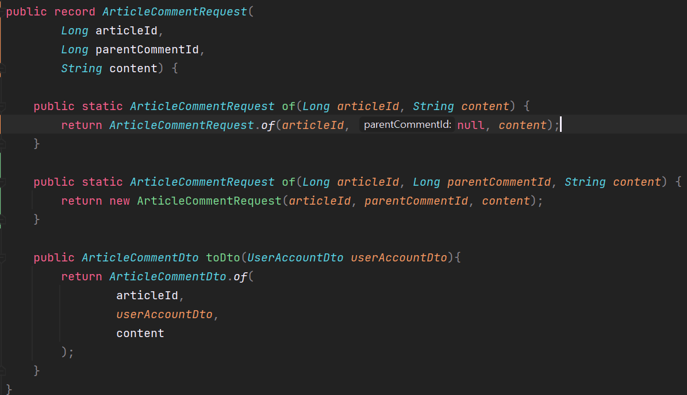

두 개에 생성자로 분리하여 기존 생성자를 통해 기존 코드가 정상 작동할 수 있음을 보장해주고,

새로운 생성자는 부모 댓글 Id를 받을 수 있는 즉 대댓글 기능 구현이 가능하도록 하였다.

Request를 변경하였으므로 Dto로 변경이 가능해야한다.

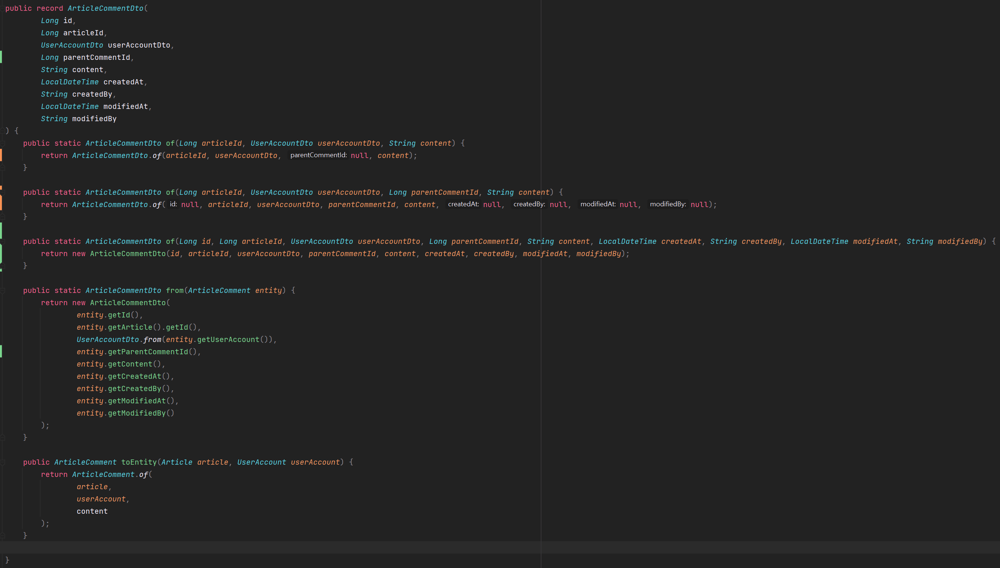

Dto에 대한 Response도 변경해주어야 한다.

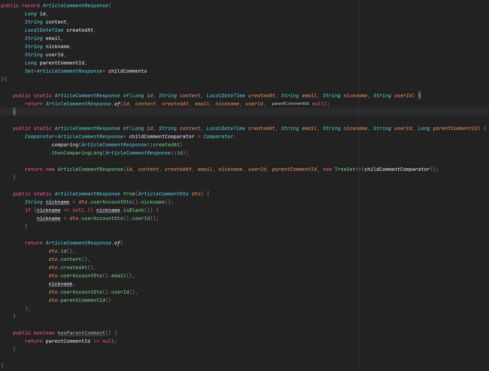

* **Comparator을 이용하여 대댓글에 정렬 순서 지정**
* **대댓글은 작성 시간을 기준으로 오름차순으로 정렬되도록 보장해야하므로 Set 중 TreeSet 선택**  
  TreeSet은 정렬 상태를 내부에 넣게 되어있는데, 넣지 않을 경우 기본적인 정렬 셋팅을 따르게 된다.

댓글은 게시글과 함께 전달해주고 있기 때문에 ArticleWithCommentsResponse를 변경해야 게시글 페이지에 댓글이 반영되게 된다.

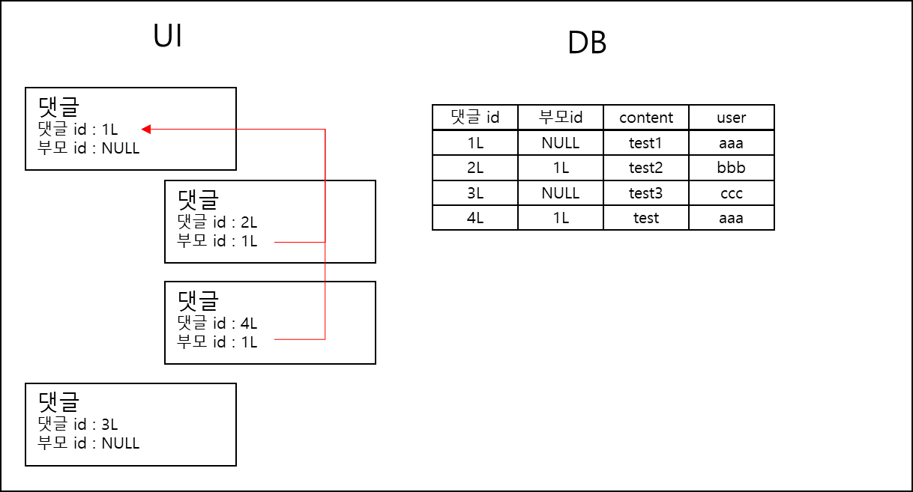

* Query는 데이터베이스 하나에 들어가 있어 댓글과 대댓글에 계층 상태가 표현되어 있지 않다.  
  그런데 최종적으로 View에 내려줄 때는 계층 상태로 보내주어야 하기 때문에 **Converting하는 로직**이 필요하다.

> Converting 로직을 어디에 넣는 것이 좋을까?

> **1. 서비스 로직에 구현하는 방법**데이터베이스에서 가져온 데이터 즉 엔티티에 있었던 단일 계층을 Dto로 바꿀 때 복합적인 구조로 바꿀 것인데, Converting 로직이 Service에 들어가 있다는 것은 Service에서 Dto에 이동과정을 다 알고 있어야 한다.  
> => 서비스 로직을 거쳐서 데이터가 엔티티에서 Dto로 바뀌어 Controller에 제공되게 되는 방법이다.  
>   
> **2. Dto에 구현하는 방법 ✔️**Dto 에 Converting 로직이 두면 Service는 Dto에게 던지기만 하면 된다. Dto로부터 Response를 만드는 작업처럼 각각에 고유한 맵핑 로직을 반드시 알아야 하는 Dto에 배치시켜 서비스 로직을 가볍게 만들 수 있다.  
> \* 적절한 위치는 ArticleWithCommentResponse이다.

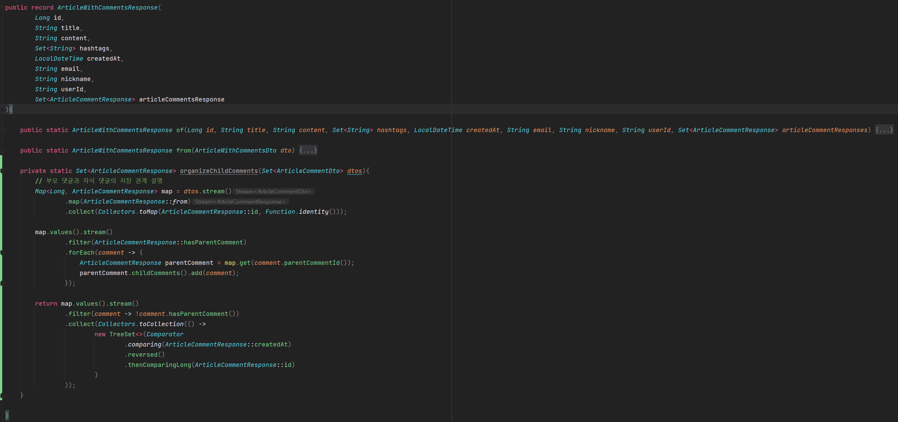

* 댓글이 이미 Collection 안에 들어가 있어 부모-자식 댓글에 관계는 표현되지 않는다.
* ArticleCommentResponse에서 부모-자식 관계가 잘 표현되었기 때문에 문제 없다.

> **\* organizeChildComments 메소드에 대한 설명**  
> 1. `Set<ArticleCommentDto> dtos` 는 데이터에 쉽게 접근하는 로직을 제공해주지 않는다.  
> 2. dtos.stream()을 사용하여 map(ArticleCommentResponse::from)로 dto에서 Response로 쉽게 맵핑을 한다.  
> 3. collect(Collectors.toMap(Key, Value))를 사용하여 Map으로 전환가능하다.  
> - Key 는 ArticleCommentResponse에 id  
> - Value는 동일한 데이터를 넣을 것이기 때문에 Function.identity()를 사용한다  
> \* Function.identity()는 현재 인자로 들어온 값을 그대로 반환한다.  
>   
> [미리 설명 - 부모 id 가 없는 데이터를 먼저 뽑아 Root 데이터를 확보하고, 나머지 데이터는 부모 아이디 값을 확인하여 Set에 add하여 저장해주고 대댓글을 삭제하는 구조]  
> 4. map.values()에서 values()만 뽑아낸다.  
> 5. stream().filter()를 통해 부모댓글만 뽑아서  
> 6. foreach()를 통해 자식 댓글 정보를 저장한다.  
> 이를 통해 순회 1번만으로 필요한 부모 댓글이 자식댓글에 저장받을 수 있게 되었다.  
> =>   
>   
> 반환하기 전에 대댓글에 정렬 순서를 설정하는 작업이 필요하다.  
> 7. map.values().stream().filter() 를 통해 자식 댓글만 뽑아서  
> 8. collection()를 사용하여 Collectors.toCollection()으로 사용하여 순서가 보장되기 위해 TreeSet을 사용하여 정렬해준다.  
> 9. Comparator에서 첫번째 비교 대상은 생성일자를 기준으로 내림차순 정렬하고, 시간이 동일할 경우를 대비하여 댓글에 id 값을 기준으로 오름차순 정렬한다.

**ArticleWithCommentsResponseTest**

```java
@DisplayName("DTO - 댓글을 포함한 게시글 응답 테스트")
class ArticleWithCommentsResponseTest {

    @DisplayName("자식 댓글이 없는 게시글 + 댓글 dto를 api 응답으로 변환할 때, 댓글을 시간 내림차순 + ID 오름차순으로 정리한다.")
    @Test
    void givenArticleWithCommentsDtoWithoutChildComments_whenMapping_thenOrganizesCommentsWithCertainOrder() {
        // Given
        LocalDateTime now = LocalDateTime.now();
        Set<ArticleCommentDto> articleCommentDtos = Set.of(
                createArticleCommentDto(1L, null, now),
                createArticleCommentDto(2L, null, now.plusDays(1L)),
                createArticleCommentDto(3L, null, now.plusDays(3L)),
                createArticleCommentDto(4L, null, now),
                createArticleCommentDto(5L, null, now.plusDays(5L)),
                createArticleCommentDto(6L, null, now.plusDays(4L)),
                createArticleCommentDto(7L, null, now.plusDays(2L)),
                createArticleCommentDto(8L, null, now.plusDays(7L))
        );
        ArticleWithCommentsDto input = createArticleWithCommentsDto(articleCommentDtos);

        // When
        ArticleWithCommentsResponse actual = ArticleWithCommentsResponse.from(input);

        // Then
        assertThat(actual.articleCommentsResponse())
                .containsExactly(
                        createArticleCommentResponse(8L, null, now.plusDays(7L)),
                        createArticleCommentResponse(5L, null, now.plusDays(5L)),
                        createArticleCommentResponse(6L, null, now.plusDays(4L)),
                        createArticleCommentResponse(3L, null, now.plusDays(3L)),
                        createArticleCommentResponse(7L, null, now.plusDays(2L)),
                        createArticleCommentResponse(2L, null, now.plusDays(1L)),
                        createArticleCommentResponse(1L, null, now),
                        createArticleCommentResponse(4L, null, now)
                );
    }

    @DisplayName("게시글 + 댓글 dto를 api 응답으로 변환할 때, 댓글 부모 자식 관계를 각각의 규칙으로 정렬하여 정리한다.")
    @Test
    void givenArticleWithCommentsDto_whenMapping_thenOrganizesParentAndChildCommentsWithCertainOrders() {
        // Given
        LocalDateTime now = LocalDateTime.now();
        Set<ArticleCommentDto> articleCommentDtos = Set.of(
                createArticleCommentDto(1L, null, now),
                createArticleCommentDto(2L, 1L, now.plusDays(1L)),
                createArticleCommentDto(3L, 1L, now.plusDays(3L)),
                createArticleCommentDto(4L, 1L, now),
                createArticleCommentDto(5L, null, now.plusDays(5L)),
                createArticleCommentDto(6L, null, now.plusDays(4L)),
                createArticleCommentDto(7L, 6L, now.plusDays(2L)),
                createArticleCommentDto(8L, 6L, now.plusDays(7L))
        );
        ArticleWithCommentsDto input = createArticleWithCommentsDto(articleCommentDtos);

        // When
        ArticleWithCommentsResponse actual = ArticleWithCommentsResponse.from(input);

        // Then
        assertThat(actual.articleCommentsResponse())
                .containsExactly(
                        createArticleCommentResponse(5L, null, now.plusDays(5)),
                        createArticleCommentResponse(6L, null, now.plusDays(4)),
                        createArticleCommentResponse(1L, null, now)
                )
                .flatExtracting(ArticleCommentResponse::childComments)
                .containsExactly(
                        createArticleCommentResponse(7L, 6L, now.plusDays(2L)),
                        createArticleCommentResponse(8L, 6L, now.plusDays(7L)),
                        createArticleCommentResponse(4L, 1L, now),
                        createArticleCommentResponse(2L, 1L, now.plusDays(1L)),
                        createArticleCommentResponse(3L, 1L, now.plusDays(3L))
                );
    }

    @DisplayName("게시글 + 댓글 dto를 api 응답으로 변환할 때, 부모 자식 관계 깊이(depth)는 제한이 없다.")
    @Test
    void givenArticleWithCommentsDto_whenMapping_thenOrganizesParentAndChildCommentsWithoutDepthLimit() {
        // Given
        LocalDateTime now = LocalDateTime.now();
        Set<ArticleCommentDto> articleCommentDtos = Set.of(
                createArticleCommentDto(1L, null, now),
                createArticleCommentDto(2L, 1L, now.plusDays(1L)),
                createArticleCommentDto(3L, 2L, now.plusDays(2L)),
                createArticleCommentDto(4L, 3L, now.plusDays(3L)),
                createArticleCommentDto(5L, 4L, now.plusDays(4L)),
                createArticleCommentDto(6L, 5L, now.plusDays(5L)),
                createArticleCommentDto(7L, 6L, now.plusDays(6L)),
                createArticleCommentDto(8L, 7L, now.plusDays(7L))
        );
        ArticleWithCommentsDto input = createArticleWithCommentsDto(articleCommentDtos);

        // When
        ArticleWithCommentsResponse actual = ArticleWithCommentsResponse.from(input);

        // Then
        Iterator<ArticleCommentResponse> iterator = actual.articleCommentsResponse().iterator();
        long i = 1L;
        while (iterator.hasNext()) {
            ArticleCommentResponse articleCommentResponse = iterator.next();
            assertThat(articleCommentResponse)
                    .hasFieldOrPropertyWithValue("id", i)
                    .hasFieldOrPropertyWithValue("parentCommentId", i == 1L ? null : i - 1L)
                    .hasFieldOrPropertyWithValue("createdAt", now.plusDays(i - 1L));

            iterator = articleCommentResponse.childComments().iterator();
            i++;
        }
    }


    private ArticleWithCommentsDto createArticleWithCommentsDto(Set<ArticleCommentDto> articleCommentDtos) {
        return ArticleWithCommentsDto.of(
                1L,
                createUserAccountDto(),
                articleCommentDtos,
                "title",
                "content",
                Set.of(HashtagDto.of("java")),
                LocalDateTime.now(),
                "artist",
                LocalDateTime.now(),
                "artist"
        );
    }

    private UserAccountDto createUserAccountDto() {
        return UserAccountDto.of(
                "artist",
                "password",
                "artist@mail.com",
                "artist",
                "This is memo",
                LocalDateTime.now(),
                "artist",
                LocalDateTime.now(),
                "artist"
        );
    }

    private ArticleCommentDto createArticleCommentDto(Long id, Long parentCommentId, LocalDateTime createdAt) {
        return ArticleCommentDto.of(
                id,
                1L,
                createUserAccountDto(),
                parentCommentId,
                "test comment " + id,
                createdAt,
                "artist",
                createdAt,
                "artist"
        );
    }

    private ArticleCommentResponse createArticleCommentResponse(Long id, Long parentCommentId, LocalDateTime createdAt) {
        return ArticleCommentResponse.of(
                id,
                "test comment " + id,
                createdAt,
                "artist@mail.com",
                "artist",
                "artist",
                parentCommentId
        );
    }

}
```

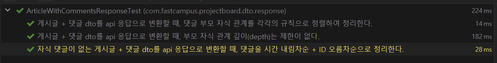

ArticleWithCommentsResponseTest 실행결과 : 정상 작동

### **Service**

---

#### **ArticleCommentServiceTest**

**원인**

대댓글 저장에 대한 비즈니스 로직을 구현하지 않아 에러가 발생한다.

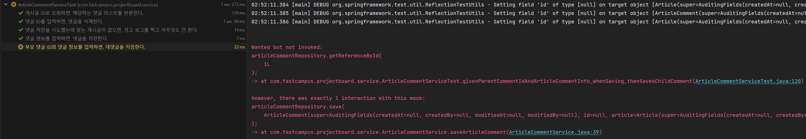

**해결 방법**

자식 댓글일 경우와 일반 댓글일 경우 두 가지 상황을 모두 해결할 수 있는 비즈니스 로직을 만들어야 한다.

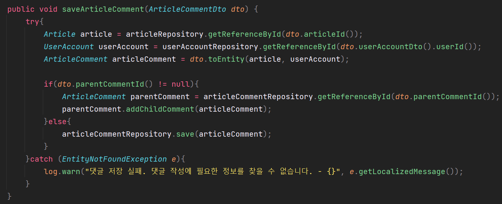

### Check The Issue

---

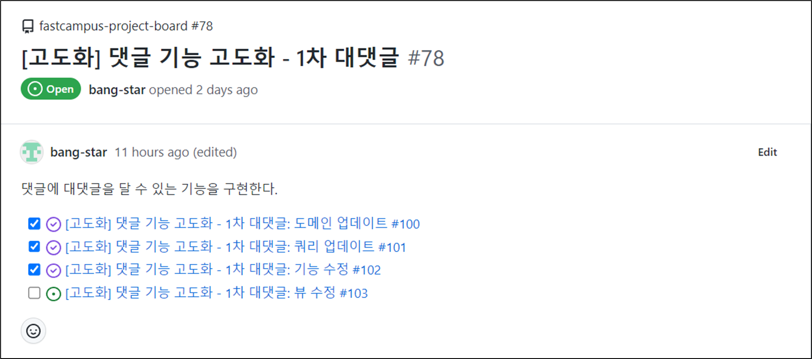

하나의 브랜치에서 작업한 것처럼 시각적인 요소를 고려하여 Rebase and Merge를 통해 분리된 작업 통합

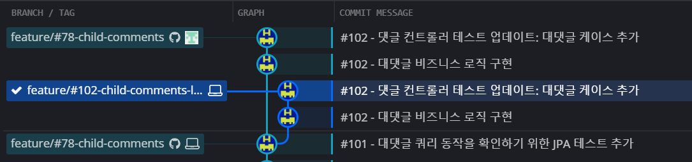
