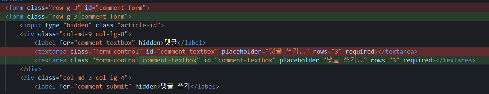
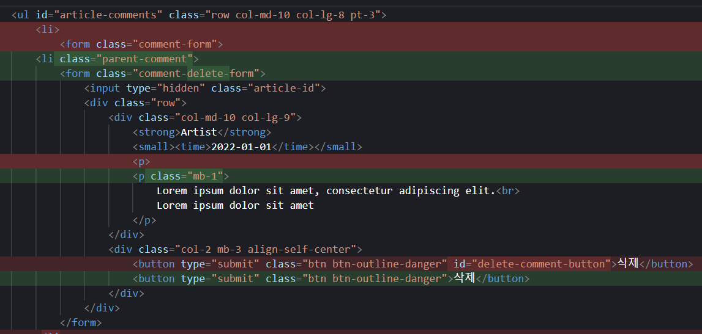
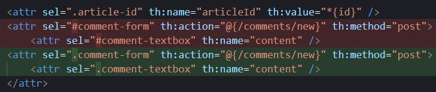
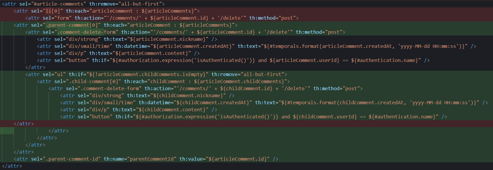
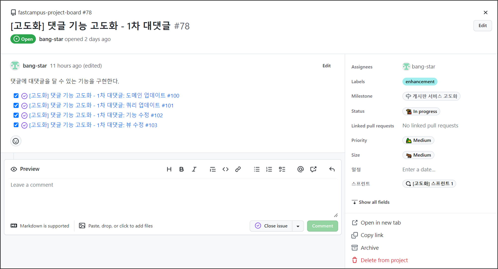
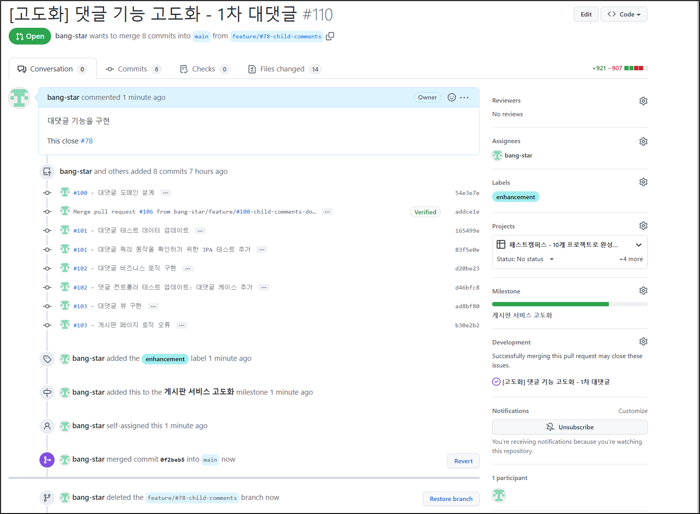

## **뷰 수정**

---

### **게시글 페이지**

---

게시글 페이지에 댓글 구조가 대댓글이 추가됨에 따라 댓글 리스트를 출력하는 구조 등을 변경시켜주어야 한다.

댓글 입력 창이 한 개에서 대댓글 입력이 가능해지면서 여러 개로 변하면서 id가 아닌 class 레벨 접근으로 변경

클래스를 통해 부모 댓글임을 명시하고 중복 사용되는 삭제 버튼은 id가 아닌 class 레벨 접근으로 변경

그에 따라 로직에서도 id 접근에서 class 접근으로 변경

대댓글 출력 로직

### Check The Issue

---

