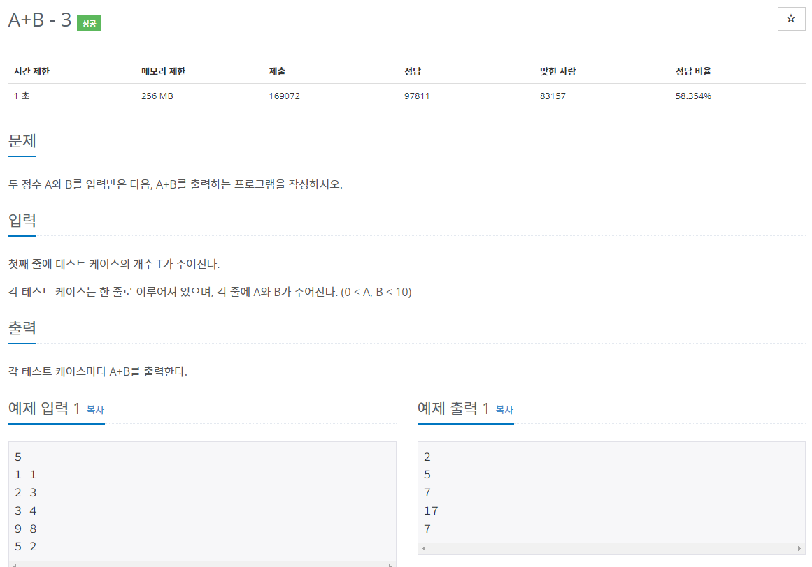
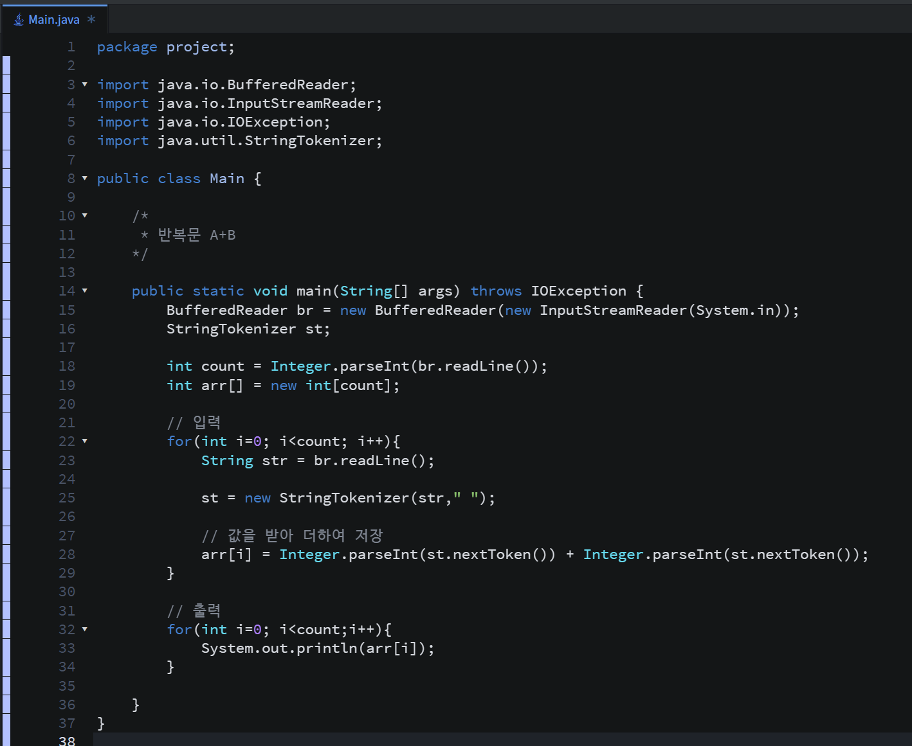

* 문제(3단계 반복문 - 2)

* 간단 설명

    이 문제도 간단하쥬??!

    (1단계) 테스트 케이스의 개수를 입력받는다

    (2단계) 테스트 개수 만큼 정수 두개를 입력받아 합한다.

* 풀이

    (방법 1 - BufferedReader)

* 정리

   간단한 문제도 꼭꼭 풀어보세요!! 기본 문법을 익히고 학습하기엔 좋다고 생각합니다!!
