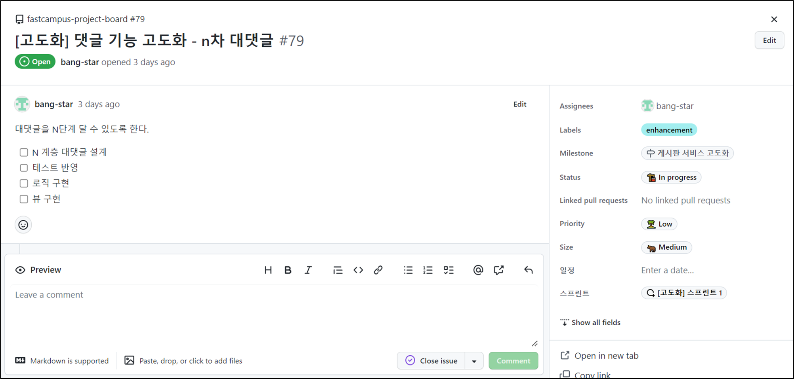
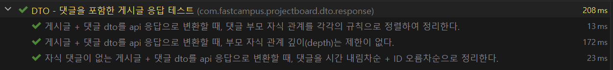
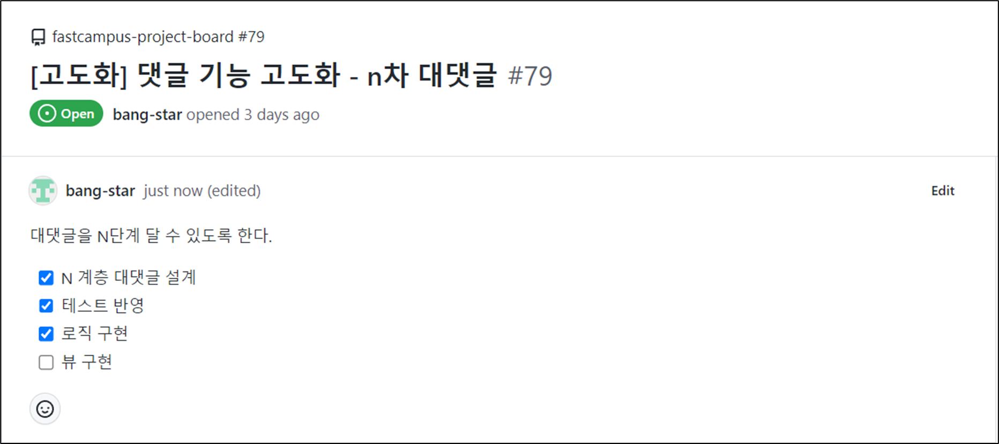
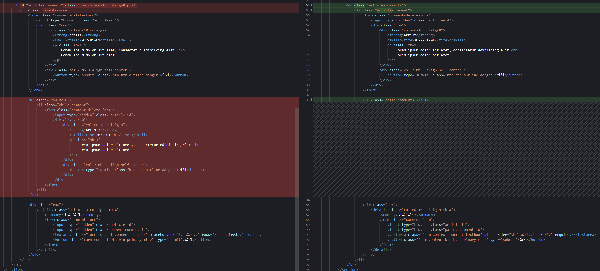
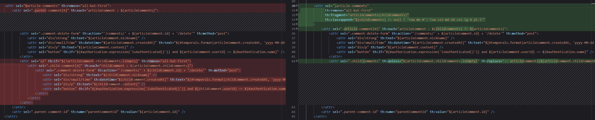
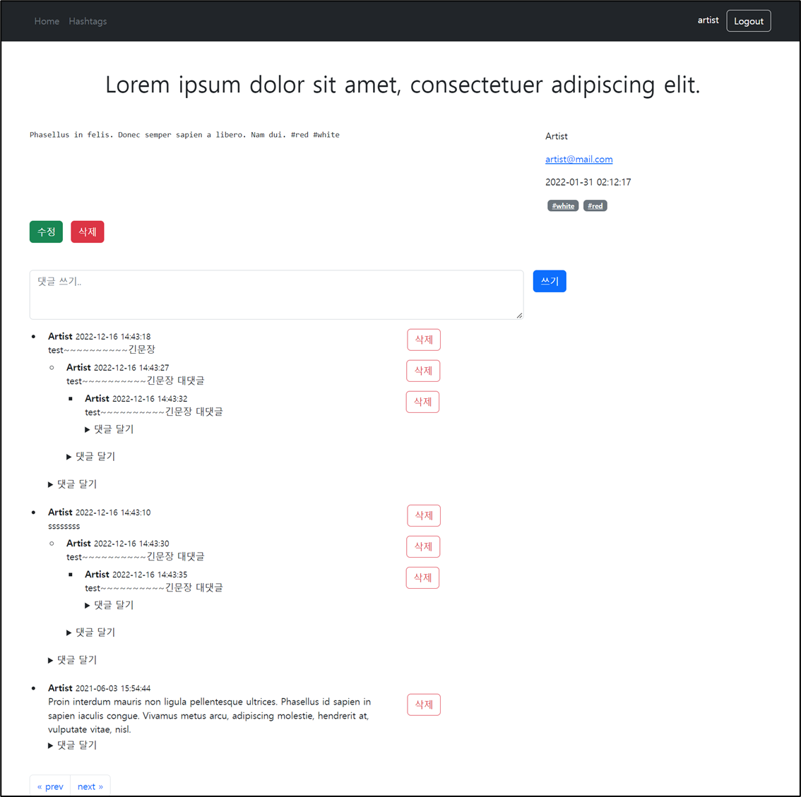
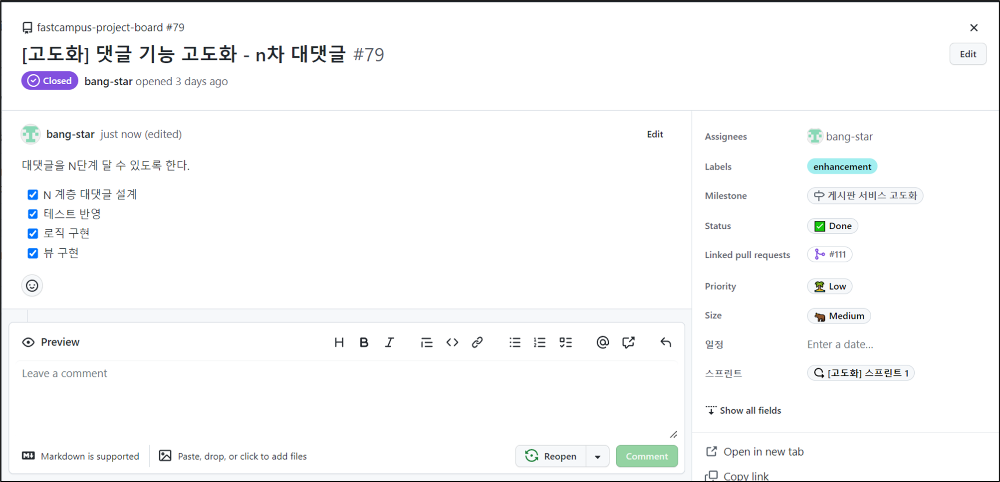

## N차 대댓글

---

## Check The Issue

---



1차 대댓글을 구현하면서

N 계층 대댓글 설계, 테스트 반영, 로직 구현은 이미 완료하였다.


다음과 같이 로직을 구성하였었다.

[원문에서 이미지 보기](https://to-be-a-artist.tistory.com/280)

ERD 에도 N차 대댓글이 가능하도록 설계가 되어있다.

댓글 테이블에 부모 댓글 id를 설정하여 댓글과 대댓글 관계가 계층적으로 만들어질 수 있는 구조이다.

테스트에는 맵핑하는 로직으로 생각하고 테이블에 1차원으로 Flat하게 펴져있는 댓글 모아와서 계층구조로 바꿔서 Response로 전환해주는 Dto를 설계하고 이에 대한 테스트를 이미 구현하였었다.



```java
@DisplayName("DTO - 댓글을 포함한 게시글 응답 테스트")
class ArticleWithCommentsResponseTest {

    @DisplayName("자식 댓글이 없는 게시글 + 댓글 dto를 api 응답으로 변환할 때, 댓글을 시간 내림차순 + ID 오름차순으로 정리한다.")
    @Test
    void givenArticleWithCommentsDtoWithoutChildComments_whenMapping_thenOrganizesCommentsWithCertainOrder() {
        // Given
        LocalDateTime now = LocalDateTime.now();
        Set<ArticleCommentDto> articleCommentDtos = Set.of(
                createArticleCommentDto(1L, null, now),
                createArticleCommentDto(2L, null, now.plusDays(1L)),
                createArticleCommentDto(3L, null, now.plusDays(3L)),
                createArticleCommentDto(4L, null, now),
                createArticleCommentDto(5L, null, now.plusDays(5L)),
                createArticleCommentDto(6L, null, now.plusDays(4L)),
                createArticleCommentDto(7L, null, now.plusDays(2L)),
                createArticleCommentDto(8L, null, now.plusDays(7L))
        );
        ArticleWithCommentsDto input = createArticleWithCommentsDto(articleCommentDtos);

        // When
        ArticleWithCommentsResponse actual = ArticleWithCommentsResponse.from(input);

        // Then
        assertThat(actual.articleCommentsResponse())
                .containsExactly(
                        createArticleCommentResponse(8L, null, now.plusDays(7L)),
                        createArticleCommentResponse(5L, null, now.plusDays(5L)),
                        createArticleCommentResponse(6L, null, now.plusDays(4L)),
                        createArticleCommentResponse(3L, null, now.plusDays(3L)),
                        createArticleCommentResponse(7L, null, now.plusDays(2L)),
                        createArticleCommentResponse(2L, null, now.plusDays(1L)),
                        createArticleCommentResponse(1L, null, now),
                        createArticleCommentResponse(4L, null, now)
                );
    }

    @DisplayName("게시글 + 댓글 dto를 api 응답으로 변환할 때, 댓글 부모 자식 관계를 각각의 규칙으로 정렬하여 정리한다.")
    @Test
    void givenArticleWithCommentsDto_whenMapping_thenOrganizesParentAndChildCommentsWithCertainOrders() {
        // Given
        LocalDateTime now = LocalDateTime.now();
        Set<ArticleCommentDto> articleCommentDtos = Set.of(
                createArticleCommentDto(1L, null, now),
                createArticleCommentDto(2L, 1L, now.plusDays(1L)),
                createArticleCommentDto(3L, 1L, now.plusDays(3L)),
                createArticleCommentDto(4L, 1L, now),
                createArticleCommentDto(5L, null, now.plusDays(5L)),
                createArticleCommentDto(6L, null, now.plusDays(4L)),
                createArticleCommentDto(7L, 6L, now.plusDays(2L)),
                createArticleCommentDto(8L, 6L, now.plusDays(7L))
        );
        ArticleWithCommentsDto input = createArticleWithCommentsDto(articleCommentDtos);

        // When
        ArticleWithCommentsResponse actual = ArticleWithCommentsResponse.from(input);

        // Then
        assertThat(actual.articleCommentsResponse())
                .containsExactly(
                        createArticleCommentResponse(5L, null, now.plusDays(5)),
                        createArticleCommentResponse(6L, null, now.plusDays(4)),
                        createArticleCommentResponse(1L, null, now)
                )
                .flatExtracting(ArticleCommentResponse::childComments)
                .containsExactly(
                        createArticleCommentResponse(7L, 6L, now.plusDays(2L)),
                        createArticleCommentResponse(8L, 6L, now.plusDays(7L)),
                        createArticleCommentResponse(4L, 1L, now),
                        createArticleCommentResponse(2L, 1L, now.plusDays(1L)),
                        createArticleCommentResponse(3L, 1L, now.plusDays(3L))
                );
    }

    @DisplayName("게시글 + 댓글 dto를 api 응답으로 변환할 때, 부모 자식 관계 깊이(depth)는 제한이 없다.")
    @Test
    void givenArticleWithCommentsDto_whenMapping_thenOrganizesParentAndChildCommentsWithoutDepthLimit() {
        // Given
        LocalDateTime now = LocalDateTime.now();
        Set<ArticleCommentDto> articleCommentDtos = Set.of(
                createArticleCommentDto(1L, null, now),
                createArticleCommentDto(2L, 1L, now.plusDays(1L)),
                createArticleCommentDto(3L, 2L, now.plusDays(2L)),
                createArticleCommentDto(4L, 3L, now.plusDays(3L)),
                createArticleCommentDto(5L, 4L, now.plusDays(4L)),
                createArticleCommentDto(6L, 5L, now.plusDays(5L)),
                createArticleCommentDto(7L, 6L, now.plusDays(6L)),
                createArticleCommentDto(8L, 7L, now.plusDays(7L))
        );
        ArticleWithCommentsDto input = createArticleWithCommentsDto(articleCommentDtos);

        // When
        ArticleWithCommentsResponse actual = ArticleWithCommentsResponse.from(input);

        // Then
        Iterator<ArticleCommentResponse> iterator = actual.articleCommentsResponse().iterator();
        long i = 1L;
        while (iterator.hasNext()) {
            ArticleCommentResponse articleCommentResponse = iterator.next();
            assertThat(articleCommentResponse)
                    .hasFieldOrPropertyWithValue("id", i)
                    .hasFieldOrPropertyWithValue("parentCommentId", i == 1L ? null : i - 1L)
                    .hasFieldOrPropertyWithValue("createdAt", now.plusDays(i - 1L));

            iterator = articleCommentResponse.childComments().iterator();
            i++;
        }
    }


    private ArticleWithCommentsDto createArticleWithCommentsDto(Set<ArticleCommentDto> articleCommentDtos) {
        return ArticleWithCommentsDto.of(
                1L,
                createUserAccountDto(),
                articleCommentDtos,
                "title",
                "content",
                Set.of(HashtagDto.of("java")),
                LocalDateTime.now(),
                "artist",
                LocalDateTime.now(),
                "artist"
        );
    }

    private UserAccountDto createUserAccountDto() {
        return UserAccountDto.of(
                "artist",
                "password",
                "artist@mail.com",
                "artist",
                "This is memo",
                LocalDateTime.now(),
                "artist",
                LocalDateTime.now(),
                "artist"
        );
    }

    private ArticleCommentDto createArticleCommentDto(Long id, Long parentCommentId, LocalDateTime createdAt) {
        return ArticleCommentDto.of(
                id,
                1L,
                createUserAccountDto(),
                parentCommentId,
                "test comment " + id,
                createdAt,
                "artist",
                createdAt,
                "artist"
        );
    }

    private ArticleCommentResponse createArticleCommentResponse(Long id, Long parentCommentId, LocalDateTime createdAt) {
        return ArticleCommentResponse.of(
                id,
                "test comment " + id,
                createdAt,
                "artist@mail.com",
                "artist",
                "artist",
                parentCommentId
        );
    }

}
```

다음과 같이 View만 남아 있는 상태이다.



### **View 구현**

---

댓글은 게시글 상세 페이지에 나타나므로 게시글 상세페이지만 변경하면 된다.

thymeleaf에 decoupled logic을 사용하고 있어 파일은 두 개이지만, 사실상 페이지는 한개이다.

#### **게시판 상세 페이지**



> **AS-IS**  
> 기존 코드는 1차 대댓글 구조로   
> ul(unordered list)태그로 시작하여 id와 부트스트랩 스타일링 코드를 가진 class를 가지고 있다.   
> li(list)태그를 시작해서 parent-comment라는 클래스를 사용했다.  
>   
> 단순히 1차 대댓글 구조로만 설계를 하였기 때문에 이와 같이 부모 댓글, 자식 댓글로 나누어 쉽게 설계할 수 있었다.  
>   
> **TO-BE**N차 대댓글로 구조로 변경되어야 하기 때문에 parent, child 만으로 구분하는 것은 좋지 않아 보여 이름을 변경하였다.   
> id는 1개만 사용할 수 있어 class 이름을 통해 N차 대댓글에서 사용할 수 있는 구조로 변경하였다.  
> class name 또한 article-comments와 article-comment로 분리하여 계층 구조로 관리할 수 있도록 하였다.

---

#### **게시판 상세 페이지-로직**



> 기존에 1차 대댓글에서 부모 댓글과 자식 댓글을 직접 그렸던 부분이 스타일을 제외하고 동일하게 반복되고 있었다.  
> 사실 부모 댓글과 자식 댓글은 동일한 댓글이므로 반복을 줄이고 재활용하여 템플릿으로 사용하여 반복문을 사용할 것이다.   
>   
> 스스로를 다시 호출하는 방식인 재귀적으로 만약 자신이 부모 댓글이고 자식 댓글을 가지고 있다면  
> 나 자신을 자식 댓글로 바꿔서 한번더 호출한다. 자식이 있으면 또 들어가고 자식이 없을 때까지 반복하다가 멈추는 구조이다.  
>   
> classappend를 통해 자식 댓글과 부모댓글을 구분하여 디자인을 다르게 할 수 있다.  
> th:unless를 사용하여 자식이 있다면 replace를 통해 fragement template를 호출한다.

다음과 같이 정상적으로 N차 대댓글이 작동함을 확인할 수 있다.



### Check The Issue

---

1차 대댓글에 이어 N차 대댓글까지 구현 완료하였다.


