## 댓글 기능 고도화 댓글 기능의 결정과 Rollback

---

### **Check The Issue**

---

아래와 같은 시나리오를 가정하고 실제 서비스에서 발생할 수 있는 문제를 경험해보려고 한다.

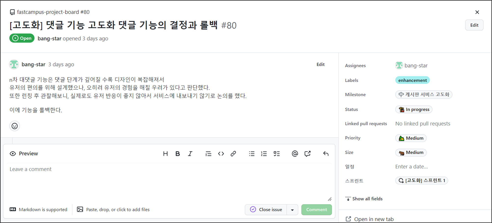

### 

### **🙋 Why?**

---

개발 프로젝트를 진행하는 회사에서 기능 하나 하나에 배포가 중요한 것이 아니라 전체적인 기능에 완성품인 서비스가 고객에게 얼마나 나은 지속적으로 전달하는가 그리고 서비스가 지속적으로 발전하고 고객에게 더 좋은 경험을 지속적으로 전달할 수 있는 능력 즉 인사이트가 쌓여 가는가라는 사실이 중요하다. 그것이 비즈니스를 성장시키고 안정적으로 이윤을 창출해내고 확장시키는데 도움이 된다.

그러한 점에서 우리의 서비스가 고객에 경험에 도움이 되지 않는다고 판단이 되는 기능을 골라서 롤백하는 경험을 쌓으려 한다. 그래서 예시로 N차 대댓글을 롤백 대상으로 결정하였다.

N차 대댓글이 잘못 구현된 것도 아니고 문제가 있는 것도 아니다. 고객에 경험에 도움이 되지 않는다는 상황을 가정하기 위해 만든 시나리오일 뿐이다.

이렇게 일어나는 취소는 단순한 취소가 아니다. 취소가 아닌 변경이다. **즉 롤백도 개발이다.**

아무것도 하지 않고 있는 것과 개발하다가 원점으로 돌아온 것은 분명한 차이가 있다.

서비스가 경험을 쌓은 것이고 우리가 고객에게 더 나은 가치를 주는 방법을 배웠고, 불필요한 것은 빼낼 수 있다는 의사결정을 통해서 배울 수 있다. 마치 결과물은 차이가 없는 것처럼 느낄 수 있지만, 내용은 완전히 다르다.

그래서 롤백을 할 수 있어야 하고, 만약 한다고 결정이 되었으면 무사히 효율적으로 할 수 있어야 한다.

### **How**

---

> 구현이 완료된 Feature 브랜치는 삭제해주는 것이 좋다.  
> => 그러면 다시 되돌리지 못하는 거 아닌가요??  
> => 커밋에 Checkout하여 언제든지 개발 지점으로 돌아갈 수 있다.  
> **반드시 브랜치가 있어야만 되돌아갈 수 있는 것은 아니다는 오해이다.**

현재 N차 대댓글의 구현이 완료되어 main 브랜치에 Merge된 상황이다.

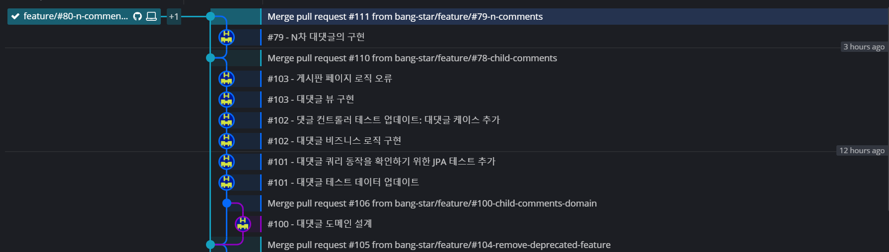

원하는 롤백 지점은 다음과 같이 N차 대댓글의 구현이 완료 되기 전이다.

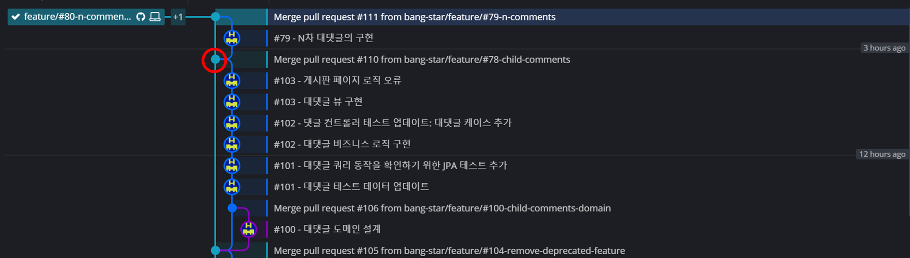

Merge 이후에서 Merge 이전으로 되돌아 가는 것처럼 보이지만

되돌린 커밋을 새로 만드는 것이다. 즉 되돌리는 과정이 형상관리에 남게 되는 것이다.

Git에서 [revert 커맨드](https://git-scm.com/docs/git-revert)로 할 수 있다.

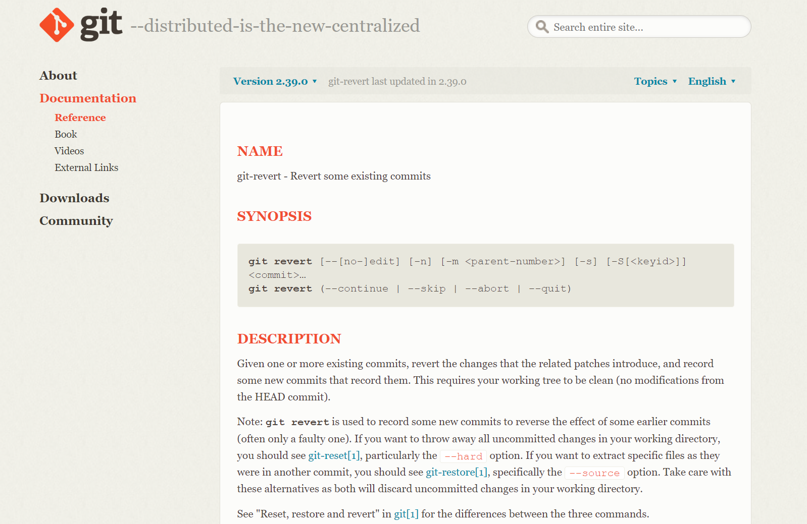

git 공식 문서 참고

공식 문서에서 보이는 것처럼 CLI에서 명령어를 통해 revert 할 수 있다.

버전을 통해 Rollback이 가능하지만 현재 버전은 오래 전에 설정해두었기 때문에 버전을 통한 Rollback은 불가능하다.

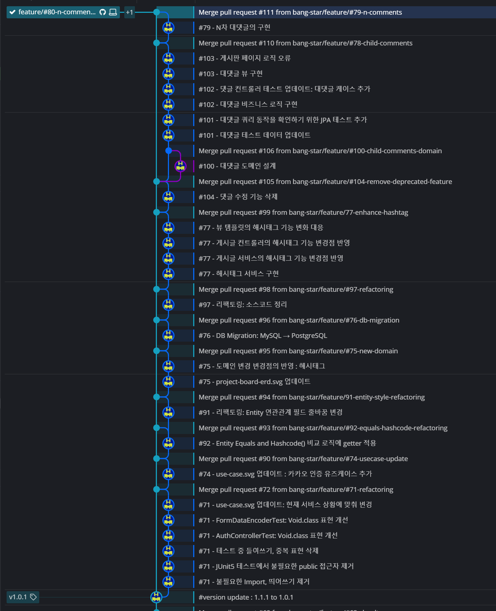

지금은 커밋단위로 롤백하려 한다.

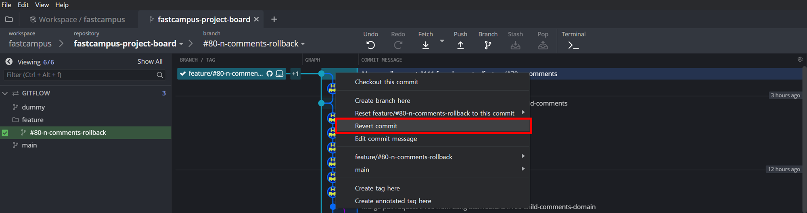

다음 질문은 바로 커밋을 날릴 것인지 물어보는 질문이다.

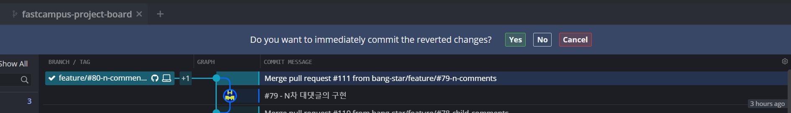

No를 누르면 롤백을 하지 않는 것이 아니라 변경점이 Stash에 남게 된다.

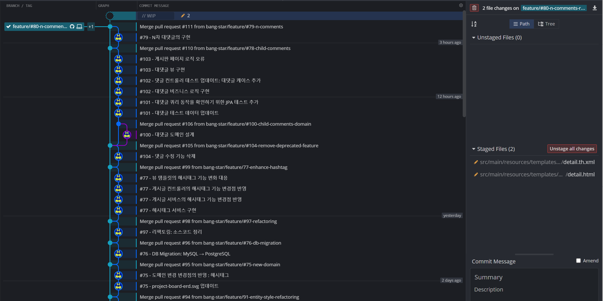

stash에 있는 코드를 보면 다음과 같이 코드에 변경점이 생기는데

이러한 변경점은 구현된 기능은 왼쪽, 구현되지 않은 상태로 되돌아갈 코드가 오른쪽이다.

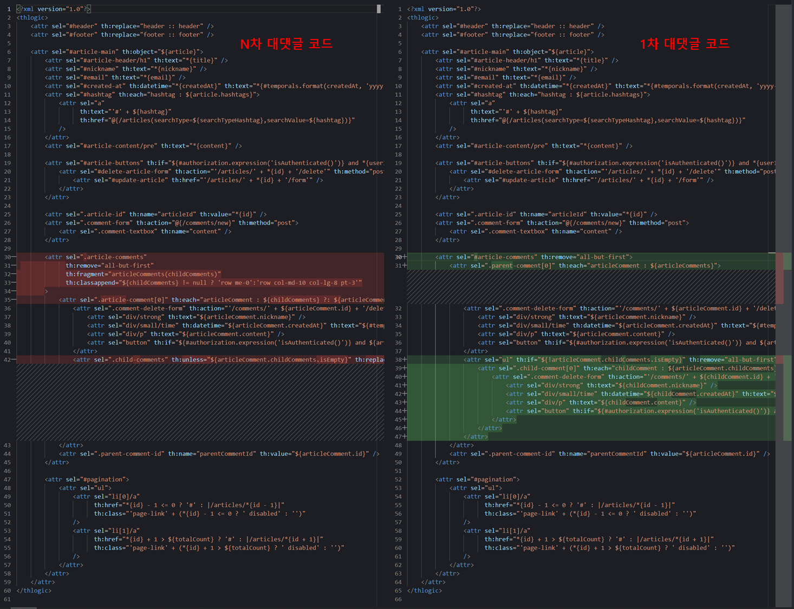

> **revert의 효과**직전에 있었던 변경점을 추가, 삭제, 수정 어떤 상황이든 그대로 되돌려준다.   
> 이러한 형상관리 개념이 있기 전에는 이전 내용을 다른 문서에 저장해두었다가 소스 코드를 분석해서  
> 필요한 부분을 직접 삭제해주었었다. 이러한 작업은 결코 간단하지 않았다.   
>   
> 이러한 형상관리 개념은 온전히 되돌려줌으로써 개발자에게 유용한 도구이다.

다음과 같이 Rollback 할 내용을 커밋해주거나 쓰레기통 모양을 누르면 Rollback 작업이 다시 취소된다.

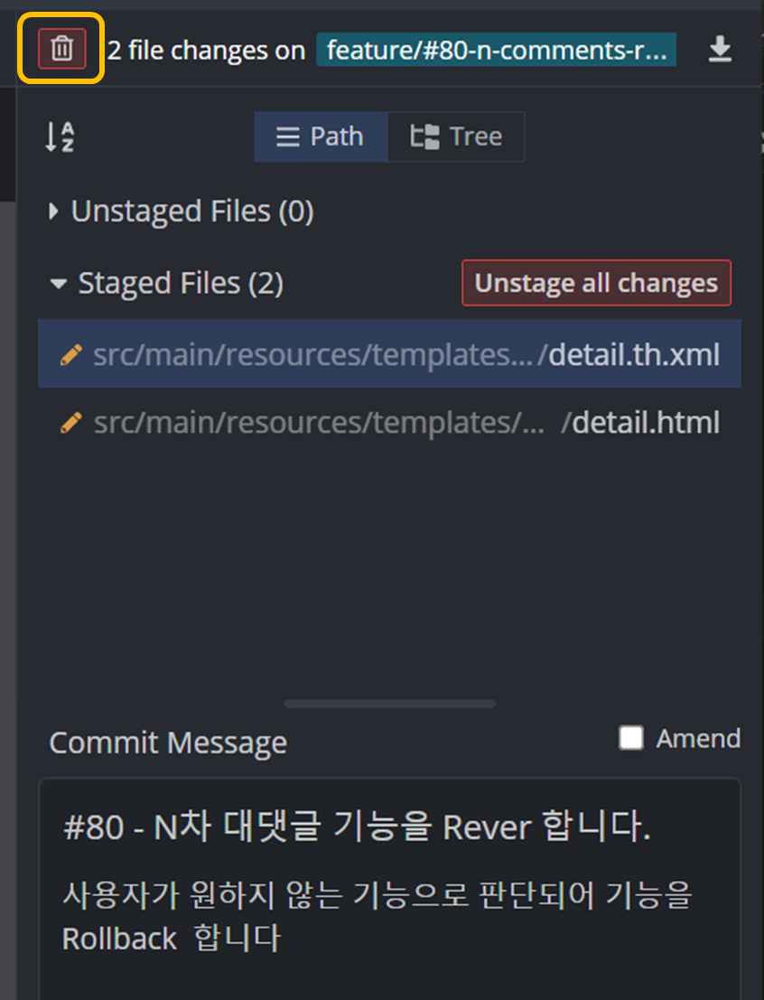

반대로 Revert Commit을 Yes를 누르면 다음과 같이 자동으로 커밋메시지가 생성된다.

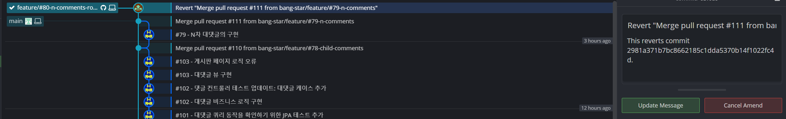

Rollback 작업 내용은 Rebase Merge하여 반영하였다.

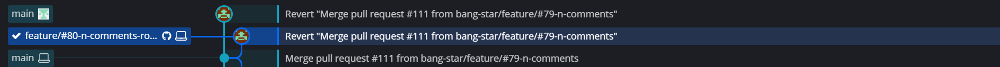

> 기존의 Merge Commit은 Feature Branch에서 main 브랜치로 연결되는 그림으로 이어지지만  
> Rebase Merge는 commit을  그대로 main 브랜치로 옮기려는 목적으로 만든 것이 Rebase이지만  
> 실제 내부 동작은 단순 이동이 아니다.   
> 1. 복사 - feature 브랜치에 commit을 복사해서 main 브랜치에 붙이고  
> 2. 삭제 - main 브랜치에 복사가 완료되었다면 feature 브랜치에 커밋은 삭제한다.  
> **즉 복사가 아닌 복제이다**. 확인해보면 feature 브랜치에 commit(**fc07c65**)과 main 브랜치에 commit(**eef747a**)에 해시 값이 다르다.

Feture 브랜치를 삭제하면 마치 main 브랜치에서 Push한 것처럼 보이지만, 개발은 Feature 단위로 하였고 Rebase Merge한 것임을 알 수 있다.

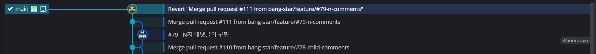

### **Check The Issue**

---

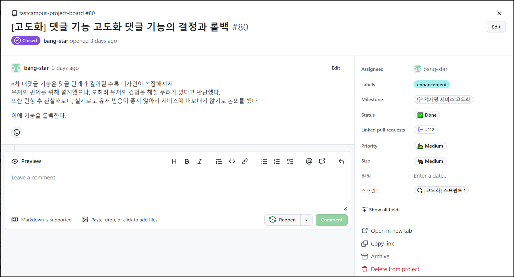
