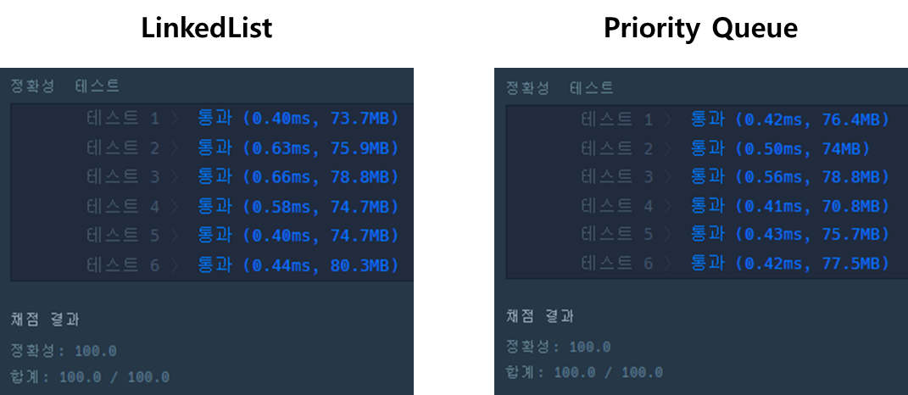

## 이중우선순위큐

---

#### **문제 설명**

이중 우선순위 큐는 다음 연산을 할 수 있는 자료구조를 말합니다.

| 명령어 | 수신 탑(높이) |
| --- | --- |
| | 숫자 | 큐에 주어진 숫자를 삽입합니다. |
| D 1 | 큐에서 최대값을 삭제합니다. |
| D -1 | 큐에서 최솟값을 삭제합니다. |

이중 우선순위 큐가 할 연산 operations가 매개변수로 주어질 때, 모든 연산을 처리한 후 큐가 비어있으면 [0,0] 비어있지 않으면 [최댓값, 최솟값]을 return 하도록 solution 함수를 구현해주세요.

#### **제한 사항**

* operations는 길이가 1 이상 1,000,000 이하인 문자열 배열입니다.
* operations의 원소는 큐가 수행할 연산을 나타냅니다.
  + 원소는 “명령어 데이터” 형식으로 주어집니다. - 최댓값/최솟값을 삭제하는 연산에서 최댓값/최솟값이 둘 이상인 경우, 하나만 삭제합니다.
* 빈 큐에 데이터를 삭제하라는 연산이 주어질 경우, 해당 연산은 무시합니다.

#### **알고리즘**

명령어에 따라서 삽입과 삭제가 자주 일어난다는 것을 고려해 자료구조를 선택해야 한다.

이 문제는 명령어에 따라서 삽입과 삭제(최대값, 최솟값)을 삭제하는 알고리즘이다.

| **명령어** | Queue | 설명 |
| --- | --- | --- |
| "I 16" | [16] | 16 삽입 |
| "I -5643" | [16, -5643] | -5643 삽입 |
| "D -1" | [16, -5643] → [-5643, 16] → [16] | 오름차순 정렬, 최소값 삭제 |
| "D 1" | [] | 최대값 삭제 |
| "D 1" | [] | 큐가 비어있으므로 삭제 연산 무시 |
| "I 123" | [123] | 123 삽입 |
| "D -1" | [] | 최솟값 삭제 |

위 내용을 참고해보면 **삽입, 삭제**과 활발하게 일어나고 **삭제 시 정렬**이 필요하다.

이를 바탕으로 풀이 방법은 **삽입 삭제가 빠른 LinkedList** 과 **우선순위가 있는 Priority Queue**룰 이용해 풀이하려 한다.

#### **풀이**

**LinkedList를 이용한 풀이**

LinkedList를 이용하여 풀이할 경우, 최솟값과 최댓값 구할 때마다 정렬을 통해서 앞뒤에서 빼내면 된다. 

삭제가 연속일 경우, 정렬은 추가적으로 할 필요가 없으므로 중복인지 확인할 수 있는 boolean 변수를 사용하였다.

```java
public int[] solution(String[] operations) {
           int[] answer = new int[]{0, 0};
    LinkedList<Integer> queue = new LinkedList<>();
    boolean continuity = false;

    StringTokenizer st;
    for (String operation : operations) {
        st = new StringTokenizer(operation, " ");
        String command = st.nextToken();
        int number = Integer.parseInt(st.nextToken());

        switch (command) {
            case "I":
                queue.add(number);
                continuity = false;
                break;
            case "D": {
                if(queue.isEmpty()) continue;

                if(continuity) Collections.sort(queue);

                if(number < 0) queue.pollFirst();
                if(number > 0) queue.pollLast();

                continuity = true;
                break;
            }
        }
    }
    Collections.sort(queue);

    if(queue.isEmpty())
        return answer;
    else
    {
        int max = queue.pollLast();
        int min = queue.pollFirst();
        answer = new int[]{max, min};
        return answer;
    }
}
```

**Priority Queue를 이용한 방법**

우선순위 큐를 이용하면 삽입하면 자동으로 정렬이 된다는 장점이 있지만, 최대값과 최솟값을 구하기 위해서는 최대힙과 최소힙이 둘다 필요하게 되고 값을 동기화 시켜주기 위해 삽입과 삭제가 2번씩 실행되어야한다는 문제가 발생한다.

```java
public int[] solution(String[] operations) {
    int[] answer = new int[]{0, 0};

    PriorityQueue<Integer> minPq = new PriorityQueue<>();
    PriorityQueue<Integer> maxPq = new PriorityQueue<>(Collections.reverseOrder());

    StringTokenizer st;
    for (String operation : operations) {
        st = new StringTokenizer(operation, " ");
        String command = st.nextToken();
        int number = Integer.parseInt(st.nextToken());

        switch (command) {
            case "I":
                minPq.add(number);
                maxPq.add(number);

                break;
            case "D": {
                if(minPq.isEmpty()) continue;

                if(number < 0){ maxPq.remove(minPq.poll()); }
                else { minPq.remove(maxPq.poll()); }

                break;
            }
        }
    }

    if(minPq.isEmpty())
        return answer;
    else
    {
        int max = maxPq.poll();
        int min = minPq.poll();
        answer = new int[]{max, min};
        return answer;
    }
}
```

#### **성능**

**성능을 비교하면 테스트 실행결과 4:2으로 PriorityQueue가 성능 상 조금 더 앞선다.**

LinkedList에 경우 테스트 1, 5에서 성능이 조금 더 앞서고, PriorityQueue에 경우 테스트 1, 2, 4, 6에서 성능이 조금 더 앞선다.



#### **후기**

우선 순위 큐를 사용하여 문제 풀이 할경우, 삽입과 삭제를 2번씩 해야한다는 단점이 있었다.

이러한 점 때문에 성능이 더 낮을 것으로 예상 했지만, 성능 차이가 미비하다는 것을 알게 되었다.
