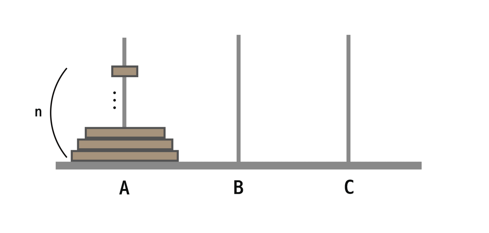
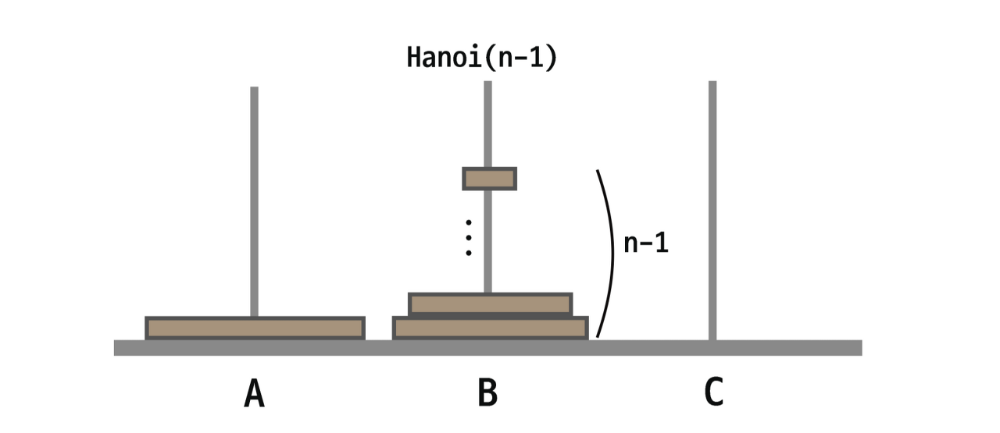
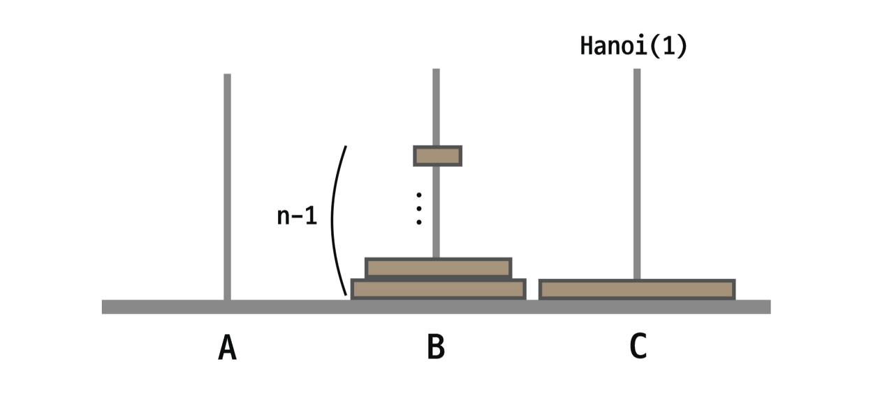
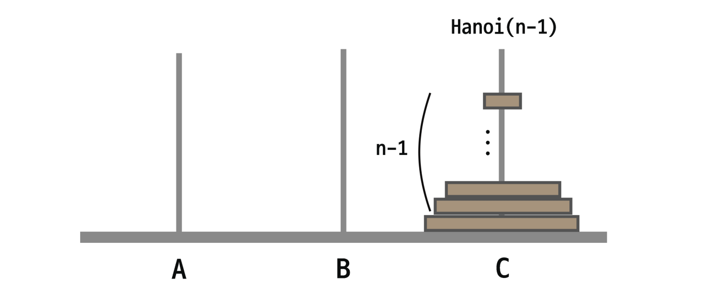
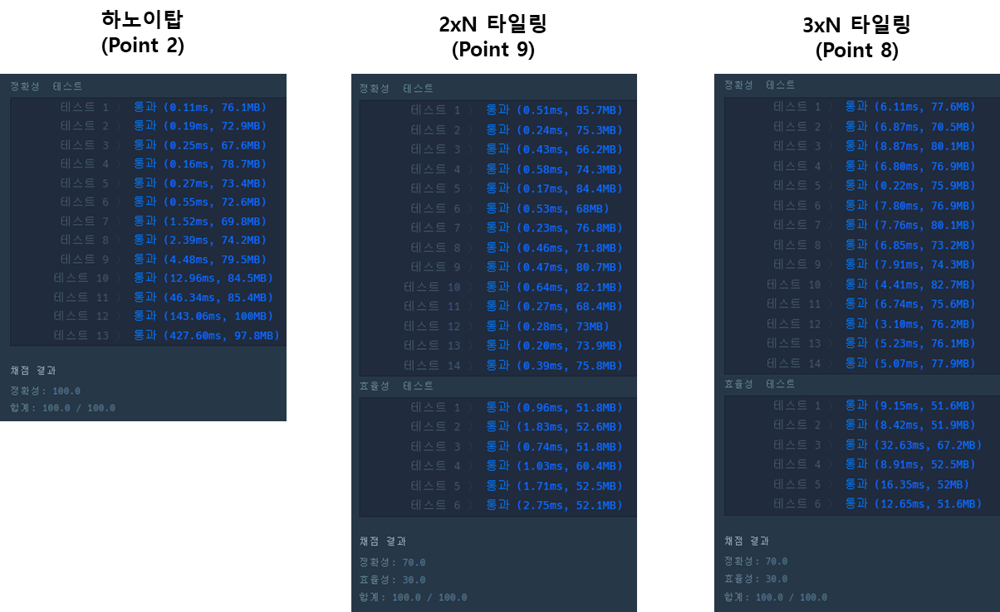

## **프로그래머스**

---

### **하노이탑**

---

#### **문제설명**

하노이 탑(Tower of Hanoi)은 퍼즐의 일종입니다. 세 개의 기둥과 이 기동에 꽂을 수 있는 크기가 다양한 원판들이 있고, 퍼즐을 시작하기 전에는 한 기둥에 원판들이 작은 것이 위에 있도록 순서대로 쌓여 있습니다. 게임의 목적은 다음 두 가지 조건을 만족시키면서, 한 기둥에 꽂힌 원판들을 그 순서 그대로 다른 기둥으로 옮겨서 다시 쌓는 것입니다.

1. 한 번에 하나의 원판만 옮길 수 있습니다.
2. 큰 원판이 작은 원판 위에 있어서는 안됩니다.

하노이 탑의 세 개의 기둥을 왼쪽 부터 1번, 2번, 3번이라고 하겠습니다. 1번에는 n개의 원판이 있고 이 n개의 원판을 3번 원판으로 최소 횟수로 옮기려고 합니다. 1번 기둥에 있는 원판의 개수 n이 매개변수로 주어질 때, n개의 원판을 3번 원판으로 최소로 옮기는 방법을 return하는 solution를 완성해주세요.

#### **제한사항**

* n은 15이하의 자연수 입니다.

#### **알고리즘**

하노이탑 문제는 가장 대표적인 재귀함수의 예시이다.

N개에 원판이 있다고 했을 때



**1. 가장 큰 원판을 C로 옮기기 위해서는 N-1개의 원판이 A에서 B로 가야 한다.**

N-1 번만큼 B로 이동하기 위한 같은 반복을 할 것이다.



**2. A에 있는 가장 큰 원판이 C로 이동할 것이다.**



**3. B에 있는 N-1개의 원판을 C로 이동한다.**



이 작업 반복하면 통해 N개를 A에서 C로 옮길 수 있게 된다.

#### **풀이**

```java
package programmers.stack_queue;

public class 하노이탑 {
    static List<int []> routes;

    public static void main(String[] args) {
        System.out.println(Arrays.toString(solution(2)));
    }

    public static int[][] solution(int n){
        int[][] answer = {};
        routes = new LinkedList<>();

        hanoi(n, 1, 2, 3);
        answer = new int[routes.size()][2];
        for(int i=0; i < routes.size(); i++){
            int[] route = routes.get(i);
            answer[i] = route;
        }

        return answer;
    }

    public static void hanoi(int n, int start, int mid, int to){
        if(n==1)
            routes.add(new int[]{start, to});
        else{
            // STEP 1: N-1개가 A -> B
            hanoi(n-1, start, to, mid);
            // STEP 2: 1개를 A -> C
            routes.add(new int[]{start, to});
            // STEP 3: N-1개가 B -> C
            hanoi(n-1, mid, start, to);
        }
    }
}
```

### **2xN 타일링**

---

#### **문제 설명**

가로 길이가 2이고 세로의 길이가 1인 직사각형 모양의 타일이 있습니다. 이 직사각형 타일을 이용하여 세로의 길이가 2이고 가로의 길이가 n인 바닥을 가득 채우려고 합니다. 타일을 채울 때는 다음과 같이 2가지 방법이 있습니다

* 타일을 가로로 배치 하는 경우
* 타일을 세로로 배치 하는 경우

예를들어서 n이 7인 직사각형은 다음과 같이 채울 수 있습니다.


직사각형의 가로의 길이 n이 매개변수로 주어질 때, 이 직사각형을 채우는 방법의 수를 return 하는 solution 함수를 완성해주세요.

#### **제한사항**

* 가로의 길이 n은 60,000이하의 자연수 입니다.
* 경우의 수가 많아 질 수 있으므로, 경우의 수를 1,000,000,007으로 나눈 나머지를 return해주세요.

#### **알고리즘**

문제를 이해하기 위해서는 규칙을 찾아야 한다.


위 그림을 통해 알 수 있듯이, N(4) = N(3) + N(2) 와 같다.

즉 N = N-1 + N-2와 동일하다.

N 값이 무수히 커질 수 있기 때문에 Overflow에 대한 처리를 위해 1,000,000,007로 나누어 반환해야 한다.

> **N = ((N-1) + (N-2)) % 1,000,000,007**

#### **풀이**

```java
public static int solution(int n){
    int answer = 0;
    int mod = 1_000_000_007;
    int[] dp = new int[60_000];

    dp[2] = 2;
    dp[3] = 3;

    for(int i=4; i<dp.length; i++){
        dp[i] = (dp[i-1] + dp[i-2]) % mod;
        if(i == n)
            return dp[i];
    }

    answer = dp[n];
    return answer;
}
```

### **3xN 타일링**

---

#### **문제 설명**

가로 길이가 2이고 세로의 길이가 1인 직사각형 모양의 타일이 있습니다. 이 직사각형 타일을 이용하여 세로의 길이가 3이고 가로의 길이가 n인 바닥을 가득 채우려고 합니다. 타일을 채울 때는 다음과 같이 2가지 방법이 있습니다

* 타일을 가로로 배치 하는 경우
* 타일을 세로로 배치 하는 경우

예를들어서 n이 8인 직사각형은 다음과 같이 채울 수 있습니다.


직사각형의 가로의 길이 n이 매개변수로 주어질 때, 이 직사각형을 채우는 방법의 수를 return 하는 solution 함수를 완성해주세요.

#### **제한사항**

* 가로의 길이 n은 5,000이하의 자연수 입니다.
* 경우의 수가 많아 질 수 있으므로, 경우의 수를 1,000,000,007으로 나눈 나머지를 return해주세요.

#### **알고리즘**

2XN 타일링 문제와 같이 규칙을 발견해야 하는 문제이다.

다음과 같이 가로에 개수에 따라 만들 수 있는 경우의 수를 파악해야한다.

홀수일 경우는 만들 수 없다는 것을 쉽게 파악할 수 있을 것이다.


> 규칙을 통해 N = (N-2) \* 3 + (N-4) \* 2 + ... (2) \* 2 + 2 라는 점화식을 얻을 수 있다.  
> N을 짝수로만 가정하면 N = (N-1) \* 3 + (N-2) \* 3 + ... (2) \* 2 + 2 가 된다.

#### **풀이**

```java
class Solution {
    public int solution(int n) {
                int answer = 0;
        int mod = 1_000_000_007;
        long[] dp = new long[5001];

        dp[0] = 1;
        dp[2] = 3;

        for(int i=4; i<=n; i+=2){

            dp[i] = dp[i-2] * 3;

            for(int j = i-4; j>=0; j-=2){
                dp[i] += dp[j] * 2;
            }
            dp[i] = dp[i] % mod;
        }

        answer = (int) dp[n];
        return answer;
    }
}
```

### 리뷰

---



> 하노이탑은 자료구조 수업을 들었을 때   
> 풀었던 문제라 기분이 좋았다.  
>   
> 2xN, 3xN 타일링 문제는 DP 문제로...  
> 2xN을 풀고 3xN 문제를 해결하는데  
> 시간이 너무 오래걸렸다... ㅠ.ㅠ
