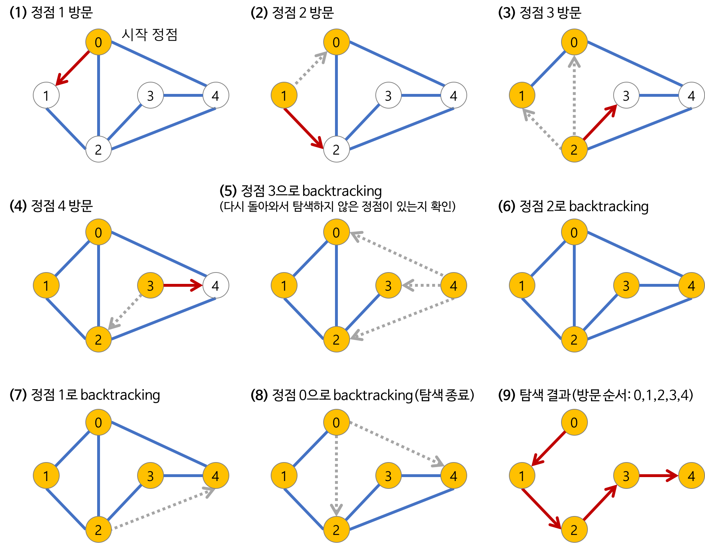
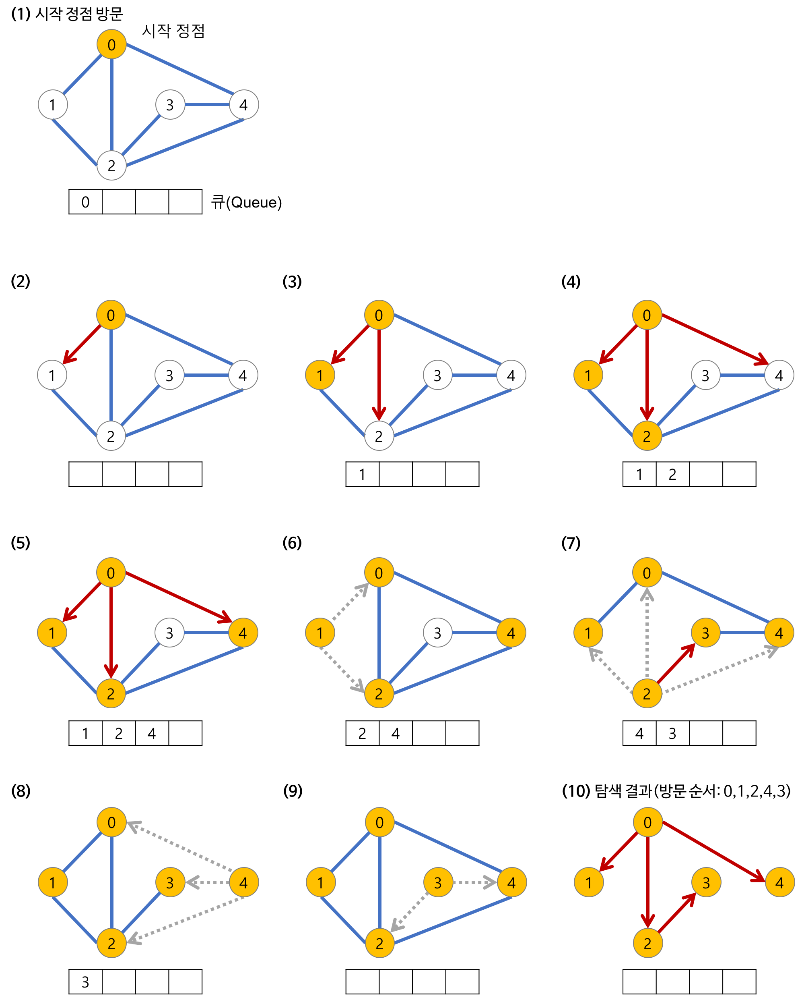
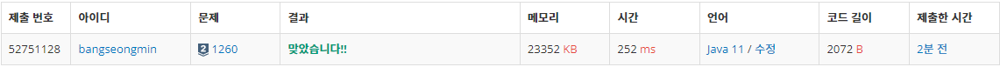

## DFS와 BFS

---

### **문제 설명**

---

그래프를 DFS로 탐색한 결과와 BFS로 탐색한 결과를 출력하는 프로그램을 작성하시오. 단, 방문할 수 있는 정점이 여러 개인 경우에는 정점 번호가 작은 것을 먼저 방문하고, 더 이상 방문할 수 있는 점이 없는 경우 종료한다. 정점 번호는 1번부터 N번까지이다.

### **입력과 출력**

---

#### **입력**

첫째 줄에 정점의 개수 N(1 ≤ N ≤ 1,000), 간선의 개수 M(1 ≤ M ≤ 10,000), 탐색을 시작할 정점의 번호 V가 주어진다. 다음 M개의 줄에는 간선이 연결하는 두 정점의 번호가 주어진다. 어떤 두 정점 사이에 여러 개의 간선이 있을 수 있다. 입력으로 주어지는 간선은 양방향이다.

#### **출력**

첫째 줄에 DFS를 수행한 결과를, 그 다음 줄에는 BFS를 수행한 결과를 출력한다. V부터 방문된 점을 순서대로 출력하면 된다.

### **알고리즘**

---

이 문제를 이해하기 위해서는 자료구조 그래프 탐색, DFS와 BFS에 대한 이해가 필요하다.

#### **그래프 탐색**

* 하나의 정점으로부터 시작하여 차례대로 모든 정점들을 한 번씩 방문하는 것  
  Ex) 특정 도시에서 다른 도시로 갈 수 있는지 없는지, 전자 회로에서 특정 단자와 단자가 서로 연결되어 있는지

#### **DFS(Depth-First Search, 깊이 우선 탐색)**

**루트 노드(혹은 다른 임의의 노드)에서 시작해서 다음 분기(branch)로 넘어가기 전에 해당 분기를 완벽하게 탐색하는 방법**

* 미로를 탐색할 때 한 방향으로 갈 수 있을 때까지 계속 가다가 더 이상 갈 수 없게 되면 다시 가장 가까운 갈림길로 돌아와서 이곳으로부터 다른 방향으로 다시 탐색을 진행하는 방법 같다.   
  **즉 넓게(wide) 탐색하기 전에 깊게(deep) 탐색하는 것이다.**
* 사용하는 경우: 모든 노드를 방문 하고자 하는 경우에 이 방법을 선택한다.
* 깊이 우선 탐색(DFS)이 너비 우선 탐색(BFS)보다 좀 더 간단하다.
* 단순 검색 속도 자체는 너비 우선 탐색(BFS)에 비해서 느리다.

**특징**

* 자기 자신을 호출하는 순환 알고리즘의 형태 를 가지고 있다.
* **전위 순회(Pre-Order Traversals)**를 포함한 다른 형태의 트리 순회는 모두 DFS의 한 종류이다.
* 알고리즘을 구현할 때 가장 큰 차이점은, 그래프 탐색의 경우 어떤 노드를 방문했었는지 여부를 반드시 검사 해야 한다는 것이다. 이를 검사하지 않을 경우 무한루프에 빠질 위험이 있다.

**과정**



---

#### **BFS(Breadth-First-Search, 너비 우선 탐색)**

> 루트 노드(혹은 다른 임의의 노드)에서 시작해서 인접한 노드를 먼저 탐색하는 방법

* **시작 정점으로부터 가까운 정점을 먼저 방문하고 멀리 떨어져 있는 정점을 나중에 방문하는 순회 방법이다.**  
  **즉, 깊게(deep) 탐색하기 전에 넓게(wide) 탐색하는 것이다.**
* **두 노드 사이의 최단 경로 혹은 임의의 경로를 찾고 싶을 때 이 방법을 선택한다.**  
  예시. 지구상에 존재하는 모든 친구 관계를 그래프로 표현한 후 Ash와 Vanessa 사이에 존재하는 경로를 찾는 경우  
  깊이 우선 탐색의 경우 - 모든 친구 관계를 다 살펴봐야 할지도 모른다.  
  너비 우선 탐색의 경우 - Ash와 가까운 관계부터 탐색
* **너비 우선 탐색(BFS)이 깊이 우선 탐색(DFS)보다 좀 더 복잡하다.**

**특징**

* **직관적이지 않다.**   
  BFS는 시작 노드에서 시작해서 거리에 따라 단계별로 탐색한다고 볼 수 있다.
* **BFS는 재귀적으로 동작하지 않는다.**
* 그래프 탐색의 경우 **어떤 노드를 방문했었는지 여부를 반드시 검사 해야 한다.**  
  이를 검사하지 않을 경우 무한루프에 빠질 위험이 있다.
* BFS는 방문한 노드들을 차례로 저장한 후 꺼낼 수 있는 자료 구조인 **큐(Queue)를 사용**한다.  
  즉, 선입선출(FIFO) 원칙으로 탐색하고 일반적으로 큐를 이용해서 반복적 형태로 구현하는 것이 가장 잘 동작한다.
* ‘Prim’, ‘Dijkstra’ 알고리즘과 유사하다.

**과정**

깊이가 1인 모든 노드를 방문하고 나서 그 다음에는 깊이가 2인 모든 노드를, 그 다음에는 깊이가 3인 모든 노드를 방문하는 식으로 계속 방문하다가 더 이상 방문할 곳이 없으면 탐색을 마친다.



문제에 `방문할 수 있는 정점이 여러 개인 경우에는 정점 번호가 작은 것을 먼저 방문`이라는 조건을 유의해야 한다.

주어진 간선을 연결하여 저장하고, DFS와 BFS를 수행하여 출력하면 되는 문제이다.

### **풀이**

---

```java
public class Main {

    static int[][] arr;
    static boolean[] visited;
    static StringBuilder sb;

    public static void main(String[] args) throws IOException {
        BufferedReader br = new BufferedReader(new InputStreamReader(System.in));
        StringTokenizer st;
        sb = new StringBuilder();

        st = new StringTokenizer(br.readLine(), " ");
        int N = Integer.parseInt(st.nextToken());   // 정점의 개수
        int M = Integer.parseInt(st.nextToken());   // 간선의 개수
        int V = Integer.parseInt(st.nextToken());   // 탐색을 시작할 정점의 번호

        // 인접행렬 생성
        arr = new int[N+1][N+1];
        for(int i=0; i<M; i++){
            st = new StringTokenizer(br.readLine(), " ");
            int a = Integer.parseInt(st.nextToken());
            int b = Integer.parseInt(st.nextToken());
            arr[a][b] = 1;
            arr[b][a] = 1;
        }

        visited = new boolean[N+1];
        dfs(V);

        sb.append("\n");
        visited = new boolean[N+1];
        bfs(V);

        System.out.println(sb);
    }

    public static void dfs(int v){
        visited[v] = true;
        sb.append(v).append(" ");

        if(v == arr.length) return;

        for(int i=1; i<arr.length; i++){
            if(arr[v][i] == 1 && visited[i] == false)
                dfs(i);
        }
    }

    public static void bfs(int v){
        visited[v] = true;

        Queue<Integer> queue = new LinkedList<>();
        queue.add(v);

        sb.append(v).append(" ");

        while (!queue.isEmpty()){
            int temp = queue.poll();
            for(int i=0; i<arr.length; i++){
                if(arr[temp][i] == 1 && visited[i] == false){
                    queue.add(i);
                    visited[i] = true;
                    sb.append(i).append(" ");
                }
            }
        }
    }

}
```

### **결과**

---



DFS와 BFS에 대한 이해가 있따면 쉽게 풀이할 수 있는 문제이다.
