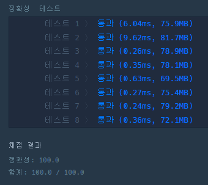
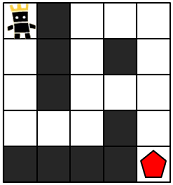
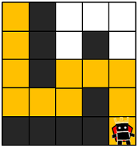
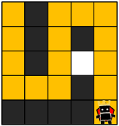
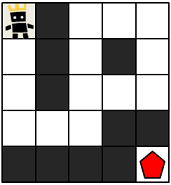
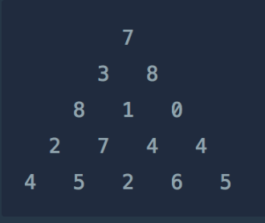
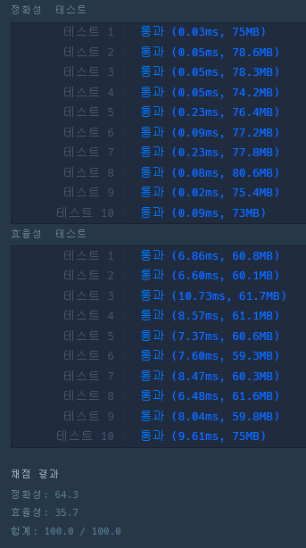



### **DFS - 타겟 넘버**

---

#### **문제 설명**

n개의 음이 아닌 정수들이 있습니다. 이 정수들을 순서를 바꾸지 않고 적절히 더하거나 빼서 타겟 넘버를 만들려고 합니다. 예를 들어 [1, 1, 1, 1, 1]로 숫자 3을 만들려면 다음 다섯 방법을 쓸 수 있습니다.

> -1+1+1+1+1 = 3   
> +1-1+1+1+1 = 3   
> +1+1-1+1+1 = 3   
> +1+1+1-1+1 = 3   
> +1+1+1+1-1 = 3

사용할 수 있는 숫자가 담긴 배열 numbers, 타겟 넘버 target이 매개변수로 주어질 때 숫자를 적절히 더하고 빼서 타겟 넘버를 만드는 방법의 수를 return 하도록 solution 함수를 작성해주세요.

#### **제한 사항**

* 주어지는 숫자의 개수는 2개 이상 20개 이하입니다.
* 각 숫자는 1 이상 50 이하인 자연수입니다.
* 타겟 넘버는 1 이상 1000 이하인 자연수입니다.

#### **알고리즘**

이 문제는 DFS와 재귀함수를 활용할 수 있는 문제이다.

numbers = {1, 1, 1}이고 target 1인 경우에 대한 테스트를 진행해보겠다.

numbers에 각 인덱스가 할 수 있는 것은 더하거나 뺄 수 있다.

즉 numbers = {1, 1, 1} 이고 operation = { +/-, +/-, +/-} 인 상황이다.

경우의 수는 2 \* 2 \* 2 = 8이다.

이 문제를 DFS 완전탐색으로 풀어도 괜찮을까? 라는 생각이 든다면 시간복잡도를 계산해야 한다.

쉽게 최악의 경우 몇번의 연산을 해야 되는지 계산해보고, 500만번 미만이라면 충분히 가능하다고 생각하면 된다.

제한사항에 보면 numbers 배열이 최대 20개 숫자까지 들어올 수 있다고 하였고

그 20개 숫자에 대해 각각 2가지의 경우의 수가 있기 때문에 20 \* 2 = 40가 최악에 경우의 수이고

다른 말로 2^20인 100만번 정도가 된다는 것을 의미한다.

이를 통해 충분히 재귀함수를 통해 문제를 풀이하여도 시간 복잡도에 문제가 없다는 것을 증명하였다.

**경우의 수 판단**

| numbers[0] | numbers[1] | numbers[2] | sum |
| --- | --- | --- | --- |
| 1 | 1 | 1 | 3 |
| 1 | 1 | -1 | **1** |
| 1 | -1 | 1 | **1** |
| 1 | -1 | -1 | -1 |
| -1 | 1 | 1 | **1** |
| -1 | 1 | -1 | -1 |
| -1 | -1 | 1 | -1 |
| -1 | -1 | -1 | -3 |

이와 같이 경우의 수를 판별하면 target 1이 되는 경우는 3가지이다.

#### **문제 풀이**

```java
class Solution {
    static int[] numbers;
    static int target;
    static int answer;

    public int solution(int[] numbers, int target){
        answer = 0;
        this.numbers = numbers;
        this.target = target;

        dfs(0, 0);

        return answer;
    }

    public void dfs(int idx, int sum){
        if(idx == numbers.length)
        {
            if(target == sum)
                answer++;

            return;
        }

        dfs(idx+1, sum + numbers[idx]);
        dfs(idx+1, sum - numbers[idx]);
    }
}
```

#### **실행 결과**

이전에 풀이한 경험이 있지만, 코드를 보지 않고 새롭게 구현하려고 하였다.

이유는 이전에 풀이한 경험을 생각해도 어차피 기억하지 못한다....

직접 확인하면 기억이 나겠지만.. 이는 좋지 않기 때문에 새롭게 구현하였다.



### **BFS - 게임 맵 최단 거리**

---

#### **문제 설명**

ROR 게임은 두 팀으로 나누어서 진행하며, 상대 팀 진영을 먼저 파괴하면 이기는 게임입니다. 따라서, 각 팀은 상대 팀 진영에 최대한 빨리 도착하는 것이 유리합니다.

지금부터 당신은 한 팀의 팀원이 되어 게임을 진행하려고 합니다. 다음은 5 x 5 크기의 맵에, 당신의 캐릭터가 (행: 1, 열: 1) 위치에 있고, 상대 팀 진영은 (행: 5, 열: 5) 위치에 있는 경우의 예시입니다.



위 그림에서 검은색 부분은 벽으로 막혀있어 갈 수 없는 길이며, 흰색 부분은 갈 수 있는 길입니다. 캐릭터가 움직일 때는 동, 서, 남, 북 방향으로 한 칸씩 이동하며, 게임 맵을 벗어난 길은 갈 수 없습니다.   
아래 예시는 캐릭터가 상대 팀 진영으로 가는 두 가지 방법을 나타내고 있습니다.

* 첫 번째 방법은 11개의 칸을 지나서 상대 팀 진영에 도착했습니다.



* 두 번째 방법은 15개의 칸을 지나서 상대팀 진영에 도착했습니다.



위 예시에서는 첫 번째 방법보다 더 빠르게 상대팀 진영에 도착하는 방법은 없으므로, 이 방법이 상대 팀 진영으로 가는 가장 빠른 방법입니다.   

만약, 상대 팀이 자신의 팀 진영 주위에 벽을 세워두었다면 상대 팀 진영에 도착하지 못할 수도 있습니다. 예를 들어, 다음과 같은 경우에 당신의 캐릭터는 상대 팀 진영에 도착할 수 없습니다.



게임 맵의 상태 maps가 매개변수로 주어질 때, 캐릭터가 상대 팀 진영에 도착하기 위해서 지나가야 하는 칸의 개수의 최솟값을 return 하도록 solution 함수를 완성해주세요. 단, 상대 팀 진영에 도착할 수 없을 때는 -1을 return 해주세요.

#### **제한사항**

* maps는 n x m 크기의 게임 맵의 상태가 들어있는 2차원 배열로, n과 m은 각각 1 이상 100 이하의 자연수입니다.
  + n과 m은 서로 같을 수도, 다를 수도 있지만, n과 m이 모두 1인 경우는 입력으로 주어지지 않습니다.
* maps는 0과 1로만 이루어져 있으며, 0은 벽이 있는 자리, 1은 벽이 없는 자리를 나타냅니다.
* 처음에 캐릭터는 게임 맵의 좌측 상단인 (1, 1) 위치에 있으며, 상대방 진영은 게임 맵의 우측 하단인 (n, m) 위치에 있습니다.

#### **알고리즘**

이 문제는 길찾기 문제에 기본이 되는 문제로 **BFS와 큐**를 활용할 수 있는 문제이다.

왜 BFS를 이용할까?

이유는 경우의 수가 아닌 최적의 거리를 구해야하기 때문이다. DFS로 최적의 거리를 찾을 수 있지만, 시간이 오래걸린다..

다음과 같이 맵이 구조가 되어있을 때, 게임 맵에서 도착지까지 이동이 가능한지 파악하고 경우의 수 중 최단거리를 구하는 문제이다. 문제에서는 1이 지나갈 수 있는 공간이고, 0이 지나갈 수 없는 공간이다.


상하좌우로 이동하면서 공간이 있는 경우, Queue에 값을 넣어 이동한다.

통과한 길은 벽으로 처리하여 재접근하지 못하도록 하였다.

#### **풀이**

```java
import java.util.*;

class Solution {
    public int solution(int[][] maps) {
        int answer = 0;

        int[][] arrows = {{0, 1}, {0, -1}, {-1, 0}, {1, 0}};
        int[][] count = new int[maps.length][maps[0].length];

        Queue<Position> queue = new LinkedList<>();
        queue.add(Position.of(0, 0));
        count[0][0] = 1;

        while (!queue.isEmpty()) {
            Position cur = queue.poll();
            int curCount = count[cur.y][cur.x];

            // 위치 파악(상, 하, 좌, 우)
            for (int i = 0; i < 4; i++) {
                int x = cur.x + arrows[i][0];
                int y = cur.y + arrows[i][1];
                Position p = Position.of(x, y);

                // 맵을 벗어난 경우
                if (p.x < 0 || p.y < 0 || p.x == maps[0].length || p.y == maps.length)
                    continue;

                // 벽에 부딪힌 경우
                if (maps[p.y][p.x] == 0)
                    continue;

                count[p.y][p.x] = curCount + 1;
                // 지난 길은 다시 돌아길 이유가 없기 때문에 벽으로 변경
                maps[p.y][p.x] = 0;
                queue.add(p);
            }
        }

        answer=count[maps.length-1][maps[0].length-1];

        return answer == 0 ? -1 : answer;
    }

    static class Position {
        int x, y;

        private Position(int x, int y) {
            this.x = x;
            this.y = y;
        }

        public static Position of(int x, int y) {
            return new Position(x, y);
        }
    }
}
```

### **DP - 정수 삼각형**

---

#### **문제 설명**



위와 같은 삼각형의 꼭대기에서 바닥까지 이어지는 경로 중, 거쳐간 숫자의 합이 가장 큰 경우를 찾아보려고 합니다. 아래 칸으로 이동할 때는 대각선 방향으로 한 칸 오른쪽 또는 왼쪽으로만 이동 가능합니다. 예를 들어 3에서는 그 아래칸의 8 또는 1로만 이동이 가능합니다. 삼각형의 정보가 담긴 배열 triangle이 매개변수로 주어질 때, 거쳐간 숫자의 최댓값을 return 하도록 solution 함수를 완성하세요.

#### **제한 사항**

* 삼각형의 높이는 1 이상 500 이하입니다.
* 삼각형을 이루고 있는 숫자는 0 이상 9,999 이하의 정수입니다.

#### **알고리즘**

이 문제는 DFS로 문제 풀이가 가능하지만 DP가 가장 효율적인 방법이다.

왼쪽과 오른쪽은 고를 것 없이 한 가지 루트로 계속 내려온다.

문제는 중간에 있는 값들인데, [2, 7, 4, 4] 중에서 7과 4는 왼쪽 대각선 위와 오른쪽 대각선 위 중에서 더 큰 합계를 가진 것을 골라주면 된다.

> dp[i][j] = MAX(dp[i-1][j-1], dp[i-1][j]) + triangle[i][j]

#### **풀이**

```java
class Solution {
    public int solution(int[][] triangle) {
        int answer = 0;

        int[][] dp = new int[triangle.length][triangle.length];
        dp[0][0] = triangle[0][0];

        for(int i=1; i<triangle.length; i++){
            // 왼쪽
            dp[i][0] = dp[i-1][0] + triangle[i][0];

            // 중간
            for(int j=1; j<=i; j++){
                dp[i][j] = Math.max(dp[i-1][j], dp[i-1][j-1]) + triangle[i][j];
            }

            // 오른쪽
            dp[i][i] = dp[i-1][i-1] + triangle[i][i];
        }

        for(int i=0; i<triangle.length; i++){
            answer = Math.max(answer, dp[triangle.length-1][i]);
        }

        return answer;
    }
}
```

#### **성능**

성능은 좋으나... 점수는 짜게 1점 주네요 ㅠㅠ


