오늘은 사전학습 2일차!!

목표한 양만큼 수강을 못할까봐 조마조마 했는데...

그래도 원하는 양만큼 수강완료했어요!!

파이썬 언어를 어제에 이어서 마무리부터 하였습니다.(알고 있어도 학습하는 사람?? 저요!!)

---

#### **오늘 공부한 내용**

* 1-11) 파이썬 심화 문법 뽀개기
* 1-12) 튜플, 집합
* 1-13) f-string
* 1-14) 예외처리
* 1-15) 파일불러오기
* 1-16) 한줄의 바법
* 1-17) map, filter, lambda식
* 1-18) 함수 심화
* 1-19) 클래스

오늘 먼저 파이썬 1주차를 완강하려고 했다.

10개 밖에 되지 않아 빠르게 끝내려고 했는데 생각보다 오래걸렸다...

이유는 정리하면서 하다보니 시간은 2배 이상 소요되는 것 같았다...

내가 거북이인가..? [파이썬 문법 뽀개기 1주차]를 1387명 중에 1378 등으로 끝냈습니다.. 이정도면 거북이 맞죠??

---

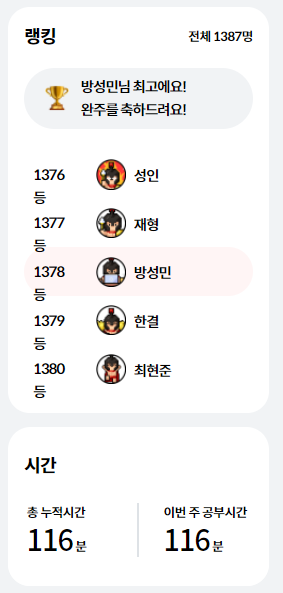

스파르타 파이썬 문법 뽀개기 1주차 등수

---

#### **Summary**

**2.2 튜플과 집합**

**1) 튜플**

**- 튜플은 리스트와 비슷하지만 불변인 자료형입니다.**

**- 딕셔너리 대신 리스트와 튜플로 딕셔너리 '비슷하게' 만들어 사용해야 할때 많이 사용된다고 하셨다.**

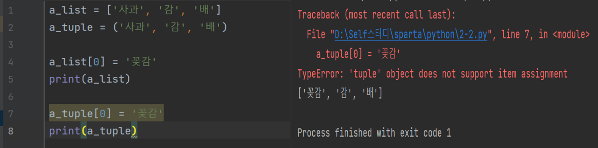

(좌) 예제 코드, (우) 튜플 값 변경시 에러

---

**2) 집합**

**- 집합은 말 그대로 '집합'을 구현하는 방법으로 중복이 제거 된다는 장점이 있다.**

**- 집합은 set(리스트) 메소드를 통해 만들 수 있다.**

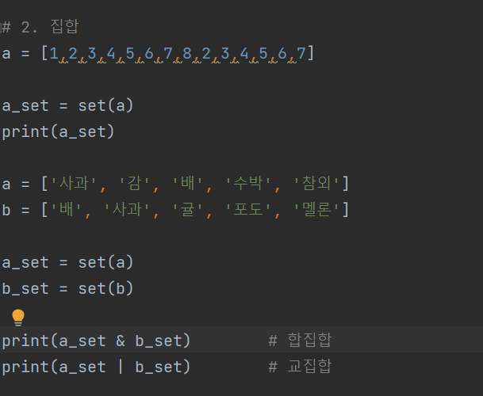

집합 예제 코드

---

**Quiz**

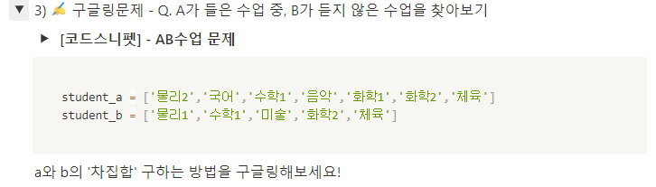

2-2 튜플과 집합 - 퀴즈

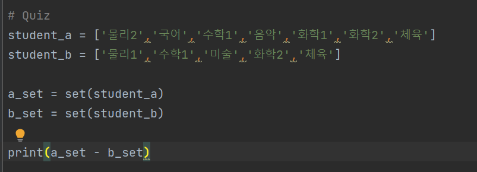

퀴즈 풀이

---

**2.3 f-string**

**- f-string은 변수로 더 직관적인 문자열을 만드는 방법이다.**

**- f-string은 자바스크립트에 ES6문법에 도입된 템플릿 리터럴과 유사하다.**

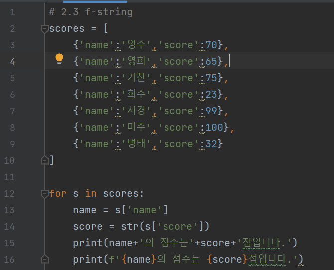

2.3 f-string 사용예제

---

**2.4 예외처리(try - except 문)**

- 에러가 있어도 건너뛰게 할 수 있는 방법

- 서버에서 잘못되었을 경우 처리할 때 사용한다고 하셨다.

- 남용할 경우, 에러가 발생하였는데 무슨 에러가 발생한 것인지 확인하기 힘들기 때문에

  사용하지 않는 것이 좋다고 하셨다.

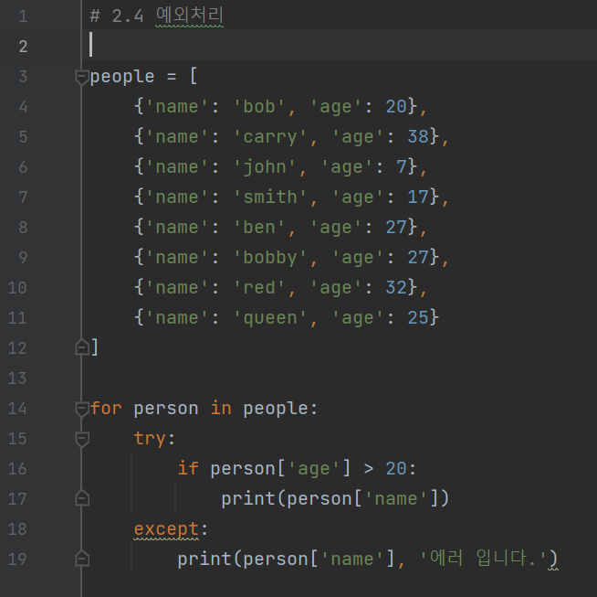

2-4. 예외처리

---

**2.5 파일 불러오기**

**Form 파일이름 import \*(또는 특정 함수)**

**- 여러개 파일로 분리하여 코드를 효율적으로 관리할 수 있는 방법이다.**

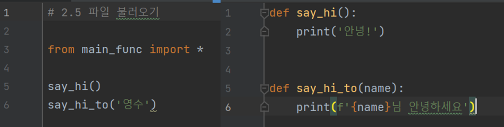

(좌) 함수 호출, (우) 메소드 구현

---

**2.6 한줄의 마법**

**1) if문 - 삼항연산자**

**2) for문 - 한방에 써버리기**

**( for문은 익숙하지 않지만, 자주 사용하면 익숙해질 것 같다. )**

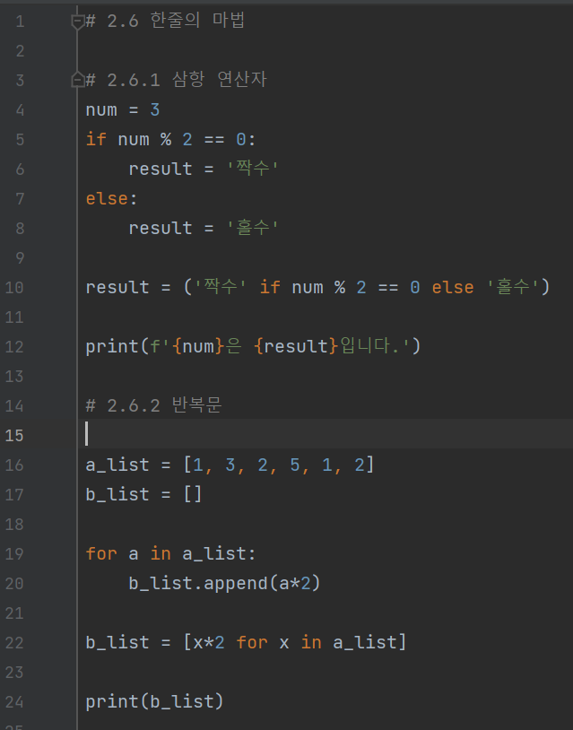

2.6 한줄의 마법 코드

> 길어도 다 봐주세요  
> 

---

**2.7 map, filter, lambda식**

**1) map - 리스트의 모든 원소를 조작하는 방법**

**2) filter - 리스트의 모든 원소 중 특별한 것만 필터링 하는 방법**

**3) lambda - 런타임에 생성해서 사용할 수 있는 익명 함수이고, 함수형 프로그램 언어에 lambda와 정확히 똑같지는 않지만,**

**파이썬에 잘 통합되어 있으며 filter(), map(), reduce()와 같은 전형적인 기능 개념과 함께 사용된다.**

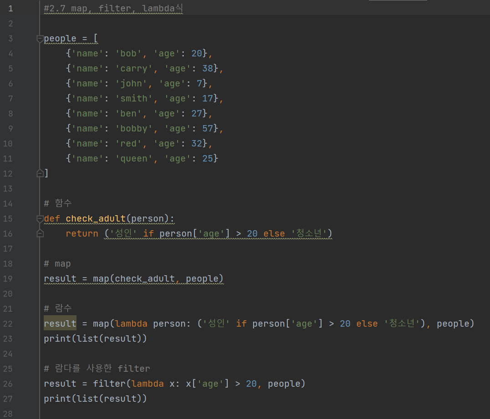

2.7 map, filter, lambda식 예제

---

**2.8 함수 심화**

**- 매개 변수를 지정하여 메소드를 호출할 수 있다.**

**- 메소드 매개변수에 디폴값을 지정할 수 있다.**

**- 매개변수에 \*args를 사용하면 매개변수 전달에 개수 제한없이 사용할 수 있으며, \*args로 들어온 데이터는 리스트 형태로 사용할 수 있게 된다.**

**- 입력 값의 개수를 지정하지 않고 모두 받는 방법과 인수를 여러 개 받는 방법은 외부 라이브러리를 사용할 때 많이 사용된다.**

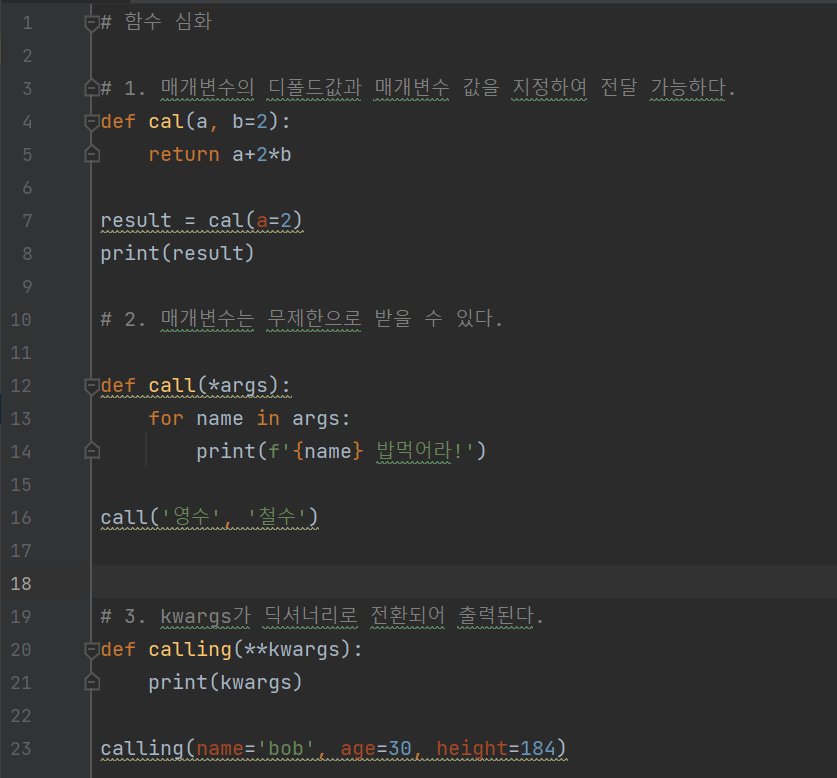

2.8 함수 심화 예제 코드

---

**2.9 클래스**

**- 클래스에서 가장 중요한 것은 "언제 사용하는지"이다.**

**- 인스턴스 : 클래스로부터 생성된 변수**

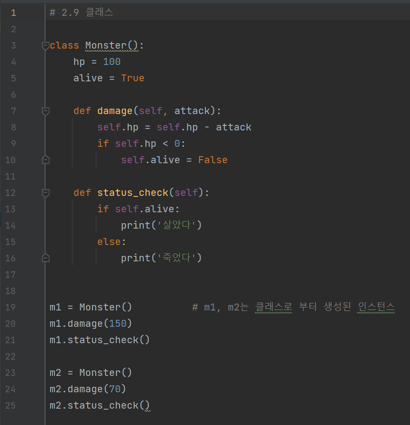

2.9 클래스 예제 코드

---

**후기**

**1주차 파이썬 문법 뽀개기를 끝냈는데** **늦게 시작한 만큼 더 열심히 해서 빠르게 따라가겠습니다****앞에 계신 1300분 달려가시죠. 제가 다 잡겠습니다.**

