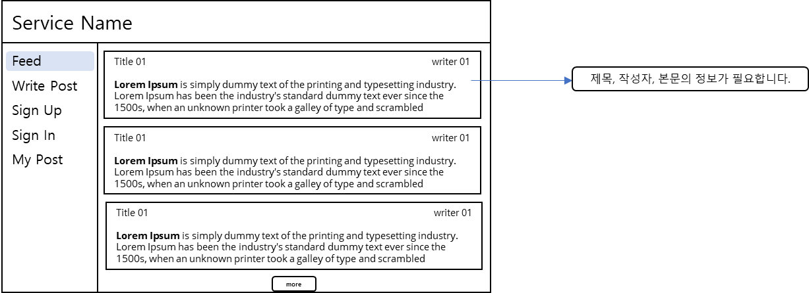
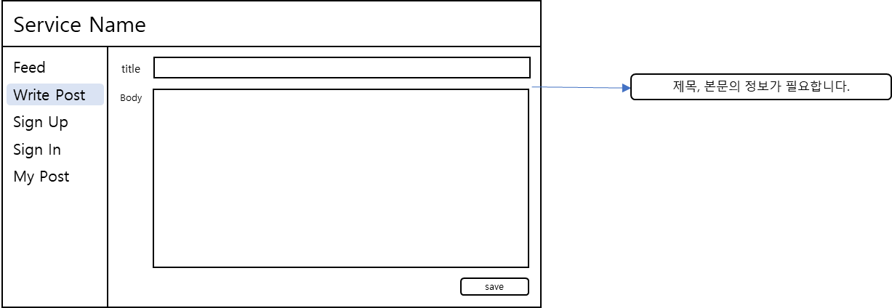
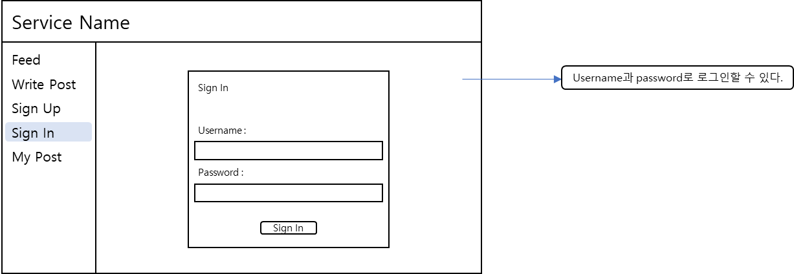

## 프로젝트 개요 및 요구사항 분석하기

---

화면 기획서를 통해 요구사항을 분석하는 과정

### **요구사항 분석**

---

#### Feed Page

**생각해보기**

* 어떤 기준으로 목록이 정렬되나요?
* 처음에는 몇개를 보여줘야할까요?
* 페이징 처리가 가능하도록 화면변경이 가능한가요?

---

#### Write Post Page

**생각해보기**

* 제목과 본문의 최대 글자수는 어떻게 될까요?

---

#### Sing Up Page

---

#### Sing In Page

---

#### My Post Page

### API 분석

---

| **Page** | **API Name** | **Function** |
| --- | --- | --- |
| **Feed Page** | Post List API | * 모든 사용자의 글을 모아서 보여주는 API * Paging 및 정렬 필요 * 제목, 작성자, 본문 |
| **Write Post Page** | Post Create API | * 제목과 본문을 이용해 포스트 작성 |
| **Sign Up Page** | User Sign Up API | * Username과 password를 이용하여 회원가입 |
| **Sign In Page** | User Sign In API | * Username과 password를 이용하여 로그인 |
| **My Post Page** | My Post API | * 로그인한 사용자의 글을 모아서 보여주는 API * Paging 및 정렬 필요 * 제목, 작성자, 본문 |
| Post Delete API | * 포스트를 삭제할 수 있다. |
| Post Modify API | * 제목과 본문을 수정할 수 있다. |
