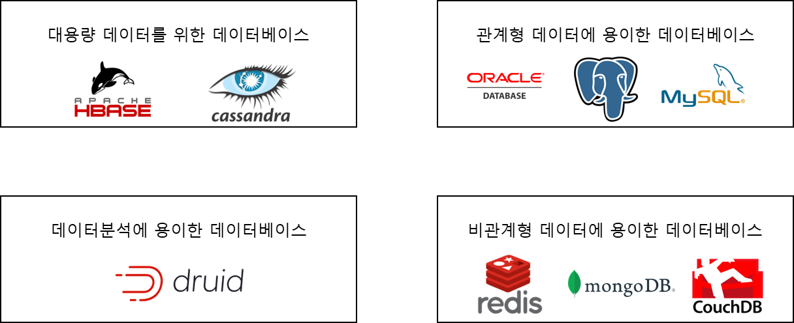
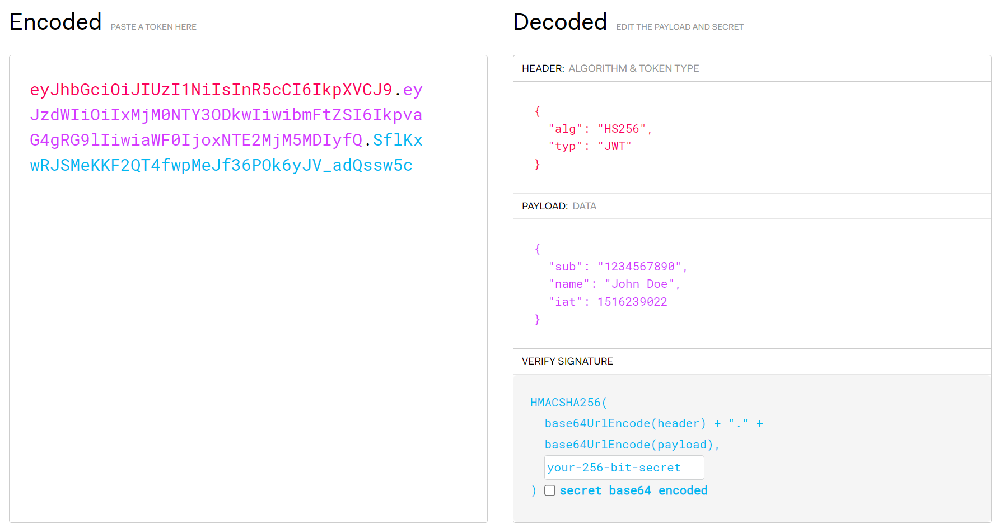

### **Architecture 설계**

---

### 데이터베이스

---

* Post와 User 정보를 저장할 데이터베이스가 필요

#### **데이터베이스의 종류**

서비스에 맞는 데이터베이스를 선택해야 서비스를 효과적이고 효율적으로 운영할 수 있다.

대용량 데이터를 위한 데이터베이스와 데이터분석에 용이한 데이터베이스는 현재 개발하려는 서비스와 맞지 않는 부분이 있어 다음과 같이 범위가 축소된다.

|  | 관계형 데이터베이스(RDBMS) | 비관계형 데이터베이스(NOSQL) |
| --- | --- | --- |
| 특징 | 데이터를 행과 열로 된 관계의 테이블 형태로 저장하는 것이 특징이다.  모든 데이터를 하나의 표처럼 나타낼 수 있다.  고정된 스키마를 가지고 있으며 이를 이용해 질의하여 데이터를 가지고 올 수 있다. | 데이터들의 관계를 저장하는 것이 아닌 저장자체에 초점을 맞춘 데이터베이스로서 문서형이나 key-value 형이 있다. |
| 장점 | SQL을 통해 데이터를 쉽게 질의하여 가지고 올 수 있다. | 유연성이 뛰어나며 빠르게 데이터를 가지고 올 수 있다. 수평 확장에 용이하다. |
| 단점 | 데이터의 관계가 복잡할 경우 다수의 JOIN이 발생하여 성능에 영향을 줄 수 있다. 수평 확장에 불리하다. | 질의하기 어렵다. 다수의 업데이트가 일어나느 경우 성능 측면에서 불리하다. |

#### **데이터베이스에 대한 이해도 및 Reference**

서비스의 특성에 맞는 데이터베이스 중에서는 팀내 운영 경험이 있는 사람이 있거나 문제가 생겼을 경우 trouble shooting에 용이하도록 reference가 많은 데이터베이스를 고르는 것도 좋은 방법이다.

#### **데이터베이스 선정**

* 회원정보와 Post 정보를 저장해야한다.
* User 1이 Post 1을 작성했다는 관계가 명확히 있어야 한다.
* Post 정렬하거나 사용자가 작성한 Post 만 가져오는 기능을 위한 질의가 필요하다.

=> RDBS 를 사용하는 것이 나은 것으로 판단됨.

배포에 사용할 Cloudtype에서는 MariaDB와 PostgreSQL 등을 지원하고 있는데 그중 PostgreSQL을 사용한 경험이 적기 때문에 PostgreSQL을 사용하여 경험을 쌓으려 한다.

### **회원가입과 로그인**

---

회원가입과 로그인 시 어떤 기술을 사용할 지 결정해보려 한다.

#### **인증(Authentication)과 인가(Authorization)**

인증(Authentication)은 회원가입이나 로그인처럼 내가 누구인지 보여주는 것

인가(Authorization)은 내가 권한이 있는지를 확인하는 것

#### **Authorization은 왜 필요할까?**

#### **Authorization 방법**

**아이디/비밀번호를 통한 Authorization**

> 아이디와 비밀번호를 매 요청마다 받아서 해당 요청을 한 사람이 접근하고자 하는 것에 대한 권한이 있는지 혹은 권한을 갖은 데이터를 반환하는지 행동을 할 수 있다.  
>   
> 그러나 이러한 방법은 위험하다. 매 요청마다 아이디와 비밀번호를 전송하게 된다면 유출될 가능성이 높다.

**임의의 문자열을 통한 Authorization**

> User 마다 특정 문자열을 발급해주거나 문자열에 User 정보를 암호화하여 유저가 누구인지 식별해줄 수 있다.  
> 이 또한 임의의 문자열이 아이디/비밀번호 방법과 같이 유출될 가능성이 있다.  
> 다만 임의의 문자열에 유효한 시간을 걸어 실제 아이디와 비밀번호를 알고 있는 유저만 매번 유효한 문자열을 받을 수 있도록 설정하여 해결할 수 있다. 이는 아이디/비밀번호를 사용하는 방법에 비해 비교적 안전하다.

**JWT(Json Web Token)**

**임의의 문자열을 만드는 방법** 중 하나가 JWT가 있다. 

JWT는 모바일이나 웹에 사용자 인증을 위해 사용되는 암호화된 토큰으로 Spring Security에서 지원하는 Authorization 방법이다.

> **Encoded -** 암호화된 토큰  
> **Decoded -** 알고리즘을 통해 복호화한 것  
> 1. HEADER는 JWT에서 사용할 타입과 해시 알고리즘의 종류 즉 암호화에 사용할 알고리즘을 설정하는 영역이다.  
> 2. PAYLOYD는 데이터로 암호화하고 싶은 데이터로 서버에서 첨부한 사용자 권한 정보와 데이터가 담겨 있다.  
> 3. VERIFY SIGNATURE는 Header, Payload를 Base64 URL-safe Encode를 한 이후 Header에 명시된 해시함수를 적용하고, 개인키(private Key)로 서명한 전자서명이 담겨 있다.

#### **전체적인 Architecture**

