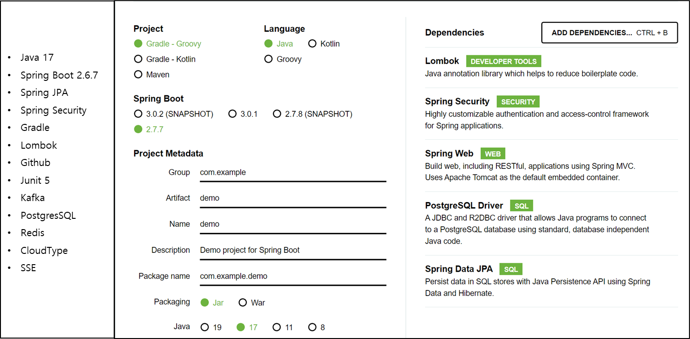
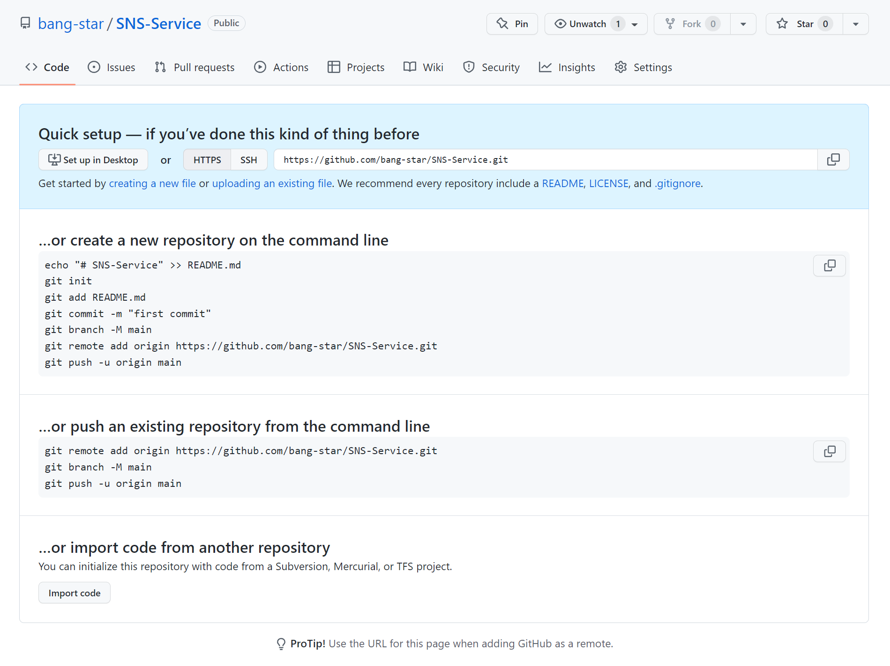
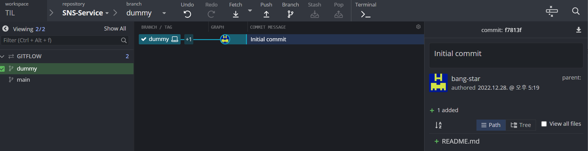
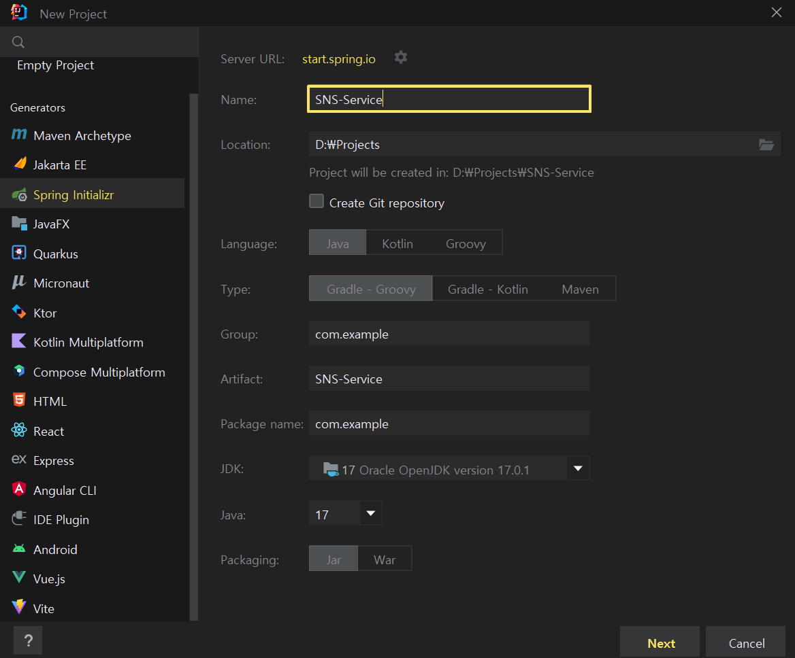
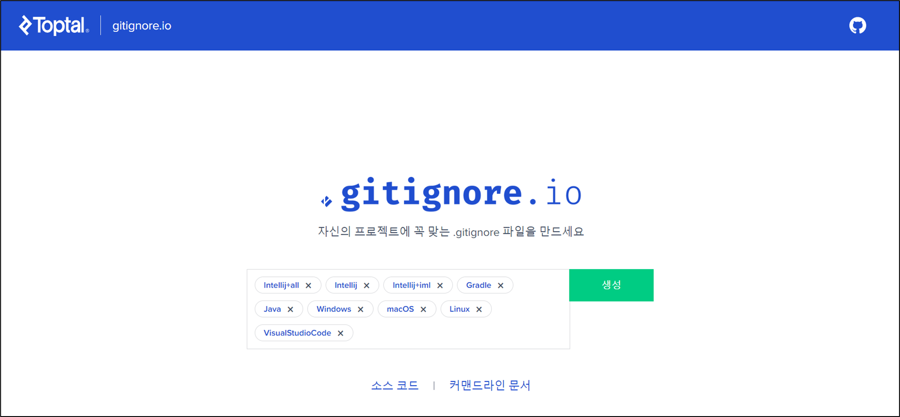
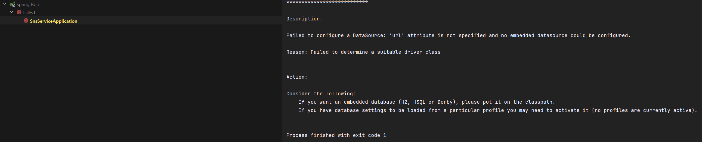
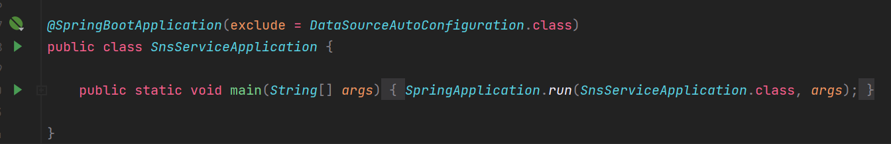
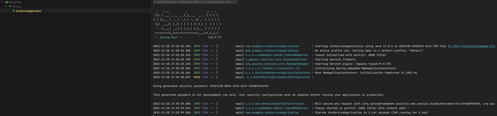

## 개발환경 구성하기

---

### **기술 스택 및 Spring Boot Project 만들기**

### **개발 도구**

* Intellij IDEA Ultimate
* Git Kraken
* Github

**1. Github에 Repository를 생성**

**2. Gitkraken에서 Repository를 Clone**

해당 Repository에 아무런 파일이 존재하지 않기 때문에 이를 위해 GitKraken에서 README.md 파일을 생성하여 최초 커밋을 만들어준다.

**3. Intellij IDE를 통해 동일한 경로에 Spring 프로젝트를 생성해주면 된다.**

**4. .gitignore 설정**

**5. 프로젝트 실행**

다음과 같이 url 속성을 명시되어 있지 않고 데이터베이스에 관한 설정이 되어 있지 않다는 에러가 발생하고 있다.

이는 JPA에서 연결할 DB를 찾지 못하여 발생한 에러이다.

DataSource를 자동으로 찾아주는 기능을 중단시키면 이를 해결할 수 있다.

이와 같이 처리한 이유는 commit 시 문제가 발생하지 않도록 하게 하기 위함이다.
