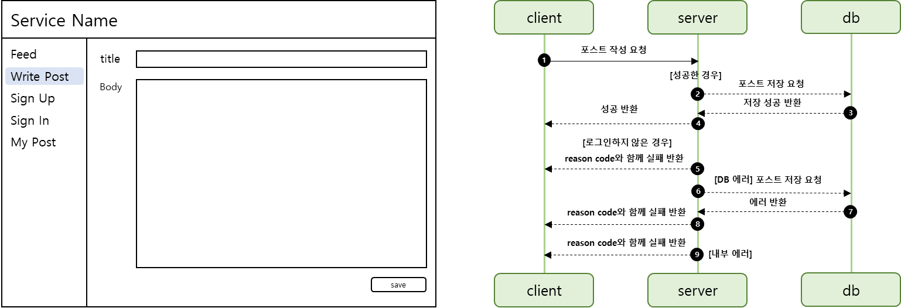
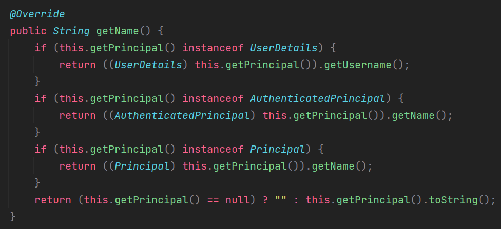

## **포스트 작성 기능**

---

### **테스트 작성**

---



제목과 본문을 입력하고 save 버튼을 누르면 포스트 작성되어야 한다.

요구사항을 바탕으로 오른쪽 그림과 같은 Sequence Diagram을 그려보면 4가지 상황을 생각할 수 있다.

* 성공
* 실패
  + 로그인을 하지 않은 경우
  + 데이터베이스 에러
  + 내부 에러

#### **Controller 테스트**

**포스트 작성 성공**

```java
@Test
@WithMockUser
void 포스트작성() throws Exception {
    String title = "title";
    String body = "body";

    mvc.perform(post("/api/v1/posts")
                    .contentType(MediaType.APPLICATION_JSON)
                    .content(objectMapper.writeValueAsBytes(PostCreateRequest.of(title, body)))
            ).andDo(print())
            .andExpect(status().isOk());
}
```

**포스트 작성시 로그인하지 않은 경우**

```java
@Test
@WithAnonymousUser
void 포스트작성시_로그인하지않은경우() throws Exception {
    String title = "title";
    String body = "body";

    // 로그인하지 않은 경우

    mvc.perform(post("/api/v1/posts")
                    .contentType(MediaType.APPLICATION_JSON)
                    .content(objectMapper.writeValueAsBytes(PostCreateRequest.of(title, body)))
            ).andDo(print())
            .andExpect(status().isUnauthorized());
}
```

---

#### **Service 테스트**

**포스트 작성 성공**

```java
@Test
void 포스트작성이_성공한경우() {
    String title = "title";
    String body = "body";
    String username = "username";

    // mocking
    when(userEntityRepository.findByUsername(username)).thenReturn(Optional.of(mock(UserEntity.class)));
    when(postEntityRepository.save(any())).thenReturn(mock(PostEntity.class));

    Assertions.assertDoesNotThrow(() -> postService.create(title, body, username));
}
```

**포스트 작성시 요청한 유저가 존재하지 않은 경우**

```java
@Test
void 포스트작성시_요청한유저가_존재하지않은경우(){
    String title = "title";
    String body = "body";
    String username = "username";

    // mocking
    when(userEntityRepository.findByUsername(username)).thenReturn(Optional.empty());
    when(postEntityRepository.save(any())).thenReturn(mock(PostEntity.class));

    SnsApplicationException e = assertThrows(SnsApplicationException.class, () -> postService.create(title, body, username));
    assertEquals(ErrorCode.USER_NOT_FOUND, e.getErrorCode());
}
```

### **기능 개발**

---

#### **Controller**

```java
@RequiredArgsConstructor
@RequestMapping("/api/v1/posts")
@RestController
public class PostController {

    private final PostService postService;

    @PostMapping
    public Response<Void> create(@RequestBody PostCreateRequest request, Authentication authentication){
        postService.create(request.getTitle(), request.getBody(), authentication.getName());

        return Response.success();
    }
}
```

Post 생성 시 반환하는 데이터가 없음.

#### **Service**

```java
@AllArgsConstructor
@Service
public class PostService {

    private final PostEntityRepository postEntityRepository;
    private final UserEntityRepository userEntityRepository;

    @Transactional
    public void create(String title, String body, String username){
        UserEntity userEntity = userEntityRepository.findByUsername(username)
                .orElseThrow(() -> new SnsApplicationException(ErrorCode.USER_NOT_FOUND, String.format("%s not founded", username)));

        postEntityRepository.save(PostEntity.of(title, body, userEntity));
    }

}
```

#### **Entity**

```java
@Setter
@Getter
@Entity
@Table(name = "\"post\"")
@SQLDelete(sql = "UPDATED \"post\" SET deleted_at = NOW() id=?")
@Where(clause = "deleted_at is NULL")
public class PostEntity {

    @Id
    @GeneratedValue(strategy = GenerationType.IDENTITY)
    private Integer id;

    @Column(name = "title")
    private String title;

    @Column(name = "body", columnDefinition = "TEXT")
    private String body;

    @ManyToOne
    @JoinColumn(name = "user_id")
    private UserEntity user;

    @Column(name = "registered_at")
    private Timestamp registeredAt;

    @Column(name = "updated_at")
    private Timestamp updatedAt;

    @Column(name = "deleted_at")
    private Timestamp deletedAt;

    @PrePersist
    void registeredAt() { this.registeredAt = Timestamp.from(Instant.now()); }

    @PreUpdate
    void updatedAt() { this.updatedAt = Timestamp.from(Instant.now());}

    public static PostEntity of(String title, String body, UserEntity userEntity){
        PostEntity entity = new PostEntity();
        entity.setTitle(title);
        entity.setBody(body);
        entity.setUser(userEntity);

        return entity;
    }

}
```

1. Post에 body 같은 경우 String 으로 할경우, 크기가 작게 설정되므로 TEXT로 변경

2. 작성자 정보를 함께 저장하기 위한 UserEntity

### **참고 사항**

---

1. 인증 과정에서 발생하는 에러 핸들링

> AuthenticationEntryPoint 인터페이스를 상속받아 인증 과정에서 발생한 에러 처리를 위해 상태값과 상태 메시지를 만들어서 AuthenticationEntryPoint에 comment 구현

2. UserDetails 상속

> 토큰 정보를 검사하는 과정에서 AbstractAuthenticationToken에 구현체인 UsernamePasswordAuthenticationToken 클래스에 getName() 메소드를 사용하고 있는데 getName에서 검사되는 instance를 구현하지 않은 상태이기 때문에 getName() 시 원하지 않는 결과를 반환하게 된다.   
>   
> 이를 해결하기 위해 Dto 클래스인 User 클래스에 UserDetails 인터페이스를 상속받아 구현함.


