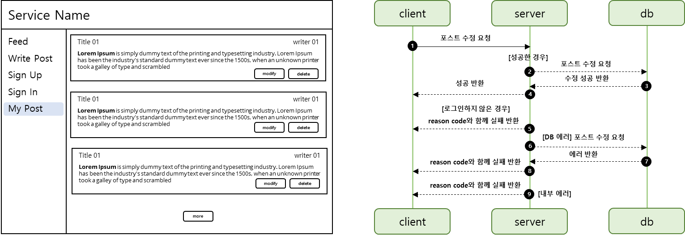

## **포스트 수정 기능**

---

### 테스트

---



MyPost 페이지에 사용자가 작성한 글에 대해 수정과 삭제 권한이 부여된다.

요구사항을 바탕으로 오른쪽 그림과 같이 Sequence Diagram을 그려보면 작성 기능과 동일하게 4가지 상황을 생각할 수 있다.

* 성공
* 실패
  + 로그인을 하지 않은 경우
  + 데이터베이스 에러
  + 내부 에러

#### **Controller 테스트**

**포스트 수정 성공**

```java
@Test
@WithMockUser
void 포스트수정() throws Exception {
    String title = "title";
    String body = "body";
    String username = "username";
    Integer postId = 1;
    Integer userId = 1;

    when(postService.modify(eq(title), eq(body), any(), any())).thenReturn(Post.fromEntity(PostEntityFixture.get(username, postId, userId)));

    mvc.perform(put("/api/v1/posts/1")
                    .contentType(MediaType.APPLICATION_JSON)
                    .content(objectMapper.writeValueAsBytes(PostModifyRequest.of(title, body)))
            ).andDo(print())
            .andExpect(status().isOk());
}
```

**포스트 수정시 로그인하지 않은 경우**

```java
@Test
@WithAnonymousUser
void 포스트수정시_로그인하지않은경우() throws Exception {
    String title = "title";
    String body = "body";

    mvc.perform(put("/api/v1/posts/1")
                    .contentType(MediaType.APPLICATION_JSON)
                    .content(objectMapper.writeValueAsBytes(PostModifyRequest.of(title, body)))
            ).andDo(print())
            .andExpect(status().isUnauthorized());
}
```

**포스트 수정시 본인이 작성한 글이 아닌 경우**

```java
@Test
@WithAnonymousUser
void 포스트수정시_본인이_작성한_글이_아닌경우_에러발생() throws Exception {
    String title = "title";
    String body = "body";

    doThrow(new SnsApplicationException(ErrorCode.INVALID_PERMISSION)).when(postService).modify(eq(title), eq(body), any(), eq(1));

    mvc.perform(put("/api/v1/posts/1")
                    .contentType(MediaType.APPLICATION_JSON)
                    .content(objectMapper.writeValueAsBytes(PostModifyRequest.of(title, body)))
            ).andDo(print())
            .andExpect(status().isUnauthorized());
}
```

**포스트 수정시 수정하려는 글이 존재하지 않은 경우**

```java
@Test
@WithMockUser
void 포스트수정시_수정하려는_글이_존재하지않은경우_에러발생() throws Exception {
    String title = "title";
    String body = "body";

    doThrow(new SnsApplicationException(ErrorCode.POST_NOT_FOUND)).when(postService).modify(eq(title), eq(body), any(), eq(1));

    mvc.perform(put("/api/v1/posts/1")
                    .contentType(MediaType.APPLICATION_JSON)
                    .content(objectMapper.writeValueAsBytes(new PostModifyRequest(title, body)))
            ).andDo(print())
            .andExpect(status().isNotFound());
}
```

---

#### **Service 테스트**

**포스트 수정이 성곤한 경우**

```java
@Test
void 포스트수정이_성공한경우() {
    String title = "title";
    String body = "body";
    String username = "username";
    Integer postId = 1;

    PostEntity postEntity = PostEntityFixture.get(username, postId, 1);
    UserEntity user = postEntity.getUser();

    when(userEntityRepository.findByUsername(username)).thenReturn(Optional.of(user));
    when(postEntityRepository.findById(postId)).thenReturn(Optional.of(postEntity));
    when(postEntityRepository.saveAndFlush(postEntity)).thenReturn(postEntity);

    Assertions.assertDoesNotThrow(() -> postService.modify(title, body, username, postId));
}
```

**포스트 수정시 포스트가 존재하지 않은 경우**

```java
@Test
void 포스트수정시_포스트가_존재하지않는_경우() {
    String title = "title";
    String body = "body";
    String username = "username";
    Integer postId = 1;

    PostEntity postEntity = PostEntityFixture.get(username, postId, 1);
    UserEntity user = postEntity.getUser();

    when(userEntityRepository.findByUsername(username)).thenReturn(Optional.of(user));
    when(postEntityRepository.findById(postId)).thenReturn(Optional.empty());

    SnsApplicationException e = assertThrows(SnsApplicationException.class, () -> postService.modify(title, body, username, postId));
    Assertions.assertEquals(ErrorCode.POST_NOT_FOUND, e.getErrorCode());
}
```

**포스트 수정시 권한이 없는 경우**

```java
@Test
void 포스트수정시_권한이_없는_경우() {
    String title = "title";
    String body = "body";
    String username = "username";
    Integer postId = 1;

    PostEntity postEntity = PostEntityFixture.get(username, postId, 1);
    UserEntity writer = UserEntityFixture.get("username1", "password1", 2);

    when(userEntityRepository.findByUsername(username)).thenReturn(Optional.of(writer));
    when(postEntityRepository.findById(postId)).thenReturn(Optional.of(postEntity));

    SnsApplicationException e = assertThrows(SnsApplicationException.class, () -> postService.modify(title, body, username, postId));
    Assertions.assertEquals(ErrorCode.INVALID_PERMISSION, e.getErrorCode());
}
```

### **구현**

---

#### **Controller**

```java
@PutMapping("/{postId}")
public Response<PostResponse> modify(@PathVariable Integer postId, @RequestBody PostModifyRequest request, Authentication authentication) {
    Post post = postService.modify(request.getTitle(), request.getBody(), authentication.getName(), postId);

    return Response.success(PostResponse.fromPost(post));
}
```

#### **Service**

```java
@Transactional
public Post modify(String title, String body, String username, Integer postId){
    UserEntity userEntity = userEntityRepository.findByUsername(username)
            .orElseThrow(() -> new SnsApplicationException(ErrorCode.USER_NOT_FOUND, String.format("%s not founded", username)));

    // post exist
    PostEntity postEntity = postEntityRepository.findById(postId)
            .orElseThrow(() -> new SnsApplicationException(ErrorCode.POST_NOT_FOUND, String.format("%s not founded", postId)));

    // post permission
    if (postEntity.getUser() != userEntity) {
        throw new SnsApplicationException(ErrorCode.INVALID_PERMISSION, String.format("%s has no permission with %s", username, postId));
    }

    postEntity.setTitle(title);
    postEntity.setBody(body);

    return Post.fromEntity(postEntityRepository.saveAndFlush(postEntity));
}
```
