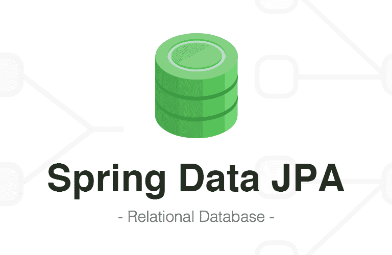
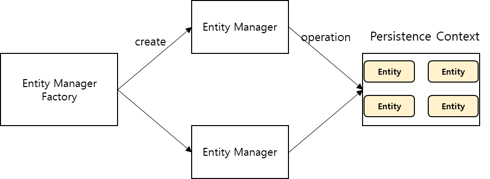
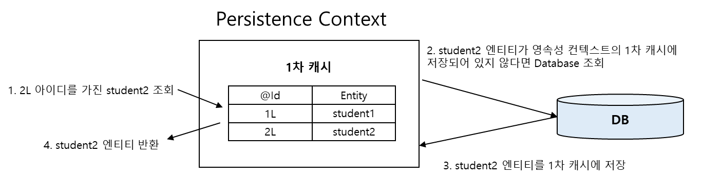
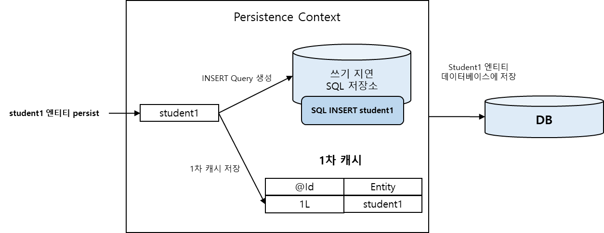

### **JPA(Java Persistence API)**

---

Java 객체와 관계형 DB 사이를 매핑하는 ORM 기술 표준

* 기술 표준 즉 인터페이스이므로 실제 구현체는 **hibernate**, **EclipseLink, **OpenJPA**** 등이 있다.

#### **장점**

* **특정 데이터베이스에 종속되지 않는다.**  
  데이터베이스마다 쿼리문이 조금씩 다르기 때문에 데이터베이스 Migration에 어려움이 많다. 하지만 JPA는 추상화한 데이터 접근 계층을 제공하므로 설정 파일에 사용 데이터베이스만 지정하면 된다.
* **객체 지향적 프로그래밍 및 생산성 향상**  
  개발자가 직접 SQL을 작성하는 데이터베이스 설계 중심에서 Java 객체에 집중하도록 지원한다.  
  테이블 컬럼 수정 시 맵핑된 클래스만을 변경하면 적용된다.

#### **단점**

* **복잡한 쿼리 처리가 불가능하다.**
* **자동으로 생성되는 쿼리로 인해서 개발자가 의도하지 않는 성능 저하가 발생할 수 있다.**
* **방대한 JPA 기술 학습에 필요한 시간과 노력이 필요하다.**
* **다수의 테이블 조인시 신경써야 할게 많다.**

### **JPA 동작 원리**

---

#### **JPA Principal**



* **Entity**   
  데이터베이스 테이블에 대응하는 클래스로 @Entity 어노테이션 붙은 클래스를 JPA가 관리한다.
* **Entity Manager**Persistence Context 에 접근하여 DB 작업을 제공하는 객체로 내부적으로 DB Connection을 이용해서 DB에 접근한다.
* **Entity Manager Factory**엔티티 매니저 인스턴스를 관리하는 주체로 Application 실행 시 한개 만들어지고 사용자로부터 요청이 오면 엔티티 매니저를 생성한다.
* **Persistence Context**Entity를 영구 저장하도록 지원하는 환경으로써 엔티티 매니저를 통해 접근 가능하다.

#### **Entity Life Cycle**


* **비영속 (new)**new 키워드를 통해 생성된 상태로 아직 영속성 컨텍스트에 저장되지 않음.
* **영속 (managed)**엔티티가 영속성 컨텍스트에 저장되어 관리되는 상태로 아직 DB에 저장된 상태는 아니며 Transaction Commit 후에 DB에 반영된다.
* **준영속 상태 (detached)**영속성 컨텍스트에 엔티티가 저장되었다가 분리된 상태
* **삭제 상태 (removed)**영속성 컨텍스트와 데이터베이스에서 삭제된 상태

```java
Studuent student = new Student();    // 1
student.setName("홍길동");

EntityManager em = entityManagerfactory.createEntityManager(); // 2
EntityTransaction transaction = em.getTransaction();           // 3

transaction.begin();
em.persist(student);         // 4

transaction.commit();        // 5

em.close();                  // 6
```

1. new 키워드로 영속성 컨텍스트에 담을 엔티티 생성
2. 엔티티 매니저 팩토리로부터 엔티티 매니저 생성
3. 데이터 변경 시 무결성을 위해 트랜잭션 시작
4. 영속성 컨텍스트에 저장된 상태, 아직 DB에 INSERT SQL 보내기 전
5. 트랜잭션을 DB에 반영, 이때 실제로 INSERT SQL 수행
6. 엔티티 매니저와 엔티티 매니저 팩토리 자원을 close 호출로 반환

#### **Persistence Context**



* **1차 캐시**
  + 영속성 컨텍스트 내에 저장되는 캐시로 MAP<Key, Value> 형태로 저장됨
  + entityManager.find() 메소드 호출 시 1차 캐시 조회
  + 존재할 경우 반환, 없으면 DB 조회 후 1차 캐시에 저장 및 반환
* **동일성 보장**
  + 하나의 트랙잭션에서 같은 키 값으로 같은 엔티티 조회를 보장받을 수있다.



* 트랜잭션을 지원하는 쓰기 지연
  + entityManager.persist() 호출하면 1차 캐시에 저장과 동시에 지연 SQL 저장소에 저장
  + Commit 호출 시 쌓인 SQL문들이 flush() 되면서 DB 에 반영
  + 한 번에 처리하기 때문에 성능 이점

* 변경 감지
  + JPA 는 1차 캐시에 DB 에서 처음 불러온 엔티티의 스냅샷을 저장
  + 스냅샷과 비교하여 변경 내용이 있따면 UPDATE SQL 수행
