**2일차에 파이썬만 한게 아녀요~**

**웹개발 종합반 1주차도 끝내버렸어요!!**

---

#### **오늘 공부한 내용**

**웹개발 종합반 - 1주차**

1. 1주차 오늘 배울 것
2. 필수 프로그램 설치
3. HTML, CSS 기본 내용
4. Quiz\_간단한 로그인 페이지 만들어보기
5. CSS 기초
6. 자주 쓰이는 CSS 연습하기
7. 폰트, 주석, 파일 분리
8. 부트스트랩, 예쁜 CSS 모음집
9. CSS 꿀팁 한번 더 배우기
10. 본격 부트스트랩 써보기
11. Quiz\_포스팅박스를 완성하기!
12. Javascript 맛보기
13. Javascript 기초 분법 배우기(1)
14. Javascript 기초 분법 배우기(2)
15. Javascript 연습하기
16. 1주차 끝 & 숙제

---

그래도.. 이건 154명 중 123등입니다!!

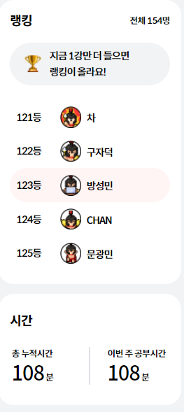

웹개발 종합반 7기 순위

---

### **Summary**

* 1주차 오늘 배울 것

      0) 실습 예제

      실제 네이버에 접속하여 "뉴스 홈" 키워드를 "스파르타"로 변경하였습니다.

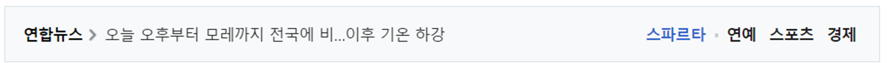

      이 예제를 통해서 오늘 배울 것들에 대해 설명해주셨습니다.

      Hint ① 어떻게 바꿀 수 있었을까?

            → 내꺼이기 때문이다. 내가 이미 받아 온것이고, 내 컴퓨터에 있는 것이기 때문에

               내 마음대로 바꿀 수 있는 것이라고 하셨습니다.

            ② 인터넷이 끊어도 어떻게 이 페이지는 계속 살아 있을까?

            → ①의 답과 동일

            ③ 새로고침을 하게 되면 변경한 "스파르타"가 다시 "뉴스 홈"으로 변경되는데, 새로고침의 의미는 무엇일까?

            → 새로 받아온다는 의미이다. 새로고침을 누르게 되면 네이버 서버가 만들어 놓은 "API"라는 창구에

                미리 정해진 약속대로 요청에 맞는 페이지를 응답해준다.

      1) 서버/클라이언트/웹의 동작개념

      - 서버(Server)는 클라이언트에게 네트워크를 통해 정보나 서비스를 제공하는 컴퓨터 시스템으로 컴퓨터 프로그램

        또는 장치를 의미

        (예시) 네이버가 갖고 있는 컴퓨터

      - 클라이언트(Clinet)는 네트워크를 통하여 서버라는 다른 컴퓨터 상의 원격 서비스에 접속할 수 있는

        응용 프로그램이나 서비스를 의미

        (예시) 자신의 컴퓨터

     -  웹(브라우저)는 인터넷상에서 웹에 연결시켜 주는 윈도 기반의 소프트웨어이고, 서버에 1) 요청을 보내고,

        2)서버가 보내준 데이터 또는 파일(HTML, CSS, JS)을 가져와서 보여주는 역할을 한다.

        => 모두 서버에서 미리 준비해두었던 것을 "받아서", "그려주는" 것입니다. 

        (예시) 크롬, 엣지, 사파리 etc

      2) 웹의 동작 개념(HTML을 받는 경우)

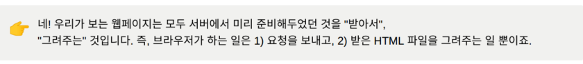

      3) 웹의 동작 개념(데이터만 받는 경우)

      - 데이터만 내려올 경우는, JSON형식으로 전달 받게 된다.

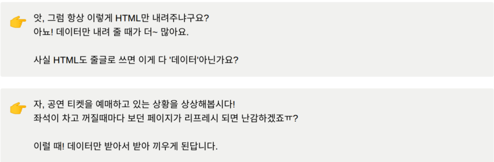
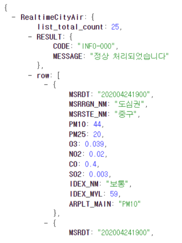

서버로 부터 받은 데이터(JSON타입)

    (서버와 클라이언트의 관계)

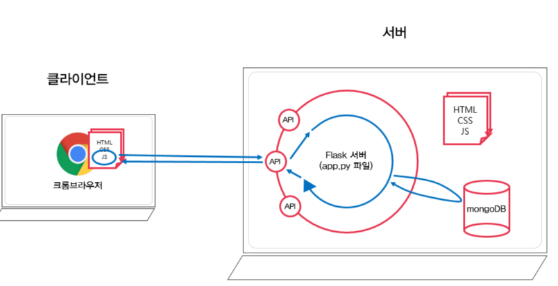

      4) 1-5주차에 배울 순서!

        1주차 : HTML, CSS, Javascript

        2주차 : JQuery, AJax, API

        3주차 : Python, 크롤링, MongoDB

        4주차 : 미니프로젝트1, 미니프로젝트2

        5주차 : 미니프로젝트3, AWS

---

* 필수 프로그램 설치

      1) Pycharm Professional 설치

      - 스파르타 코딩클럽을 통해 4개월 간 무료로 사용하실 수 있습니다.

      (저는 대학생으로 등록하여 이미 사용 중이라 간단하게 보고 Skip!)

---

* HTML, CSS 기본 내용

      1) HTML, CSS의 개념

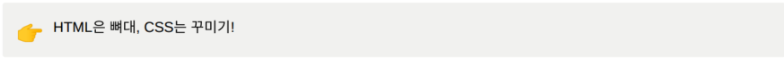

      - HTML은 구역과 텍스트를 나타내는 코드로, CSS은 잡은 구역을 꾸며주는 것으로 생각합니다. HTML 내

       style 속성으로 꾸미기를 할 수 있지만, 긴 세월동안 이것을 한데 모아 볼 수 있는 CSS파일이 탄생하게 되었습니다.

       HTML 코드 내에 CSS 파일을 불러와서 적용합니다.

      2) HTML의 개념

     - head 안에는 페이지의 속성 정보를, body 안에는 페이지의 내용을 담습니다.

     - head 안에 들어가는 대표적인 요소는 아이콘(favicon.ico), 타이틀, 구글엔진이 내 웹사이트를 잘 긁어갈 수 있도록

       해주는 속성들 등등

     - body는 div, p, h1, h2~h5, span 등이 있다.

---

* Quiz\_간단한 로그인 페이지 만들어보기

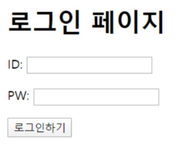

1.4 Quiz - 로그인 페이지 예시

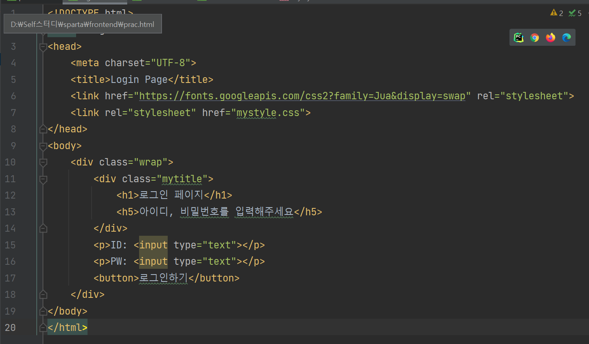

1.4 Quiz -&nbsp;로그인 페이지 구현

---

* CSS 기초

**- CSS는 가르킬 수 있어야 꾸밀 수 있다.**

**(1 단계) 태그 내에 class를 통해 이름을 부여한다.                          /\*** **클래스 이외에도 id, name, 태그명 등으로 접근 가능 \*/**

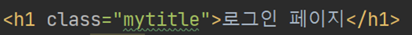

1.5 CSS 기초 - 1단계

**(2 단계) head 태그 내부에 style 태그를 생성한다.**

**(3 단계) 생성한 style 태그 내부에 .classname{ }을 통해 접근하여 스타일을 지정한다.**

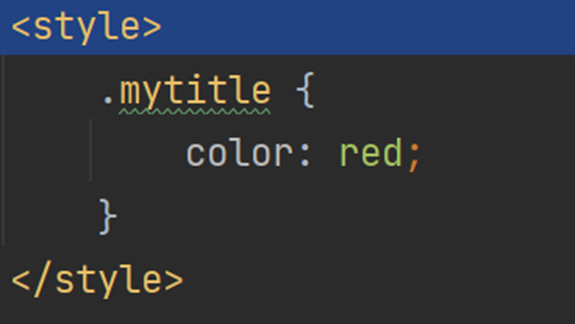

1.5 CSS기초 - 2, 3단계

* 자주 쓰이는 CSS 연습하기

**- (주의!) margin은 바깥 여백, padding은 내 안쪽 여백**

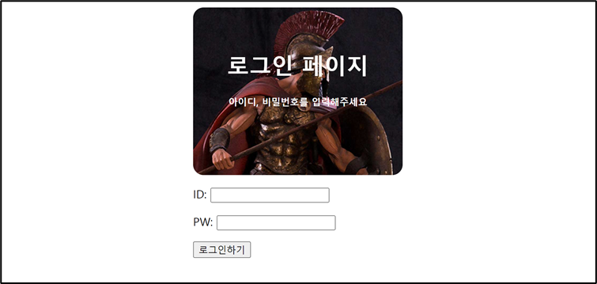

1.6 자주 쓰이는 CSS - 로그인 페이지

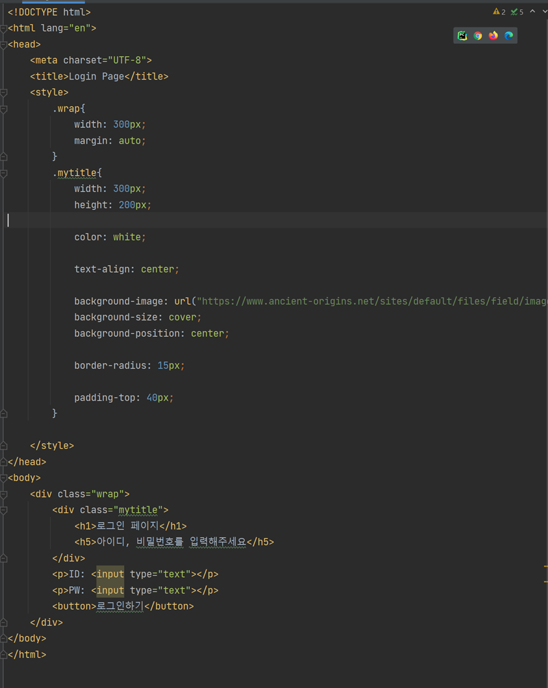

1.6 자주 쓰이는 CSS - 페이지 구현코드

---

* 폰트, 주석, 파일 분리

**1) 폰트(구글 폰트사용)**

**(1단계) 폰트를 선택한다.**

**(2단계) 선택한 폰트의 링크 중 3번째 링크를 복사**

**(3단계) html 파일에 원하는 태그에 적용시킨다.                                                 /\* '\*'는 전체를 가리킨다 \*/**

**2) 꿀팁! 주석달기**

**- 주석은 언제 사용하는가?**

**→ 필요 없어진 코드를 삭제하는 대신 임시로 작동하지 못하게 하고 싶을 때**

****→ 코드에 대한 간단한 설명을 붙여두고 싶을 때 사용합니다.****

**- Ctrl + /를 통해서 원하는 위치에 주석을 사용할 수 있다.**

**3) 파일분리**

**- CSS/JS 파일을 분리하여 link 태그로 연결시켜 사용할 수 있다.**

**- 코드를 분리하여 가독성 있게 개발할 수 있으며 역할을 분담하여 개발할 수 있다.**

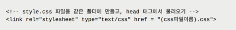

1.7 파일분리 예시

---

* 부트스트랩, 예쁜 CSS 모음집

**1) 부트스트랩이란?**

**- 트위터에서 사용하는 각종 레이아웃, 버튼, 입력창 등의 디자인을 CSS와 Javascript로 만들어 놓은 것이다.**

**웹 디자이너나 개발자 사이에서는 웹 디자인의 혁명이라고 불릴 정도로 폭발적은 반응을 얻는 프레임워크  
       => **예쁜 CSS를 미리 모아둔 것****

---

* CSS 꿀팁 한번 더 배우기

****1) 부트스트랩을 사용하는 이유****

****- 내가 아는 CSS 지식으로 무엇인가를 만들어두고 적재적소에 부트스트랩을 써가는 것이 효율적이기 때문****

****2) 중간 정렬하는 방법(외우지 말기)****

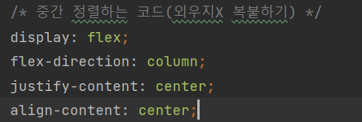

1.9 CSS 꿀팁 - 중간 정렬 코드

****3) 부트스트랩 사용전, CSS 적용****

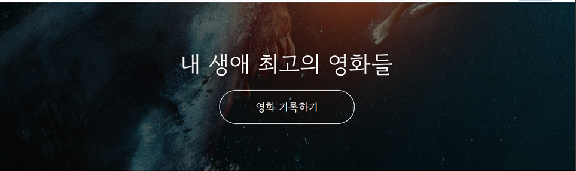

1.9 CSS 꿀팁 - 타이틀 CSS 적용

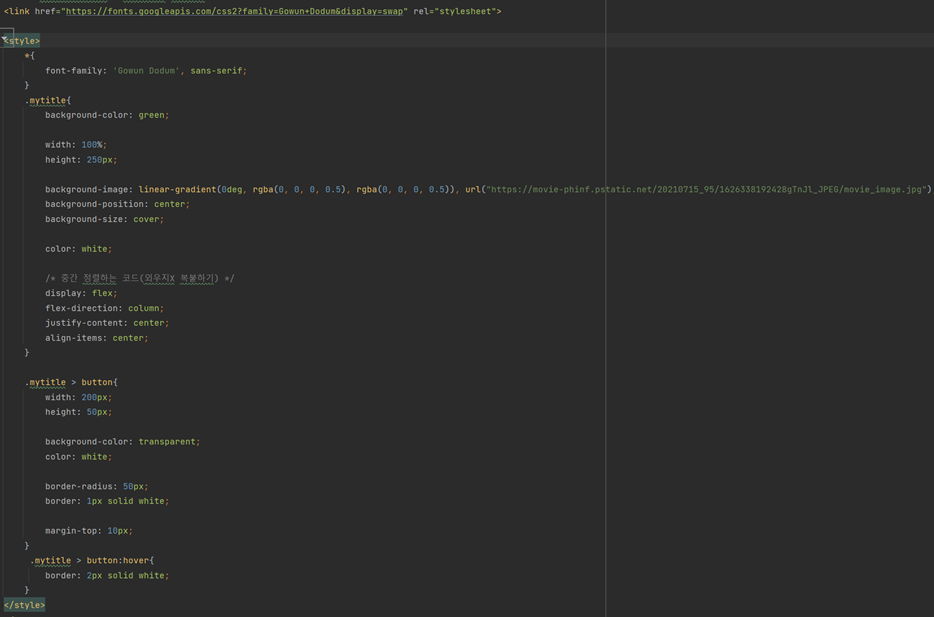

1.9 CSS 꿀팁 - CSS 코드

---

* 본격 부트스트랩 써보기

****1) 부트스트랩 사용(버튼, 카드)****

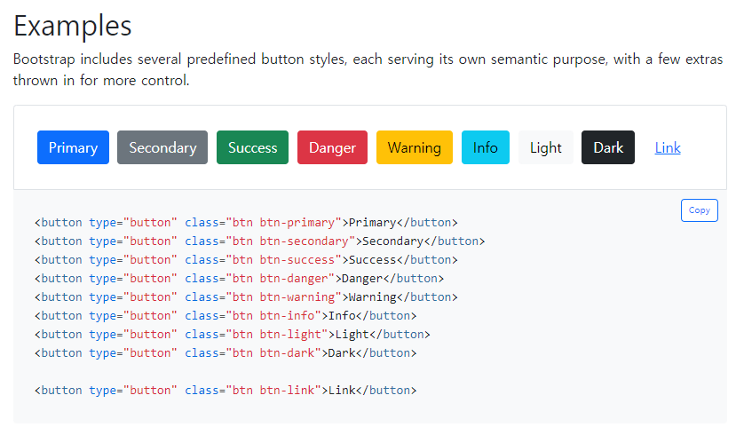

1.10 - Bootstrap 버튼

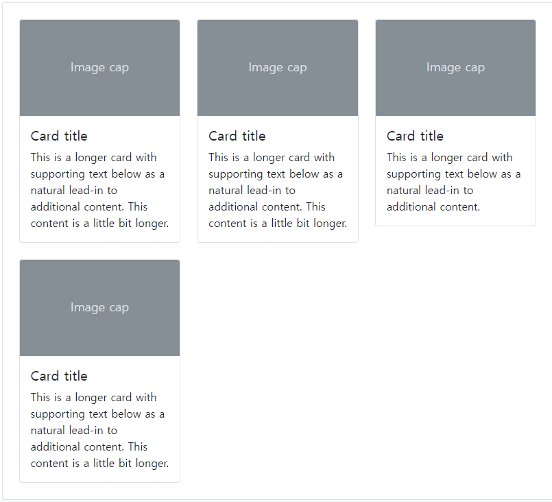

1.10 - Bootstrap 카드

****2) 이모티콘 사용(참고 :**** <https://kr.piliapp.com/facebook-symbols/>)

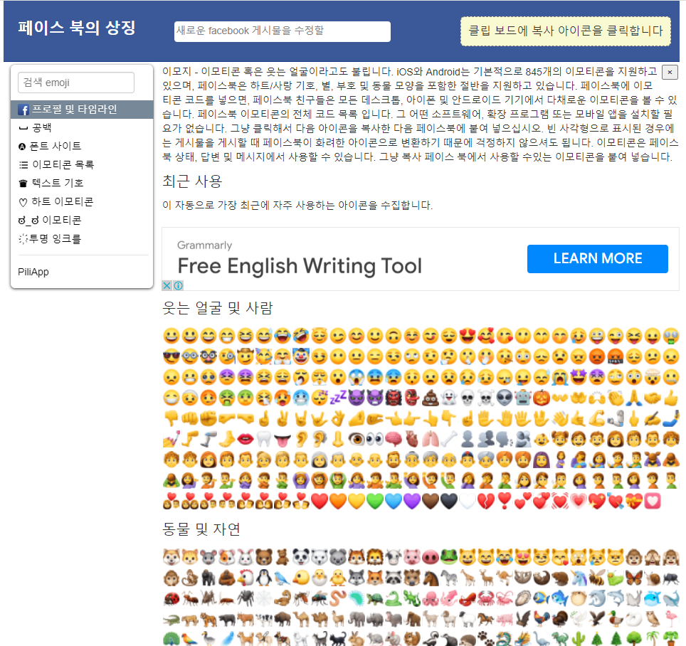

1-10. 페이스북 아이콘

* Quiz\_포스팅박스를 완성하기!

****1) 약간의 모바일 처리를 해두기****

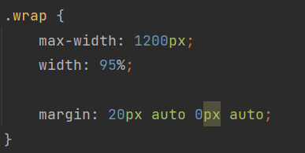

1.11 - 모바일 처리 예제 코드

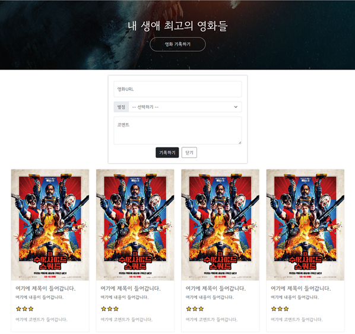

1.11 - Quiz 포스팅 박스

* Javascript 맛보기

****1) 자바스크립트란****

**- 자바스크립트는 프로그래밍 언어 중 하나로, 브라우저가 알아들을 수 있는 표준 언어입니다.**

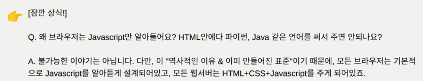

1.12 자바스크립트 맛보기 - 상식

**(Quiz) Java와 Javascript는 어떤 차이가 있나요?!!**

**Answer : 인도와 인도네시아, 바다와 바다코끼리 처럼 아무 관련 없습니다.**

****2) 자바스크립트 기초****

**(1단계) script 코드 작성**

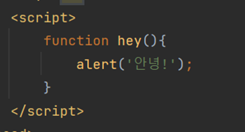

1.12 - 자바스크립트 코드 작성

**(2단계) script 코드 적용**

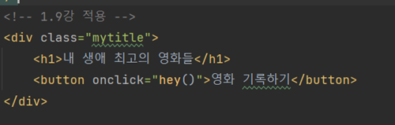

1.12 - 버튼 태그에 함수 적용

**(3단계) 테스트 페이지**

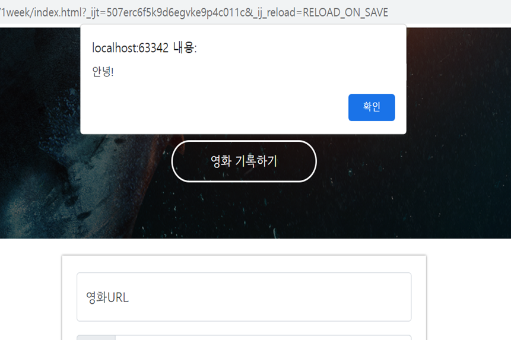

1.12 - 자바스크립트 alert 사용

* Javascript 기초 분법 배우기(1)

**1. 변수와 기본 연산**

**- 자바스크립트의 변수 선언은 3가지 방법이 있습니다.**

**(1) var : 변수를 선언, 추가로 동시에 값을 초기화**

**(2) let : 블록 범위(scope) 지역 변수 선언, 추가로 동시에 값을 초기화**

**(3) const : 블록 범위 읽기 전용 상수 선언**

**<참고 : [mozilla web docs](https://developer.mozilla.org/ko/docs/Web/JavaScript/Guide/Grammar_and_types) >**

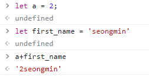

1.13 Javascript 기초 - 변수와 기본 연산

**2. 리스트와 딕셔너리**

**- 리스트 : 순서를 지켜서 가지고 있는 형태**

**- 딕셔너리 : 키(key)-값(value) 값의 묶음으로 저장된 형태**

**- 자바스크립트의 리스트와 딕셔너리는 파이썬 문법과 유사하다.**

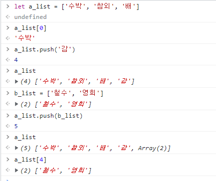

1.13 Javascript 기초 - 리스트 예제

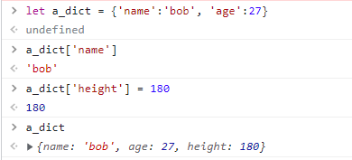

1.13 Javascript 기초문법(1)&nbsp;- 딕셔너리

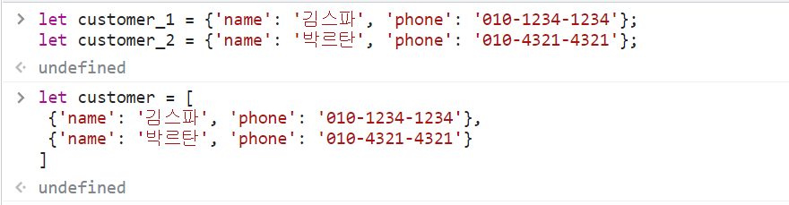

1.13 Javascript 기초문법(1)&nbsp;- 리스트와 딕셔너리의 조합

**3. 기본 함수**

**-  타 프로그래밍 언어처럼 자바스크립트도 다양한 내부 함수가 존재한다.**

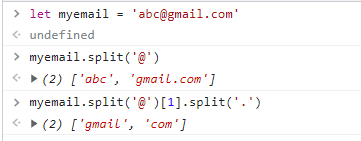

1.13 Javascript 기초문법(1) - 내장함수

---

* Javascript 기초 분법 배우기(2)

**1. 함수**

**- 함수는 크게 정해진 동작을 하는 것과 정해진 값을 주는 역할을 한다.**

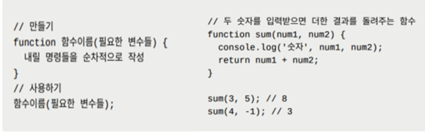

1.14 Javascript 기초 문법(2) -(좌) 기본 생김새, (우) 함수 예시

****2. 조건문****

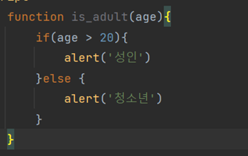

1.14 Javascript 기초 문법(2) - 조건문 에시

******3. 반복문******

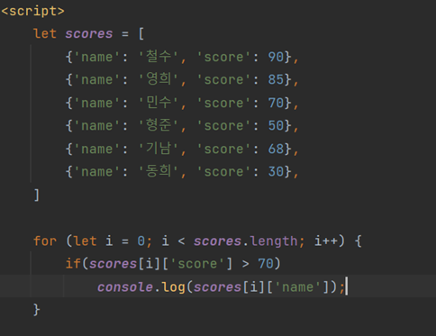

1.14 Javascript 기초 문법(2) - 반복문 사용 예시

---

* Javascript 연습하기

******1. 전형적인 패턴******

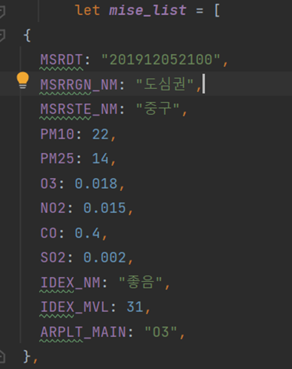

1.15 Javascript 연습하기 - 실제 기상청 데이터

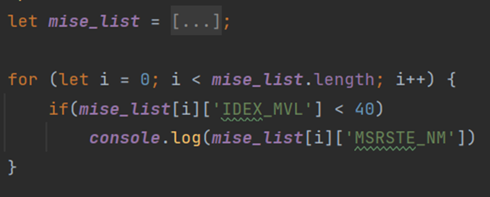

1.15 Javascript 연습하기 - 반복문 전형적 패턴

* 1주차 끝 & 숙제

******1. 과제 예시 화면******

******- 과제는 위 과정을 모두 수행하였다면, 누구나 완료할 수 있는 수준이였습니다.******

******강사님 말씀처럼 새로 작성하는 것이 아니라 코드를 재활용하는 것이 중요한 키 포인트라 생각한다.******

******작성자는 좋아하는 연예인이 없어서 똑같이 10cm로 연예인을 선정하였다.. ( 남자 좋아하는 것도 아님!! )******

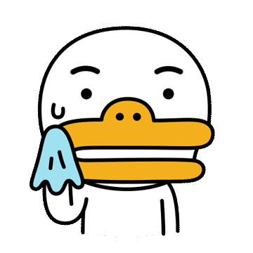

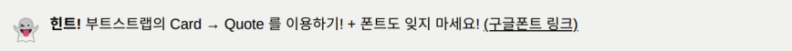

1.16 1주차 과제 힌트

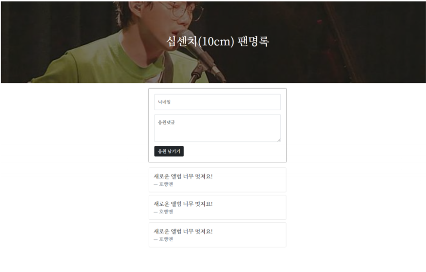

1.16 1주차 과제 - 예시화면

---

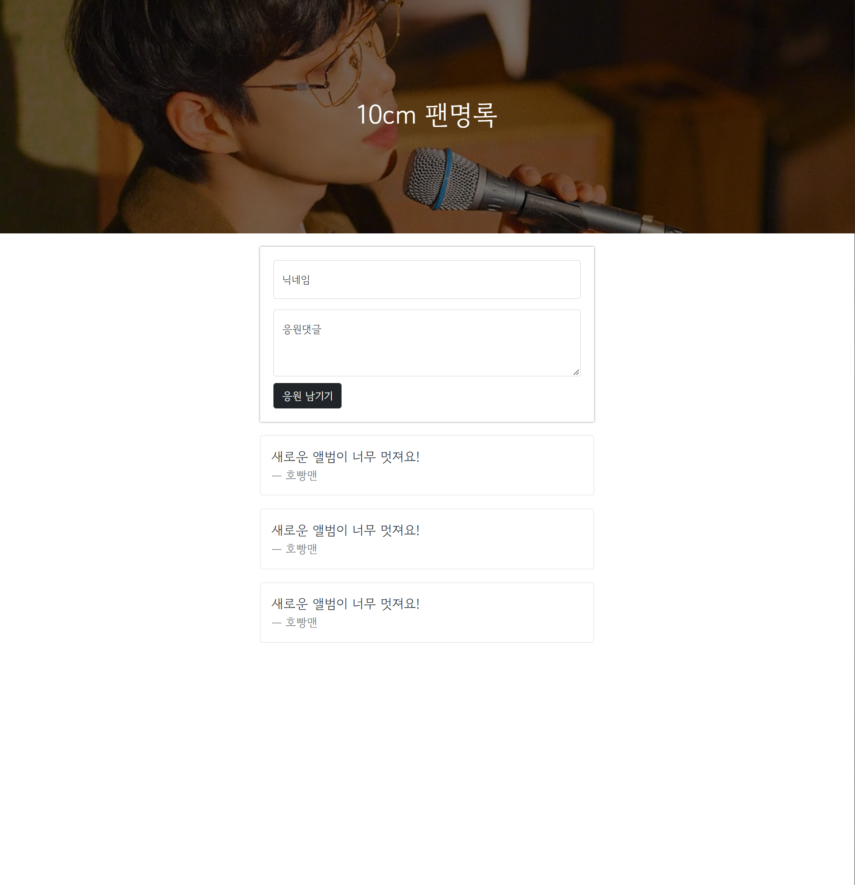

1.16 1주차 과제 - 팬명록 페이지 구현

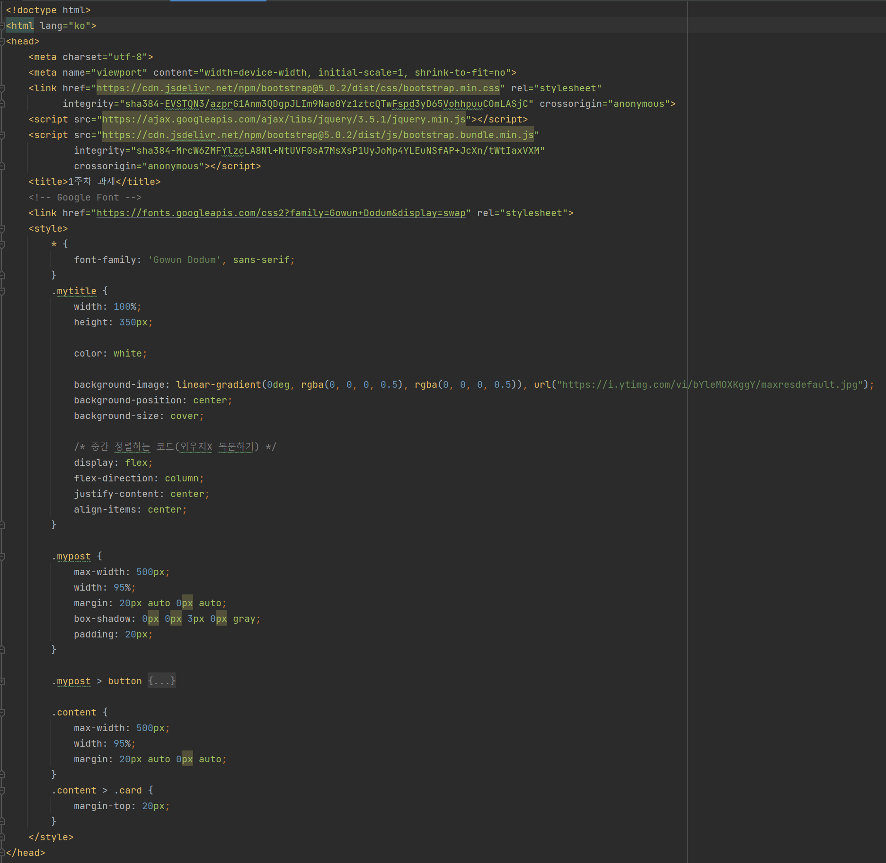

1.16 1주차 과제 - head 코드

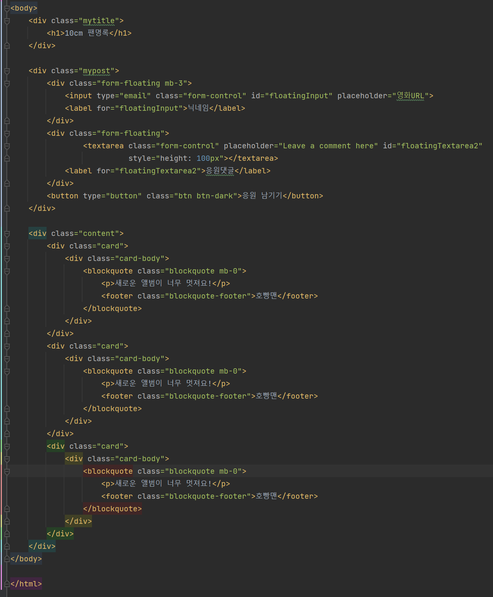

1..16 1주차 과제 - body 부분 코드

### **정리**

**오늘 1주차를 하면서 알고 있던 내용이 대부분이었다.. (아쉽)****그래도 체계적으로 배워가는 것에 설레이는 마음으로 개발했다.****마지막 과제를 하면서 느낀 것은 마지막 card 부분을 javascript에서 반복문을 통해 작성하는 것도 좋을 것 같다는 생각을 했다.****팬명록에 아직 자바스크립트 구현이 제대로 되지 않아 아쉽지만 1주차 과제로 완성을 깔끔하게 한 것에 만족!!**

**오늘 나에게 점수는 : 50점****이유 : 열심히 한 것 같지만, 더 열심히 할 수 있기 때문에 더 열심히 하라고 이와 같은 점수를 부여함**

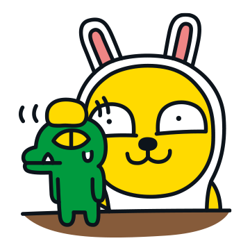
