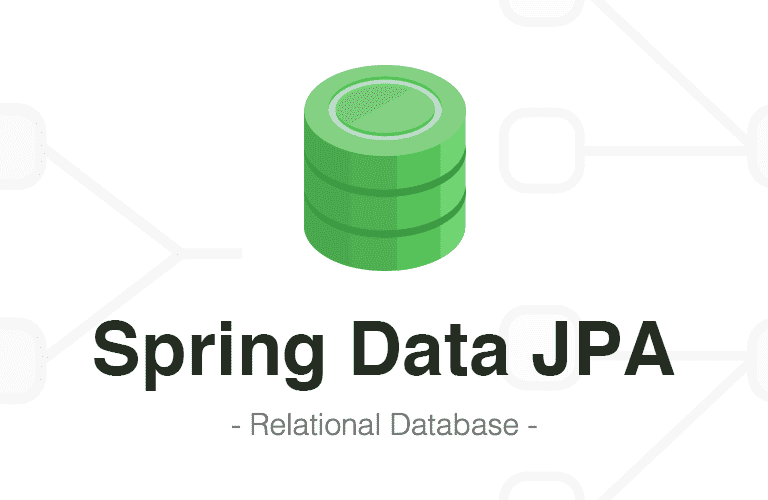

## Difference Between save() and saveAndFlush() in Spring Data JPA

---

게시글 수정 작업을 구현하면서 자동완성을 누르면서 save()가 들어갔다. 이러한 상황을 모른상태로 API를 호출하여 테스트하는데 이상한 상황이 발생했다...

게시글은 수정하여 Response는 updated\_at에 값이 들어가지 않았다... 코드를 잘못썻나? 하고 Dto와 Entity 코드를 유심히 살펴보았다... 하지만 범인은 가까운 곳에 있었다... (스포 금지!)

이러한 실수를 다시 하지 않기 위해 이 글을 작성하게 되었다.

아래 과정은 모두 @Transaction 어노테이션이 붙었을 때 상황이다.

### 업데이트를 save 메소드를 사용하는 경우

---

#### 저장 : save()

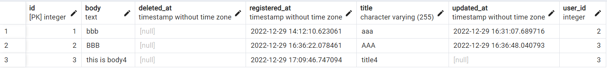

다음과 같이 처음 저장할 경우, register\_at에 현재 시간이 저장되게 된다.

#### 수정 : save()

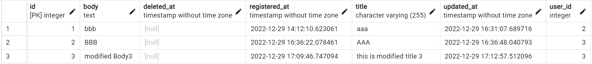

다음과 같이 수정 작업이 이뤄진 시간을 최신화하여 updated\_at에 반영된다.

API 호출을 통해 Response로 받은 결과는 DB에 저장된 정보와 일치하지 않는다.

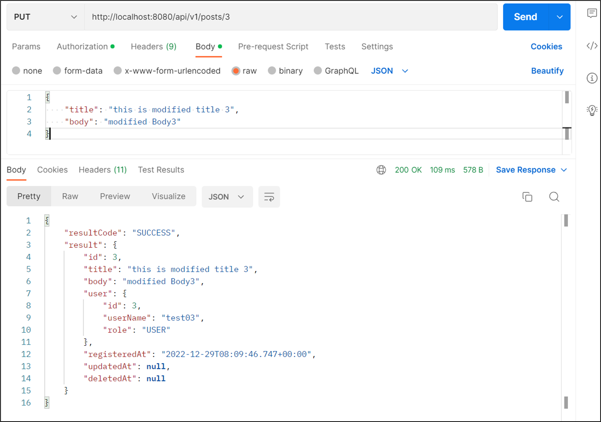

> 코드가 문제인가라고 생각할 수 있지만  
> 정답은 save와 saveAndFlush() 차이다.

### 업데이트를 saveAndFlush() 메소드를 사용하는 경우

---

#### 저장 : save()

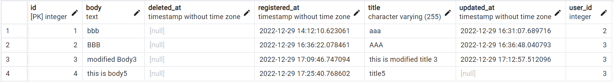

#### 수정 : saveAndFlush()

saveAndFlush() 메소드를 통해 반환되는 Response에 updatedAt이 나타나는 원하는 결과를 확인할 수 있다. 

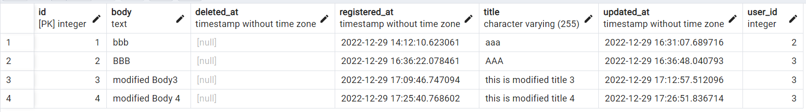
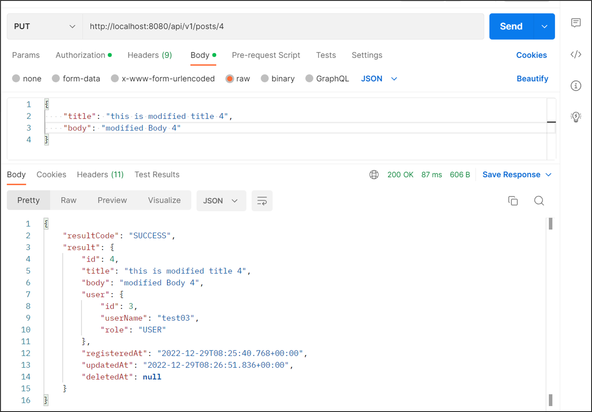

### Save VS SaveAndFlush()

---

* [[선행 학습] JPA 동작원리](tistory-299.html)

#### **save() 메소드**

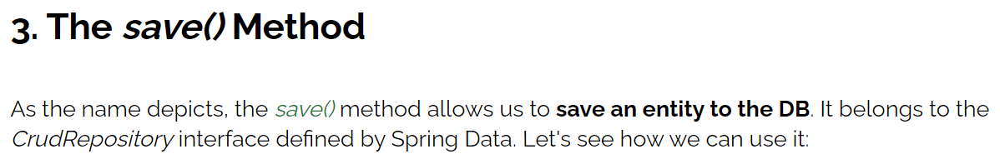

> 엔티티를 DB에 저장하는 기능을 수행한다. save() 메소드는 Spring Data 에서 정의한 CrudRepository 인터페이스의 메소드이다.

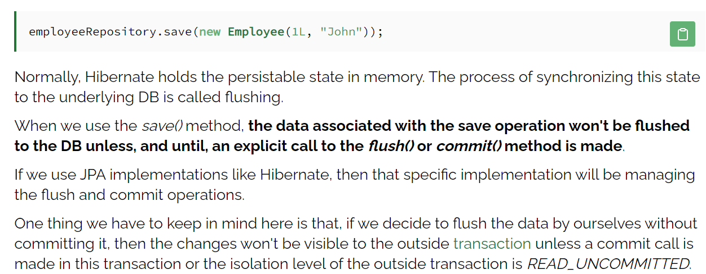

> 일반적으로 Hibernate는 지속 가능한 상태를 메모리에 유지합니다. 이 상태를 기본 DB에 동기화하는 프로세스를 플러시라고 합니다. save() 메서드를 사용할 때 저장 작업과 관련된 데이터는 flush() 또는 commit() 메서드를 명시적으로 호출하지 않는 한 DB로 플러시되지 않습니다. Hibernate와 같은 JPA 구현을 사용하는 경우 해당 특정 구현이 flush 및 commit 작업을 관리하게 됩니다. 여기서 한 가지 명심해야 할 점은 커밋하지 않고 데이터를 직접 플러시하기로 결정한 경우 이 트랜잭션 또는 격리 수준에서 커밋 호출이 이루어지지 않는 한 변경 사항이 외부 트랜잭션에 표시되지 않는다는 것입니다. 외부 트랜잭션은 READ\_UNCOMMITTED입니다.

정리하면 save() 메소드는 바로 DB 에 저장되지 않고 영속성 컨텍스트에 저장되었다가 flush() 또는 commit() 수행 시 DB에 저장된다.

---

#### **saveAndFlush() 메소드**

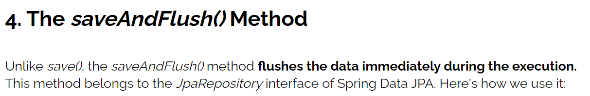

> save() 메소드와는 다르게 saveAndFlush() 메소드는 실행중(트랜잭션)에 즉시 data를 flush 한다.   
> saveAndFlush() 메소드는 Spring Data JPA 에서 정의한 JpaRepository 인터페이스의 메소드이다.

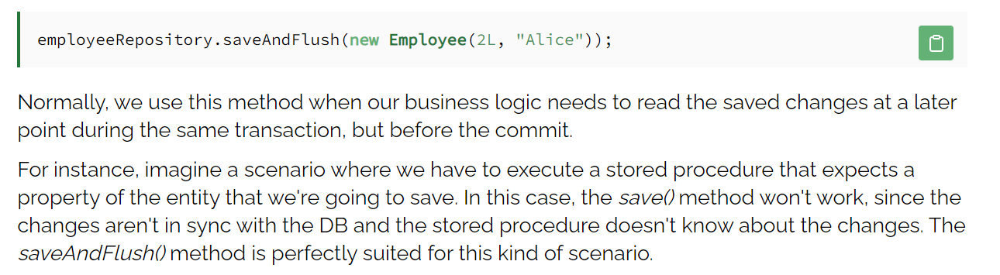

> saveAndFlush() 메소드가 주로 사용되는 상황은, 아직 commit 되지 않은 같은 트랜잭션 내에서 먼저 처리된 결과를 후에 사용할 때 사용된다. 예를 들어, 우리가 저장할 예정인 entity 의 속성을 기대하는(참조할 예정인) 스토어드 프로시저가 실행되어야 될때 save() 메소드는 db에 동기화 시키지 않았기 때문에 스토어드 프로시저는 변경 사항을 알 수가 없고, 이로인해 제대로 동작하지 않는다.

---

#### **정리**

* save() 메소드는 영속성 컨텍스트에 저장하는 것이고 실제로 DB 에 저장은 추후 flush 또는 commit 메소드가 실행될 때 이루어진다.
* saveAndFlush() 메소드는 즉시 DB 에 데이터를 반영된다.

**참고**

* **[Baeldung]** [**Difference Between save() and saveAndFlush() in Spring Data JPA**](https://www.baeldung.com/spring-data-jpa-save-saveandflush)
