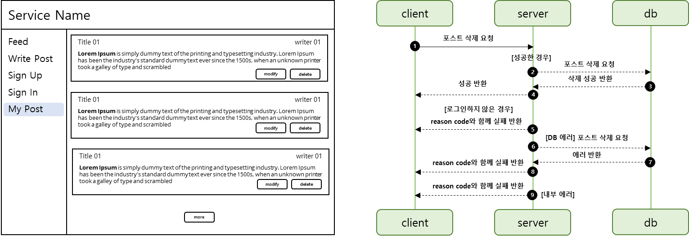
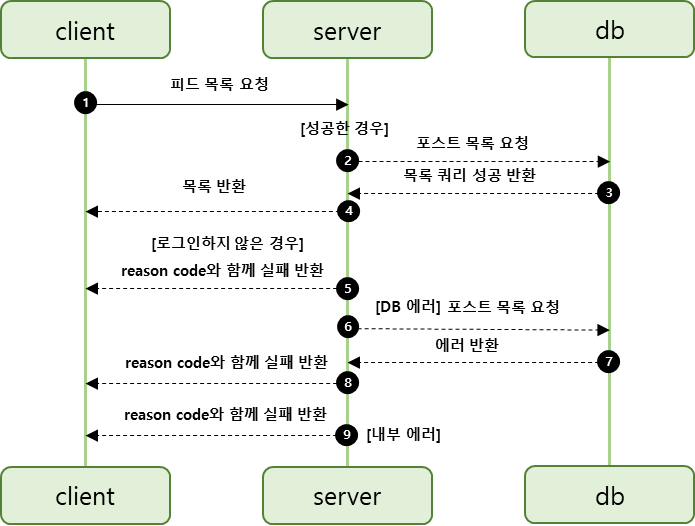

## 포스트 삭제

---

### 테스트

---



MyPost 페이지에 사용자가 작성한 글에 대해 수정과 삭제 권한이 부여된다.

요구사항을 바탕으로 오른쪽 그림과 같이 Sequence Diagram을 그려보면 삭제기능도 동일하게 4가지 상황을 생각할 수 있다.

* 성공
* 실패
  + 로그인을 하지 않은 경우
  + 데이터베이스 에러
  + 내부 에러

#### Controller

**포스트 삭제 성공**

```java
@Test
@WithMockUser
void 포스트삭제() throws Exception {
    mvc.perform(delete("/api/v1/posts/1")
                    .contentType(MediaType.APPLICATION_JSON)
            ).andDo(print())
            .andExpect(status().isOk());
}
```

**포스트 삭제시 로그인하지 않은 경우**

```java
@Test
@WithAnonymousUser
void 포스트삭제시_로그인하지않은_경우() throws Exception {
    mvc.perform(delete("/api/v1/posts/1")
                    .contentType(MediaType.APPLICATION_JSON)
            ).andDo(print())
            .andExpect(status().isUnauthorized());
}
```

**포스트 삭제시 작성자와 삭제 요청자가 다른 경우**

```java
@Test
@WithMockUser
void 포스트삭제시_작성자와_삭제요청자가_다른경우() throws Exception {
    // mocking
    doThrow(new SnsApplicationException(ErrorCode.INVALID_PERMISSION)).when(postService).delete(any(), any());

    mvc.perform(delete("/api/v1/posts/1")
                    .contentType(MediaType.APPLICATION_JSON)
            ).andDo(print())
            .andExpect(status().isUnauthorized());
}
```

**포스트 삭제시 삭제하려는 포스트가 존재하지 않은 경우**

```java
@Test
@WithMockUser
void 포스트삭제시_삭제하려는_포스트가_존재하지않은경우() throws Exception {
    // mocking
    doThrow(new SnsApplicationException(ErrorCode.POST_NOT_FOUND)).when(postService).delete(any(), any());

    mvc.perform(delete("/api/v1/posts/1")
                    .contentType(MediaType.APPLICATION_JSON)
            ).andDo(print())
            .andExpect(status().isNotFound());
}
```

---

#### **Service**

**포스트 삭제가 성공한 경우**

```java
@Test
void 포스트삭제가_성공한경우() {
    String username = "username";
    Integer postId = 1;

    PostEntity postEntity = PostEntityFixture.get(username, postId, 1);
    UserEntity user = postEntity.getUser();

    when(userEntityRepository.findByUsername(username)).thenReturn(Optional.of(user));
    when(postEntityRepository.findById(postId)).thenReturn(Optional.of(postEntity));

    Assertions.assertDoesNotThrow(() -> postService.delete(username, postId));
}
```

**포스트 삭제시 포스트가 존재하지 않는 경우**

```java
@Test
void 포스트삭제시_포스트가_존재하지않는_경우() {
    String username = "username";
    Integer postId = 1;

    PostEntity postEntity = PostEntityFixture.get(username, postId, 1);
    UserEntity user = postEntity.getUser();

    when(userEntityRepository.findByUsername(username)).thenReturn(Optional.of(user));
    when(postEntityRepository.findById(postId)).thenReturn(Optional.empty());

    SnsApplicationException e = assertThrows(SnsApplicationException.class, () -> postService.delete(username, postId));
    Assertions.assertEquals(ErrorCode.POST_NOT_FOUND, e.getErrorCode());
}
```

**포스트 삭제시 권한이 없는 경우**

```java
@Test
void 포스트삭제시_권한이_없는_경우() {
    String username = "username";
    Integer postId = 1;

    PostEntity postEntity = PostEntityFixture.get(username, postId, 1);
    UserEntity writer = UserEntityFixture.get("username1", "password1", 2);

    when(userEntityRepository.findByUsername(username)).thenReturn(Optional.of(writer));
    when(postEntityRepository.findById(postId)).thenReturn(Optional.of(postEntity));

    SnsApplicationException e = assertThrows(SnsApplicationException.class, () -> postService.delete(username, postId));
    Assertions.assertEquals(ErrorCode.INVALID_PERMISSION, e.getErrorCode());
}
```

### **구현**

---

#### **Controller**

```java
@DeleteMapping("/{postId}")
public Response<Void> delete(@PathVariable Integer postId, Authentication authentication) {
    postService.delete(authentication.getName(), postId);

    return Response.success();
}
```

#### **Service**

```java
@Transactional
public void delete(String username, Integer postId){
    UserEntity userEntity = userEntityRepository.findByUsername(username)
            .orElseThrow(() -> new SnsApplicationException(ErrorCode.USER_NOT_FOUND, String.format("%s not founded", username)));

    PostEntity postEntity = postEntityRepository.findById(postId)
            .orElseThrow(() -> new SnsApplicationException(ErrorCode.POST_NOT_FOUND, String.format("%s not founded", postId)));

    if (postEntity.getUser() != userEntity) {
        throw new SnsApplicationException(ErrorCode.INVALID_PERMISSION, String.format("%s has no permission with %s", username, postId));
    }

    postEntityRepository.delete(postEntity);
}
```

> Post 등록, 수정, 삭제 작업을 진행하면서 느끼는 것은  
> 동일한 패턴으로 반복되어 생산성이 향상됨을 느낄 수 있다.

---

## 피드 목록

---

### **테스트**

---

화면기획서를 통해 알 수 있듯이 피드 목록 기능은 두 가지타입이 있다.

하나는 **Feed**(전체 피드 목록), 다른 하나는 **MyPost**(작성자가 본인인 피드 목록)이다.




피드 목록에 경우도 마찬가지로 성공하는 경우와 실패하는 경우가 있다. 실패하는 경우를 제외한 경우는 성공하는 경우이므로 실패하는 경우를 먼저 생각하면 된다.

1. 로그인을 하지 않은 경우

2. DB 에러

3. 내부 에러

DB 에러와 내부 에러가 모호하지만 테스트 코드 구현을 통해 정의하도록 하도록 하겠다.

#### **Controller TEST**

**피드 목록**

```java
@Test
@WithMockUser
void 피드목록() throws Exception {
    when(postService.list(any())).thenReturn(Page.empty());

    mvc.perform(get("/api/v1/posts")
                    .contentType(MediaType.APPLICATION_JSON)
            ).andDo(print())
            .andExpect(status().isOk());
}
```

**피드목록 요청시 로그인하지 않은 경우**

```java
@Test
@WithAnonymousUser
void 피드목록_요청시_로그인하지않은_경우() throws Exception {
    when(postService.list(any())).thenReturn(Page.empty());

    mvc.perform(get("/api/v1/posts")
                    .contentType(MediaType.APPLICATION_JSON)
            ).andDo(print())
            .andExpect(status().isUnauthorized());
}
```

**내피드목록**

```java
@Test
@WithMockUser
void 내피드목록() throws Exception {
    when(postService.mypost(any(), any())).thenReturn(Page.empty());

    mvc.perform(get("/api/v1/posts/my")
                    .contentType(MediaType.APPLICATION_JSON)
            ).andDo(print())
            .andExpect(status().isOk());
}
```

**내피드목록 요청시 로그인하지 않은 경우**

```java
@Test
@WithAnonymousUser
void 내피드목록_요청시_로그인하지않은_경우() throws Exception {
    when(postService.mypost(any(), any())).thenReturn(Page.empty());

    mvc.perform(get("/api/v1/posts/my")
                    .contentType(MediaType.APPLICATION_JSON)
            ).andDo(print())
            .andExpect(status().isUnauthorized());
}
```

---

#### **Service TEST**

**피드 목록 요청이 성공한 경우**

```java
@Test
void 피드목록요청이_성공한경우() {
    Pageable pageable = mock(Pageable.class);

    when(postEntityRepository.findAll(pageable)).thenReturn(Page.empty());
    Assertions.assertDoesNotThrow(() -> postService.list(pageable));
}
```

**내피드 목록 요청이 성공한 경우**

```java
@Test
void 내피드목록요청이_성공한경우() {
    UserEntity user = mock(UserEntity.class);
    Pageable pageable = mock(Pageable.class);

    when(userEntityRepository.findByUsername(any())).thenReturn(Optional.of(user));
    when(postEntityRepository.findAllByUser(user, pageable)).thenReturn(Page.empty());
    Assertions.assertDoesNotThrow(() -> postService.mypost("", pageable));
}
```

### **구현**

---

#### **Controller**

```java
@GetMapping
public Response<Page<PostResponse>> list(Pageable pageable, Authentication authentication) {
    return Response.success(postService.list(pageable).map(PostResponse::fromPost));
}

@GetMapping("/my")
public Response<Page<PostResponse>> myPost(Pageable pageable, Authentication authentication) {
    return Response.success(postService.mypost(authentication.getName(), pageable).map(PostResponse::fromPost));
}
```

#### **Service**

```java
@Transactional(readOnly = true)
public Page<Post> list(Pageable pageable) {
    return postEntityRepository.findAll(pageable).map(Post::fromEntity);
}

@Transactional(readOnly = true)
public Page<Post> mypost(String username, Pageable pageable) {
    UserEntity userEntity = userEntityRepository.findByUsername(username)
            .orElseThrow(() -> new SnsApplicationException(ErrorCode.USER_NOT_FOUND, String.format("%s not founded", username)));

    return postEntityRepository.findAllByUser(userEntity, pageable).map(Post::fromEntity);
}
```
