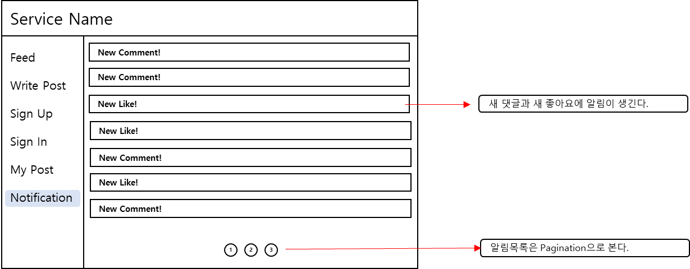
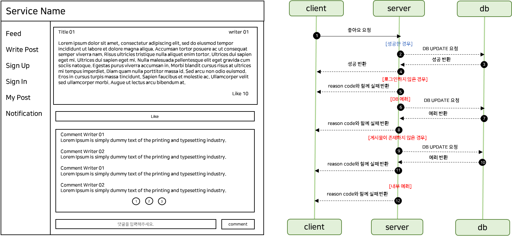
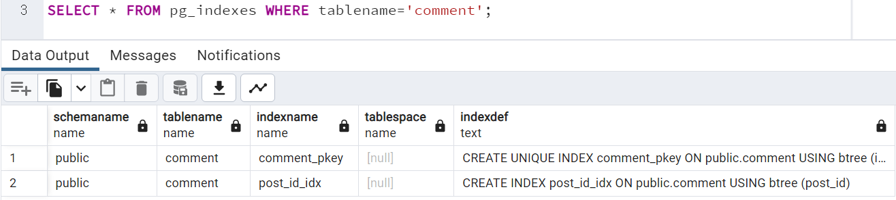
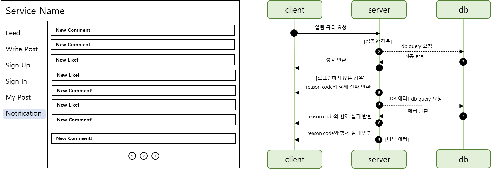

## SNS 어플리케이션 발전시키기

---

### **요구사항 분석**

---

#### **상세 피드 페이지**


**추가 기능**

* 좋아요 기능
* 댓글 기능 + 댓글 Pagination

---

#### **알림 페이지**



**추가 기능**

* 자신의 게시글에 대한 좋아요와 댓글에 대한 알림 메시지가 전달된다.
* 알림 목록은 Pagination 처리가 된다.

---

#### **API 분석**

| **Page** | **API NAME** | **Function** |
| --- | --- | --- |
| Post Detail Page | Comment List API | **·** 특정 글의 댓글 목록을 보여주는 API  **·** Paging 및 정렬 필요 **·** 작성자 및 댓글 |
| Comment Write API | **·** 댓글을 작성할 수 있는 API **·** 로그인한 사람만 작성이 가능하고 작성자만 댓글을 받는다. |
| LikeCount API | · 해당 글에 좋아요한 갯수를 보여주는 API |
| Like API | **·** 해당 글에 좋아요를 하는 API **·** 좋아요는 한번만 누를 수 있다. |
| Notification Page | Notification List API | · 알림 목록을 보여주는 API |

---

#### **Architecture 설계**


기존 설계한 Architecture는 변하지 않고 데이터베이스에 들어가는 데이터가 추가된다.

데이터는 댓글, 좋아요, 알림 기능이 추가됨에 따라 데이터를 함께 추가만 해주면 된다.


### 좋아요 기능

---

#### **시나리오 분석**



화면 기획서에서 분석한 기능을 바탕으로 Sequence Diagram을 그리면 5가지 상황을 생각할 수 있다.

* 로그인하지 않은 경우
* DB 에러
* 게시물이 존재하지 않은 경우
* 내부 에러
* 이외에 경우 성공 처리

---

#### **테스트 작성**

테스트 기능 자체는 로그인하지 않은 경우와 게시물이 존재하지 않은 경우에 대해 테스트를 작성해보려 한다.

**Controller 테스트**

```java
@Test
@WithMockUser
void 좋아요기능() throws Exception {
    mvc.perform(post("/api/v1/posts/1/likes")
                    .contentType(MediaType.APPLICATION_JSON)
            ).andDo(print())
            .andExpect(status().isOk());
}

@Test
@WithAnonymousUser
void 좋아요버튼클릭시_로그인하지_않은경우() throws Exception {
    mvc.perform(post("/api/v1/posts/1/likes")
                    .contentType(MediaType.APPLICATION_JSON)
            ).andDo(print())
            .andExpect(status().isUnauthorized());
}

@Test
@WithMockUser
void 좋아요버튼클릭시_게시물이_없는경우() throws Exception {
    doThrow(new SnsApplicationException(ErrorCode.POST_NOT_FOUND)).when(postService).like(any(), any());

    mvc.perform(post("/api/v1/posts/1/likes")
                    .contentType(MediaType.APPLICATION_JSON)
            ).andDo(print())
            .andExpect(status().isNotFound());
}

@Test
@WithMockUser
void 좋아요개수요청_성공() throws Exception {
    mvc.perform(get("/api/v1/posts/1/likes")
                    .contentType(MediaType.APPLICATION_JSON)
            ).andDo(print())
            .andExpect(status().isOk());
}

@Test
@WithMockUser
void 좋아요개수요청시_게시물이_없는경우() throws Exception {
    doThrow(new SnsApplicationException(ErrorCode.POST_NOT_FOUND)).when(postService).likeCount(any());

    mvc.perform(get("/api/v1/posts/1/likes")
                    .contentType(MediaType.APPLICATION_JSON)
            ).andDo(print())
            .andExpect(status().isNotFound());
}
```

**Service 테스트**

```java
@Test
void 좋아요요청이_성공한경우() {
    Integer postId = 1;
    String username = "username";
    UserEntity user = mock(UserEntity.class);
    PostEntity post = mock(PostEntity.class);

    when(userEntityRepository.findByUsername(any())).thenReturn(Optional.of(user));
    when(postEntityRepository.findById(postId)).thenReturn(Optional.of(post));
    when(likeEntityRepository.findByUserAndPost(user, post)).thenReturn(Optional.empty());

    Assertions.assertDoesNotThrow(() -> postService.like(postId, username));
}

@Test
void 좋아요요청시_포스트가_존재하지않는_경우() {
    Integer postId = 1;
    String username = "username";
    UserEntity user = mock(UserEntity.class);
    PostEntity post = mock(PostEntity.class);

    when(userEntityRepository.findByUsername(any())).thenReturn(Optional.of(user));
    when(postEntityRepository.findById(postId)).thenReturn(Optional.empty());
    when(likeEntityRepository.findByUserAndPost(user, post)).thenReturn(Optional.empty());

    SnsApplicationException e = assertThrows(SnsApplicationException.class, () -> postService.like(postId, username));
    Assertions.assertEquals(ErrorCode.POST_NOT_FOUND, e.getErrorCode());
}

@Test
void 좋아요요청시_이미좋아요한_게시물인경우() {
    Integer postId = 1;
    String username = "username";
    UserEntity user = mock(UserEntity.class);
    PostEntity post = mock(PostEntity.class);
    LikeEntity like = mock(LikeEntity.class);

    when(userEntityRepository.findByUsername(any())).thenReturn(Optional.of(user));
    when(postEntityRepository.findById(postId)).thenReturn(Optional.of(post));
    when(likeEntityRepository.findByUserAndPost(user, post)).thenReturn(Optional.of(like));

    SnsApplicationException e = assertThrows(SnsApplicationException.class, () -> postService.like(postId, username));
    Assertions.assertEquals(ErrorCode.ALREADY_LIKED, e.getErrorCode());
}

@Test
void 좋아요개수요청이_성공한경우() {
    Integer postId = 1;
    String username = "username";
    UserEntity user = mock(UserEntity.class);
    PostEntity post = mock(PostEntity.class);

    when(userEntityRepository.findByUsername(any())).thenReturn(Optional.of(user));
    when(postEntityRepository.findById(postId)).thenReturn(Optional.of(post));
    when(likeEntityRepository.findByUserAndPost(user, post)).thenReturn(Optional.empty());

    Assertions.assertDoesNotThrow(() -> postService.like(postId, username));
}
```

---

#### **기능 구현**

**Controller**

```java
@PostMapping("/{postId}/likes")
public Response<Void> like(@PathVariable Integer postId, Authentication authentication){
    postService.like(postId, authentication.getName());

    return Response.success();
}

@GetMapping("/{postId}/likes")
public Response<Integer> likeCount(@PathVariable Integer postId, Authentication authentication){
    return Response.success(postService.likeCount(postId));
}
```

**Service**

```java
@Transactional
public void like(Integer postId, String username){
    UserEntity userEntity = userEntityRepository.findByUsername(username)
            .orElseThrow(() -> new SnsApplicationException(ErrorCode.USER_NOT_FOUND, String.format("%s not founded", username)));

    PostEntity postEntity = postEntityRepository.findById(postId)
            .orElseThrow(() -> new SnsApplicationException(ErrorCode.POST_NOT_FOUND, String.format("%s not founded", postId)));

    // check liked -> throw
    likeEntityRepository.findByUserAndPost(userEntity, postEntity).ifPresent(it -> {
        throw new SnsApplicationException(ErrorCode.ALREADY_LIKED, String.format("%s already liked post %d", username, postId));
    });

    // like save
    likeEntityRepository.save(LikeEntity.of(userEntity, postEntity));
}

@Transactional
public int likeCount(Integer postId){
    PostEntity postEntity = postEntityRepository.findById(postId)
            .orElseThrow(() -> new SnsApplicationException(ErrorCode.POST_NOT_FOUND, String.format("%s not founded", postId)));

    // count like
    // AS-IS
    // List<LikeEntity> likeEntities = likeEntityRepository.findAllByPost(postEntity);
    // return likeEntities.size();

    // TO-BE
    return likeEntityRepository.countByPost(postEntity);
}
```

> 좋아요 개수를 파악하는 방법으로 JPA를 이용할 수 있지만, PostgreSQL에 간단한 Query를 이용해서 쉽게 구할 수 있다.

#### 

### 댓글 기능

---


댓글 기능도 좋아요 기능과 마찬가지로 5가지로 나뉜다.

* 로그인하지 않은 경우
* DB 에러
* 게시물이 존재하지 않은 경우
* 내부 에러
* 이외에 경우 성공 처리

#### **테스트**

**Controller**

```java
@Test
@WithMockUser
void 댓글기능() throws Exception {
    String comment = "comment";

    mvc.perform(post("/api/v1/posts/1/comments")
                    .contentType(MediaType.APPLICATION_JSON)
                    .content(objectMapper.writeValueAsBytes(PostCommentRequest.of(comment)))
            ).andDo(print())
            .andExpect(status().isOk());
}

@Test
@WithAnonymousUser
void 댓글작성시_로그인하지_않은경우() throws Exception {
    String comment = "comment";

    mvc.perform(post("/api/v1/posts/1/comments")
                    .contentType(MediaType.APPLICATION_JSON)
                    .content(objectMapper.writeValueAsBytes(PostCommentRequest.of(comment)))
            ).andDo(print())
            .andExpect(status().isUnauthorized());
}

@Test
@WithMockUser
void 댓글작성시_게시물이_없는경우() throws Exception {
    String comment = "comment";

    doThrow(new SnsApplicationException(ErrorCode.POST_NOT_FOUND)).when(postService).comment(any(), any(), any());

    mvc.perform(post("/api/v1/posts/1/comments")
                    .contentType(MediaType.APPLICATION_JSON)
                    .content(objectMapper.writeValueAsBytes(PostCommentRequest.of(comment)))
            ).andDo(print())
            .andExpect(status().isNotFound());
}
```

**Service**

```java
@Test
void 댓글생성이_성공한경우(){
    Integer postId = 1;
    String comment = "comment";
    UserEntity user = mock(UserEntity.class);
    PostEntity post = mock(PostEntity.class);

    when(userEntityRepository.findByUsername(any())).thenReturn(Optional.of(user));
    when(postEntityRepository.findById(postId)).thenReturn(Optional.of(post));

    Assertions.assertDoesNotThrow(() -> postService.comment(postId, "username", comment));
}

@Test
void 댓글생성시_포스트가_존재하지않는_경우() {
    Integer postId = 1;
    String comment = "comment";
    UserEntity user = mock(UserEntity.class);

    when(userEntityRepository.findByUsername(any())).thenReturn(Optional.of(user));
    when(postEntityRepository.findById(postId)).thenReturn(Optional.empty());

    SnsApplicationException e = assertThrows(SnsApplicationException.class, () -> postService.comment(postId, "username", comment));
    Assertions.assertEquals(ErrorCode.POST_NOT_FOUND, e.getErrorCode());
}

@Test
void 댓글생성시_요청한유저가_존재하지않은경우() {
    Integer postId = 1;
    String comment = "comment";
    PostEntity post = mock(PostEntity.class);

    when(userEntityRepository.findByUsername(any())).thenReturn(Optional.empty());
    when(postEntityRepository.findById(postId)).thenReturn(Optional.of(post));

    SnsApplicationException e = assertThrows(SnsApplicationException.class, () -> postService.comment(postId, "username", comment));
    Assertions.assertEquals(ErrorCode.USER_NOT_FOUND, e.getErrorCode());
}

@Test
void 댓글리스트요청시_성공한경우() {
    Integer postId = 1;
    PostEntity post = mock(PostEntity.class);
    Pageable pageable = mock(Pageable.class);

    when(postEntityRepository.findById(postId)).thenReturn(Optional.of(post));
    when(commentEntityRepository.findAllByPost(post, pageable)).thenReturn(Page.empty());

    Assertions.assertDoesNotThrow(() -> postService.getComments(postId, pageable));
}
```

---

#### **기능 구현**

**Controller**

```java
@PostMapping("/{postId}/comments")
public Response<Void> comment(@PathVariable Integer postId, @RequestBody PostCommentRequest request, Authentication authentication) {
    postService.comment(postId, authentication.getName(), request.getComment());

    return Response.success();
}

@GetMapping("/{postId}/comments")
public Response<Page<CommentResponse>> comment(@PathVariable Integer postId, Pageable pageable, Authentication authentication) {
    return Response.success(postService.getComments(postId, pageable).map(CommentResponse::fromComment));
}
```

**Service**

@Before

```java
@Transactional
public void comment(Integer postId, String username, String comment) {
    UserEntity userEntity = userEntityRepository.findByUsername(username)
            .orElseThrow(() -> new SnsApplicationException(ErrorCode.USER_NOT_FOUND, String.format("%s not founded", username)));

    PostEntity postEntity = postEntityRepository.findById(postId)
            .orElseThrow(() -> new SnsApplicationException(ErrorCode.POST_NOT_FOUND, String.format("%s not founded", postId)));

    // comment save
    commentEntityRepository.save(CommentEntity.of(userEntity, postEntity, comment));
}

public Page<Comment> getComments(Integer postId, Pageable pageable) {
    PostEntity postEntity = postEntityRepository.findById(postId)
            .orElseThrow(() -> new SnsApplicationException(ErrorCode.POST_NOT_FOUND, String.format("%s not founded", postId)));

    return commentEntityRepository.findAllByPost(postEntity, pageable).map(Comment::fromEntity);
}
```

현재 PostService 코드에 저장소에서 Entity를 부르는 코드가 중복되어 사용되고 있어 리팩토링을 통해 중복을 제거하여 가독성 향상

@After

```java
@Transactional
public void comment(Integer postId, String username, String comment) {
    UserEntity userEntity = getUserEntityOrException(username);

    PostEntity postEntity = getPostEntityOrException(postId);

    // comment save
    commentEntityRepository.save(CommentEntity.of(userEntity, postEntity, comment));
}


public Page<Comment> getComments(Integer postId, Pageable pageable) {
    PostEntity postEntity = getPostEntityOrException(postId);

    return commentEntityRepository.findAllByPost(postEntity, pageable).map(Comment::fromEntity);
}

// post exist
private PostEntity getPostEntityOrException(Integer postId) {
    return postEntityRepository.findById(postId)
            .orElseThrow(() -> new SnsApplicationException(ErrorCode.POST_NOT_FOUND, String.format("%s not founded", postId)));
}

// user exist
private UserEntity getUserEntityOrException(String username) {
    return userEntityRepository.findByUsername(username)
            .orElseThrow(() -> new SnsApplicationException(ErrorCode.USER_NOT_FOUND, String.format("%s not founded", username)));
}
```

---

#### **정리**

* **INDEX를 설정하여 DB 성능 향상**  
  디폴트로 기존 PK에 대해서만 INDEX 설정이 되어 있는데 해당 테이블에 연관정보를 통해 해당 테이블을 조회하는 경우 인덱스 설정을 통해 성능 향상시킬 수 있다. 연관정보뿐만아니라 필드에 대해서도 설정 가능하다.  

  예시) Page<PostEntity> findAllByUser(UserEntity entity, Pageable pageable);  
  PostSQL에서는 다음과 같이 테이블에 index 정보를 확인할 수 있다.



* **중복된 메소드 호출을 추출하여 간결화**

### **알림 기능**

---



알림 기능은 다음과 같이 4가지 케이스를 생각할 수 있습니다.

* 로그인하지 않은 경우
* DB 에러
* 내부 에러
* 이외에 경우 성공으로 처리

#### **테스트 구현**

**Controller**

```java
@Test
@WithMockUser
void 알람기능() throws Exception{
    when(userService.alarmList(any(), any())).thenReturn(Page.empty());
    mvc.perform(get("/api/v1/users/alarm")
            .contentType(MediaType.APPLICATION_JSON)
            ).andDo(print())
            .andExpect(status().isOk());
}

@Test
@WithAnonymousUser
void 알람리스트요청시_로그인하지_않은경우() throws Exception{
    when(userService.alarmList(any(), any())).thenReturn(Page.empty());
    mvc.perform(get("/api/v1/users/alarm")
                    .contentType(MediaType.APPLICATION_JSON)
            ).andDo(print())
            .andExpect(status().isUnauthorized());
}
```

**Service**

Service 테스트는 두가지로 UserService와 PostService에 모두 테스트해주어야합니다.

첫번째 - 알림이 생성되는 경우는 댓글과 좋아요 기능이 활성화될 때 같이 생성됩니다.

```java
@Test
void 알림_댓글생성시_알림메시지전달이_성공한경우(){
    Integer postId = 1;
    String comment = "comment";
    UserEntity user = mock(UserEntity.class);
    PostEntity post = mock(PostEntity.class);
    AlarmEntity alarm = mock(AlarmEntity.class);

    when(userEntityRepository.findByUsername(any())).thenReturn(Optional.of(user));
    when(postEntityRepository.findById(postId)).thenReturn(Optional.of(post));
    when(alarmEntityRepository.save(AlarmEntity.of(post.getUser(), AlarmType.NEW_COMMENT_ON_POST, new AlarmArgs(user.getId(), post.getId()))))
            .thenReturn(alarm);

    Assertions.assertDoesNotThrow(() -> postService.comment(postId, "username", comment));
}

@Test
void 알림_좋아요버튼클릭시_알림메시지전달이_성공한경우(){
    Integer postId = 1;
    String comment = "comment";
    UserEntity user = mock(UserEntity.class);
    PostEntity post = mock(PostEntity.class);
    AlarmEntity alarm = mock(AlarmEntity.class);

    when(userEntityRepository.findByUsername(any())).thenReturn(Optional.of(user));
    when(postEntityRepository.findById(postId)).thenReturn(Optional.of(post));
    when(alarmEntityRepository.save(AlarmEntity.of(post.getUser(), AlarmType.NEW_LIKE_ONE_POST, new AlarmArgs(user.getId(), post.getId())))).thenReturn(alarm);

    Assertions.assertDoesNotThrow(() -> postService.comment(postId, "username", comment));
}
```

두번째 - 알림 리스트를 요청하는 Service는 UserService이므로 UserServiceTest에서 진행해주어야합니다.

```java
@Test
void 알람리스트요청_정상적으로_동작하는_경우(){
    String username = "username";
    Pageable pageable = mock(Pageable.class);
    UserEntity fixture = UserEntityFixture.get(username, "", 1);

    //mocking
    when(userEntityRepository.findByUsername(username)).thenReturn(Optional.of(fixture));
    when(alarmEntityRepository.findAllByUser(fixture, pageable)).thenReturn(Page.empty());

    Assertions.assertDoesNotThrow(() -> userService.alarmList(username, pageable));
}
```

---

#### **기능 구현**

**Controller**

컨트롤러는 알림 리스트 조회에 기능만 구현됩니다.

```java
@GetMapping("/alarm")
public Response<Page<AlarmResponse>> alarm(Pageable pageable, Authentication authentication){
    return Response.success(userService.alarmList(authentication.getName(), pageable).map(AlarmResponse::fromAlarm));
}
```

**UserService**

```java
public Page<Alarm> alarmList(String username, Pageable pageable) {
    UserEntity userEntity = userEntityRepository.findByUsername(username)
            .orElseThrow(() -> new SnsApplicationException(ErrorCode.USER_NOT_FOUND, String.format("%s not founded", username)));

    return alarmEntityRepository.findAllByUser(userEntity, pageable).map(Alarm::fromEntity);
}
```

**PostService**

```java
@Transactional
public void comment(Integer postId, String username, String comment) {
UserEntity userEntity = getUserEntityOrException(username);

PostEntity postEntity = getPostEntityOrException(postId);

// comment save
commentEntityRepository.save(CommentEntity.of(userEntity, postEntity, comment));
alarmEntityRepository.save(AlarmEntity.of(postEntity.getUser(), AlarmType.NEW_COMMENT_ON_POST, new AlarmArgs(userEntity.getId(), postEntity.getId())));
}

@Transactional
public void like(Integer postId, String username){
    UserEntity userEntity = getUserEntityOrException(username);

    PostEntity postEntity = getPostEntityOrException(postId);

    // check liked -> throw
    likeEntityRepository.findByUserAndPost(userEntity, postEntity).ifPresent(it -> {
        throw new SnsApplicationException(ErrorCode.ALREADY_LIKED, String.format("%s already liked post %d", username, postId));
    });

    // like save
    likeEntityRepository.save(LikeEntity.of(userEntity, postEntity));
    alarmEntityRepository.save(AlarmEntity.of(postEntity.getUser(), AlarmType.NEW_LIKE_ONE_POST, new AlarmArgs(userEntity.getId(), postEntity.getId())));
}
```

---

#### **추가 사항**

* **알림 메시지의 확장을 고려하여 타입을 Enum 클래스로 설정**  
  현재 알림 메시지는 댓글과 좋아요 기능에 대해서만 적용되고 있지만 확장될 여지가 있기 때문에 Enum 타입으로 설정
* **알림 메시지 엔티티에 Argument 클래스 필드를 추가하고 Json 타입으로 저장**  
  SNS 서비스에 알림 메시지는 "A가 B 게시글에 좋아요를 눌렀습니다"와 같은 메시지가 존재한다. 이는 기능에 따라 달라지기 때문에 이를 엔티티로 관리하는 것은 어렵다. PostgreSQL에 Json 타입을 사용하기 위해 아래와 같은 의존성을 추가해주었다.

```
implementation 'com.vladmihalcea:hibernate-types-52:2.17.3'
```
