## **대규모 트래픽 고려해보기**

---

### **대규모 트래픽일시 현 architecture의 문제점 분석 및 해결법**

현재 SNS 어플리케이션 서비스를 구현하고 있다.

처음 간단하게 회원가입과 로그인 기능, 포스트 기능(작성, 수정, 삭제, 조회)을 구현하고 추가적으로 댓글, 좋아요, 알림 기능을 추가로 구현하였다. 

> 만약 SNS 어플리케이션 서비스의 이용자들이 늘어나  
> 트래픽이 증가한다고 가정했을 때  
> 어떤 부분에서 문제가 생길 수 있을까?

현재 개발한 SNS 어플리케이션 서비스에 경우에는 기능만을 집중하여 개발하였다. 그래서 대규모 트래픽이나 코드 같은 부분들이 최적화되어 있지 않고 기본적인 부분이 구현이 되어 동작하도록만 구현이 되어있다. 이러한 부분이 아쉽기 때문에 대규모 트래픽이 발생하였을 때 현 아키텍처에 어떠한 문제가 발생할 수 있고, 어떻게 분석하고 해결할 수 있는지 알아보려한다.

현재 서비스 아키텍츠는 다음과 같습니다.


#### **💣 문제점 1 - Token 인증시 user 를 조회하고, 그 이후 또 user를 조회하는 구조**

회원가입 이후 로그인하면 토큰이 발급되고 API 요청할 때마다 Token 정보를 통해 유효한 유저인지 인증하는 과정이 있다.

이 과정에서 토큰을 인증할 때 Filter 부분과 Service 에서 user를 조회하는 작업이 중복해서 발생하여 DB에 IO를 2번 발생시키고 있다.

**로그인 과정**

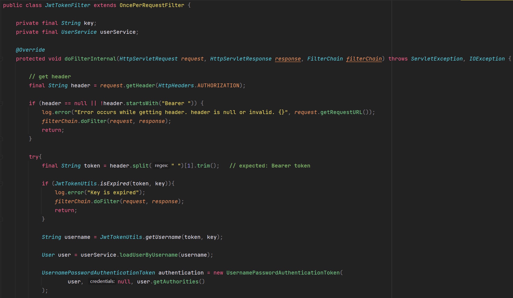

토큰에서 username을 추출하여 username을 조회하는 작업이 이루어지고 있다. 

```java
User user = userService.loadUserByUsername(username);
```

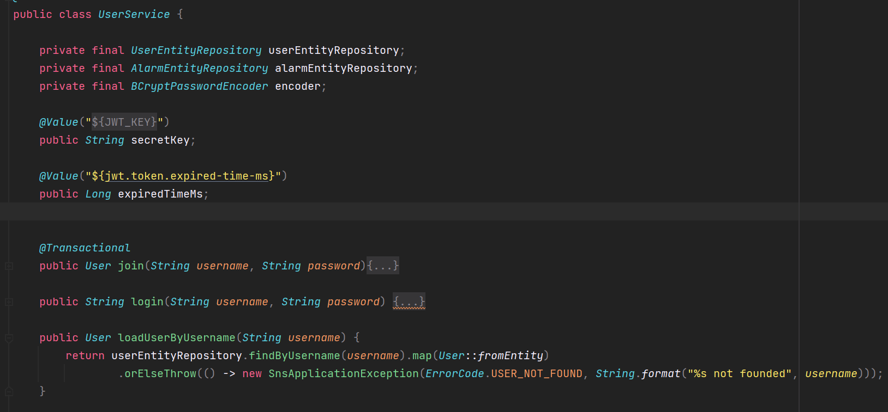

UserService에 loadUserByUsername() 메소드는 Repository에 접근하여 DB를 조회하는 IO 작업이 1회 실행된다.

**API 호출하는 과정(예시 - Post 생성)**

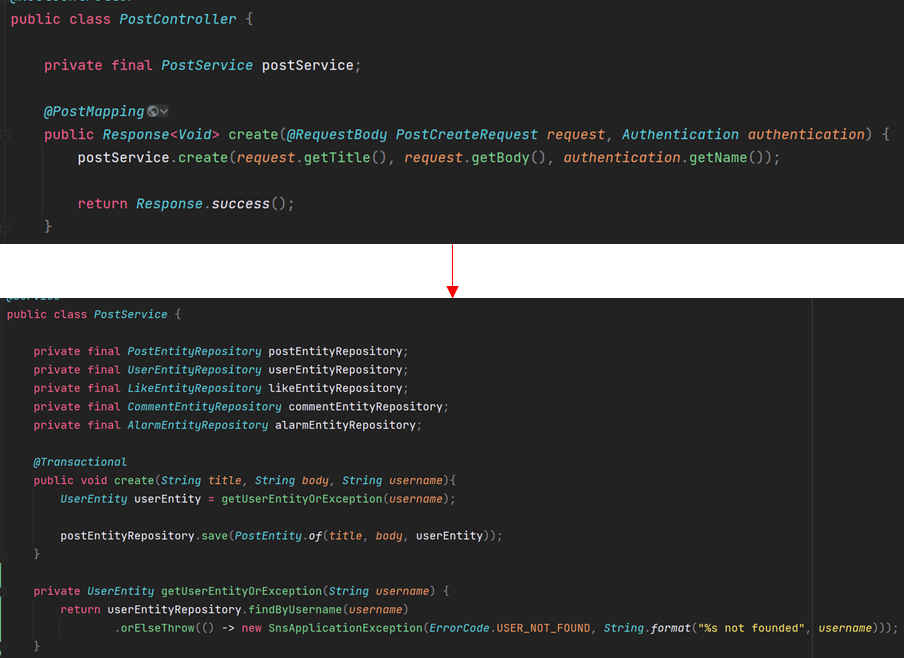

Post 생성 과정에서 user를 조회하는 작업이 발생하고 있다.

JwtTokenFilter에서 user를 한번 체크했기 때문에 이 부분에서 절대 에러가 발생하지 않는다는 것을 알고 있다. 

하지만 Post 생성과정에서 user를 조회하는 작업은 Post 생성시 user 정보를 필요로 하기 때문에 필요한 작업이다.

이 부분을 간단하게 구현할 수 없을까? 한번만 Select 하도록 할 수 없을까? 라는 최적화 방법을 생각 할 수 있다.

이와 같이 대용량을 고민할 때는 최적화가 되어있는지 고민할 필요가 있다.

최적화를 고민해볼때 가장 쉽게 접근할 수 있는 부분이 코드의 중복이 없는지 특히 중복된 부분이 DB를 Select하거나 외부 API를 호출하는 무거운 작업들이라면 반드시 줄여주는 것이 좋다.

=> user를 조회하는 작업이 너무 중복되어 있다.

---

#### **💣 문제점 2 -** **매 API 요청시마다 조회하는 User**

문제점 1과 동일한 이야기이지만 매 API 요청시마다 User를 조회하고 있다. 예를 들어 로그인한 유저가 Post를 작성, 수정, 삭제 작업을 하거나 댓글을 작성하는 등에 작업을 수행할 때마다 User를 조회하는 작업이 반복해서 일어난다.

User라는 정보 자체는 현재 스펙으로는 변경될 일이 없다. User에 name을 변경하거나 password를 변경하는 기능이 없다.

현재 서비스에서 User라는 객체가 만들어지면 변화가 이루어지지 않는 정보인데 이러한 User 정보를 반복해서 조회하는 작업이 이루어지고 있다.

이러한 작업을 줄일 수 없을까? 매번 DB에서 조회하지 않고 조금 더 가볍게 가져올수 있는 방법이 없을까? 라는 고민을 해볼 수 있다.

=> 코드를 분석할 때 어떤 작업이 Cost가 많이드는 작업이고 어떤 작업이 부하가 많이 되는 작업인지를 고려해서 줄여주는 것이 좋다.

---

#### **💣 문제점 3 - Alarm까지 생성해야 하는 응답을 하는 API**

아래 코드는 좋아요 기능에 비즈니스 로직이다.

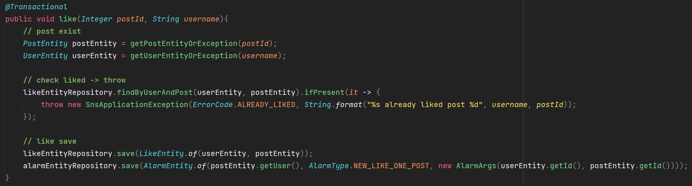

1. Post를 조회하여 존재하는지 파악

2. User를 조회하여 존재하는지 파악

3. 해당 Post에 User가 좋아요 기능을 했는지 조회하여 좋아요한 이력이 남아있다면 에러를 발생시킨다.

4. 좋아요한 기록이 없다면 Post와 User 정보를 함께 저장하여 좋아요를 저장한다.

5. 알람 기능을 저장한다.

이를 비즈니스적으로 생각해보면 

A가 #1 Post에 좋아요를 했을 때 중요한 것은 A가 #1에 좋아요를 했다는 것이다. 

A가 #1 Post에 좋아요를 함으로써 작성자에게 알람이 가는 부분은 즉각적으로 일어날 필요는 없다. 

아래 코드를 통해 예시로 쉽게 설명해보겠다.


> Post를 조회하는 부분에서 지연 발생 → Post Entity를 DB로부터 가져오는데 DB가 작업으로 부하가 많이 걸려 상태라 느진 상태이다. 이로인해 Post를 조회하는 기능이 5초가 걸린다고 생각해보자.  
>   
> 이때 우리는 Post를 조회하는 기능에 5초를 기다려줄 필요가 있을까 라는생각을 할 수 있다.   
> Post에 좋아요 기능을 활성화해야하므로 무조건적으로 필요하다. User를 조회하는 작업 또한 동일한 이유로 필요하다.  
>   
> 좋아요를 조회하는 기능 또한 한번 좋아요한 Post는 중복해서 좋아요 할 수 없다는 비즈니스 로직이기 때문에 기다려야 한다. 좋아요를 저장하는 기능 또한 좋아요 중복을 방지하거나 좋아요 기능을 활성화할 수 있도록 하기 위해 필요하다.  
>   
> 그런데 알람기능에 경우 알림 기능 저장이 5초가 발생한다고 했을 때  
> 5초를 기다리고 User에게 전달하는 것이나 나중으로 빼두었다가 User에 응답하는 것은 동일한 결과이다.   
>   
> 즉 User에게 중요한 것은 해당 Post에 Like 기능을 수행했다는 것이 중요한 것이고   
> 알람을 보내는 작업 자체는 급하게 처리할 필요가 없으며 지연되어도 크게 문제될 것이 없다.   
>   
> 현재 코드는 Like 기능과 Alarm 기능이 강하게 결속되어 있다. 즉 Like라는 행동 자체가 Alarm이 save가 되어야만 완성이 되는 끝나는 작업인데 이러한 작업을 분리해볼수는 없을까? 라는 고민을 해볼수 있다.

=> 관심사 분리가 필요하다.

---

#### **💣**문제점 4 - Alarm List API를 호출해야만 갱신되는 알람 목록

Alram 페이지에서 새로운 알람을 갱신하기 위해서는 새로고침하여 Alarm List API를 재호출하는 방법밖에 없다. 왜냐하면 새로고침하지 않으면 새로운 Alram이 추가되었는지 알수가 없다. 클라이언트 입장에서는 새로운 데이터가 추가되었음을 알수 있는 방법이 없기 때문이다.

페이스북, 인스타그램과 같은 SNS 서비스는 SNS을 읽지 않는 상태에서도 추가적인 알람("OOO님이 좋아요 눌렀습니다")이 발생한다. 채팅 기능 경우도 상대방이 전송한 메시지가 바로바로 전달된다. 이와 같이 구현은 가능하지만 SNS 어플리케이션 서비스는 구현이 되지 않았다.

알람이라는 것은 서비스적으로 생각해보면 새로고침을 통해 받는 것이 아니라 지연이 발생하더라도 자동으로 갱신되는 것을 생각하고 있다. 이와 같은 서비스를 위해서는 현재 API 구조에서 **Alarm List API**를 주기적으로 호출해주어야 한다.

주기적으로 API를 호출하면 서버에 부하가 될 것이다. 왜냐하면 데이터 업데이트가 없을 수 있는데, 2-3 초마다 데이터가 업데이트 되었는지 확인하여 갱신되도록 구현해야하므로 서버에 많은 부하가 발생한다. 

=> 효율적으로 알람 목록을 가져올 수 있는 방법이 필요하다.

---

#### **💣**문제점 5 - 데이터베이스로 날아가는 Query들은 최적화가 되었을까?

Spring Data JPA를 사용하여 개발을 하고 있다. JPA 같은 경우 Query를 직접 작성하는 것이 아니라 Entity를 바탕으로 메소드를 사용하여 Query가 생성된다.

Entity 간에 연관관계를 설정하였는데 원하는대로 Index를 사용하거나 Join 또는 Fetch가 잘 되어 Query가 사용되고 있는지 확인할 필요가 있다. 특히 MySQL Query를 MyBatis를 이용하여 짜게되면 Query가 한눈에 보이기 때문에 Query가 최적화되었는지 안되었는지 명확하게 보이는데 JPA에 경우 객체화을 시켜 Query를 생성하는데 초점을 두다보니까 Query 자체에 최적화를 한번 체크를 해줘야지만 효율적인 서비스를 개발할 수 있다. 

=> Query가 효율적으로 잘 생성되고 있는지 점검이 필요

---

#### **📎 정리**

정리하면 3가지에 문제점으로 볼 수 있다.

1. **코드의 비 최적화**  
   현 아키텍처는 Query를 포함하여  코드 최적화가 이루어지지 않은 상태이다.
2. **수많은 DB IO**  
   중복된 DB IO가 발생하면서 쓸모 없는 IO가 함께 발생하고 있다.
3. **기능 간의 강한 결합성**기능 간에 강한 결합성이 있어 변경과 확장에 어려움이 있어 높은 응집도와 낮은 결합도를 갖은 코드로 리팩토링 해줄 필요가 있다.

문제점 분석을 바탕으로 아키텍처를 다시 설계하였다.

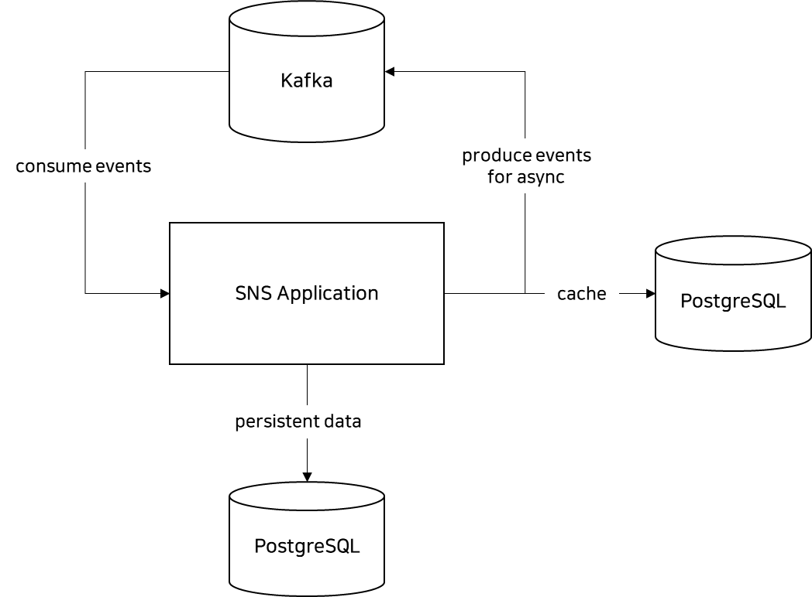

> **1. Cache**  
> 변하지 않는 User 데이터를 조회하는 부분이 있었다. User를 여러 번 조회하는 부분은 코드를 통해 수정해야되겠지만 변하지 않는 데이터를 DB에서 가져올 필요는 없기 때문에 캐시를 할 것이다. DB IO를 통해 가져오지 않고 캐시에서 가져오도록 하여 DB에 부하를 줄일 것이다.  
> (예시) 100만명이 동시 접속하여 로그인을 시도하면 DB에 100만개에 IO가 날아간다면 DB가 버티지 못할 수 있다. 이때 굳이 DB까지 가지 않아도 되는 데이터라면 다른 캐시 또는 저장소에서 가져오는 것이 효율적이라면 더 나을 것이다.  
>   
> **2. 강한 결합성 문제를 비동기로 처리**  
> 알람이 완성되어야지만 API 호출이 종료가 되는 강한 결합성 문제가 있었다. 이러한 문제는 Kafka를 통해 느슨하게 할 수 있다. Kafka는 메시징 Queue로 메시지를 Kafka에게 주면 Kafka에 consumer들이 메시지를 받아온다.   
> 누가 produce를 하면 받아와서 메시지를 받아서 동작할 수 있도록 하는 것이다. 즉 consumer가 있고 produce하는 부분이 있다. 우리는 produce까지만 하고 실제 메시지 처리(알람)는 Kafka에게 맡기는 것이다. 이를 통해 비동기적으로 처리할 수 있게 된다. 

**댓글 기능 Sequence**

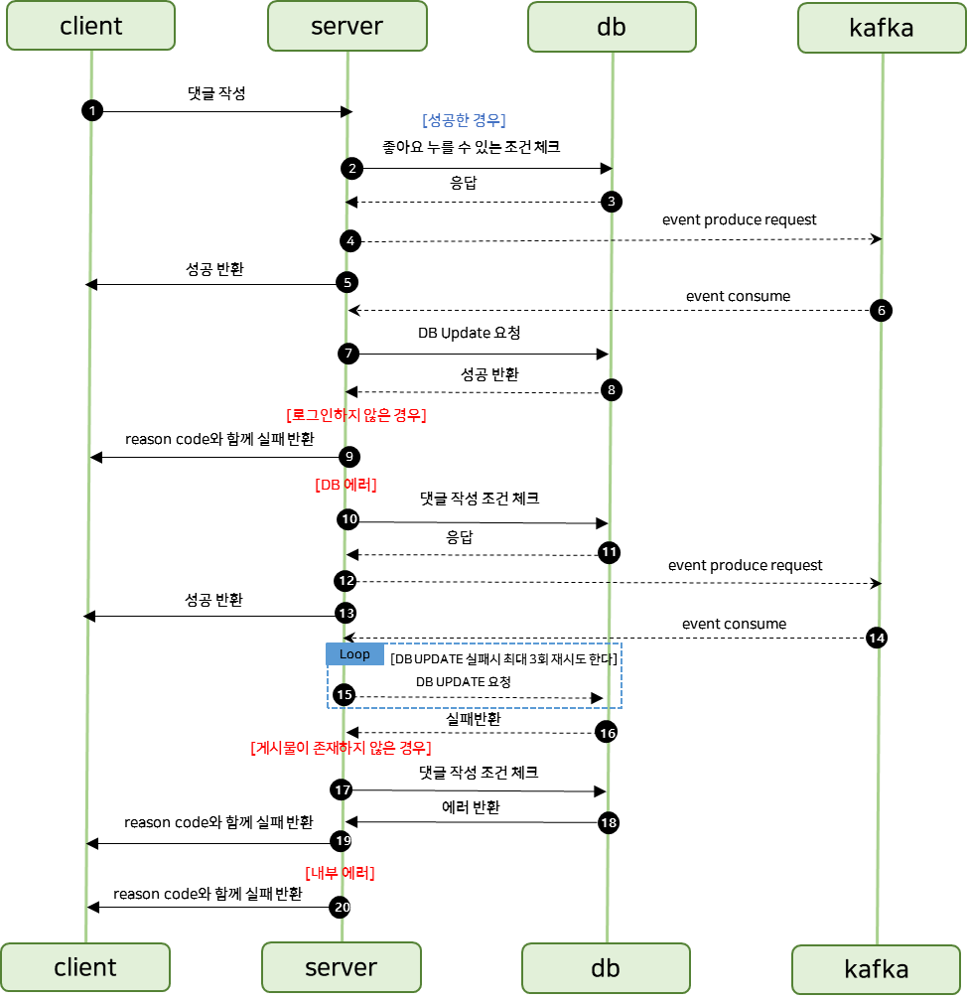

**좋아요 기능 Sequence**


개발할 때는 개발하는 본인만 API를 사용하는 것을 가정하고 개발하는 경우가 많다. 대규모 트래픽을 고려할 때는 동시에 여러명이 사용하게 되었을 때 문제점이 발생할 수 있지않을까라는 생각을 하면서 개발하면 조금더 대규모 트래픽일 때 문제점을 찾기가 쉽고 해결방법 또한 쉽게 찾을 수 있다. 

### **코드 최적화**

---

#### **알람 기능**

**@Before**

JwtTokenFilter에서 User를 1번 조회, Alram 리스트를 조회할 때 User를 1번 조회하고 있다. Alram 리스트 조회할 때 User를 조회하는 작업은 불필요한 중복작업이다.

**JwtTokenFilter**

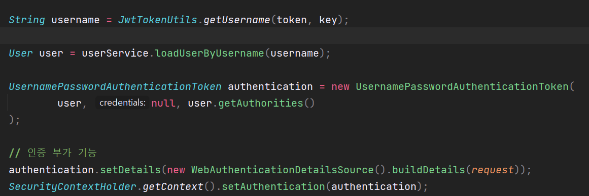

**UserController**

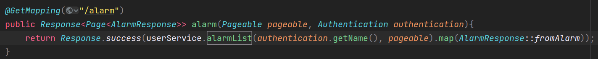

**UserService**

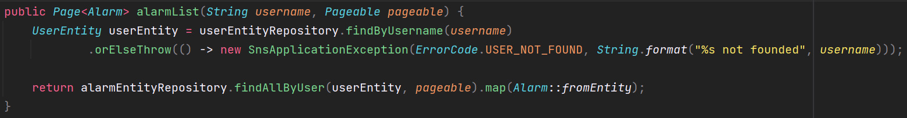

**Executed Query**

```sql
Hibernate: 
    select
        userentity0_.id as id1_4_,
        userentity0_.deleted_at as deleted_2_4_,
        userentity0_.password as password3_4_,
        userentity0_.registered_at as register4_4_,
        userentity0_.role as role5_4_,
        userentity0_.updated_at as updated_6_4_,
        userentity0_.username as username7_4_ 
    from
        "user" userentity0_ 
    where
        (
            userentity0_.deleted_at is NULL
        ) 
        and userentity0_.username=?

Hibernate: 
    select
        userentity0_.id as id1_4_,
        userentity0_.deleted_at as deleted_2_4_,
        userentity0_.password as password3_4_,
        userentity0_.registered_at as register4_4_,
        userentity0_.role as role5_4_,
        userentity0_.updated_at as updated_6_4_,
        userentity0_.username as username7_4_ 
    from
        "user" userentity0_ 
    where
        (
            userentity0_.deleted_at is NULL
        ) 
        and userentity0_.username=?

Hibernate: 
    select
        alarmentit0_.id as id1_0_,
        alarmentit0_.alarm_type as alarm_ty2_0_,
        alarmentit0_.args as args3_0_,
        alarmentit0_.deleted_at as deleted_4_0_,
        alarmentit0_.registered_at as register5_0_,
        alarmentit0_.updated_at as updated_6_0_,
        alarmentit0_.user_id as user_id7_0_ 
    from
        "alram" alarmentit0_ 
    where
        (
            alarmentit0_.deleted_at is NULL
        ) 
        and alarmentit0_.user_id=? limit ?
```

다음과 같이 user를 조회하는 Query가 2번 발생하고 있다. 

**@After**

**UserController**

안전하게 Casting할 수 있도록 ClassUtils 클래스 구현

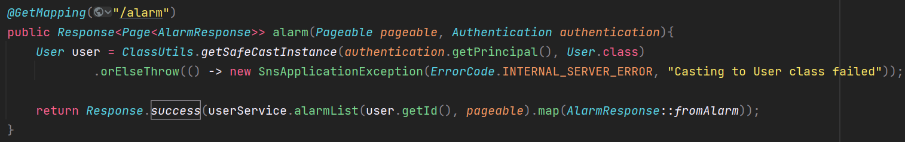

**UserService**

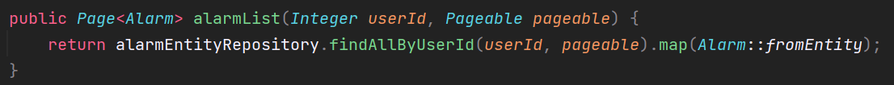

**Executed Query**

```sql
Hibernate: 
    select
        userentity0_.id as id1_4_,
        userentity0_.deleted_at as deleted_2_4_,
        userentity0_.password as password3_4_,
        userentity0_.registered_at as register4_4_,
        userentity0_.role as role5_4_,
        userentity0_.updated_at as updated_6_4_,
        userentity0_.username as username7_4_ 
    from
        "user" userentity0_ 
    where
        (
            userentity0_.deleted_at is NULL
        ) 
        and userentity0_.username=?
Hibernate: 
    select
        alarmentit0_.id as id1_0_,
        alarmentit0_.alarm_type as alarm_ty2_0_,
        alarmentit0_.args as args3_0_,
        alarmentit0_.deleted_at as deleted_4_0_,
        alarmentit0_.registered_at as register5_0_,
        alarmentit0_.updated_at as updated_6_0_,
        alarmentit0_.user_id as user_id7_0_ 
    from
        "alram" alarmentit0_ 
    left outer join
        "user" userentity1_ 
            on alarmentit0_.user_id=userentity1_.id 
    where
        (
            alarmentit0_.deleted_at is NULL
        ) 
        and userentity1_.id=? limit ?
Hibernate: 
    select
        userentity0_.id as id1_4_0_,
        userentity0_.deleted_at as deleted_2_4_0_,
        userentity0_.password as password3_4_0_,
        userentity0_.registered_at as register4_4_0_,
        userentity0_.role as role5_4_0_,
        userentity0_.updated_at as updated_6_4_0_,
        userentity0_.username as username7_4_0_ 
    from
        "user" userentity0_ 
    where
        userentity0_.id=? 
        and (
            userentity0_.deleted_at is NULL
        )
```

=> user를 조회하는 작업이 2회에서 1회로 감소되었다.

> 그런데.. 새로운 Query 친구가 나타났다.  
> 3번째 Query는 의도하지 않은 새로운 Query로  
> 이 친구 또한 필요하지 않을 것으로 판단된다.

알람 API를 요청하면 다음과 같이 반환된다.

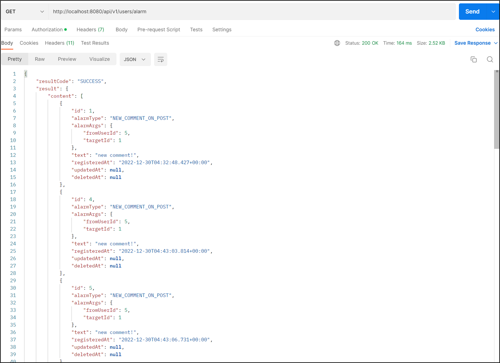

AlarmEntity에서 알람을 받는 사람 즉 UserEntity와 Join을 했었는데, Query는 어떻게 만들어질까?

AlarmEntity를 조회할 때 UserEntity를 함께 가져오고 싶다면 Alarm 테이블과 User 테이블을 Join을 시킬 것이다. 이때 Join Key로는 user\_id라는 것을 아래 코드를 통해 확인할 수 있다.

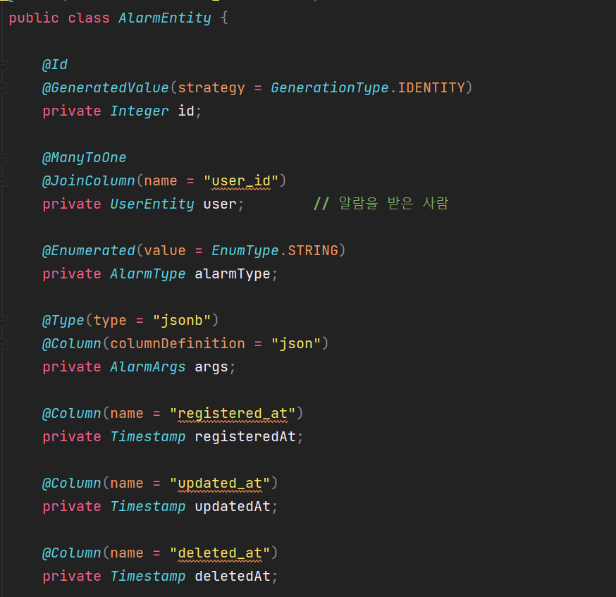

알람 테이블은 다음과 같이 id, alarm\_type, args, deleted\_at, registerd\_at, updated\_at, user\_id로 구성되어 있다.

user\_id 컬럼은 User 테이블의 id와 같은 컬럼이다. 알람 같은 경우는 user\_id로부터 발생되었다는 의미이다. user\_id 가 2인 User를 찾으려면 User 테이블에서 id가 2인 유저를 찾으면 된다.

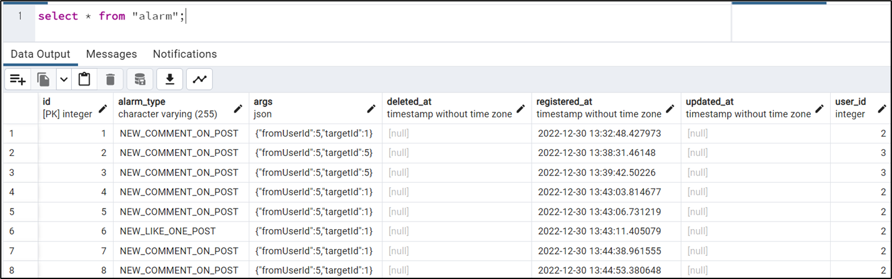

만약 Alarm 테이블과 User 테이블의 정보를 결합해서 가져오고 싶을 때 Join을 사용한다.

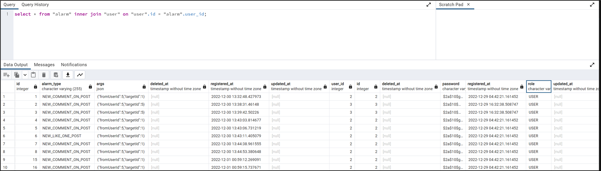

작성한 Alarm 클래스 같은 경우에는 UserEntity가 함께 결합되어 있어 Alarm을 가져올 때 User를 Join하면 가져오는 것을 기대할 수 있지만 비효율적으로 Join을 할수 있다.

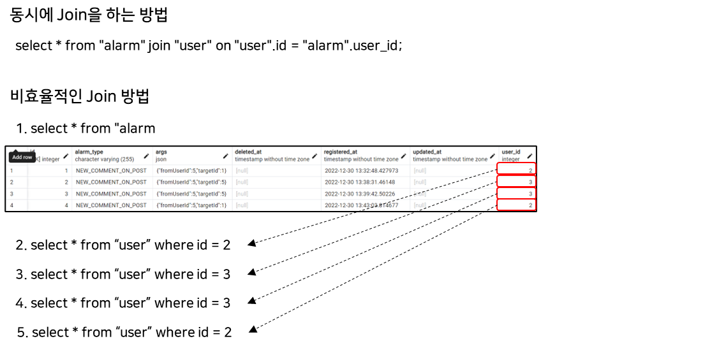

위와 같이 비효율적으로 alarm 테이블에 user\_id에 마다 Select를 실행하여 Join할 수 있다.

기대한 것은 Alarm과 User 테이블을 한번에 Join한 결과를 기대하였지만

사실은 Alarm은 한번 Query하고 Alarm에 user\_id에 개수만큼 User 정보를 Query를 실행한다. (**N+1문제**)

Alarm에서 한번에 Query를 날렸다고 생각하지만 사실 Query를 날리면서 Alarm에 연결된 User에 대한 Query까지 다 실행되기 때문에**Alarm을 조회하는 Query 1개** Alarm에 row 수가 N개라고 하면, **User에 N번에 Query가 실행되게 된다.**

AlramEntity에서 UserEntity와 ManyToOne 관계로 설정했었다. ManyToOne에 fetch 타입은 EAGER 로 Default 설정되어 있다.

> **EAGER(즉시 로딩)** : 데이터를 조회할 때 연관된 데이터까지 한 번에 불러오는 것으로 사용 여부와 관계 없이 Query가 실행된다.  
> **LAZY(지연로딩)** : 필요한 시점에 연관된 데이터를 불러오는 것이다.

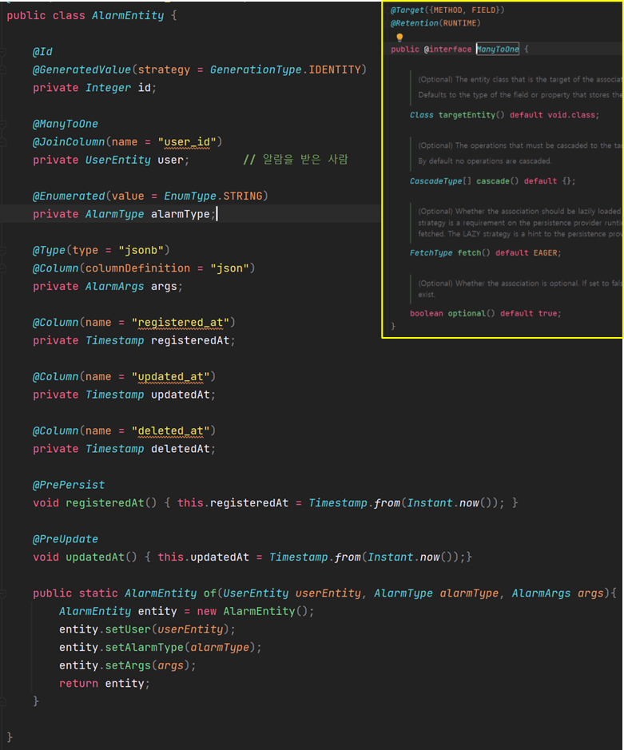

EAGER과 LAZY를 구분하기 위해 Alarm이 Dto로 변환되는 위치에 Log를 추가하도록 하겠다.

```java
package com.example.model;

@Slf4j
@Getter
@AllArgsConstructor
public class Alarm {
    private Integer id;
    private User user;
    private AlarmType alarmType;
    private AlarmArgs args;
    private Timestamp registeredAt;
    private Timestamp updatedAt;
    private Timestamp deletedAt;

    public static Alarm fromEntity(AlarmEntity entity) {
        log.info("=== Call fromEntity");

        return new Alarm(
                entity.getId(),
                User.fromEntity(entity.getUser()),
                entity.getAlarmType(),
                entity.getArgs(),
                entity.getRegisteredAt(),
                entity.getUpdatedAt(),
                entity.getDeletedAt()
        );
    }
}
```

**Fetch가 EAGER인 경우**

```sql
Hibernate: 
    select
        userentity0_.id as id1_4_,
        userentity0_.deleted_at as deleted_2_4_,
        userentity0_.password as password3_4_,
        userentity0_.registered_at as register4_4_,
        userentity0_.role as role5_4_,
        userentity0_.updated_at as updated_6_4_,
        userentity0_.username as username7_4_ 
    from
        "user" userentity0_ 
    where
        (
            userentity0_.deleted_at is NULL
        ) 
        and userentity0_.username=?
Hibernate: 
    select
        alarmentit0_.id as id1_0_,
        alarmentit0_.alarm_type as alarm_ty2_0_,
        alarmentit0_.args as args3_0_,
        alarmentit0_.deleted_at as deleted_4_0_,
        alarmentit0_.registered_at as register5_0_,
        alarmentit0_.updated_at as updated_6_0_,
        alarmentit0_.user_id as user_id7_0_ 
    from
        "alarm" alarmentit0_ 
    left outer join
        "user" userentity1_ 
            on alarmentit0_.user_id=userentity1_.id 
    where
        (
            alarmentit0_.deleted_at is NULL
        ) 
        and userentity1_.id=? limit ?
Hibernate: 
    select
        userentity0_.id as id1_4_0_,
        userentity0_.deleted_at as deleted_2_4_0_,
        userentity0_.password as password3_4_0_,
        userentity0_.registered_at as register4_4_0_,
        userentity0_.role as role5_4_0_,
        userentity0_.updated_at as updated_6_4_0_,
        userentity0_.username as username7_4_0_ 
    from
        "user" userentity0_ 
    where
        userentity0_.id=? 
        and (
            userentity0_.deleted_at is NULL
        )
2022-12-31 18:43:42.181  INFO 14612 --- [nio-8080-exec-2] com.example.model.Alarm                  : === Call fromEntity
2022-12-31 18:43:42.181  INFO 14612 --- [nio-8080-exec-2] com.example.model.Alarm                  : === Call fromEntity
2022-12-31 18:43:42.181  INFO 14612 --- [nio-8080-exec-2] com.example.model.Alarm                  : === Call fromEntity
2022-12-31 18:43:42.181  INFO 14612 --- [nio-8080-exec-2] com.example.model.Alarm                  : === Call fromEntity
2022-12-31 18:43:42.181  INFO 14612 --- [nio-8080-exec-2] com.example.model.Alarm                  : === Call fromEntity
2022-12-31 18:43:42.181  INFO 14612 --- [nio-8080-exec-2] com.example.model.Alarm                  : === Call fromEntity
2022-12-31 18:43:42.181  INFO 14612 --- [nio-8080-exec-2] com.example.model.Alarm                  : === Call fromEntity
2022-12-31 18:43:42.181  INFO 14612 --- [nio-8080-exec-2] com.example.model.Alarm                  : === Call fromEntity
2022-12-31 18:43:42.181  INFO 14612 --- [nio-8080-exec-2] com.example.model.Alarm                  : === Call fromEntity
2022-12-31 18:43:42.181  INFO 14612 --- [nio-8080-exec-2] com.example.model.Alarm                  : === Call fromEntity
```

> 1. Select는 Filter에서 User를 검증하는 부분으로 패스  
> 2. Alarm 엔티티를 가져와서 User를 Left outer Join을 하여 Alarm Entity를 가져오는 쿼리 1개  
> 3. 일치하는 User를 조회하는 Query 1개  
> 4. Call fromEntity가 10개 출력된다.   
> => User 정보 사용 여부와 관계없이 User를 조회하는 Query가 실행된다.

**Fetch가 LAZY인 경우**

```sql
Hibernate: 
    select
        userentity0_.id as id1_4_,
        userentity0_.deleted_at as deleted_2_4_,
        userentity0_.password as password3_4_,
        userentity0_.registered_at as register4_4_,
        userentity0_.role as role5_4_,
        userentity0_.updated_at as updated_6_4_,
        userentity0_.username as username7_4_ 
    from
        "user" userentity0_ 
    where
        (
            userentity0_.deleted_at is NULL
        ) 
        and userentity0_.username=?
Hibernate: 
    select
        alarmentit0_.id as id1_0_,
        alarmentit0_.alarm_type as alarm_ty2_0_,
        alarmentit0_.args as args3_0_,
        alarmentit0_.deleted_at as deleted_4_0_,
        alarmentit0_.registered_at as register5_0_,
        alarmentit0_.updated_at as updated_6_0_,
        alarmentit0_.user_id as user_id7_0_ 
    from
        "alarm" alarmentit0_ 
    left outer join
        "user" userentity1_ 
            on alarmentit0_.user_id=userentity1_.id 
    where
        (
            alarmentit0_.deleted_at is NULL
        ) 
        and userentity1_.id=? limit ?
2022-12-31 19:00:29.437  INFO 4432 --- [nio-8080-exec-1] com.example.model.Alarm                  : === Call fromEntity
Hibernate: 
    select
        userentity0_.id as id1_4_0_,
        userentity0_.deleted_at as deleted_2_4_0_,
        userentity0_.password as password3_4_0_,
        userentity0_.registered_at as register4_4_0_,
        userentity0_.role as role5_4_0_,
        userentity0_.updated_at as updated_6_4_0_,
        userentity0_.username as username7_4_0_ 
    from
        "user" userentity0_ 
    where
        userentity0_.id=? 
        and (
            userentity0_.deleted_at is NULL
        )
2022-12-31 19:00:29.446  INFO 4432 --- [nio-8080-exec-1] com.example.model.Alarm                  : === Call fromEntity
2022-12-31 19:00:29.446  INFO 4432 --- [nio-8080-exec-1] com.example.model.Alarm                  : === Call fromEntity
2022-12-31 19:00:29.446  INFO 4432 --- [nio-8080-exec-1] com.example.model.Alarm                  : === Call fromEntity
2022-12-31 19:00:29.446  INFO 4432 --- [nio-8080-exec-1] com.example.model.Alarm                  : === Call fromEntity
2022-12-31 19:00:29.447  INFO 4432 --- [nio-8080-exec-1] com.example.model.Alarm                  : === Call fromEntity
2022-12-31 19:00:29.447  INFO 4432 --- [nio-8080-exec-1] com.example.model.Alarm                  : === Call fromEntity
2022-12-31 19:00:29.447  INFO 4432 --- [nio-8080-exec-1] com.example.model.Alarm                  : === Call fromEntity
2022-12-31 19:00:29.447  INFO 4432 --- [nio-8080-exec-1] com.example.model.Alarm                  : === Call fromEntity
2022-12-31 19:00:29.448  INFO 4432 --- [nio-8080-exec-1] com.example.model.Alarm                  : === Call fromEntity
```

> 1. Select는 Filter에서 User를 검증하는 부분으로 패스  
> 2. Alarm 엔티티를 가져와서 User를 Left outer Join을 하여 Alarm Entity를 가져오는 쿼리 1개  
> 3. Call fromEntity가 로그 1개  
> 4. User를 조회하는 Query 1개  
> 5. Call fromEntity가 9개 출력된다.   
>   
> 현재 CallfromEntity가 호출되고 나서 User를 조회한다. 즉 User를 실제로 사용할때 Select Query가 발생하고 있다.

그런데 사실 UserEntity를 사용하고 있지 않다.  Lazy로 하여 미리 가져오지 않도록 하고 사용되지 않는 User 정보를 제거하여 불필요한 Query가 발생되지 않도록 하겠다.

```java
public class Alarm {
    private Integer id;
    private AlarmType alarmType;
    private AlarmArgs args;
    private Timestamp registeredAt;
    private Timestamp updatedAt;
    private Timestamp deletedAt;

    public static Alarm fromEntity(AlarmEntity entity) {
        log.info("=== Call fromEntity");

        return new Alarm(
                entity.getId(),
                entity.getAlarmType(),
                entity.getArgs(),
                entity.getRegisteredAt(),
                entity.getUpdatedAt(),
                entity.getDeletedAt()
        );
    }
}
```

의도하지 않은 N+1 문제는 API와 관계없는 즉 사용되지 않는 필드를 제거해줌으로써 필요가 없는 연관관계는 조회하지 않는 방법으로 문제를 해결하였다.

---

#### **좋아요 기능**

Query 어노테이션을 통해 Native Query 사용하여 좋아요 개수를 가져오는 코드를 구현했었는데, JPA 기능을 통해 보다 간편하게 구현하려 한다.

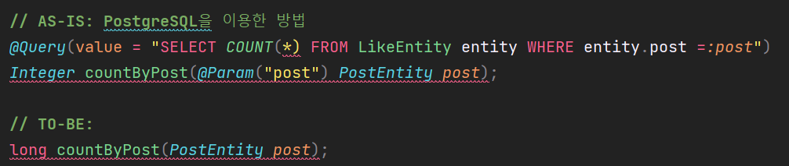

차이점으로는 반환값의 형태가 long 타입이다.

---

#### **포스트 삭제**

데이터들이 제대로 들어가고 있는지 즉 불필요한 데이터가 없는지 확인하려 한다. 서비스에서 User를 삭제하거나 Like를 삭제하거나 하는 기능이 없고 Post 삭제가 존재한다. Post 삭제는 게시글만 삭제되고 게시글에 댓글과 좋아요가 삭제되지 않는 문제가 발생하고 있어 수정하였다.

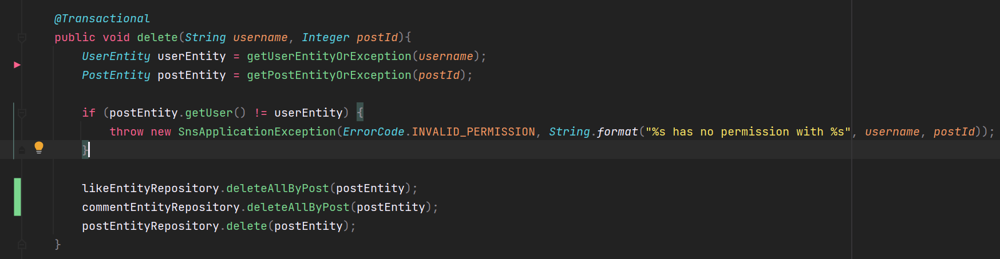

삭제 대상은 Post 1개, Comment 4개, Like 1개를 생성하는 경우로 동일하고 JPA를 이용하는 방법과 Native Query를 이용하는 방법을 비교하려 한다. 

**참고**

> **JPA**  
> JPA는 영속성을 관리한다. 쉽게 말해 데이터베이스에서 데이터를 가져왔을 때 데이터에 Life Cycle 관리를 Application 내에서 한다. 이 데이터가 변경되거나 삭제되거나 어떤 변화가 있는 것을 영속성 관리를 통해 확인하게 된다. 실제 Transaction이 일어나고 Commit이 되었을 때 데이터에 상태를 업데이트하게 되는 방식으로 동작한다.  
>   
> \* [JPA 알아보기](tistory-299.html)

영속성을 관리하기 위해서는 데이터베이스에서 데이터를 가져오는 작업이 먼저 이루어져야한다. JPA에 deleteAll()을 사용하면 다음과 같은 현상이 일어난다.

* **Expect** : 데이터를 삭제한다.
* **Actual :** 데이터를 가져와서 비교해서 삭제한다.

**@Before **Executed Query(JPA)****

```sql
Hibernate: 
    select
        userentity0_.id as id1_4_,
        userentity0_.deleted_at as deleted_2_4_,
        userentity0_.password as password3_4_,
        userentity0_.registered_at as register4_4_,
        userentity0_.role as role5_4_,
        userentity0_.updated_at as updated_6_4_,
        userentity0_.username as username7_4_ 
    from
        "user" userentity0_ 
    where
        (
            userentity0_.deleted_at is NULL
        ) 
        and userentity0_.username=?
Hibernate: 
    select
        userentity0_.id as id1_4_,
        userentity0_.deleted_at as deleted_2_4_,
        userentity0_.password as password3_4_,
        userentity0_.registered_at as register4_4_,
        userentity0_.role as role5_4_,
        userentity0_.updated_at as updated_6_4_,
        userentity0_.username as username7_4_ 
    from
        "user" userentity0_ 
    where
        (
            userentity0_.deleted_at is NULL
        ) 
        and userentity0_.username=?
Hibernate: 
    select
        postentity0_.id as id1_3_0_,
        postentity0_.body as body2_3_0_,
        postentity0_.deleted_at as deleted_3_3_0_,
        postentity0_.registered_at as register4_3_0_,
        postentity0_.title as title5_3_0_,
        postentity0_.updated_at as updated_6_3_0_,
        postentity0_.user_id as user_id7_3_0_,
        userentity1_.id as id1_4_1_,
        userentity1_.deleted_at as deleted_2_4_1_,
        userentity1_.password as password3_4_1_,
        userentity1_.registered_at as register4_4_1_,
        userentity1_.role as role5_4_1_,
        userentity1_.updated_at as updated_6_4_1_,
        userentity1_.username as username7_4_1_ 
    from
        "post" postentity0_ 
    left outer join
        "user" userentity1_ 
            on postentity0_.user_id=userentity1_.id 
    where
        postentity0_.id=? 
        and (
            postentity0_.deleted_at is NULL
        )
Hibernate: 
    select
        likeentity0_.id as id1_2_,
        likeentity0_.deleted_at as deleted_2_2_,
        likeentity0_.post_id as post_id5_2_,
        likeentity0_.registered_at as register3_2_,
        likeentity0_.updated_at as updated_4_2_,
        likeentity0_.user_id as user_id6_2_ 
    from
        "like" likeentity0_ 
    where
        (
            likeentity0_.deleted_at is NULL
        ) 
        and likeentity0_.post_id=?
Hibernate: 
    select
        userentity0_.id as id1_4_0_,
        userentity0_.deleted_at as deleted_2_4_0_,
        userentity0_.password as password3_4_0_,
        userentity0_.registered_at as register4_4_0_,
        userentity0_.role as role5_4_0_,
        userentity0_.updated_at as updated_6_4_0_,
        userentity0_.username as username7_4_0_ 
    from
        "user" userentity0_ 
    where
        userentity0_.id=? 
        and (
            userentity0_.deleted_at is NULL
        )
Hibernate: 
    select
        commentent0_.id as id1_1_,
        commentent0_.comment as comment2_1_,
        commentent0_.deleted_at as deleted_3_1_,
        commentent0_.post_id as post_id6_1_,
        commentent0_.registered_at as register4_1_,
        commentent0_.updated_at as updated_5_1_,
        commentent0_.user_id as user_id7_1_ 
    from
        "comment" commentent0_ 
    where
        (
            commentent0_.deleted_at is NULL
        ) 
        and commentent0_.post_id=?
Hibernate: 
    UPDATE
        "like" 
    SET
        deleted_at = NOW() 
    WHERE
        id=?
Hibernate: 
    UPDATE
        "comment" 
    SET
        deleted_at = NOW() 
    WHERE
        id=?
Hibernate: 
    UPDATE
        "comment" 
    SET
        deleted_at = NOW() 
    WHERE
        id=?
Hibernate: 
    UPDATE
        "comment" 
    SET
        deleted_at = NOW() 
    WHERE
        id=?
Hibernate: 
    UPDATE
        "comment" 
    SET
        deleted_at = NOW() 
    WHERE
        id=?
Hibernate: 
    UPDATE
        "post" 
    SET
        deleted_at = NOW() 
    WHERE
        id=?
```

> 실행된 Query를 보면 SELECT하고 UPDATE(삭제) 되고 있다.  
> 1. UPDATE like Query 1개  
> 2. UPDATE comment 4개  
> 3. UPDATE post 1개

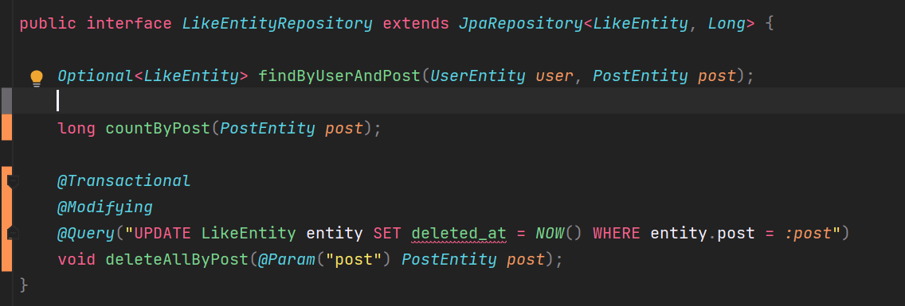

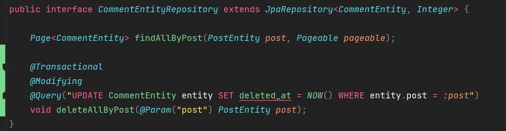

****@After** Executed Query(Native Query)**

```sql
Hibernate: 
    select
        userentity0_.id as id1_4_,
        userentity0_.deleted_at as deleted_2_4_,
        userentity0_.password as password3_4_,
        userentity0_.registered_at as register4_4_,
        userentity0_.role as role5_4_,
        userentity0_.updated_at as updated_6_4_,
        userentity0_.username as username7_4_ 
    from
        "user" userentity0_ 
    where
        (
            userentity0_.deleted_at is NULL
        ) 
        and userentity0_.username=?
Hibernate: 
    select
        userentity0_.id as id1_4_,
        userentity0_.deleted_at as deleted_2_4_,
        userentity0_.password as password3_4_,
        userentity0_.registered_at as register4_4_,
        userentity0_.role as role5_4_,
        userentity0_.updated_at as updated_6_4_,
        userentity0_.username as username7_4_ 
    from
        "user" userentity0_ 
    where
        (
            userentity0_.deleted_at is NULL
        ) 
        and userentity0_.username=?
Hibernate: 
    select
        postentity0_.id as id1_3_0_,
        postentity0_.body as body2_3_0_,
        postentity0_.deleted_at as deleted_3_3_0_,
        postentity0_.registered_at as register4_3_0_,
        postentity0_.title as title5_3_0_,
        postentity0_.updated_at as updated_6_3_0_,
        postentity0_.user_id as user_id7_3_0_,
        userentity1_.id as id1_4_1_,
        userentity1_.deleted_at as deleted_2_4_1_,
        userentity1_.password as password3_4_1_,
        userentity1_.registered_at as register4_4_1_,
        userentity1_.role as role5_4_1_,
        userentity1_.updated_at as updated_6_4_1_,
        userentity1_.username as username7_4_1_ 
    from
        "post" postentity0_ 
    left outer join
        "user" userentity1_ 
            on postentity0_.user_id=userentity1_.id 
    where
        postentity0_.id=? 
        and (
            postentity0_.deleted_at is NULL
        )
Hibernate: 
    update
        "like" 
    set
        deleted_at=now() 
    where
        post_id=?
Hibernate: 
    update
        "comment" 
    set
        deleted_at=now() 
    where
        post_id=?
Hibernate: 
    UPDATE
        "post" 
    SET
        deleted_at = NOW() 
    WHERE
        id=?
```

Native Query는 해당 Post를 조회하고 관련된 좋아요, 댓글, Post 순서로 삭제되고 있다.

JPA를 적용한 Query와 Native Query은 동일한 작업을 수행한 Query로 중요하게 확인해야하는 부분은 하단에 update Query들이다. JPA를 적용한 Query는 N+1 문제가 발생하고, Native Query는 N+1 문제가 발생하지 않는다.
