### Redis

---

Redis는 빠른 오픈 소스 인 메모리 키 값 데이터 구조 스토어입니다. Redis는 다양한 인 메모리 데이터 구조 집합을 제공하므로 다양한 사용자 정의 애플리케이션을 손쉽게 생성할 수 있습니다. 주요 Redis 사용 사례로는 캐싱, 세션 관리, pub/sub 및 순위표를 들 수 있습니다. Redis는 현재 가장 인기 있는 키 값 스토어로서, BSD 라이선스가 있고, 최적화된 C 코드로 시작되었으며, 다양한 개발 언어를 지원합니다. Redis는 REmote DIctionary Server의 약어입니다. [출처 - [AWS Redis](https://aws.amazon.com/ko/elasticache/what-is-redis/) ]

#### 캐싱

> 컴퓨팅에서 캐시는 일반적으로 일시적인 특징이 있는 데이터 하위 집합을 저장하는 고속 데이터 스토리지 계층입니다. 따라서 이후에 해당 데이터에 대한 요청이 있을 경우 데이터의 기본 스토리지 위치에 액세스할 때보다 더 빠르게 요청을 처리할 수 있습니다. 캐싱을 사용하면 이전에 검색하거나 계산한 데이터를 효율적으로 재사용할 수 있습니다.  
>   
> [출처 - [AWS Caching](https://aws.amazon.com/ko/caching/) ]

#### 캐싱의 동작 원리

> 캐시의 데이터는 일반적으로 RAM(Random Access Memory)과 같이 빠르게 액세스할 수 있는 하드웨어에 저장되며, 소프트웨어 구성 요소와 함께 사용될 수도 있습니다. 캐시의 주요 목적은 더 느린 기본 스토리지 계층에 액세스해야 하는 필요를 줄임으로써 데이터 검색 성능을 높이는 것입니다.   
>   
> 속도를 위해 용량을 절충하는 캐시는 일반적으로 데이터의 하위 집합을 일시적으로 저장합니다. 보통 완전하고 영구적인 데이터가 있는 데이터베이스와는 대조적입니다.

일반적으로 데이터를 가져올 때 DB에서 가져오는데 이는 DB IO를 써서 Query 실행하여 가져오므로 부하가 많이 든다.

DB에 많은 부하를 주지 않으면서 데이터를 손쉽게 가져올 수 있게 하는 방법이 캐싱이다. 

캐싱은 DB보다 가볍게 데이터를 저장하고 가져오는 방법이다.

DB는 데이터를 가져올 떄 Query를 사용해서 질의하여 데이터를 가져오는데, 보통 캐싱같은 경우는 Key-Value 형식으로 구성되어 있어 Key에 해당하는 Value를 요청하는 것으로 캐싱을 사용한다. 캐싱은 여러 가지 방법이 있고, 솔루션이 있다.

그중 많이 사용하는 Redis와 Local Caching을 가지고 비교하려 한다. 

|  | **Redis** | **Local Caching** |
| --- | --- | --- |
| **특징** | 인메모리 데이터베이스로 Key-Value 형태의 데이터베이스다. 다양한 command를 제공하며 single thread이다. | 서버 내에 caching 하는 방법으로 서버와 라이프 사이클을 함꼐할 수 있다. |
| **장점** | 여러 instance가 하나의 데이터를 공유할 수 있고 다양한 command를 지원한다. | 네트워크를 타지 않기 때문에 Redis에 비해 비교적 빠르다. |
| **단점** | Local caching에 비해서는 느리다. | 여러 instance로 구성된 서버의 경우 캐시를 공유할 수 없다. 즉 서버와 서버간에 캐시를 공유할 수 없다. |

#### [**Redis**](https://redis.io/)

* **In-memory 데이터베이스로 Key-Value 형태의 데이터베이스이다.**  
  1. **인메모리 데이터베이스 즉 휘발성 메모리로 백업을 하지 않을 경우 서버가 다운되면 전부 소멸된다.**  
     캐시로 사용하는 경우 데이터베이스에 원본 데이터가 있고 그 데이터를 캐싱을 해놓은 것이기 때문에 사실상 큰 문제는 없지만 만약 많은 데이터를 캐싱하고 있다가 Redis 서버가 다운되면 많은 데이터를 DB에서 가져오게 될 것이다. 이로인해 DB는 순간적으로 큰 부하가 걸릴 수 있다.
  2. **Redis는 빠른 데이터베이스이기 때문에 Redis를 Main DB로 사용하는 경우 데이터 유실 위험이 크다.**   
     Sentinel(여러 개에 인스턴스를 하나의 인스턴스처럼 사용하는 방법)을 통해 Redis를 여러 개 구성하여 해결할 수 있다.
     + **Standalone**하나의 인스턴스만 사용해 Redis를 구성하는 방식으로 인스턴스에 장애가 생기면 대체할 수 있는 다른 인스턴스가 없기 때문에 HA(High availibility) 보장되지 않는다. 싱글스레드로 작업이 처리되기 때문에 병목 현상이 발생할 확률이 높다.
     + **Sentinel**운영중 예기치 않게 마스터가 다운되었다면, 관리자가 이를 감지해서 복제를 마스터로 올리고 클라이언트들이 새로운 마스터에 접속할 수 있도록 해 주어야 합니다.   센티널은 마스터와 복제를 감시하고 있다가 마스터가 다운되면 이를 감지해서 관리자의 개입없이 자동으로 복제를 마스터로 올려줍니다.
     + **Cluster**Sentinel보다 더 발전된 형태로 마스터를 여러 개 두고 트래픽이 큰 서비스에서 사용한다.
* 다양한 Command를 제공한다.
* Single Thread이다.
* 높은 Availability를 위한 몇가지 옵션이 존재한다.
  + Setinel
  + Redis Cluster

### Redis Commands

---

[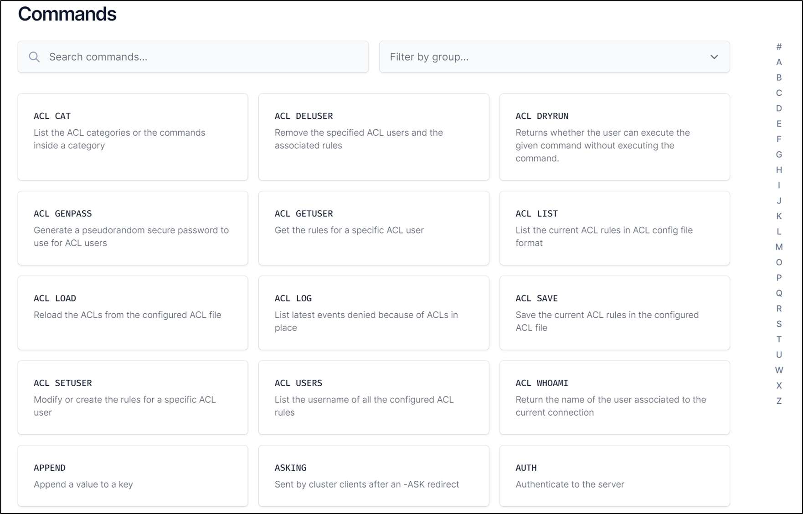](https://redis.io/commands)

Redis는 굉장히 많은 Command를 지원합니다.

#### **SET**

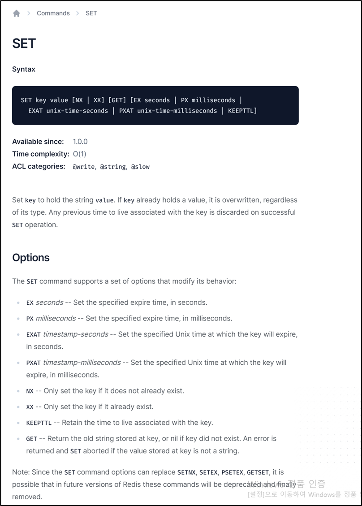

Examples 에서 직접 테스트를 통해 경험해볼 수 있다.

```java
# 기본적인 SET & GET
redis> SET mydog "pomeranian"
"OK"
redis> GET mydog
"pomeranian"

# alive-time 설정
redis> SET mydog-life-expectancy "pomeranian" EX 500
"OK"
redis> GET mydog-life-expectancy 	# IF 유효시간 이내인 경우
"pomeranian"
redis> GET mydog-life-expectancy 	# IF 유효시간이 지난경우
(nil)
```

---

#### **HSET**

[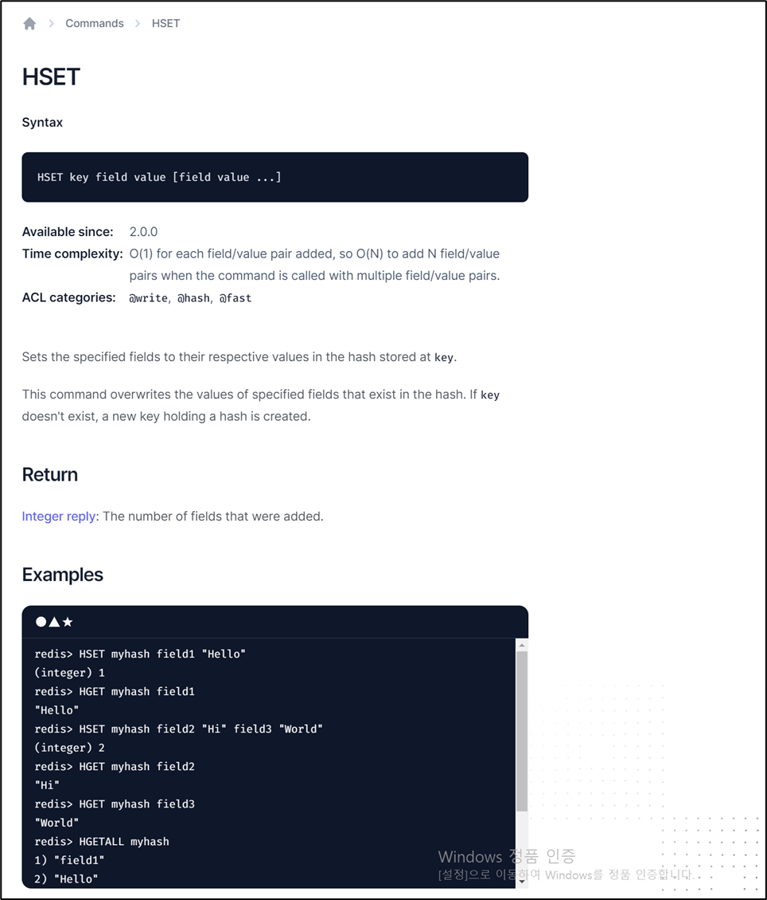](https://redis.io/commands/hset/)

기본적으로 필드는 Key와 Value 형태이다. 만약 User에 대한 정보를 캐싱했는데 User를 저장하는 로직에 문제가 있어 User Key를 모두 날려버리고 싶은 상황이다. 문제는 User도 캐싱되어 있지만 Post, Comment, Like도 함께 캐싱되어 있는 상태이다. 이때 User만 날리고 싶은 상황이다. 이럴 경우 어떻게 지워야할까? 지우기가 어렵다.. 

이와 같이 단위별로 지워야될  필요성이 있는 데이터에 경우는 HSET을 사용하면 편하게 관리할 수 있다. 

HSET은 Key, Field, Value 형태로 구성되고 Key에 저장하고 Key에 Field가 하나의 키가 된다. 

```java
# SET Key + Field + Value
redis> HSET myhash field1 "Hello"
(integer) 1
redis> HSET myhash field2 "Hi" field3 "World"
(integer) 2

# GET Key Field -> Value
redis> HGET myhash field1
"Hello"
redis> HGET myhash field2
"Hi"
redis> HGET myhash field3
"World"

# GET Key -> All Fields
redis> HKEYS myhash
1) "field1"
2) "field2"
3) "field3"

# GET Key : All Fields, Values
redis> HGETALL myhash
1) "field1"
2) "Hello"
3) "field2"
4) "Hi"
5) "field3"
6) "World"

# DELETE
redis> HDEL myhash field1
(integer) 1
```

만약 HSET을 사용하지 않고 User, Post, Comment 등이 캐싱이 되어있을 때 User만 지울수 있는 방법이 없지만 HSET은 통해 순차적으로 지울 수 있어 데이터를 한번에 묶어 사용하는데 좋다. 

```java
redis> HSET user userId:1 user-1
(integer) 1
redis> HSET user userId:2 user-2
(integer) 1
redis> HKEYS user
1) "userId:1"
2) "userId:2"
redis> HDEL user userId:1
(integer) 1
```

---

#### **KEYS**

[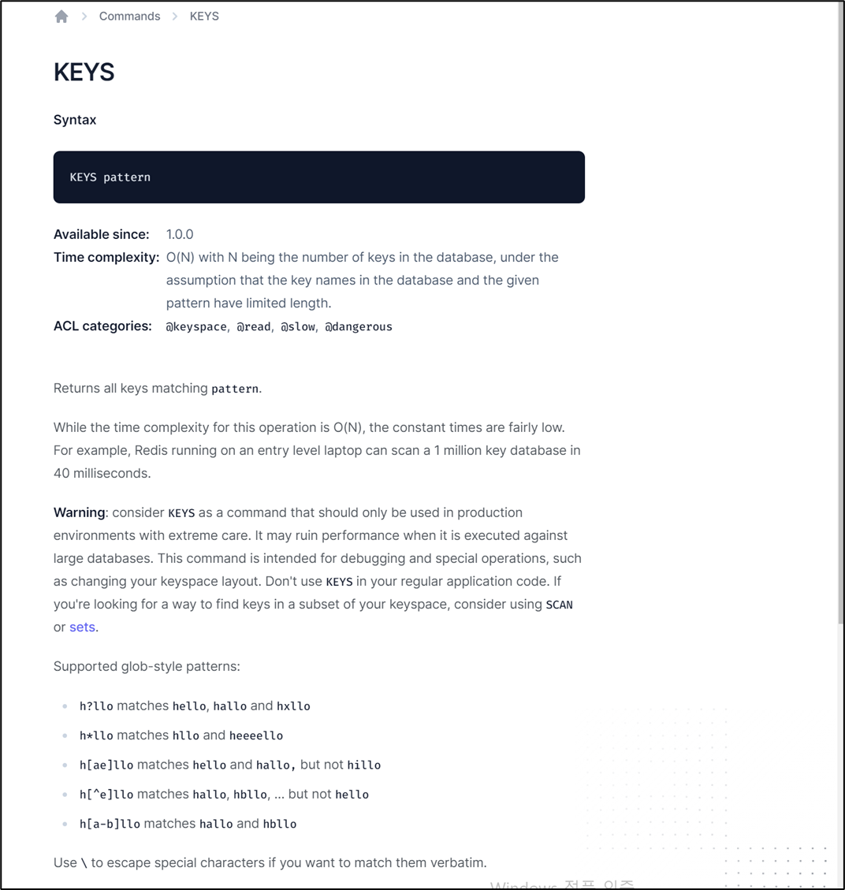](https://redis.io/commands/keys/)

KEYS 명령어를 통해 Redis에 있는 전체 KEY를 조회할 수 있다. **Warning**이 있을정도로 부하가 큰 작업이기 때문에 되도록 사용하지 않는 것이 좋다.

---

#### **ZADD**

[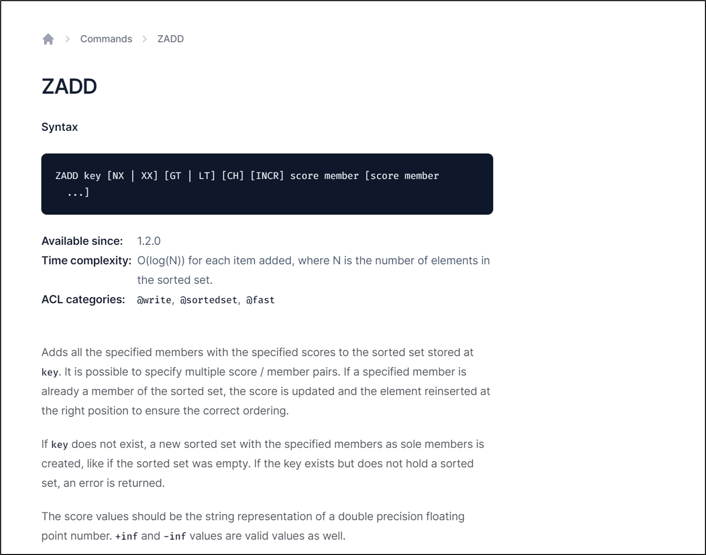](https://redis.io/commands/zadd/)

ZADD는 SET과 유사하지만 구조가 특이하다.

ZADD는 Key, INC(Increment), score, number를 넣는다.

```java
redis> ZADD myzset 1 "one"
(integer) 1
redis> ZADD myzset 1 "uno"
(integer) 1
redis> ZADD myzset 2 "two" 3 "three"
(integer) 2
redis> ZRANGE myzset 0 -1 WITHSCORES
1) "one"
2) "1"
3) "uno"
4) "1"
5) "two"
6) "2"
7) "three"
8) "3"
```

점수를 넣어 정렬을 하고 점수별로 잘라서 가져올때 유용한 Command 이다. 

이외에도 Redis에는 많은 Command가 존재하기 때문에 [공식문서](https://redis.io/commands/)를 참고해보시는것이 좋다.

[Commands

Redis is an open source (BSD licensed), in-memory data structure store, used as a database, cache, and message broker

redis.io](https://redis.io/commands/)

### Caching을 통해 DB 호출수 줄여보기

---

Caching을 통해 DB IO를 줄이는 형태로 아키텍처를 구성했었다. 대규모 트래픽일 경우에는 DB 호출 수를 줄이는 것이 어플리케이션에 부하를 줄일 수 있기 때문에 Caching을 해서 DB 호출 수를 줄이기로 했었다. 

Caching도 여러가지 종류가 있었는데 그중 Redis를 사용하기로 결정했었다. 

#### CloudType에 Redis 추가하기

1. CloudType 프로젝트에 Redis 템플릿 검색

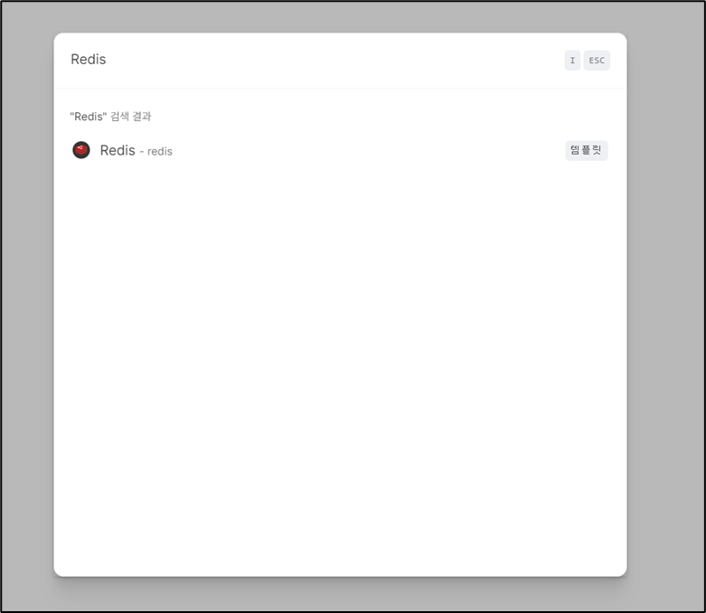

2. Redis 서비스명, 패스워드를 설정하고 연동할 프로젝트 선택

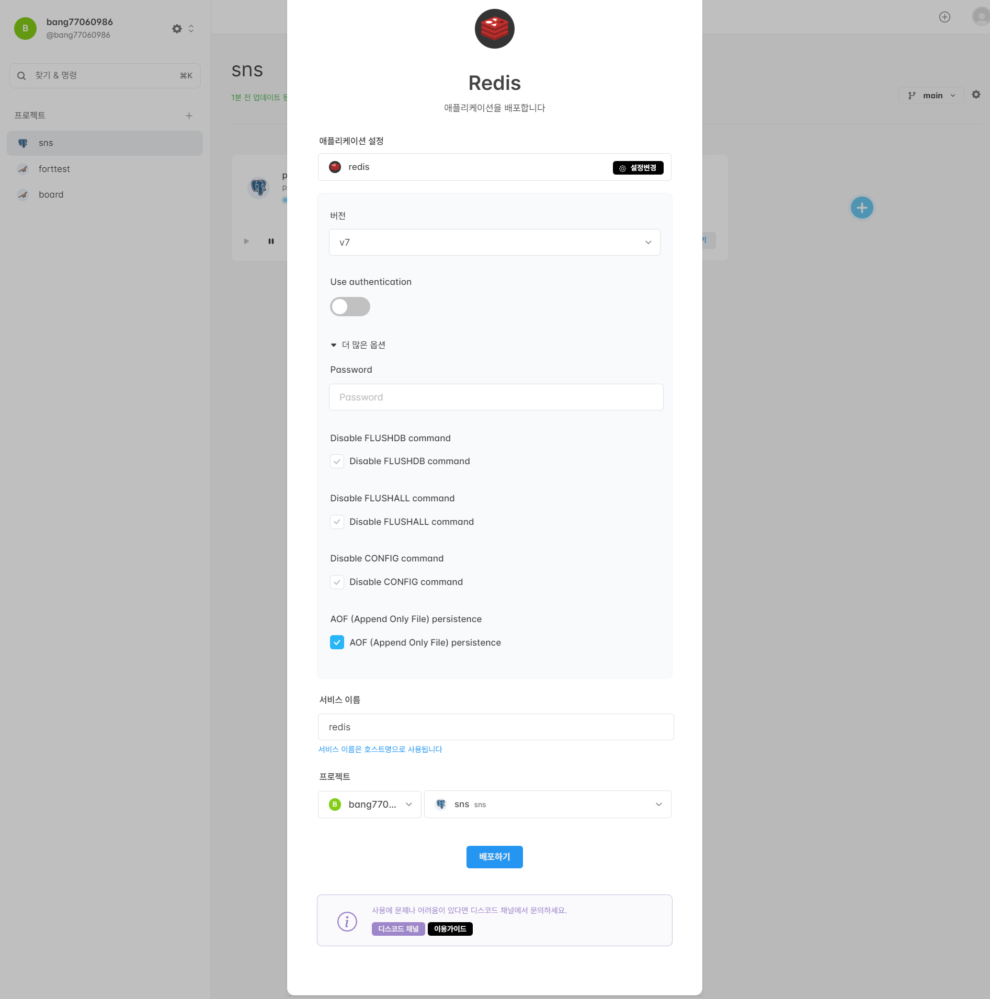

3. 외부에서 접근이 가능하도록 TCP 외부 접속 허용 기능을 활성화

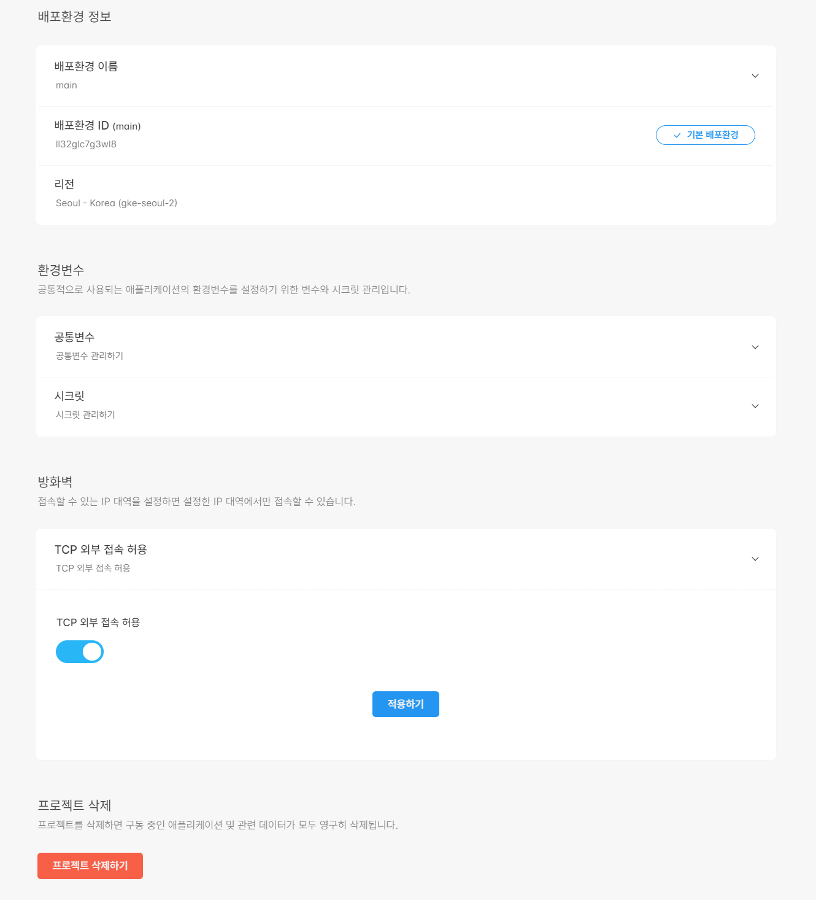

4. Redis를 연결하기 위한 주소 확인

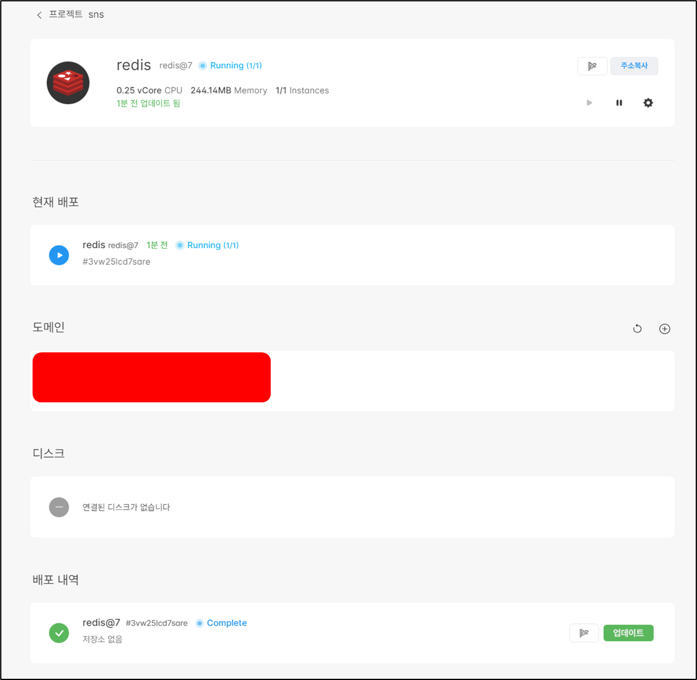

---

#### Redis Configuration 설정

1. 의존성 추가

```java
implementation 'org.springframework.boot:spring-boot-starter-data-redis'
```

2. Redis Configuration

DB 같은 경우 application.yaml 에 datasource 설정정보(username, password, url 등)를 입력하면  SpringbootApplication에서 자동으로 Property를 만들어주고 데이터베이스에 접근할 수 있는 커넥션을 해주기 때문에 Repository에서 간단하게 메소드를 작성하여 Query를 날릴 수 있는 형태로 개발했었다. Redis도 비슷한 형태로 개발할 수 있다.

3. Redis Template

Redis 템플릿은 Redis에 여러가지 Command를 쉽게 사용할 수 있도록 하는 클래스입니다. 원하는 Command를 만들어 실행 요청하게 되면 Redis로 실행되게 된다.

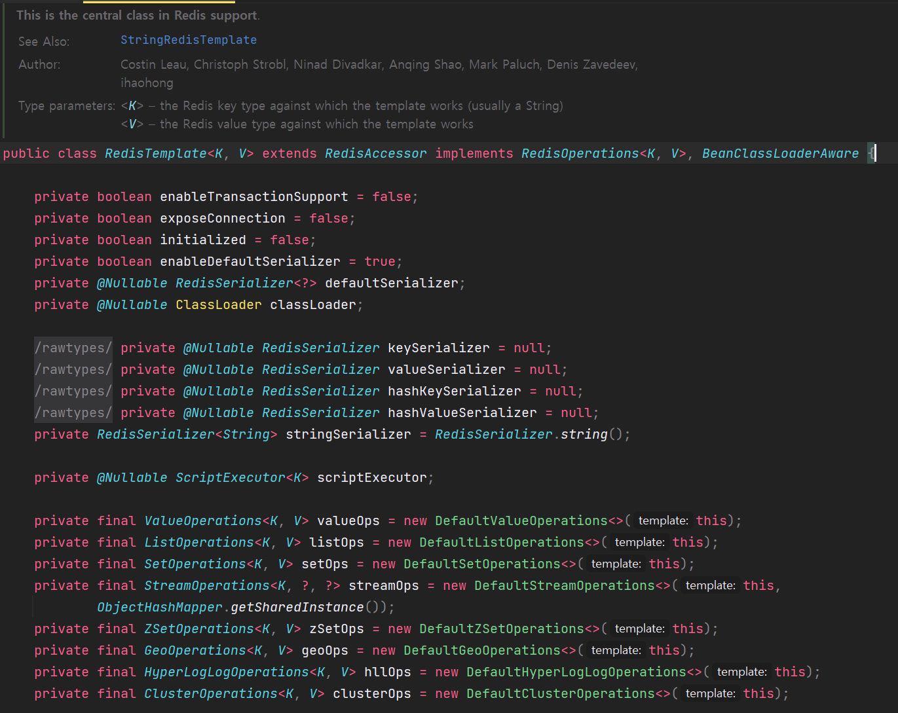

RedisTemplate 기본 구조

어떤 데이터를 캐싱할지 정해야 Value에 어떤 데이터가 들어갈지 정할 수 있다. 현재 데이터는 User, Post, Comment, Like, Alarm이 있다. 데이터를 선정을 위해 캐싱할 때 고려해야하는 부분들이 있다.

1. **데이터의 변경이 자주 일어나는가?**  
   데이터의 변경이 자주 일어나는 데이터는 캐싱할 이유가 없다. 캐싱은 데이터베이스에 있는 데이터를 Cost가 적은 곳에 두고 가져오는 것인데 만약 원본 데이터베이스에 데이터가 변화하게 되면 캐시도 당연히 변화를 해야한다. 이럴 경우에는 캐시를 에디션시키고 데이터베이스에 저장된 데이터를 가져와서 캐시에 다시 올려놓는 상태로 동작을 하게 된다. 만약 데이터가 자주 변하게 된다면 캐시 에디션이 자주 발생할 것이고 원본 데이터를 캐시에 올려야하기 때문에 트래픽 또한 많이 발생하게 된다.
2. **자주 사용하는 데이터인가?**  
   접근이 많은 데이터를 캐싱할 수록 DB에 부하가 적어지기 때문에 조금 더 접근이 자주되는 데이터를 캐싱하면 더 큰 효과를 볼 수 있다.

현재 서비스에서는 가장 많이 사용하는 User를 캐싱하려 한다. 

**1. 자주 사용되는 데이터이다.**

User 같은 경우 매 API마다 Filter를 탈때 User에 존재유무를 파악하는 DB IO가 존재한다. API Call마다 DB에 접근해서 User에 존재를 체크하게 되는데 이 부분을 캐싱한다면 부하가 훨씬더 줄어들게 될 것이다. 

**2. 변경이 일어나지 않는다.**

User는 패스워드나 name을 변경할 수 없는 상태로 만약 이러한 스펙이 추가되더라도 Post, Comment, Like, Alarm과 같이 빈번하게 변화가 되는 데이터와 비교했을 때 비교적 적게 변화하기 때문이다.

이러한 이유로 User 데이터를 캐싱하려 한다. 

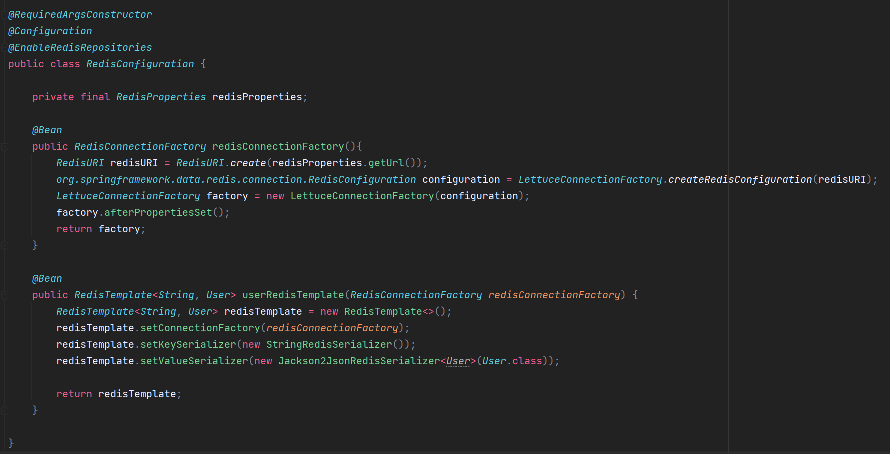

**RedisTemplate**

**RedisTemplate**는 Operation들을 쉽게 할 수 있는 클래스다. **RedisTemplate**에 opsForValue() 메소드는 통해 기본적인 GET, SET을 할 수 있는 메소드다. 이외에도 HashSet이나 ZSet 과 같은 여러가지 Command 들이 **RedisTemplate** 에서 제공하고 있다. 그렇기 때문에 RedisTemplate라는 코드자체는 Redis에 Command를 쉽게 코드를 작성할 수 있게 도와주는 클래스이다.

**setConnectionFactory**

작성한 Command를 실제 Redis에 날려주기 위해서는 서버의 정보를 알아야한다. 그러한 정보를 가지고 있는 곳이 setConnectionFactory 다. setConnectionFactory 를 설정해야지만 Redis를 실제 어떤 Redis로 연결하겠다 즉 **RedisTemplate**을 실제 어떤 Redis에 Command를 날리는 요청을 할 수 있다.

**setKeySerializer**

데이터를 넣어줄 때 Serializer를 해줘야하는데 Key를 String으로 설정하였기 때문에 StringRedisSerializer를 사용한다.

**setValueSerializer**

Key는 String 타입이지만 Value는 직접 만든 오브젝트이기 때문에 Jackson2JsonRedisSerializer를 사용한다.

**redisConnectionFactory()**

설정정보는 보통 코드에 넣지 않고 application.yaml(properties)에 넣어 사용한다. 이와 같이 사용하는 이유는 결합성을 줄이기 위함이다. RedisConfiguration 내부에 URL, Port, Username, Password를 작성하게 되면 Redis에 변화가 생겼을 때 application.yaml(properties)을 변경시키는 것이 아니라 RedisConfiguration 에서 변경을 해야한다. 즉 코드에 적용될 경우 정보가 필요한 부분마다 작성하면서 변경이 생길 때마다 모두 변경해줘야하는 문제가 발생한다. 

application.yaml(properties)에서 작성하게 되면 깔끔하게 관리할 수 있고 또 하나는 yaml 파일을 리소스 안에 넣고 개발하고 있지만 따로 서버를 두고 끌어와서 yaml 파일을 업데이트하는 경우도 있다. 이때 설정한 부분이 수정이 되었을 때 비즈니스 로직이 아니고 Configuration 부분이기 때문에 서비스 서버에 코드 수정없이 yaml 파일에 대한 정보를 관리하는 서버에 수정만으로 업데이트할 수 있다. 이와 같은 이유로 yaml 과 같이 리소스 파일에서 관리하는 것이 좋다.

Redis 같은 경우도 다음과 같이 설정할 수 있다.

```java
spring.redis.url: ${REDIS_URL}
```

Redis Repository를 설정해두었기 때문에 따로 yaml 파일에 빼게 되면 Spring에서 자동으로 RedisProperties를 만들어준다. RedisProperties을 통해 URL 등에 정보를 가져와서 사용할 수 있다.

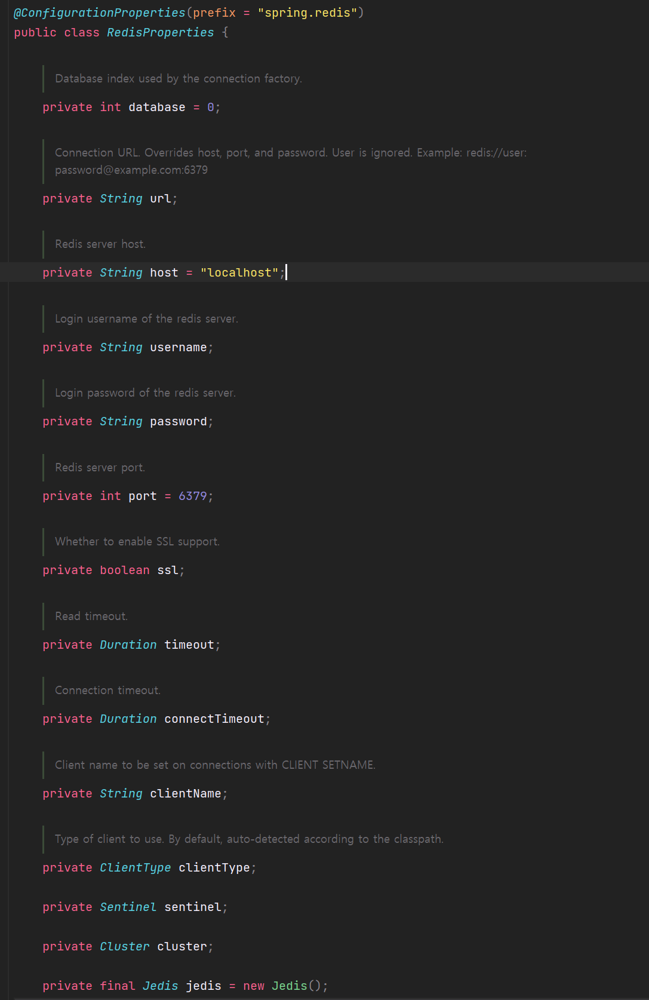

Spring이 제공해주는 RedisConfiguration에 redisURI를 가지고 Configuration을 만들어준 다음 Configuration에 connection을 만들어주는 Factory에 넣고 Factory를 반환시키도록하고 setConnectionFactory에 넣어주면 실제로 Connection이 발생하게 된다.

Redis와 Application을 연결시키는 방법은 여러 가지가 있다. 그중 Jedis와 Lettuce가 있다.

* Jedis는 Java에서 개발할 때 많이 쓰던 방법 즉 전통적으로 많이 사용하는 방법이다.
* Lettuce는 Jedis보다 나중에 나온 방법으로 Netty(**비동기 이벤트 기반 고성능 네트워크 프레임워크**)을 사용하여 성능적으로 더 좋기 때문에 더 많이 사용하는 추세이다.

=> Lettuce를 이용하도록 하겠다.

LettuceConnectionFactory에 afterPropertiesSet을 해주어야지만 initialized가 돌아서 initializing이 되기 때문에 해주어야한다.

---

#### User 캐싱

UserCacheRepository의 역할은 Redis에 User를 캐싱하고 캐시에서 User를 가져오는 역할을 하는 클래스이다.

Key를 어떻게 정의해야하는지 고민해볼 필요가 있다. User를 캐싱하기로 하였을 때 가장 많이 쓰는 부분이 Filter 부분이었다. Filter에서 User가 존재하는지 항상 체크하기 때문에 Filter에서 User를 DB에 갔다와서 체크하는 부분이 있었다. 그부분을 캐싱으로 대체하려고 하기 때문에 그부분에서 사용하는 User 조회에 사용하는 Key는 username이었다. 이와 동일하게 username을 Key로 사용하는 것이 좋다.

username만 사용하게 된다면 어려운 일이 발생할 수 있다. 예를 들면 Redis는 하나의 클러스터로 만들어두고 서비스에 쓰는 모든 캐싱을 다 넣게 된다. 현재는 User라는 정보만 캐싱하고 있지만 Post, Comment, Like 등 다른 데이터도 캐싱하게 되면 Key 값을 username으로 Key값을 하게 되면 이 값이 어떤 데이터에 Key 값인지 알아보기가 어렵다. Comment를 캐싱한다고 했을때 그것도 username으로 Key 값을 설정한다면 그것이 무엇인지 정확하게 알기 어렵기 때문에 Redis Key를 저장할 때는 Prefix를 설정하는 것이 좋다. 현재 User에 대한 캐싱정보이므로 "USER"라는 Prefix를 사용하였다. 

캐싱으로 데이터를 저장할 때 특히 Redis 같은 경우 TTL을 걸어두는 것이 좋다. 쉽게 말하면 어떤 일정 시간이 지나면 expired가 되도록 설정하는 것이 좋다는 의미이다. expired Time을 설정하는 것이 좋은 이유는 회원가입을 하고 로그인을 하거나 어떤 동작을 해서 User가 캐싱되었다. 그 이후에 User는 서비스를 사용하지 않았다했을 때 캐싱된 데이터는 영원히 캐싱에 저장되게 된다. 캐시가 서비스에 부하를 줄여주기 위해 유효한 데이터인지 역할을 하고 있는지 확인하기가 어렵다.  User 정보를 캐싱하는 이유는 로그인하고나서 Post 생성, Comment 생성 등을 할 때 항상 체크하는 Filter에서 User를 가져오는 부분이 DB를 통하지않고 캐싱를 통해 가져오도록 하기 위함이었다. 그래서 데이터를 3일 동안만 캐싱이 되도록 하면 3일 이후에 다시 로그인한다면 다시 캐싱하면 되는 것이고 3일 이후에 사용하지 않는다면 그 정보를 캐싱에 남아있지 않게 되는 것이다.

이를 통해 사용되지 않는 캐시가 Redis에 남아있지 않게 되는 즉 Redis 용량을 효율적으로 사용할 수 있게 된다. 

정리하면 Redis에 공간을 효율적으로 사용하기 위해서는 expired Time을 걸어두는 것이 좋고 expired Time을 사용함으로써 우리가 원하는 데이터에 IO를 줄여주는 데 크게 영향을 주지 않는 범위에서 걸어준다면 오히려 효율적일 수 있다. 

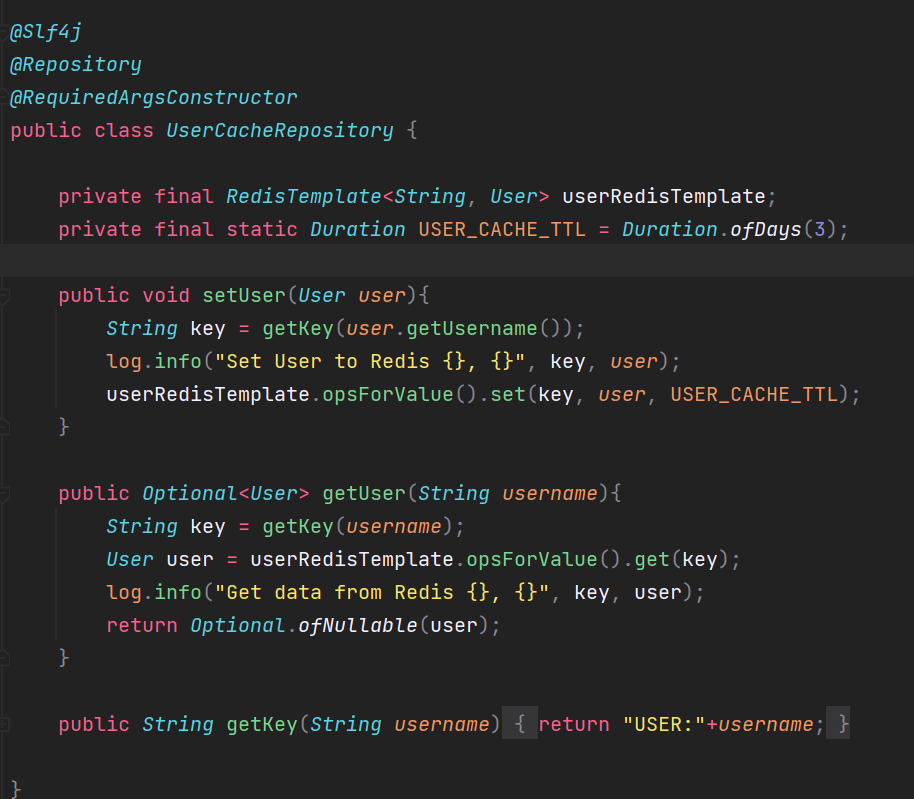

---

#### 비즈니스 로직에 적용

JwtTokenFilter에 loadByUsername를 캐시를  통해 가져오도록 변경하려 한다.

* GET : API 요청마다 조회하는 loadUserByUsername을 캐시를 통해 조회하도록 함.
* SET : 로그인 시에 캐시가 존재하지 않다면 캐시에 저장되도록 함.

```java
package com.example.service;

@RequiredArgsConstructor
@Service
public class UserService {
    private final UserCacheRepository userCacheRepository;

    public User loadUserByUsername(String username) {
        return userCacheRepository.getUser(username).orElseGet(() ->
                userEntityRepository.findByUsername(username).map(User::fromEntity)
                        .orElseThrow(() -> new SnsApplicationException(ErrorCode.USER_NOT_FOUND, String.format("%s not founded", username)))
        );
    }

    public String login(String username, String password) {
        // 회원가입 여부 체크
        User user = loadUserByUsername(username);
        userCacheRepository.setUser(user);

        // 비밀번호 체크
        if(!encoder.matches(password, user.getPassword())){
            throw new SnsApplicationException(ErrorCode.INVALID_PASSWORD);
        }

        // 토큰 생성
        return JwtTokenUtils.generateToken(username, secretKey, expiredTimeMs);
    }
}
```

### **API 테스트**

---

#### 로그인 요청

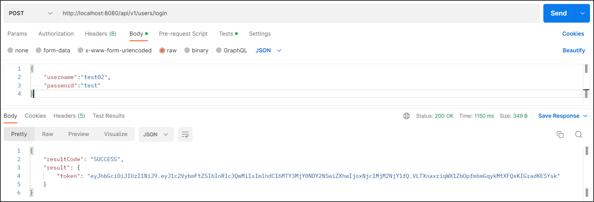

**Log**

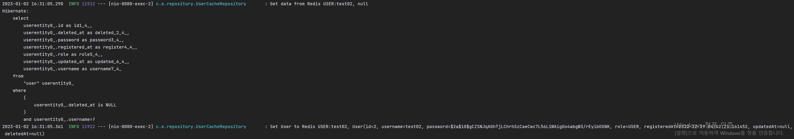

처음 로그인하였기 때문에 첫번째 로그에서 확인할 수 있는 것처럼 Redis에 GET 요청에 NULL이 반환되고 DB IO가 발생한다. 이후 Redis에 Set 요청이 발생하는 것을 확인할 수 있다.

**RedisInsight**

RedisInsight를 통해 다음과 같이 정상적으로 저장되는 것을 확인할 수 있다.

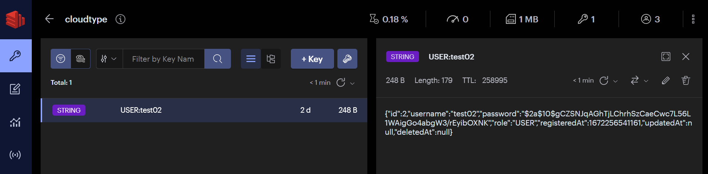

---

#### 재로그인 요청

재로그인을 요청하게 되면 DB IO가 발생하지 않을 것이고 Redis에 GET 요청만 실행되는 것을 예상할 수 있다.

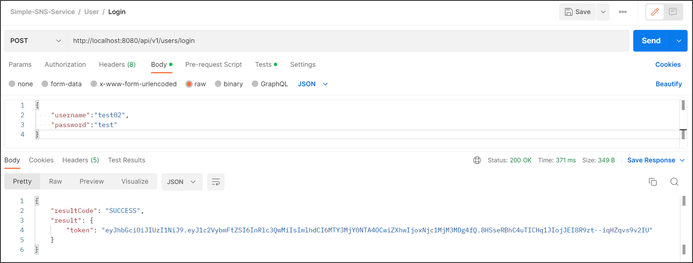

**Log**

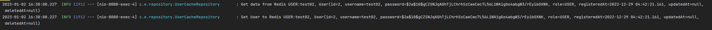

**RedisInsight**

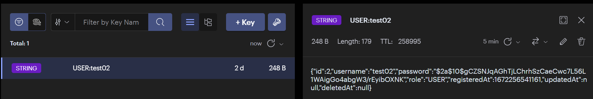

확인을 해보면 실제 GET 요청만 이루어지는 것이 아닌 업데이트 즉 SET 요청이 다시 발생하는 것을 확인할 수 있다. 문제는 토큰이 저장되기 전과 현재 토큰 정보가 다르다.

현재 로그인 코드에서 setUser를 통해 Set을 하도록 하였기 때문에 SET이 발생한 것이다. 다음과 같이 set 메소드에서 setIfAbsent 메소드로 변경해주어도 되고 TTL이 걸려있기 때문에 set메소드로 설정해도 무관하다.

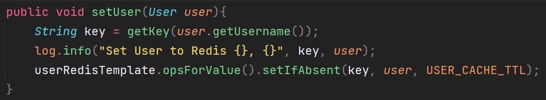
