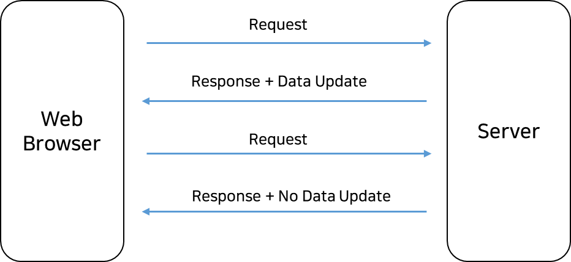
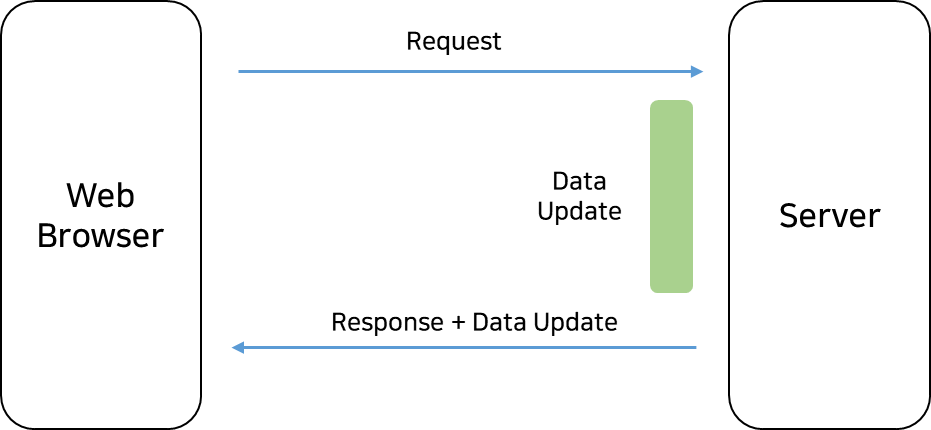
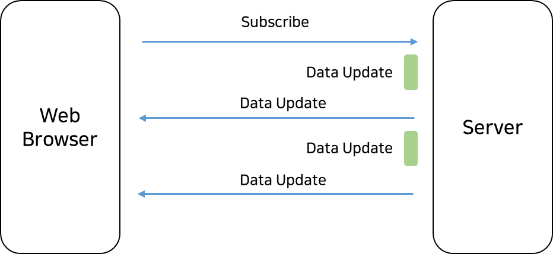
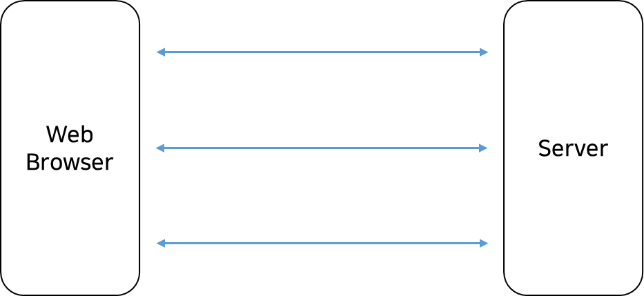
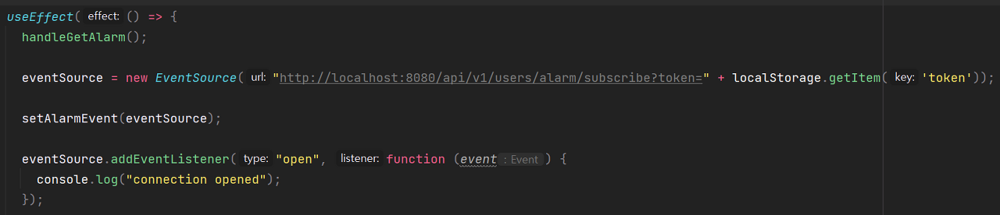
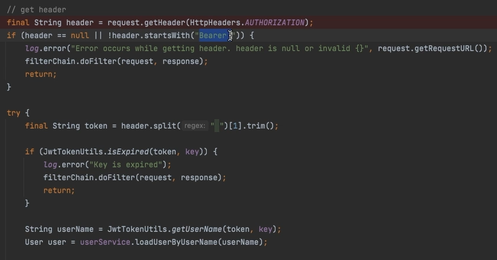
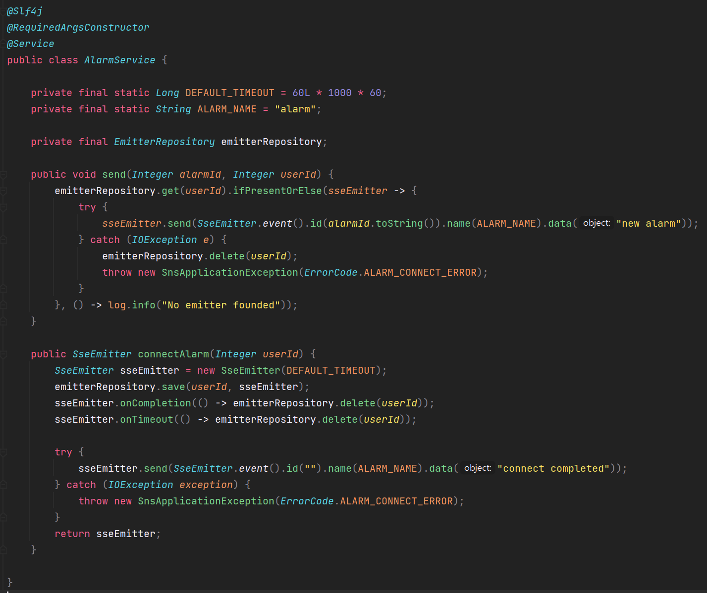
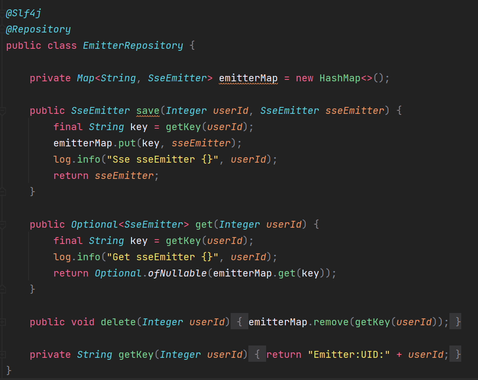
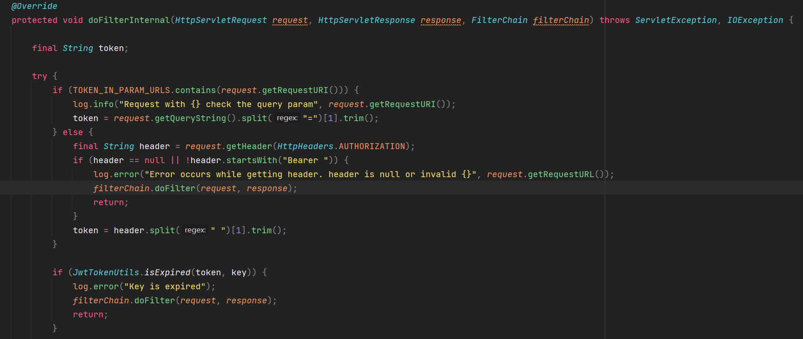

## **들어가기**

---

알람 페이지를 보면 알람 목록이 나오는 페이지이고 페이지에 데이터를 뿌려주기 위해 알람 리스트 API를 만들었다.

현재 상태로는 알람 리스트가 1회 호출되고 새로고침이 있을 경우에는 새로운 알람 리스트가 갱신될 수 있다. 

요구사항이 다음과 같이 변경되었다는 가정을 해보자.

> 페이지를 새로고침할 때에만 데이터 갱신이 일어나는 것이 아니라 User가 알람을 받아야할 상황이 되었을 때 즉 누군가 User가 작성한 Post에 댓글 또는 좋아요를 눌렀을 때 알람이 Real-Time 실시간이 아니더라도 새롭게 갱신되었으면 좋겠다.

실제로 많이 사용하는 SNS 서비스들은 위와 같이 알람을 보내주고 있다. 이러산 상황이 주어진다면 어떻게 해야할까?

## **주기적으로 Client에서 데이터를 가지고 와야하는 경우**

---

### **API를 주기적으로 호출해주는 방법(Polling)**

---

주기적으로 API를 호출하여 데이터를 주기적으로 갱신하는 방법이다. 

예를 들어 5초에 한번씩 알림 리스트 API를 호출한다고 가정해보자. 그럴 경우에는 5초동안 업데이트된 내역을 5초후에 볼 수 있는 것이다. 일정한 주기를 가지고 API를 호출하게 되면 알람을 갱신할 수 있다. 이러한 방식을 **Polling**이라 한다.

> **Polling**일정 주기를 가지고 서버의 API를 호출하는 방법으로 실시간으로 데이터가 업데이트 되지 않는다는 단점이 있다.  
> 불필요한 요청이 발생하며 따라서 불필요한 서버 부하가 발생한다. 다만 호환성이 좋다는 장점이 있다.  
>   
> Polling 같은 경우 주기적으로 API를 호출하기 때문에 데이터가 업데이트 되었든 안되었든 간에 API를 호출하게 된다. 이 부분은 User가 적을 때는 문제가 없지만 User가 많은 대규모 트래픽 서비스에 경우는 굉장히 많은 요청이 발생하게 되어 서버에 굉장히 많은 부하가 걸리게 된다.   
>   
> 
>
> **=> 대규모 트래픽을 고려한 상황에서 Polling 방법은 적합하지 않다.**

### **API를 주기적으로 호출해주는 방법(Long-Polling)**

---

polling 같은 경우 데이터에 업데이트 유무에 관계 없이 응답을 받는 구조이기 때문에 불필요한 요청이 많이 발생하게 된다. 웹브라우저에서 Request 요청을 보냈을 경우 서버에 업데이트가 발생한 경우에만 웹브라우저에 응답을 보내는 Long-Polling 방법이 있다.

> **Long Polling**  
>   
> 서버로 요청이 드러올 경우 일정 시간동안 대기 하였다가 요청한 데이터가 업데이트 된 경우 서버에서 웹브라우저로 응답을 보낸다. 연결이 된 경우 실시간으로 데이터가 들어올 수 있다는 장점이 있다. 따라서 Polling보다 개선된 형태이지만 데이터 업데이트가 빈번한 경우 Polling과 유사하다.  
>   
> 업데이트된 시점에 Response를 받을 수 있다는 점과 Polling 보다 적은 Request를 요청이 발생한다는 장점이 있다. 그래서 Polling보다는 개선된 형태이긴 하지만 데이터의 변경이 비번하게 발생한다면 Request를 보내자마자 응답이 올 것이고 그러면 또 다시 Request를 보내게 될 것이다. 이런식으로 Request가 지속적으로 발생하면 오히려 Polling과 유사하게 동작하게 된다.   
>   
> 
>
> **=> 데이터 업데이트가 많은 경우에는 적합하지 않다.**

### **SSE(Server-Sent Event)**

---

웹브라우저에 Request 요청이 없이도 서버에서 웹브라우저로 응답을 보내줄 수 없을까? 라는 생각을 할 수 있다.

이러한 생각에서 나온 것이 SSE 방식이다.

> **SSE(Server-Sent Event)**  
>   
> 서버에서 웹브라우저로 데이터를 보내줄 수 있다. 웹브라우저에서 서버쪽으로 특정 이벤트를 구독함을 알려준다. 서버에서는 해당 이벤트가 발생하면 웹브라우저쪽으로 이벤트를 보내를 보내준다. 다만 서버에서 웹브라우저로만 데이터 전송이 가능하고 그 반대는 불가능하다. 또한 최대 동시 접속 횟수가 제한되어 있다.  
>   
> SSE는 Polling과 Long-Polling 보다는 부하가 적게 발생할 것이다.  
> 왜냐하면 구독만한 상태이고 서버에서는 데이터 업데이트가 발생한 경우에만 데이터를 보내주면 되기 때문에 훨씬 더 서버 부하가 적게 걸린다. 다만 서버에서 웹브라우저로만 데이터 전송이 가능하고 웹브라우저에서 데이터를 담아 서버로 보내는 것은 불가능하고 브라우저마다 최대 동시 접속 횟수가 제한되어 있다는 단점이 있다.   
>   
> => SSE는 채팅과 같은 서비스에는 적합하지 않고 알람 기능에는 적합한 형태이다.  
> 알람같은 경우 서버에서 알람이 발생한 것을 알고 있기 때문에 알람 정보를 웹브라우저로 보내주기만 하면 되고 웹브라우저에서는 서버쪽에 데이터를 보내주지 않아도 되기 때문에 알람 기능은 SSE를 많이 사용한다.

### WebSocket

---

SSE는 서버에서만 데이터를 보내줄 수 있는데 웹 브라우저와 서버가 양방향 통신이 가능한 구조는 없을까? 라는 생각을 할 수 있다. 서버와 웹브라우저가 양방향 통신이 가능한 구조가 WebSocket 방식이다.

> **WebSocket**서버에서 웹브라우저사이 양방향 통신이 가능한 방법이다.  
> 
>
> => WebSocket은 채팅 서비스에 적합한 기능이다.

### 정리

---

주기적으로 Client에서 데이터를 가지고 와야하는 경우에 사용할 수 있는 방법 4가지를 알아보았다.

1. Polling
2. Long-Polling
3. SSE
4. WebSocket

대규모 트래픽같은 경우에는 Polling과 Long-Polling은 적합하지 않다.

SSE 또는 WebSocket을 사용하여 알람 기능을 개선할 수 있는데 이중에서 알람 기능에 적합한 SSE를 사용하여 알람 기능을 개선하려 한다.

## **SSE를 통한 알람 개선하기**

---

데이터를 주기적으로 가지고 와야하는 경우에 사용할 수 있는 방법 중에서 알람에 적합한 SSE를 사용하여 알람 기능을 개선하기로 결정하였다.

#### 알람 subscribe 요청

```java
@GetMapping("/alarm/subscribe")
public SseEmitter subscribe(Authentication authentication) {
    User user = ClassUtils.getSafeCastInstance(authentication.getPrincipal(), User.class)
            .orElseThrow(() -> new SnsApplicationException(ErrorCode.INTERNAL_SERVER_ERROR, "Casting to User class failed"));

    return alarmService.connectAlarm(user.getId());
}
```

1. SSE를 사용하기 위해서는 SseEmitter를 사용해야 한다.  
2. 보통은 헤더에 토큰을 넣어 요청을 하게 되는데 Request Param으로 토큰이 전달된다. 이유는 FrontCode에 EventSource가 Header를 지원하지 않기 때문이다. 유효한 토큰이 확인하기 위해 Filter를 수정해주어야 한다.



기존에는 Header에 Authorization 부분에서 Header를 가져와서 Bearer \*\* 부분을 통해 토큰 정보를 확인하였다.



특정 API 경우에는 RequestParam에 있는지 확인해서 토큰 체크를 해야한다.

---

#### 알람 비즈니스 로직



* DEFAULT\_TIMEOUT은 유효기간으로 해당 시간동안 연결이 이루어지지 않으면 해당 웹브라우저와의 연결은 종료된다.
* send 메소드는 User에 웹브라우저에게 데이터가 갱신되었음을 알려주는 이벤트를 전송하는 메소드이다.
* connectAlarm 메소드는 User에 웹브라우저에게 연결되었음을 알리고 있다.
* delete 메소드는 연결이 종료되어 에러가 발생할 경우 해당 브라우저 정보를 저장할 필요가 없기 때문에 삭제해주는 메소드이다.

---

#### EmitterRepository

sseEmitter는 브라우저 커넥트마다 인스턴스가 하나씩 생기는데 sseEmitter를 찾아서 User에 맞는 sseEmitter를 보내주어야 한다. 서버 한대에 여러 개에 브라우저가 물려있는데 해당 브러우저에 업데이트가 일어났음을 알려주어야 한다. 해당 브러우저가 어디인지 찾기 위해서는 sseEmitter를 저장해야 한다.

인스턴스 자체를 저장해야 해당 인스턴스에 커넥트할 수 있기 때문에 Redis나 DB를 사용하지 않고 로컬 캐시를 사용하려 한다. Repository에 기본적인 구조는 Redis와 유사하게 만들 것이다.



* save시 userId가 필요한 이유는 알람 서비스가 발생하였을 때 알람을 받는 유저의 아이디로 해당 유저의 브라우저를 찾아야하기 때문이다.

앞서 로컬캐시와 비교했을 때 Redis는 여러 개에 인스턴스 서버가 있을 때에도 사용할 수 있지만 로컬 캐싱은 해당 서버 인스턴스 내에서만 사용할 수 있다 문제가 있다. 다중 인스턴스 서버일 경우에는 다른 메시징을 두고 해당 유저에게 이벤트를 보내야할 때는 전체 인스턴스에게 전송할 수 있도록 해야한다(브로드캐스트과 유사).

현재 서비스에서는 이를 고려하지 않고 하나의 서버 인스턴스만 사용한다고 생각하고 개발하려 한다.

---

#### JwtTokenFilter

RequestParam으로 토큰이 전송될 경우 처리될 수 있도록 구현해주어야 한다.

지정한 경로에 대해서는 RequestParam으로 token을 처리하고, 아닌 경우 정상적인 Bearer 방식으로 처리한다.



### 정리

---

SSE를 통해 새로고침하지 않아도 자동으로 알람 기능이 갱신되는 것을 확인할 수 있다.

Polling 형태로 알람을 받아볼 수 있게 하려면 Polling 형태로 구현했어야하는 것을

서버의 부하를 줄이기 위해 간단하게 SSE를 도입하여 즉각적인 알람을 받아볼 수 있도록 구현하였다.
