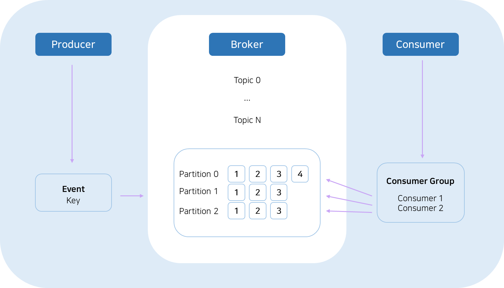
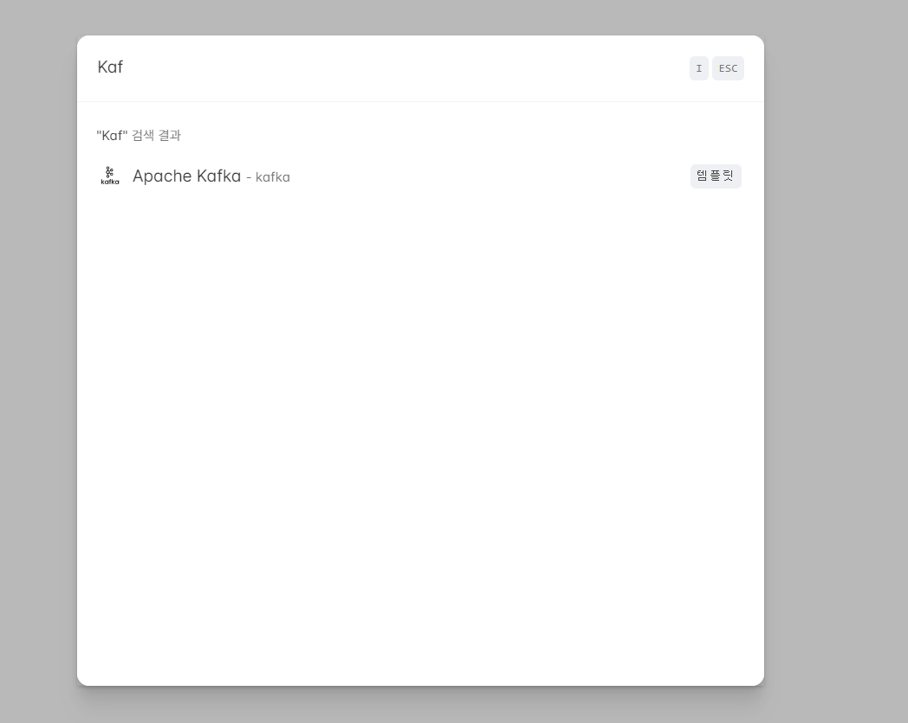
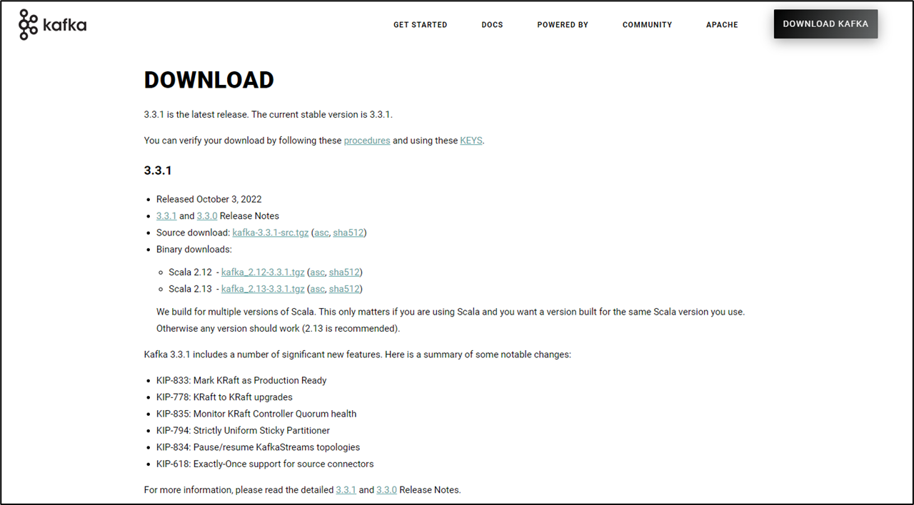
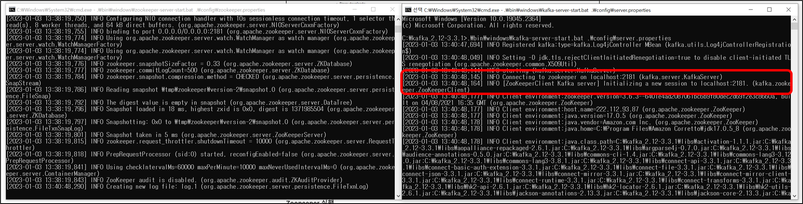
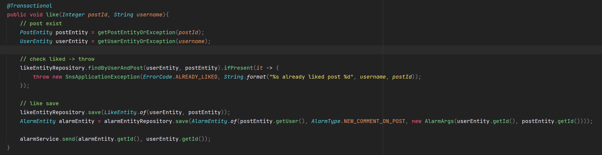
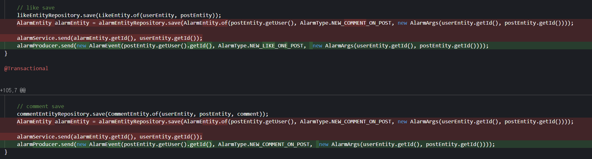
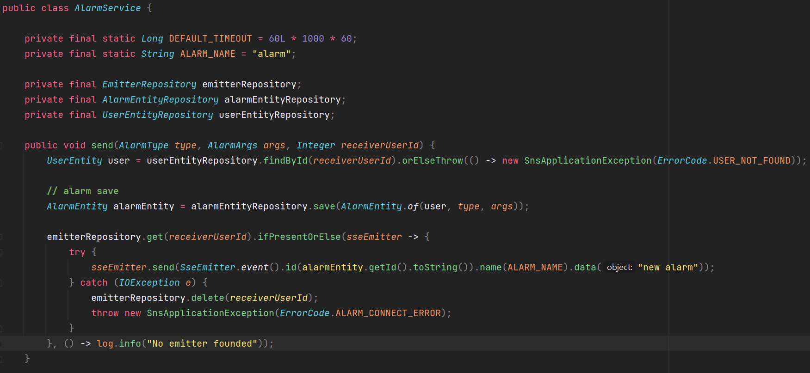

## 들어가기

---

대규모 트래픽에 적합한 아키텍처를 고민했었는데 그중에서 알람 기능을 비동기로 처리하기로 결정했었다.

비동기로 데이터를 처리하는 방법은 Spring에서 제공해주는 방법, Thread를 이용한 처리 등 다양하다. 

그중에서 실무에서 많이 사용하는 방법 중 하나인 Kafka를 이용하여 비동기적으로 데이터를 처리해보려 한다. 

### **Kafka**

---

Kafka는 간단하게 설명하면 메시징 큐로

메시지를 생성하는 **Producer**와 메시지를 받아서 처리하는 **Consumer**로 구성되어 있다. 



**간단 요약**

* **Producer**가 생성한 메시지는 **Broker**에 파일로 작성되게 된다.  
  Producer 는 메시지(=이벤트)를 생성할 때 Key 값을 설정해주어야 하는데, Key 값은 Broker에서 어떻게 Partition이 될지 결정되는 정보이다.
* **Consumer**가 **Broker**에서 파일을 읽어 메시지를 처리한다.

#### **Topic**

* 각각의 메시지를 목적에 맞게 구분할 때 사용한다.
* 메시지를 전송하거나 소비할 때 Topic을 반드시 입력한다.
* Consumer는 자신이 담당하는 Topic의 메시지를 처리한다.
* 한 개의 토픽은 한 개 이상의 파티션으로 구성된다.
* Producer와 Consumer를 이어주는 Key 값으로 메시지는 Topic을 중심으로 생성되고 해당 Topic에서 메시지를 소비하는 구조이다.

#### **Partition**

* 분산 처리를 위해 사용된다.
* Topic 생성 시 partition 개수를 지정할 수 있다. (파티션 개수 변경 가능)
* 파티션이 1개라면 모든 메시지에 대해 순서가 보장된다.
* 파티션 내부에서 각 메시지는 offset(고유 번호)로 구분된다.
* 파티션이 여러 개라면 Kafka 클러스터가 라운드 로빈 방식으로 분배해서 분산처리되기 때문에 순서가 보장되지 않는다.
* 파티션이 많을수록 처리량이 좋지만 장애 복구 시간이 늘어난다.

#### **Producer**

* 메시지를 만들어서 Kafka 클러스터에 전송한다.
* 메시지 전송 시 Batch 처리가 가능하다.
* Key 값을 지정하여 특정 파티션으로만 전송이 가능하다.
* 전송 acks 값을 설정하여 효율성을 높일 수 있다.
  + ACKS = 0 : 매우 빠르게 전송. 파티션 리더가 받았는지 알 수 없음
  + ACKS = 1 : 파티션 리더가 받았는지 확인. 기본값
  + ACKS = ALL : 파티션 리더뿐만 아니라 팔로워까지 메시지를 받았는지 확인

#### **Consumer**

* Kafka 클러스터에서 메시지를 읽어서 처리한다.
* 메시지를 Batch 처리할 수 있다.
* 한 개의 Consumer는 여러 개의 토픽을 처리할 수 있다.
* 메시지를 소비하여도 메시지를 삭제하지는 않는다(Kafka delete policy에 의해 삭제됨)
* 한번 저장된 메시지를 여러번 소비도 가능하다.
* Consumer는 Consumer 그룹에 속한다.
* 한 개 Partition 은 같은 Consumer 그룹의 여러 개의 컨슈머에서 연결할 수 없다.

#### **Broker**

* 실행된 Kafka 서버를 의미한다.
  + Producer와 Consumer는 별도의 애플리케이션으로 구성되는 반면, Broker는 Kafka 자체이다.
* 메시지를 저장하고 관리하는 역할을 수행한다.

#### **Zookeeper**

* 분산 애플리케이션 관리를 위한 코더네이션 시스템
* 분산 메시지큐의 메타 정보를 중앙에서 관리하는 역할을 수행한다.

**참고**

* [kafka 공식 문서](https://kafka.apache.org/documentation/#gettingStarted)

### **Kafka 특징**

---

* 디스크에 메시지를 저장해서 영속성(persistency)를 보장한다.
* Producer와 Consumer를 분리하고 멀티 Producer와 멀티 Consumer를 지원한다.
* Producer와 Consumer 모두 배치 처리가 가능해서 네트워크 오버헤드를 줄일 수 있다.
* 높은 성능과 고가용성과 확장성을 가진다.
* 메시지 보장 여부를 선택할 수 있다.

### **Kafka 활용**

---

* 서비스간 결합도를 낮추기 위해 사용한다.
* 모든 데이터를 한 곳으로 집중할 때 유리하다. (EX. 로그 통합, 실시간 접속 분석, 서버 모니터링)
* 실시간 스트리밍 서비스에 적합하다. (EX. 알림 전송)
* 대규모 서비스와 배치 시스템에 적합하다.
* 트래픽의 변화가 큰 곳에서 유용하다.

## 비동기적으로 데이터 처리하기

---

Kafka를 이용하여 알람 기능을 비동기적으로 처리해보려 한다.

### Kafka 환경 구성

---

#### Cloudtype에 Apache Kafka 템플릿 생성

CloudType에서 Kafka를 무료로 지원해주지만, 사용할 수 있는 영역은 내부에서만 사용가능하다.

즉 배포된 서버에서만 사용가능하며 외부에서 테스트를 지원하지는 않는다.



배포된 서비스에서는 Kafka를 사용할 수 있지만 로컬 테스트환경에서는 사용할 수 없기 때문에 로컬환경에 Kafka를 설치해야한다.

---

#### **Windows에 Kafka 설치 방법**

Kafka에서 원하는 형식에 파일로 설치한다(필자는 Binary downloads를 선택함)

[](https://kafka.apache.org/downloads)

설치한 파일을 root(C:\) 경로로 이동시켜준다. 이동하는 이유는 CMD, Powershell에서 주키퍼, 카프카를 실행할 경우 **"입력 줄이 너무 깁니다. 명령 구문이 올바르지 않습니다"** 라는 에러가 발생하기 때문이다.

kafka를 실행하기 위해서는 주키퍼와 카프카를 둘다 실행해주어야 합니다.

> **ZooKeeper** 란 카프카 클러스트의 메타데이터(브로커, 컨트롤러 ID 등)를 저장하는 서버로 현재는 Broker를 실행하려면 필수로 떠있어야 하는 서비스이나 향후 카프카 클러스트에 통합 시킬 예정이라고 하니 참고해 주세요.

---

#### **Windows에서 Zookeeper와 Kafka 실행**

**Zookeeper 실행**

* zookeeper-server-start.bat : zookeeper 실행에 사용 (내경로 - C:\kafka\_2.12-3.3.1\bin\windows)
* zookeeper.properties : zookeeper 실행에 사용 (내경로 - C:\kafka\_2.12-3.3.1\config)

```java
C:\kafka_2.12-3.3.1>.\bin\windows\zookeeper-server-start.bat .\config\zookeeper.properties
```

**Kafka 실행**

* - kafka-server-start.bat : Kafka 실행에 사용 (내경로 - C:\kafka\kafka\_2.12-3.3.1\bin\windows)
* - server.properties : Kafka 실행에 사용 (내경로 - C:\kafka\_2.12-3.3.1\config)

```java
C:\kafka_2.12-3.3.1>.\bin\windows\kafka-server-start.bat .\config\server.properties
```

Kafka Server가 시작되고 zookeeper가 연결되는 모습을 확인할 수 있다.



Zookeeper와 Kafka가 정상적으로 작동하는지 확인을 위해 jps 명령을 실행한다.

```java
C:\kafka_2.12-3.3.1>jps
484 Jps
16124 QuorumPeerMain
8892 Kafka
```

---

#### **Kafka CLI(Command Line Interface - ShellScript)**

**Kafka** 의 bin폴더에 **Kafka**를 편리하게 사용할 수 있도록 다양한 쉘스크립트를 제공하고 있습니다. 이를 통해 터미널의 CLI 환경에서도 카프카에 이벤트를 쓰고 읽고 쓸 수가 있으며 자주 사용되는 쉘은 아래와 같습니다.

* **kafka-topics.sh** : 토픽 생성, 조회, 수정 등 역할
* **kafka-console-consumer.sh**: 토픽의 레코드 즉시 조회
* **kafka-console-producer.sh**: 토픽의 레코드를 전달(String)
* **kafka-consumer-groups.sh** : 컨슈머그룹 조회, 컨슈머 오프셋 확인, 수정

---

#### **Kafka 사용법**

**토픽 생성**

**토픽(Topic)이란 메시지를 구분하는 단위**다. 먼저 위에서 실행한 카프카 브로커에 **토픽(Topic)을 생성**해 보도록 하겠습니다.

생성될 토픽 정보는 아래와 같습니다. 

* 토픽이름 : test
* replication-factor : 복제 대상 파티션 개수 1개 (없음)
* partitions : 파티션 개수 3개

```java
# TOPIC 생성
C:\kafka_2.12-3.3.1\bin\windows>kafka-topics.bat kafka-topics --create --bootstrap-server localhost:9092 --replication-factor 1 --partitions 3 --topic test
Created topic test.

# TOPIC 조회
C:\kafka_2.12-3.3.1\bin\windows>kafka-topics.bat --describe --bootstrap-server localhost:9092
Topic: test     TopicId: aGkIBccXS-uNkvwesES0qg PartitionCount: 3       ReplicationFactor: 1    Configs:
        Topic: test     Partition: 0    Leader: 0       Replicas: 0     Isr: 0
        Topic: test     Partition: 1    Leader: 0       Replicas: 0     Isr: 0
        Topic: test     Partition: 2    Leader: 0       Replicas: 0     Isr: 0
```

**이벤트 쓰기(Producer - Write)**

Kafka 클라이언트는 이벤트 쓰기(+읽기)를 위해 네트워크를 통해 Kafka 브로커와 통신하며 브로커는 이벤트를 수신하면 설정에 따라 필요한 기간 동안 이벤트를 저장합니다.(파일)  

kafka-console-producer.bat 를 이용하여 생성했던 브로커내 test 토픽에 hello ifuwanna kafka 총 3개의 이벤트(레코드)를 발행하여 test 토픽(파티션)에 저장해 보겠습니다.

```java
C:\kafka_2.12-3.3.1\bin\windows>kafka-console-producer.bat --bootstrap-server localhost:9092 --topic test
>hello
>ifuwanna
>kafka
>일괄 작업을 끝내시겠습니까 (Y/N)? Y
```

**이벤트 읽기(Consumer - Read)**

afka-console-producer.bat 를 통해 test 토픽에 저장했던 이벤트(레코드)들을 읽어와 보도록 하겠습니다. 별도의 컨슈머 그룹 없이 --from-beginning 옵션을 통해 최초 시작지점의 오프셋부터 데이터를 가져오는 예제입니다.

```java
# 조회
C:\kafka_2.12-3.3.1\bin\windows>kafka-console-consumer.bat --bootstrap-server localhost:9092 --topic test
hello
kafka
ifuwanna
```

* **컨슈머가 데이터를 polling()**해서 Producer가 넣은 이벤트 3개 hello ifuwanna kafka 모두 조회해 온 것을 확인 하실 수 있습니다.
* **데이터가 순서대로 출력되지 않는 이유는 test토픽의 파티션이 3개이기 때문**입니다. 컨슈머는 모든 파티션에 할당이 되었을 뿐이지 가져오는 것에는 순서가 없습니다. **순서를 유지하려면 파티션 하나를 지정**하여 메시지를 관리해야 합니다.
* **이벤트는 Kafka에 영구적으로 저장**되기 때문에 원하는 만큼 많은 소비자가 이벤트를 읽을 수 있습니다. 또 다른 터미널 세션을 열고 이전 명령을 다시 실행하여 이를 쉽게 확인할 수 있습니다.

### **구현**

---

#### **Kafka 의존성 추가**

```java
implementation 'org.springframework.kafka:spring-kafka'
```

---

#### **Kafka 연결을 위한 프로퍼티 설정**

```java
spring:
  kafka:
      consumer:
        properties.spring.json.trusted.packages: "*"
        bootstrap-servers: localhost:9092
        group-id: alarm
        auto-offset-reset: latest
        key-deserializer: org.apache.kafka.common.serialization.IntegerDeserializer
        value-deserializer: org.springframework.kafka.support.serializer.JsonDeserializer
      listener:
        ack-mode: count
      producer:
        bootstrap-servers: localhost:9092
        key-serializer: org.apache.kafka.common.serialization.IntegerSerializer
        value-serializer: org.springframework.kafka.support.serializer.JsonSerializer
      topic:
        alarm: alarm
```

> **[Consumer]  
> \* properties.spring.json.trusted.packages: "\*"**Json으로 변환할 때 전체 패키지에 대해 허용한다는 의미  
> **\* key-deserializer가 IntergerDeserializer인 이유** 알람의 순서 보장을 위해 이벤트를 활성화시킨 유저의 Id를 사용하여 User에 동작에 따라 알람이 발생하는데 동작의 순서가 보장되면 알람의 순서가 바뀌는 문제는 없을 것이기 때문이다.  
> **\* value-deserializer는 알람 정보를 Object로 보내주는 것이 편하기 때문에 JsonDeserializer 사용**  
>   
> **[listener]** ack-mode는 MANUAL(수동)설정하여 수동으로 글을 알린다는 의미이다.  
> **[producer]** producer는 consumer와 유사하지만 반대로 Serializer를 사용하면 된다.  
> **[topic]** kafka을 통해 생성하여 사용할 Topic이다.

---

#### **코드의 문제점**

좋아요 기능이 수행되면 알람을 만들고 SSE로 알람을 보내는 방식으로 구현되어 있다. 

유저가 좋아요를 눌렀을 때 Like가 Save 되기만 하면 응답이 받아지고 알람은 유저의 관심사가 아니기 때문에 따로 처리해도 되는 부분이다. 만약 알람 save 시 지연이 일어난다면 지연을 기다릴 필요성이 없는 코드이다. 

현재 알람을 save하는 부분을 Kafka에서 수행되도록 변경할 것이다.

알람 정보에 대한 이벤트로 활성화시킨 유저의 정보, 알람의 타입, 알람 Argument에 대한 정보를 보내줘야한다. 알람의 순서 보장을 위해 이벤트를 활성화시킨 유저의 Id를 사용할 것이다. User에 동작에 따라 알람이 발생하는데 동작의 순서가 보장되면 알람의 순서가 바뀌는 문제는 없을 것이다. 



---

#### **Producer**

메시지를 생성하는 Producer 코드

send 시에는 topic, key, value 값으로 전달해준다.

```java
@Slf4j
@RequiredArgsConstructor
@Component
public class AlarmProducer {

    private final KafkaTemplate<Integer, AlarmEvent> kafkaTemplate;

    @Value("${spring.kafka.topic.alarm}")
    private String topic;

    public void send(AlarmEvent event) {
        kafkaTemplate.send(topic, event.getReceiveUserId(), event);
        log.info("Send to Kafka finished");
    }
}
```

#### 

**Alarm Event**

알람 저장시 필요한 데이터를 넣어주어야 한다.

```java
@Data
@AllArgsConstructor
@NoArgsConstructor
public class AlarmEvent {

    private Integer receiveUserId;
    private AlarmType alarmType;
    private AlarmArgs args;
}
```

---

#### **Consumer**

메시지를 처리하는 Consumer 코드

**@KafkaListenr** : Listener인 것을 표시하기 위함

```java
@Slf4j
@RequiredArgsConstructor
@Component
public class AlarmConsumer {

    private final AlarmService alarmService;

    @KafkaListener(topics = "${spring.kafka.topic.alarm}")
    public void consumeAlarm(AlarmEvent event, Acknowledgment ack){
        log.info("Consume the event {}", event);
        alarmService.send(event.getAlarmType(), event.getArgs(), event.getReceiveUserId());
        ack.acknowledge();
    }
}
```

---

#### **비즈니스 로직**

Alarm 서비스에 send가 아닌 alarmProducer를 통해 알람 이벤트를 생성하여 전송할 것이다.



알람 서비스 코드에서 알람 이벤트를 저장하는 형태로 변경하였다.



### **정리**

---

> Kafka 이용하여 비동기적으로   
> 데이터(알람 메시지)를 처리하도록 구현하였다.  
>   
> Kafka를 처음 사용하여 다소 서투른 부분이 많았지만  
> 열심히 공부하여 사용법과 기초적인 지식을 사용하여  
> 적용해보는 시간을 갖을 수 있었다.
