## 개발 환경 구성하기

---

### 스프링 부트 프로젝트 환경 구성

---

#### Spring Boot Initializer 이용한 프로젝트 생성

Intellij IDE Ultimate를 이용하여 다음과 같이 프로젝트를 생성합니다.

* JDK 17
* Spring Boot 2.7.7
* Gradle Wrapper
* Spring Web
* Spring Data JPA
* Lombok
* MariaDB Driver
* Spring Configuration Processer  
  application.yaml이나 application.properties에서 자동완성을 도와주는 기능

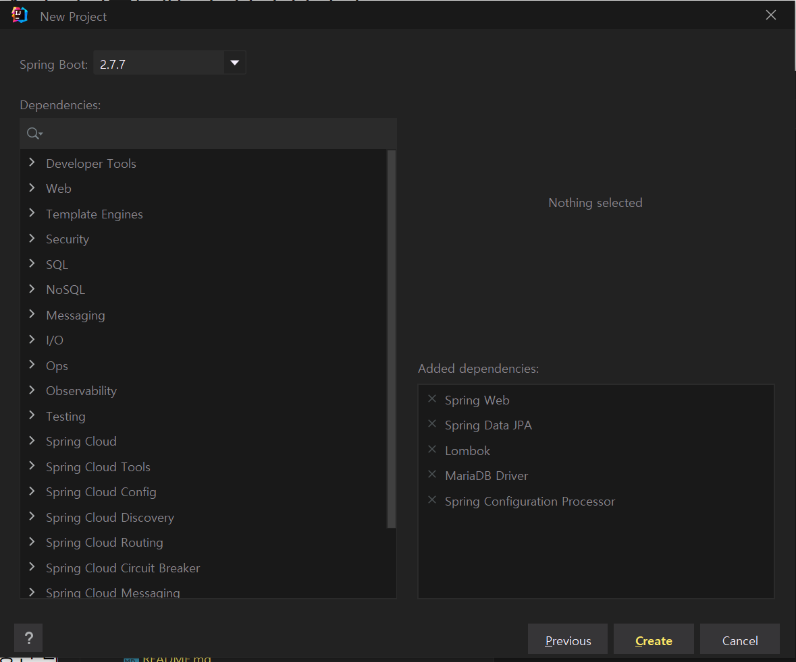

#### Intellij 프로젝트 설정

**1. Setting > Build, Execution, Deployment > Gradle**

다음과 같이 Build와 Run을 Intellij로 설정

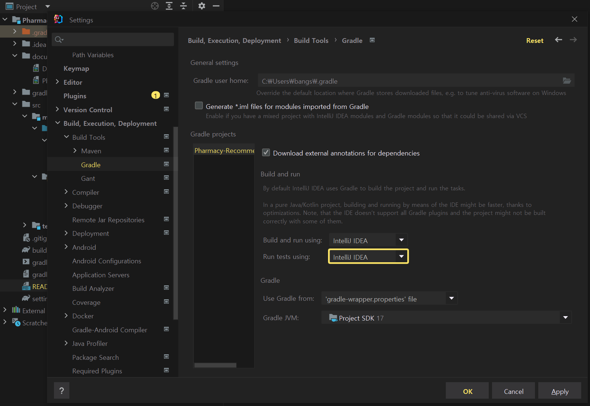

**2. Setting > Build, Execution, Deployment > Compiler > Annotation Processors**

Lombok Annotation을 활성화시킴켜준다.

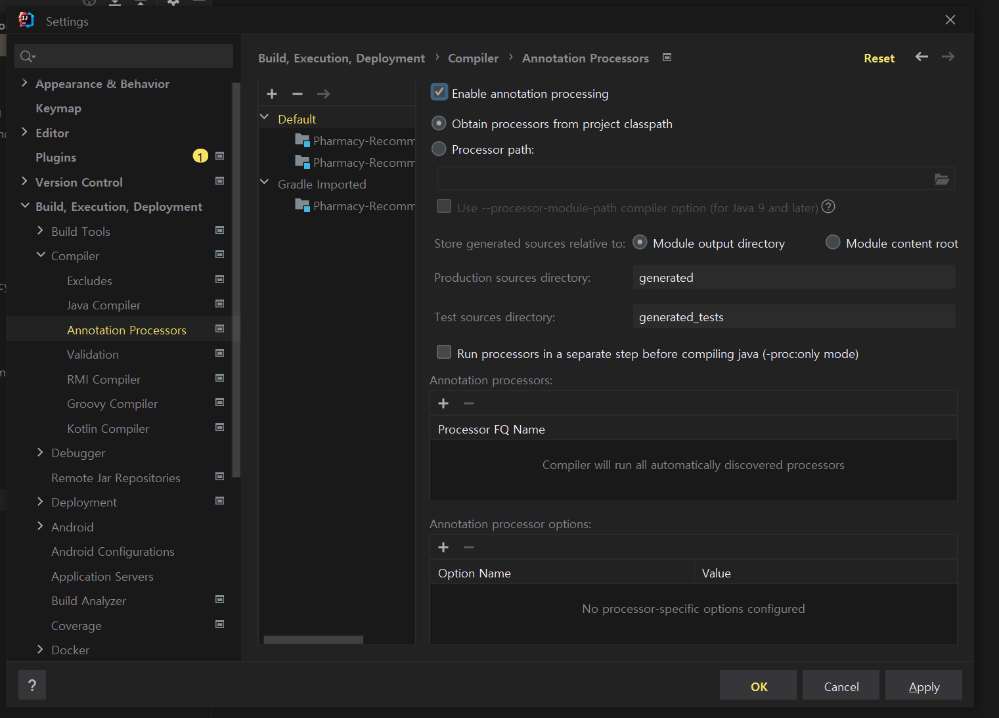

**3. 플러그인**

* Lombok
* Handlebars
* Spock Framework
* (Optional) Key Promoter X, Grep Console, Rainbow Brackets, GitToolBox

#### Github 를 통한 버전 관리

**Github와 Project 연동**

```java
# 현재 디렉토리 기준, git 저장소 생성(초기화)하여 .git 폴더 생성
$ git init 

# 생성된 .git 폴더 등 확인 가능
$ git status

# github 원격 저장소 확인
$ git remove -v 

# 로컬 저장소와 원격 저장소 연결
$ git remote add origin {remote repository url}
```

원격 저장소 URL은 다음과 같이 볼 수 있다.

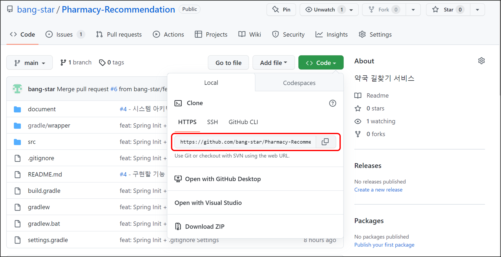

### **도커 및 도커 컴포즈 소개**

---

도커를 이용하여 컨테이너화하기 위해 도커에 대한 이해가 필요하다.

#### **도커**

* 컨테이너를 사용하여 응용프로그램을 더 쉽게 만들고, 배포하고 실행할 수 있도록 설계된 도구이며 컨테이너 기반의 오픈소스 가상화 플랫폼
* 일반 컨테이너 개념에서 물건을 손쉽게 운송해주는 것처럼 어플리케이션 환경에 구애 받지 않고 손쉽게 배포 관리를 할 수 있게 해준다.
* 컨테이너 기반 배포 방식은 구글을 비롯해 대부분 서비스 회사가 컨테이너로 서비스 운영 중이다.  
  따라서 AWS, Azure, Google Cloud 등 어디서든 실행 가능하다.

---

#### **도커를 왜 굳이 사용해야 할까?**

똑같은 일을 하는 2대의 서버가 있다 해도, A 서버는 1년 전에 구성했고 B 서버는 이제 막 구성했다면 운영체제부터 컴파일러, 설치된 패키지까지 완벽하게 같기는 쉽지 않다. 이러한 차이가 문제를 발생시킬 수 있다.

A 서버에서는 동작하는데 B 서버에서는 동작하지 않되는 문제가 발생했을 때 여러 가지 방식으로 추가적인 비용을 소모하여 해결할 수 있다. **도커는 서버마다 동일한 환경을 구성**해주기 때문에 이러한 문제를 쉽게 해결할 수 있다.

**동일한 환경을 구성하기 때문에 auto scaling에 유리하다.**

> **auto scaling**서버를 줄이고 늘리는 작업을 자동으로 해준다는 개념이다. 특정 서비스에 트래픽이 몰리는 시간 대가 존재할 것이다. 이때 트래픽이 몰리는 시간대에는 자동으로 서버를 늘려주고 반면에 트래픽이 줄어든 시간대에는 비용을 줄이기 위해 서버를 줄여주는 것을 의미한다.

프로젝트에 사용될 MariaDB 또는 Redis 를 사용할 것인데 데이터베이스나 Redis 를 도커베이스 이미지로 받아 사용할 것이다. 이유는 데이터베이스나 Redis 를 로컬에서 직접 설치할 때 환경 변수 및 설정을 직접 해줘야하는데 잘만들어진 도커베이스 이미지를 사용하면 실행만 하면 되기 때문에 굉장히 구성하기 쉽다. 

---

#### **도커와 기존 가상화 기술(VM) 차이**

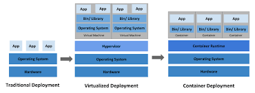

애플리케이션 배포 환경의 변화(Traditional Development) 출처: Kubernates

**Traditional Develment**

한대의 서버에 하나의 어플리케이션만 운영하는 방식을 의미한다. 한대의 서버에 여러 어플리케이션을 올릴 수 있지만 하나의 어플리케이션에서 문제가 발생하게 되면 동일한 OS에서 공유해서 작동하기 때문에 다른 어플리케이션에 전파가 된다. 전파가 되면 위험하기 때문에 보통은 한대에 서버에서 하나의 어플리케이션만 운영하는 것이 전통적 방식인데 이렇게 되면 남는 리소스가 있거나 비효율적인 문제 때문에 VM이 등장하였다.

**Virtualized Deployment**

하드웨어 가상화는 VM을 생성한다. VM은 하이퍼 바이저로 하이퍼 바이저는 호스트 시스템(윈도우, 리눅스 등)에서 다수의 게스트 OS(가상머신)을 구동할 수 있게 하는 소프트웨어를 의미한다. 

* 가상화를 사용하면 단일 물리적 서버에서 여러 VM을 실행할 수 있다.
* 각 VM에는 수십 GB를 차지하는 운영 체제, 애플리케이션, 필수 바이너리 및 라이브러리의 전체 사본이 포함된다.
* 가상화를 통해 확장성 문제를 해결하는 애플리케이션을 보다 쉽게 추가 및 업데이트할 수 있다.
* 가상화를 통해 리소스를 더 잘 활용할 수 있다.
* 가상화는 VM 간에 애플리케이션을 격리한다.

VM을 사용하다보면 알 수 있지만 버벅이고 느리다. 

**Container Deployment**

도커는 하이퍼 바이저 구조를 토대로 등장했으며, VM보다 훨씬 가볍게 동작하기 때문에 성능에 유리하다.

* 운영 체제를 가상화하는 프로세스는 컨테이너를 생성한다.
* 컨테이너는 가상 운영 체제다.
* 컨테이너는 표준화된 소프트웨어 단위로 코드와 종속성을 함께 패키징하는 OS 계층의 추상화다.
* 컨테이너는 VM보다 적은 공간을 차지하고 빠르게 부팅되며 격리된다.
* 컨테이너화는 인프라 낭비 리소스를 제거하고 활용한다.

전통적인 방식에 비해 어플리케이션 간에 분리되어 있기 때문에 하나의 어플리케이션에서 문제가 발생해도 다른 어플리케이션에 전혀 영향을 주지 않기 때문에 VM과 Container은 굉장히 안전하다. 

**Refer**

* [LinkedIn] [Traditional Deployment VS Virtualization VS Container](https://www.linkedin.com/pulse/traditional-deployment-vs-virtualization-container-shazly-abozeid)

---

#### 도커의 컨테이너와 이미지

* **이미지란 코드, 런타임,  시스템 도구, 시스템 라이브러리 및 설정과 같은 으용프로그램을 실행하는데 필요한 모든 것을 포함하는 패키지다.**
  + 이미지는 Github와 유사한 서비스인 [Docker Hub](https://hub.docker.com/)을 통해 버전관리 된다.
* **컨테이너란 도커 이미지를 독립된 공간에서 실행할 수 있게 해주는 기술이다.**


---

#### 도커 파일이란?

**Dockerfile 이란 도커 이미지를 구성하기 위해 있어야할 패키지, 의존성, 소스 코드 등을 하나의 file로 기록하여 이미지화 시킬 명령 파일이다. 즉 이미지는 컨테이너를 실행하기 위한 모든 정보를 가지고 있기 때문에 더 이상 새로운 서버가 추가되면 의존성 파일을 컴파일하고 이것 저것 설치할 필요가 없다.**

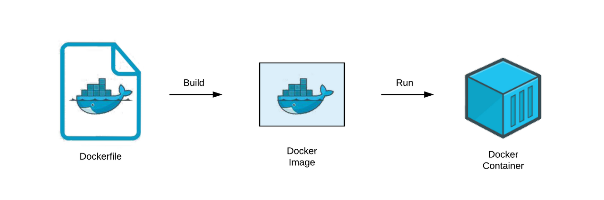

하나의 서버를 구성하면 설치되어야할 명령어들이 나열되어 있다.

```java
FROM openjdk:17
ARG JAR_FILE=build/libs/app.jar
COPY ${JAR_FILE} ./app.jar
COPY pharmacy.csv ./
ENV TZ=Asia/Seoul
ENTRYPOINT ["java", "-jar", "./app.jar"]
```

> 도커베이스 이미지는 openjdk 17을 사용할 것이고  
> ARG는 Argument로 어떤 변수를 사용할 것인지   
> COPY는 어떤 부분을 복사할 것인지  
> ENV 환경변수로 컨테이너가 어떤 Time Zone을 사용할 것인지 명시하였다.  
> ENTRYPOINT는 컨테이너가 실행될 때 어떤 명령어를 실행할 것인지에 대한 부분이다.

어떤 서버를 추가하고 JDK를 설치하거나 자료 파일을 올려 실행하거나 이와 같이 해야할 작업들이 모두 하나의 파일에 모여 있다고 생각하면 된다.

=> Docker File이 Build가 되면 Docker Image가 되고 Docker Image를 실행하면 독립된 Docker Container에서 프로그램이 실행되게 된다.

---

#### 도커 파일 주요 명령어

* **FROM**새로운 이미지를 생성할 때 기반으로 사용할 이미지를 지정(이미지 이름 : 태그)  
  예시) JDK 17이 있는 컨테이너를 사용한다면 **FROM openjdk:17**
* **ARG**이미지 빌드 시점에서 사용할 변수 지정  
  예시) ARG JAR\_FILE=build/libs/app.jar
* **COPY**호스트에 있는 파일이나 디렉토리를 Docker 이미지의 파일 시스템으로 복사  
  예시) COPY ${JAR\_FILE}./app.jar
* **ENV**컨테이너에서 사용할 환경 변수 지정할 때 사용한다.예시) TimeZone 환경 변수는 ENV TZ=Asiz/Seoul
* **ENTRYPOINT**컨테이너가 실행되었을 때 항상 실행되어야 하는 커맨드 지정  
  예시) ENTRYPOINT ["java", "-jar", "./app.jar"]

---

#### 도커 컴포즈란?

* **Docker Compose란 멀티 컨테이너 도커 어플리케이션을 정의하고 실행하는 도구**
  + **다중 컨테이너 라이프 사이클을 관리한다.**일반적으로 Docker는 싱글 컨테이너로 배포하지 않고 멀티 컨테이너로 배포하게 된다. Application, Database, Redis, Nginx 등 각 독립적인 컨테이너로 관리한다고 했을 때 다중 컨테이너 라이프 사이클은 Docker Compose가 관리해준다.
  + **여러개의 도커 컨테이너로 부터 이루어진 서비스를 구축 및 네트워크 연결, 실행 순서를 자동으로 관리**도커 컨테이너는 각각 독립적인 환경으로 되어 있어 각 컨테이너 별로 네트워크 연결하는 부분을 따로 설정을 해야 한다. 이러한 부분들도 Docker Compose가 알아서 관리해준다.
* docker-compose.yml 파일을 작성하여 1회 실행하는 것으로 라이프 사이클과 도커 컨테이너 간에 실행 순서을 관리해주고 설정된 모든 컨테이너를 실행해준다.

### **도커를 이용한 싱글 컨테이너 어플리케이션 실습**

---

#### Docker Desktop 설치

자신의 OS에 맞게 설치하면 된다.

[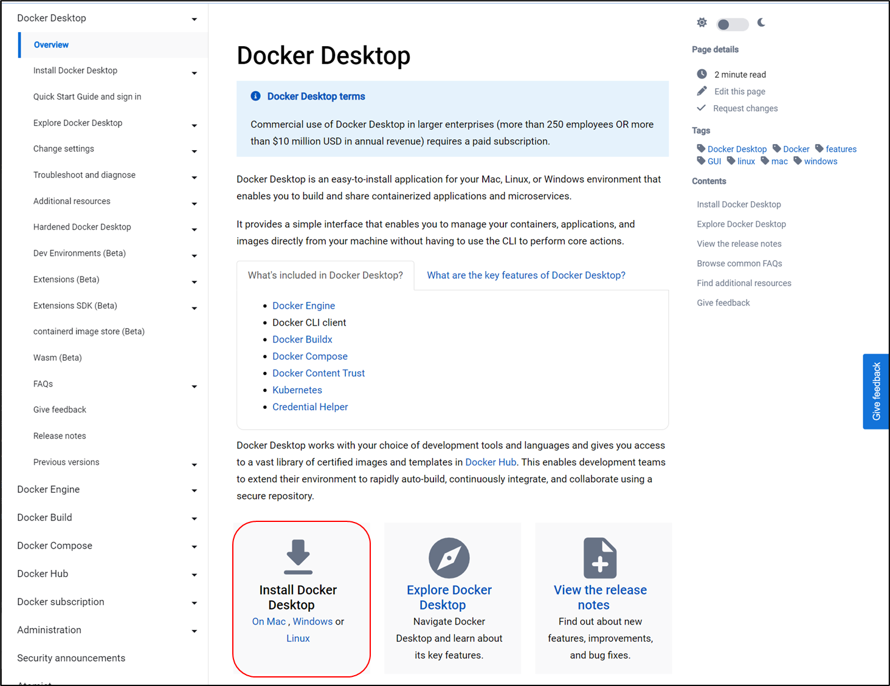](https://docs.docker.com/desktop/)

#### Docker Hub

무료 플랜으로 회원가입 및 로그인을 해주면 된다.

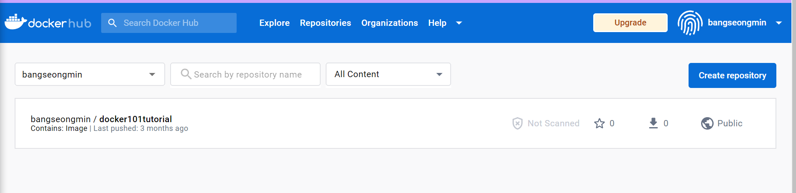

#### Docker Compose

Mac 또는 Windows의 경우 Docker desktop을 서치한 경우라면 docker-compose 설치할 필요 없으며, Linux의 경우 추가 설치가 필요하다.

> $sudo curl -L https://github.com/docker/compose/releases/download/1.29.2/docker-compose-$(uname- s)-$(uname -m) -o /user/local/bin/docker-compose

설치 후 아래 명령어를 통해 설치를 확인할 수 있다.

> $ docker -v  
> $ docker-compose -v

**gradle wrapper를 이용하여 jar 파일 생성**

보통 자바를 실행할 때 빌드 결과물인 jar 파일을 이용해서 java를 실행한다. 실제로 Docker 컨테이너에서 jar 파일을 실행해서 Spring boot Application을 실행해볼 것이다. 실행하기 위해서는 build 결과물인 jar 파일이 필요하다.

```java
# 기본 경로는 프로젝트의 build/libs/*.jar
$ gradlew build (Window)
$ ./gradlew build (Linux, OSX)
```

**build.gradle에서 jar 파일 이름 변경**

```java
bootJar{
   archiveFilename = 'app.jar'
}
```

**app, database, redis 도커 파일 각각 작성**


**docker run 명령어를 통해 컨테이너 생성 및 시작**

도커 파일을 작성하고 나면 도커 파일을 이용하여 도커 이미지로 빌드할 것이다. 

도커 이미지를 통해 컨테이너를 생성하고 시작한다. 이때 docker run 이라는 명령어를 통해 컨테이너를 생성함과 동시에 실행할 수 있다. 


**Docker run 명령어를 통해 컨테이너 생성 및 시작**


#### 실행 로그

**1. docker, docker-compose 버전 확인 및 docker 로그인(docker hub 회원가입이 선행되어야함)**

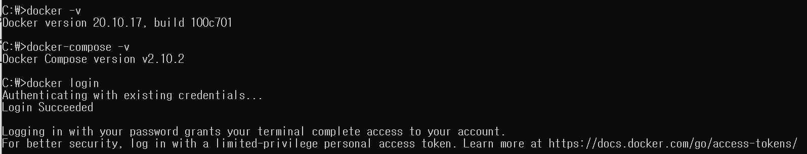

**2. 어플리케이션 프로젝트에서 jar 파일 생성**

```java
$ ./gradlew clean

BUILD SUCCESSFUL in 2s
1 actionable task: 1 executed

$ ./gradlew build

BUILD SUCCESSFUL in 14s
7 actionable tasks: 7 executed
```

3. Dockerfile 생성

```java
FROM openjdk:17
ARG JAR_FILE=build/lib/app.jar
COPY ${JAR_FILE} ./app.jar
ENV TZ=Asiz/Seoul
ENTRYPOINT ["java", "-jar", "./app.jar"]
```

> FROM openjdk:17                                                                         // 베이스 이미지 명시  
> ARG JAR\_FILE=build/lib/app.jar                                                   // 변수 선언하고 jar 파일 경로를 값으로 설정  
> COPY ${JAR\_FILE} ./app.jar                                                         // jar 파일을 Docker컨테이너 내부로 가져오는 명령  
> ENV TZ=Asiz/Seoul                                                                       // Default:UTC  
> ENTRYPOINT ["java", "-jar", "./app.jar"]                                        //  컨테이너 실행시 실행될 명령어

3. Dockerfile build → Docker Image

```java
bangs@DESKTOP-UE84M7G MINGW64 $ docker build -t bangseongmin/application-project-test .
[+] Building 3.2s (4/6)
 => [internal] load build definition from Dockerfile                                                                                                                                                                              0.0s                  0.0s 
 => => transferring dockerfile: 176B                                                                                                                                                                                              0.0s 
 => [internal] load .dockerignore                                                                                                                                                                                                 0.0s 
 => => transferring context: 2B                                                                                                                                                                                                   0.0s 
 => [internal] load metadata for docker.io/library/openjdk:17                                                                                                                                                                     0.9s 
 => [internal] load build context                                                                                                                                                                                                 0.3s 
 => => transferring context: 17.65MB                                                                                                                                                                                              0.3s 
 => [1/2] FROM docker.io/library/openjdk:17@sha256:528707081fdb9562eb819128a9f85ae7fe000e2fbaeaf9f87662e7b3f38cb7d8                                                                                                               2.1s 
bangs@DESKTOP-UE84M7G MINGW64 /d/Self-Study/FastCampus-Project/Part7_Pharmacy_Recommendation/Pharmacy-Recommendation (main)
$ docker build -t bangseongmin/application-project-test .
[+] Building 29.1s (7/7) FINISHED
 => [internal] load build definition from Dockerfile                                                                                                                                                                              0.0s 
 => => transferring dockerfile: 176B                                                                                                                                                                                              0.0s 
 => [internal] load .dockerignore                                                                                                                                                                                                 0.0s 
 => => transferring context: 2B                                                                                                                                                                                                   0.0s 
 => [internal] load metadata for docker.io/library/openjdk:17                                                                                                                                                                     0.9s 
 => [internal] load build context                                                                                                                                                                                                 0.3s 
 => => transferring context: 17.65MB                                                                                                                                                                                              0.3s 
 => [1/2] FROM docker.io/library/openjdk:17@sha256:528707081fdb9562eb819128a9f85ae7fe000e2fbaeaf9f87662e7b3f38cb7d8                                                                                                              26.1s 
 => => resolve docker.io/library/openjdk:17@sha256:528707081fdb9562eb819128a9f85ae7fe000e2fbaeaf9f87662e7b3f38cb7d8                                                                                                               0.0s 
 => => sha256:528707081fdb9562eb819128a9f85ae7fe000e2fbaeaf9f87662e7b3f38cb7d8 1.04kB / 1.04kB                                                                                                                                    0.0s 
 => => sha256:98f0304b3a3b7c12ce641177a99d1f3be56f532473a528fda38d53d519cafb13 954B / 954B                                                                                                                                        0.0s 
 => => sha256:5e28ba2b4cdb3a7c3bd0ee2e635a5f6481682b77eabf8b51a17ea8bfe1c05697 4.45kB / 4.45kB                                                                                                                                    0.0s 
 => => sha256:38a980f2cc8accf69c23deae6743d42a87eb34a54f02396f3fcfd7c2d06e2c5b 42.11MB / 42.11MB                                                                                                                                 10.8s 
 => => sha256:de849f1cfbe60b1c06a1db83a3129ab0ea397c4852b98e3e4300b12ee57ba111 13.53MB / 13.53MB                                                                                                                                  3.6s 
 => => sha256:a7203ca35e75e068651c9907d659adc721dba823441b78639fde66fc988f042f 187.53MB / 187.53MB                                                                                                                               21.0s 
 => => extracting sha256:38a980f2cc8accf69c23deae6743d42a87eb34a54f02396f3fcfd7c2d06e2c5b                                                                                                                                         4.1s 
 => => extracting sha256:de849f1cfbe60b1c06a1db83a3129ab0ea397c4852b98e3e4300b12ee57ba111                                                                                                                                         1.4s 
 => => extracting sha256:a7203ca35e75e068651c9907d659adc721dba823441b78639fde66fc988f042f                                                                                                                                         4.8s 
 => [2/2] COPY build/libs/app.jar ./app.jar                                                                                                                                                                                       1.6s 
 => exporting to image                                                                                                                                                                                                            0.2s 
 => => exporting layers                                                                                                                                                                                                           0.2s 
 => => writing image sha256:a82e8fdb16a5d657da17be8e9849c1d4e4fb5c66d9805ff0a675a86e553aa2bc                                                                                                                                      0.0s 
 => => naming to docker.io/bangseongmin/application-project-test                                                                                                                                                                  0.0s 

Use 'docker scan' to run Snyk tests against images to find vulnerabilities and learn how to fix them
```

**Docker Image를 확인하는 방법**

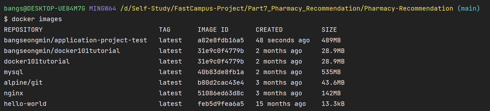

**4. Docker Image Run → Docker Container 생성 및 실행**

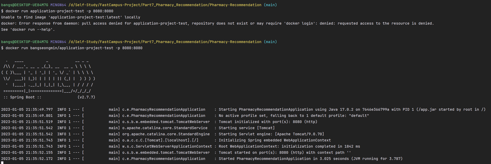

**5. 정상 실행 확인**

> $ docker ps // 현재 실행중인 docker container 조회

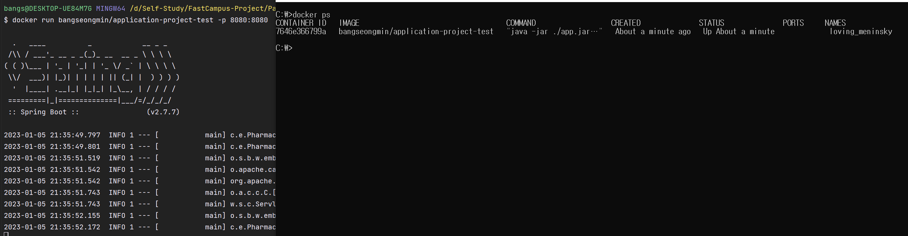

> $ docker exec -it {CONTAINER ID} bash  // 컨테이너 내부 접속

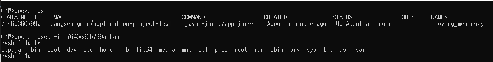

### 개발환경과 운영환경 profile 나누기

---

* Spring Profile는 어플리케이션 설정(데이터베이스 설정 값이나 API Key 등)을 특정 환경에서만 적용되게 하거나 환경 별(local, develop, production)로 다르게 적용할 때 사용한다.  
  (application-local.yml, application-prod.yml) /  application-{profile}.yml
* Spring boot는 어플리케이션이 실행될 떄 자동으로 application.properties(yml)를 찾는다.  
  application.properties와 application.yml을 동시에 사용하지 않도록 주의하자.  
  같이 존재할 경우 properties가 항상 나중에 로드되어 yaml에 정의한 profile 설정을 덮어 쓸 수 있기 때문이다.
* Spring boot 버전 2.4 이전과 이후 설정 방법이 다르므로 주의해야 한다.

#### **Spring boot 2.4 이전 profile**

참고로 YAML은 하나의 profile에 (---) 구분자로 구분을 하면, 논리적으로 구분이 되어 파일을 나누어서 사용하는 효과를 볼 수 있다.

**application.yml**

```java
# default
spring:
    profiles:
        active: local
---
spring:
    profiles: local
# ...
---
spring:
    profiles: dev
# ...
---
spring:
    profiles: prod
# ...
```

또한, 여러 profile을 포함시키기 위해 include를 이용하여 아래와 같이 설정 할 수 있었다.

**application.yml**

```java
# default
spring:
    profiles:
        active: local
---
spring:
    profiles: local
        include:
        - common
# ...
```

#### **Spring boot 2.4 이후 profile**

Spring boot 2.4부터는 spring.profiles은 deprecated 되었고 spring.profiles로 사용하는 것이 아닌 spring.config.active.on-profile로 더 직관적으로 알아 볼 수 있도록 변경되었다.

application.yml

```java
spring:
  profiles:
    active: local # 기본적으로 활성화할 profile을 local로 설정 

---
spring:
  config:
    activate:
      on-profile: local
# ... 
---
spring:
  config:
    activate:
      on-profile: prod
# ...
```

또한, 아래와 같이 spring.profiles.group 을 이용해서 여러 profile들을 한꺼번에 그룹지어 하나의 profile로 만들 수 있다.

=> include 대신 group을 사용한다.

spring.profiles.active=prod로 실행하게 되면 prod와 common 두개의 profile들을 한번에 실행할 수 있다.

**application.yml**

```java
# default
spring:
  profiles:
    active: local # default
    group:
      local:  # local, common profile을 그룹지어 함께 어플리케이션 구동    
        - common
      prod:   # prod, common profile을 그룹지어 함께 어플리케이션 구동  
        - common   

---
spring:
  config:
    activate:
      on-profile: common   # application-common.yml 과 동일한 역할

---
spring:
  config:
    activate:
      on-profile: local

---
spring:
  config:
    activate:
      on-profile: prod
```

인텔리제이에서 profile 값을 주기 위해 자바로 실행할 때 VM arguments로 java -jar -Dspring.profiles.active=local app.jar 로 줄 수도 있다.

실제로 application을 실행할 때 spring.profiles.active 설정을 주어 어떠한 profile를 활성화할 것인지 정해주어야 한다.  
해당 설정이 없을 시에는 위에서 정해준 default 값으로 profile이 실행된다

참고로, 위의 YAML 파일에서 사용하는 구분자는 Spring boot 2.4 부터 properties도 구분자(#---)를 이용하여 아래와 같이 사용가능하다.

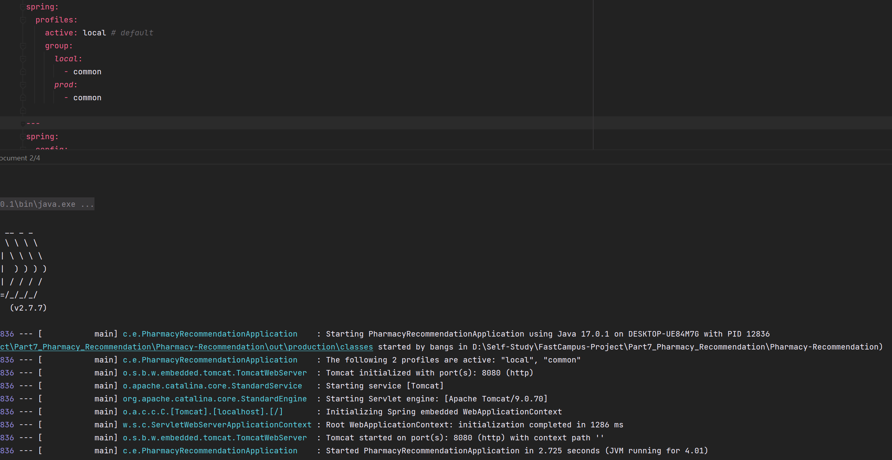
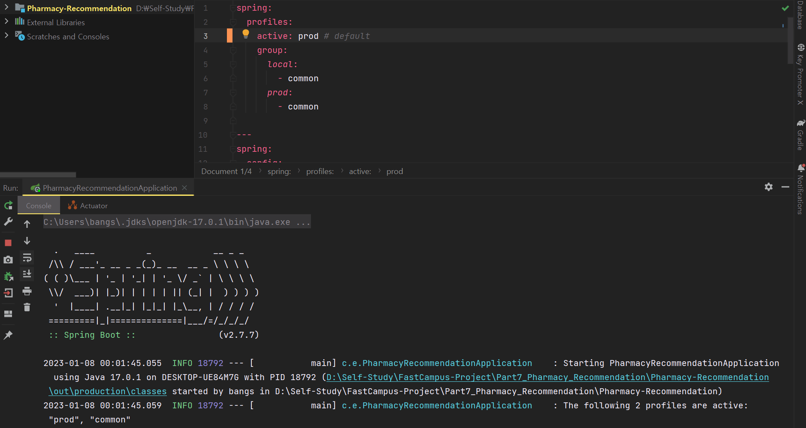

### 도커를 이용한 다중 환경 구성하기

---

개발환경과 운영환경으로 분리한 프로파일을 나눈것을 기반으로 다중환경을 구성해보려 한다.

먼저 로컬 환경에서 실행할 Docker-compose를 구성해보려 한다.

#### 도커 컴포즈 파일 작성(docker-compose.yml)

Docker Compose는 멀티 컨테이너 도커 어플리케이션을 정의하고 실행하는 도구로 여러개의 도커 컨테이너로 부터 이루어진 서비스를 구축 및 네트워크 연결, 실행 순서를 자동으로 관리해준다. docker-compose.yml 파일을 작성하여 1회 실행하는 것으로 설정된 모든 컨테이너를 실행한다.


docker-compose.yml 이 개발환경과 운영환경이 다르다.

로컬에서 개발할 때에는 Spring boot application, Database와 Redis 를 모두 컨테이너로 띄우서 개발한다고 한다면 Spring boot application을 디버깅하기가 까다롭다. 그래서 로컬환경 즉 개발환경에서는 데이터베이스와 Redis만 컨테이너로 띄우고 Spring boot application만 Intellij 로 띄우고 편하게 디버깅하면서 테스트할 수 있도록 환경을 구성하려 한다.

클라우드 서비스 배포할 때는 Application, Database, Redis를 다중 컨테이너로 구성해서 배포할 것이다. 

* 로컬에서 사용할 DB, Redis 도커파일 작성 후 docker-compose 파일 작성
* docker-compose -f docker-compose-local.yml up          // 실행
* docker-compose -f docker-compose-local.yml down     // 중지 및 컨테이너 정리

redis와 database(mariadb)는 이미 docker-hub에 베이스 이미지가 존재하기 때문에 간편하게 이미지를 사용할 수 있다.

각각에 도커 파일을 도커 이미지 없이 도커 컨테이너를 띄우려 한다면 도커 파일을 이미지로 빌드하고 빌드한 이미지를각각에 컨테이너로  띄워주어야한다. 도커 파일이 많아질 수록 관리해야할 도커 컨테이너가 늘어나게 된다.

도커 컨테이너들을 한번에 라이프 사이클을 관리하기 위해 도커 컴포즈를 사용하는 것이다.

TODO 이미지 넣기!!

#### docker MariaDb 설정

* 한글 깨짐 현상을 막기 위해 추가 설정이 필요하다.
* docker mariaDB 컨테이너 내에 /etc/mysql/conf.d 경로에 .cnf 설정 파일을 넣어주면 해당 내요을 바탕으로 설정이 초기화된다.

```java
[client]
default-character-set=utf8mb4

[mysql]
default-character-set=utf8mb4

[mysqld]
character-set-server=utf8mb4
collation-server=utf8mb4_unicode_ci
skip-character-set-client-handshake

[mysqldump]
default-character-set=utf8mb4
```

DB 및 Redis 설정 추가(application.yml 로컬 환경)

도커 컴포즈 파일을 작성하고 나면 Spring boot application에서 데이터베이스나 Redis 관련 설정값을 추가해주어야한다.

```java
spring:
  config:
    activate:
      on-profile: local
    datasource:
      driver-class-name: org.mariadb.jdbc.Driver
      url: jdbc:mariadb://localhost:3306/pharmacy-recommendation
      username: ${SPRING_DATASOURCE_USERNAME}
      password: ${SPRING_DATASOURCE_PASSWORD}
    redis:
      host: localhost
      port: 6379
    jpa:
      hibernate:
        ddl-auto: create
      show-sql: ture
```

#### Docker Compose 환경변수 설정 방법

* Docker Compose에서 환경 변수 정보들을 분리하여 별도의 파일로 구성할 때 간편한 방법은 Compose 파일이 위치한 경로에 .evn 파일을 구성한다.
* 작성한 .evn 파일은 별다른 설정 없이 Docker Compose에 바로 반영된다.
* 비밀정보가 코드에 노출되지 않도록 하기 위해 .gitignore에 .evn 파일 추가한다.

```java
$ docker-compose config // .evn 파일 자동 반영
$ docker-compose up     // 이미지 없을 때 이미지 빌드 후 컨테이너 실행(이미 존재하는 경우 해당 이미지 사용)
$ docker-compose up --build // 이미지가 있든 없든 재빌드하여 컨테이너 실행
```

```java
// .env 파일 (.gitignore에 추가할 것)
SPRING_DATASOURCE_USERNAME=root
SPRING_DATASOURCE_PASSWORD=1234
```

추후 암호화를 통해 더 높은 보안을 제공하는 오픈소스 HashiCorp Vault 고려

### 도커를 이용한 다중 컨테이너 환경 구현하기

---

다음과 같이 Docker Compose 파일과 Dockfile을 생성한다.

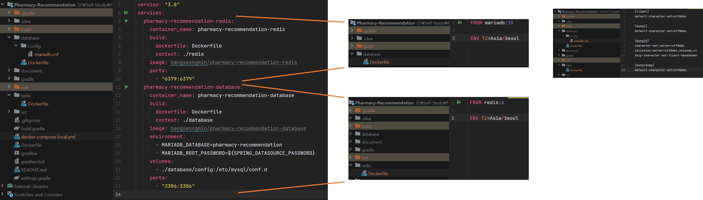

Docker Desktop을 실행하고 터미널을 통해 docker-compose 파일을 실행시켜준다.

```java
$ docker-compose -f docker-compose-local.yml up
```

docker-compose 파일을 실행하면 다음과 같이 database와 redis 컨테이너가 생성되게 된다.

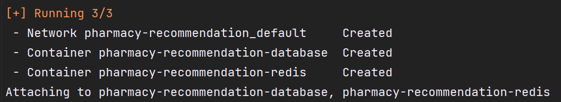

새로운 터미널을 통해 정상적으로 컨테이너가 실행되었는지 확인할 수 있다.

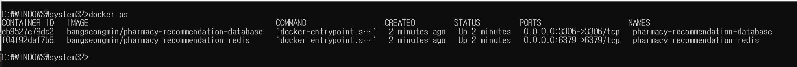

spring boot application은 intellij를 이용해서 database와 redis를 편하게 사용할 수 있게 되었다.

이를 위해 application.yaml파일에 설정을 추가해주어야 한다.

```java
spring:
  profiles:
    active: local # default
    group:
      local:
        - common
      prod:
        - common

---
spring:
  config:
    activate:
      on-profile: common

# ...

---

spring:
  config:
    activate:
      on-profile: local
  datasource:
    driver-class-name: org.mariadb.jdbc.Driver
    url: jdbc:mariadb://localhost:3306/pharmacy-recommendation
    username: ${SPRING_DATASOURCE_USERNAME}
    password: ${SPRING_DATASOURCE_PASSWORD}


---

spring:
  config:
    activate:
      on-profile: prod
```

username과 password는 .env 파일은 Docker compose가 실행될때 참조하는 파일이기 때문에 .env 파일에서 가져올 수 없고 intellij 에서 환경변수를 추가해주어야한다. 그래서 클라우드 서비스에 배포할 때에는 Spring boot application이 컨테이너로 실행될 것이기 때문에 .evn 파일로 정상적으로 참조해서 실행되겠지만 현재 로컬에서 개발할 때에는 Intellij에서 따로 환경변수를 추가해주어야 한다.

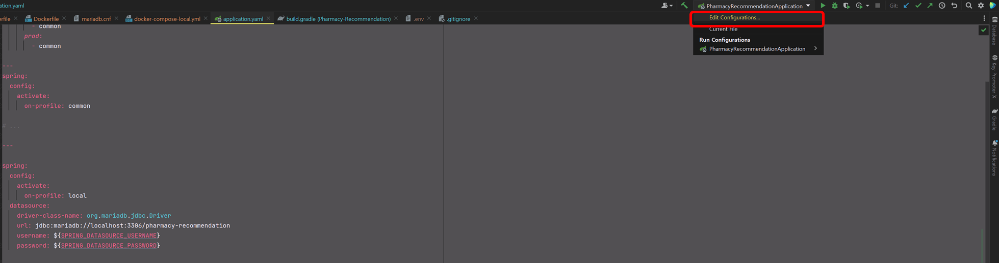

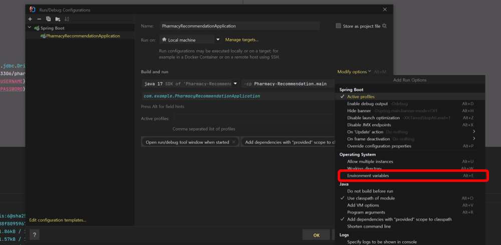

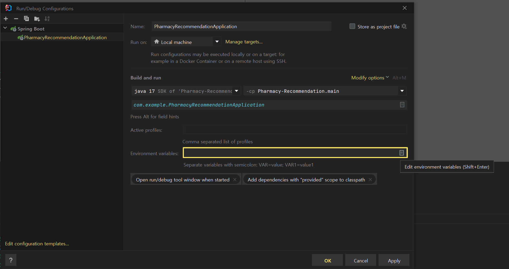

다음과 같이 데이터베이스에 username과 password를 입력해주면 된다.

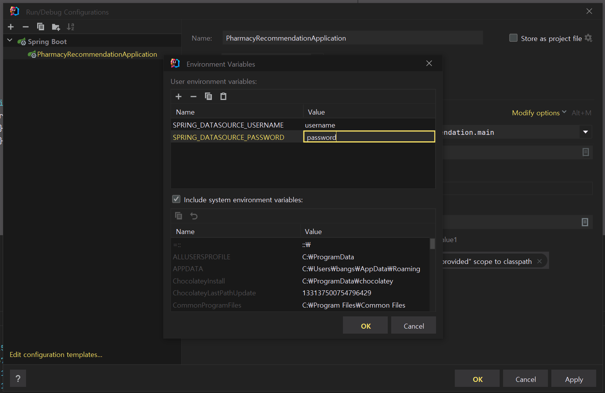

현재 데이터베이스만 설정하였고, Redis와 jpa 관련 설정을 해주어야 한다.

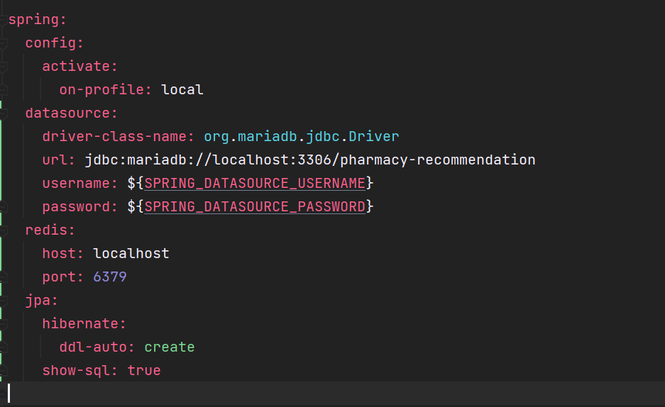

위와 같이 설정을 완료하면 로컬환경에서 개발하기 위한 환경을 모두 준비가 되었다.

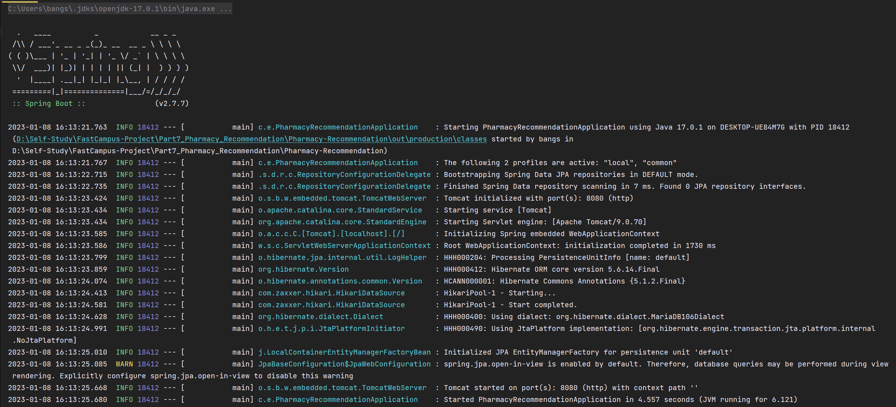

현재 에러가 발생하지 않기 때문에 정상적으로 동작함을 확인할 수 있다.
