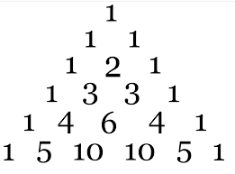
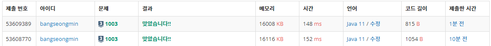

## 피보나치 함수

---

### **문제 설명**

다음 소스는 N번째 피보나치 수를 구하는 C++ 함수이다.

```java
int fibonacci(int n) {
    if (n == 0) {
        printf("0");
        return 0;
    } else if (n == 1) {
        printf("1");
        return 1;
    } else {
        return fibonacci(n‐1) + fibonacci(n‐2);
    }
}
```

fibonacci(3)을 호출하면 다음과 같은 일이 일어난다.

* fibonacci(3)은 fibonacci(2)와 fibonacci(1) (첫 번째 호출)을 호출한다.
* fibonacci(2)는 fibonacci(1) (두 번째 호출)과 fibonacci(0)을 호출한다.
* 두 번째 호출한 fibonacci(1)은 1을 출력하고 1을 리턴한다.
* fibonacci(0)은 0을 출력하고, 0을 리턴한다.
* fibonacci(2)는 fibonacci(1)과 fibonacci(0)의 결과를 얻고, 1을 리턴한다.
* 첫 번째 호출한 fibonacci(1)은 1을 출력하고, 1을 리턴한다.
* fibonacci(3)은 fibonacci(2)와 fibonacci(1)의 결과를 얻고, 2를 리턴한다.

1은 2번 출력되고, 0은 1번 출력된다. N이 주어졌을 때, fibonacci(N)을 호출했을 때, 0과 1이 각각 몇 번 출력되는지 구하는 프로그램을 작성하시오.

### **입력과 출력**

#### **입력**

첫째 줄에 테스트 케이스의 개수 T가 주어진다.

각 테스트 케이스는 한 줄로 이루어져 있고, N이 주어진다. N은 40보다 작거나 같은 자연수 또는 0이다.

#### **출력**

각 테스트 케이스마다 0이 출력되는 횟수와 1이 출력되는 횟수를 공백으로 구분해서 출력한다.

### **알고리즘**

피보나치는 재귀함수에 대표적인 예시이다.

피보나치는 **수열** 중 하나로 수열의 항들을 **피보나치 수**라고 한다. 피보나치수열의 이웃한 두 항이 항상 서로소이다.

피보나치를 나타낼 F 메소드가 있을 때

F(0) = 0, F(1) = 1이라고 할때 0과 1은 시작을 위함이다. 0, 0 -> 0 으로 무한대로 0만 나열되므로 시작을 위해 0, 1로 시작한다. 

| Before | Cur | Next |
| --- | --- | --- |
| F(0) = 0 | F(1) = 1 | F(2) = 1 |
| F(1) = 1 | F(2) = 1 | F(3) = 2 |
| F(2) = 1 | F(3) = 2 | F(4) = 3 |
| F(3) = 2 | F(4) = 3 | F(5) = 5 |
| F(4) = 3 | F(5) = 5 | F(6) = 8 |
| F(N-1) | F(N) | F(N+1) = F(N-1) + F(N) |

F(N+1)에 대한 결과를 알기 위해서는 피연산자 두 개를 구해야한다.

F(N) = F(N-2) + F(N-1), F(N-1) = F(N-3) + F(N-2) ... 이처럼 하나를 알려면 두가지를 알아야 한다. 이를 구하려면 순차적으로 그림이 만들어진다.



이 문제는 피보나치의 F(N)을 구하는 것이 아닌 F(0)과 F(1)이 각각 몇번 호출되는지 묻는 문제이다.

이 문제는 재귀(Top-Down)를 이용하여 풀이할 수 있고, 다른 하나는 반복문(Bottom-Up)을 사용하여 계산하는 방법이 있다. 

#### **DP 재귀 풀이법**

재귀호출을 할 때 이미 한번 탐색했던 값이 있다면 또다시 연산하는 것이 아니라 이미 계산된 값을 자사용하여 반복적인 연산과정을 줄이는 방법이 DP 풀이의 기초다.

피보나치 수를 배열에 담아 해당 배열에 값이 있다면 F(N-1) + F(N-2)을 통해 재귀호출을 해주고, 만약 배열에 값이 있다면 해당 배열값을 바로 반환해주면 된다.

N = 2 → F(2) = F(1) + F(0) 이므로 0과 1은 각각 1번씩 호출된다.

| N | formula | Count(0) | Count(1) |
| --- | --- | --- | --- |
| 0 | F(0) = 0 | 1 | 0 |
| 1 | F(1) = 1 | 0 | 1 |
| 2 | F(2) = F(0) + F(1) | 1 | 1 |
| 3 | F(3) = F(2) + F(1) = (F(0) + F(1)) + F(1) | 1 | 2 |
| 4 | F(4) = F(3) + F(2) = (F(2) + F(1)) + (F(0) + F(1)) | 2 | 3 |

표를 통해 알 수 있듯이 0과 1에 개수는 F(N-1)과 F(N-2)의 합이다.

즉, N=20 에 대해 구한다음에 만약 N=15 같이 이하의 수가 입력된다면 또 다시 재귀호출 할 필요 없이 이미 연산과정에서 한 번 탐색이 이루어졌으므로 바로 해당 값을 꺼내면 된다.

이 과정을 DP로 풀어내면 된다는 의미다. 즉, 한 번 탐색할 때마다 해당 N의 0과 1의 값을 저장해두고, 이후 다음 탐색에서 이미 탐색했던 노드일 경우 해당 배열값을 쓰면 된다.

코드로는 N이 최대 40 까지 주어지고, 각 N에 0과 1이 호출된 횟수를 담아야 하므로 2차원 배열이 있어야한다.

```java
static Integer[][] dp = new Integer[41][2];

dp[0][0] = 1;	// N=0 일 때의 0 호출 횟수
dp[0][1] = 0;	// N=0 일 때의 1 호출 횟수
dp[1][0] = 0;	// N=1 일 때의 0 호출 횟수
dp[1][1] = 1;	// N=1 일 때의 1 호출 횟수


statc Integer[] fibonacci(int N) {

	// N에 대한 0, 1의 호출 횟수가 없을 때(탐색하지 않은 값일 때)
	if(dp[N][0] == null || dp[N][1] == null) {
		// 각 N에 대한 0 호출 횟수와 1 호출 횟수를 재귀호출한다.
		dp[N][0] = fibonacci(N - 1)[0] + fibonacci(N - 2)[0];
		dp[N][1] = fibonacci(N - 1)[1] + fibonacci(N - 2)[1];
	}

	// N에 대한 0과 1, 즉 [N][0]과 [N][1] 을 담고있는 [N]을 반환한다.
	return dp[N];
}
```

#### **DP 반복문 풀이**

**위에서 찾은 규칙성을 정리해보면**

**N에 대한 0 호출 횟수는 = N-1의 1 호출 횟수**

**N에 대한 1 호출 횟수는 = N-1의 0 호출 횟수**

```java
// 기본 값(N=0일 때)
int zero = 1;
int one = 0;
int zero_plus_one = 1;

for (int i = 0; i < N; i++) {
	zero = one;		            // 0호출 횟수를 이전의 1호출 횟수로 변경
	one = zero_plus_one;		// 1호출 횟수를 이전의 0과 1호출 횟수의 합으로 변경
	zero_plus_one = zero + one;	// 0과 1 호출의 합 계산
}
```

### **풀이**

#### **재귀 함수를 이용한 풀이**

```java
public class NO1003 {
    static Integer[][] dp = new Integer[41][2];

    public static void main(String[] args) throws IOException {
        BufferedReader br = new BufferedReader(new InputStreamReader(System.in));

        dp[0][0] = 1;   // N=0일떄 0 호출 횟수
        dp[0][1] = 0;   // N=0일떄 1 호출 횟수
        dp[1][0] = 0;   // N=1일때 0 호출 횟수
        dp[1][1] = 1;   // N=1일때 1 호출 횟수

        int T = Integer.parseInt(br.readLine());

        StringBuilder sb = new StringBuilder();

        while (T --> 0){
            int N = Integer.parseInt(br.readLine());
            F(N);
            sb.append(dp[N][0] + " " + dp[N][1]).append('\n');
        }

        System.out.println(sb);
    }

    static Integer[] F(int N) {
        if(dp[N][0] == null || dp[N][1] == null){
            dp[N][0] = F(N-1)[0] + F(N-2)[0];
            dp[N][1] = F(N-1)[1] + F(N-2)[1];
        }

        return dp[N];
    }
}
```

#### **반복문를 이용한 풀이**

```java
public class NO1003 {

    public static void main(String[] args) throws IOException {
        BufferedReader br = new BufferedReader(new InputStreamReader(System.in));


        int T = Integer.parseInt(br.readLine());
        StringBuilder sb = new StringBuilder();

        for (int i = 0; i < T; i++) {
            int N = Integer.parseInt(br.readLine());
            int zero = 1;
            int one = 0;
            int zero_plus_one = 1;

            for (int j = 0; j < N; j++) {
                zero = one;
                one = zero_plus_one;
                zero_plus_one = zero + one;
            }

            sb.append(zero + " " + one).append("\n");
        }

        System.out.println(sb);
    }

}
```

### **결과**



**채점 번호 : 53609389 -  재귀함수를 이용한 방법**

**채점 번호 : 51087001 -  반복문을 이용한 방법**

**재귀함수를 이용하든 반복문을 이용하든 성능적으로 차이가 없는 것 같다.**

**원하는 방식으로 구현하면 될 것 같다.**

**DP 문제는 규칙성을 발견하는 것이 가장 중요하다.**
