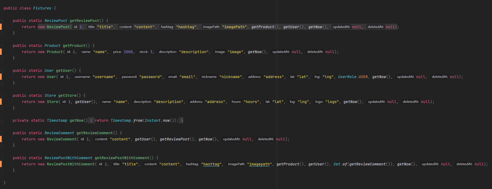

## What is Fixture?

---


Test Fixture은 일부 항목, 장치 또는 소프트웨어를 일관되게 테스트하는 데 사용되는 환경이다. 테스트 픽처는 전자 제품, 소프트웨어 및 물리적 장치를 테스트할 때 찾을 수 있다. [출처 - [위키백과](https://en.wikipedia.org/wiki/Test_fixture)] 

JUnit 팀에서 말하는 Test Fixture는 테스트 실행을 위해 베이스라인으로서 사용되는 객체들의 고정된 상태를 의미한다. Test Fixture의 목적은 결과를 반복가능할 수 있도록 알 수 있고, 고정된 환경에서 테스트할 수 있음을 보장하기 위해 만들어야한다고 한다.

## Why Should I spend time making it?

---

기능을 구현하고 게시글 수정 기능 테스트를 만들었다. 테스트 코드를 먼저 만들었으면 문제 없지 않을까? 라는 생각을 할 수 있다. 필자는 테스트 코드를 미리 만들었었다. 그런데 기존 코드에 문제가 많은 것 같아 다른 프로젝트를 만들어 새로운 기능을 적용하여 코드를 발전시켜 적용하는 작업에서 테스트를 진행하였었다. 본 프로젝트에 해당 코드를 적용만 하면 된다는 생각에 테스트 코드를 작성하지 않고 도메인 코드와 비즈니스 로직을 적용하였다. 기능에 문제가 없는지 확인하기 위해 테스트 코드가 아닌 API 테스트를 진행하였고 문제가 없어 테스트 코드 작성을 진행하게 되었다.

그런데 게시글 수정 기능 테스트에서만 문제가 발생하여 5시간 이상을 삽질했다... 분명 기능에 이상이 없었는데 왜 수정 기능에서 에러가 발생할까 하면서 디버깅도 해보고 여러가지 작업을 진행해보았다. 그런데 아무리 찾아보아도 기능에 이상이 없다... 필자에 눈에는 안보여 코드 리뷰를 함께 해줄 동료를 찾아 비즈니스 로직을 설명하고 함께 오류를 찾기로 하였다. 테스트에 들어가는 임의 값은 임의로 만들어 개발하였었다. 혹시나 하는 마음에 Fixture를 변경해보았다.


출처 : 런닝맨

문제는 기능이 아닌 Fixture였다. 문제를 해결한 순간 필자는 정말 행복과 슬픔을 동시에 느꼈다. 필자는 이러한 행복을 즐기기 때문이다. 항상 문제는 큰 곳에 있지 않고 작은 곳에서 발생한다. 필자는 이러한 문제를 개선하기 위해 Fixture 메소드를 체계적으로 관리하기 위해 클래스를 생성하여 관리하도록 코드를 변경하였다. 즉 다른 코드에서 Fixture가 제대로 작동한다면 Fixture에 문제가 아닌 다른 곳에 문제가 있다는 것을 알고 수정할 수 있기 때문에 만들게 되었다. 이를 통해 테스트 코드 작성 시간을 단축시킬 수 있게 되었다.

### @Before

이전에는 다음과 같이 변수를 직접 작성하여 팩토리 방식으로 값을 넣어주는 방식으로 개발하였다.

```java
@DisplayName("[view][POST] 후기 게시글 생성 - 정상호출")
@WithMockUser
@Test
void givenReviewPostInfo_whenRequestingCreatePost_thenReturnNothing() throws Exception {
    Integer productId = 1;
    String title = "title";
    String content = "content";
    String hashtag = "hashtag";
    String image = "image";

    mvc.perform(post("/api/v1/posts")
                    .contentType(MediaType.APPLICATION_JSON)
                    .content(objectMapper.writeValueAsBytes(ReviewPostCreateRequest.of(productId, title, content, hashtag, image)))
            ).andDo(print())
            .andExpect(status().isOk());
}
```

### @After

동일한 테스트 코드를 테스트 작동 유무만 판단할 수 있도록 다시 말해 테스트 값에 신경쓰지 않고 개발하기 위해 Test Fixture를 만들어 사용하게 되었다.

```java
@DisplayName("[view][POST] 후기 게시글 생성 - 정상호출")
@WithMockUser
@Test
void givenReviewPostInfo_whenRequestingCreatePost_thenSaveReviewPost() throws Exception {
    mvc.perform(post("/api/v1/posts")
                    .contentType(MediaType.APPLICATION_JSON)
                    .content(objectMapper.writeValueAsBytes(getReviewPostCreateRequest()))
            ).andDo(print())
            .andExpect(status().isOk());
}
```



## 정리

---

> 오늘 배운 것을 정리해보면   
>   
> 1. 테스트 코드를 먼저 작성하는 습관을 갖자.  
> 2. 테스트 코드는 기능에만 집중할 수있도록 하자.  
>   
>   
> 부족한 점이 있거나 개선해야할 사항이 있다면 언제든 칼질 부탁드립니다!  
> 당신의 칼질은 필자를 행복하게 만들어줄 것입니다.  
> 
