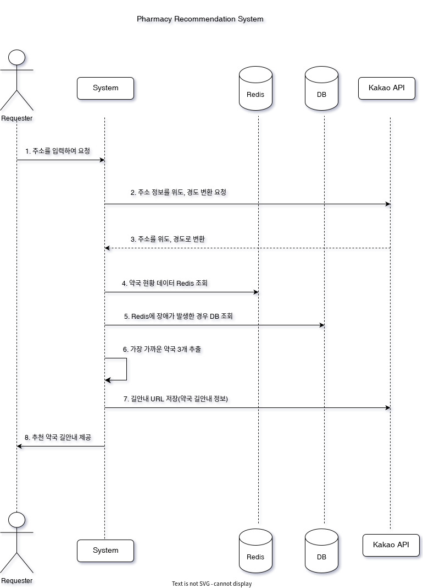
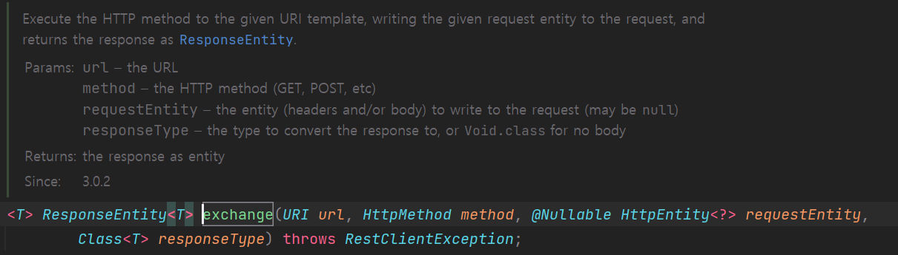

# [약국 길찾기 서비스] 카카오 주소검색 API 구현

티스토리 최초 발행일 2023-01-08 · [원문](https://to-be-a-artist.tistory.com/311)

## 카카오 주소검색 API 구현

---

### 카카오 주소검색 API 스펙 살펴보기

---

카카오 주소검색 API 스펙을 살펴보면서 외부 API를 사용할 때 주의해야할 사항을 알아보자.

#### 약국 추천 서비스 요구사항 분석



1. **고객이 문자열 기반 주소를 입력하여 시스템에 요청한다.**
2. **문자열 기반 주소를 입력받아 위치 기반 데이터인 위도와 경도로 변환한다.**  
   이때 요구사항에서 카카오 API를 통해 위치 기반 데이터인 위도와 경도로 변환하도록 결정했었다.
3. **변환된 위도와 경도를 통해 가까운 약국을 3개 추천한다.**

#### 주소 검색 요청 확인하기

주소 문자열은 `query`에 넣고, REST API 키는 `Authorization` 헤더에 넣어 GET으로 요청한다. `KakaoAK`와 키 사이에는 공백이 필요하다. 앱별 호출 한도는 현재 쿼터 문서에서 확인한다. [주소 검색 API](https://developers.kakao.com/docs/ko/local/dev-guide#address-coord) · [카카오 쿼터](https://developers.kakao.com/docs/ko/getting-started/quota)

```sh
curl -G 'https://dapi.kakao.com/v2/local/search/address.json' \
  -H "Authorization: KakaoAK ${KAKAO_REST_API_KEY}" \
  --data-urlencode 'query=서울특별시 중구 세종대로 110'
```

응답의 `meta`에서 검색 결과 수를 확인하고, `documents`에서 주소와 좌표를 읽는다. `x`는 경도, `y`는 위도다.

### 카카오 주소검색 API 구현하기

---

살펴본 카카오 API Spec을 토대로 구현해보려 한다.

#### **카카오 API Key 연결**

Rest API Key를 application.yaml 파일에 설정하고 Spring boot에서 사용할 수 있도록 설정해주어야 하는데 이 부분은 개발환경과 운영환경에 공통적으로 필요한 부분이기 때문에 common profile에 작성하려한다.

> 실무에서는 개발환경과 운영환경에서 사용하는 Key 값을 다르게 사용하여 개발한다. 이유는 외부 API는 호출 횟수 제한이 있기 때문에 각각 다른 호출 횟수 제한을 개별적으로 적용해서 API 횟수 제한에 걸리지 않도록 하기 위함이다.

다음과 같이 Kakao Rest API Key 또한 공개되면 안되는 값이기 때문에 환경변수로 지정해주어야 한다.

```yaml
spring:
  config:
    activate:
      on-profile: common

kakao:
  rest:
    api:
      key: ${KAKAO_REST_API_KEY}
```

#### **카카오 API Response에 대한 Dto 만들기**

**카카오 개발 가이드에 주소 검색하기에서 Response를 참고 해야한다.**

사용할 필드는 meta에 필드와 가장 중요한 documents에서 주소 정보와 위도, 경도만 응답값으로 받을 수 있도록 Dto를 구현하려 한다.

* DTO
  + MetaDto
  + DocumentDto
  + KakaoApiResponseDto - Meta 정보와 Document 정보를 한번에 받을 수 있는 Dto

응답 DTO에서 필드명을 다르게 쓰면 `@JsonProperty("meta")`와 `@JsonProperty("documents")`로 각각 매핑한다. 주소는 `address_name`, 경도는 `x`, 위도는 `y`에서 읽는다.

> **@JsonProperty**Jackson에서 제공하는 어노테이션으로 Json으로 응답을 받을 때 맵핑된 필드와 맵핑시켜주는 어노테이션이다.  
> 현재 카카오에서 제공하는 Json 형태는 snake 표기법을 사용하고 있고 현재 Dto는 카멜표기법을 사용하고 있어 맵핑시켜주기 위해 사용한다.

#### **Service 코드 작성**

API에서 제공받을 Dto 형태를 완성하였고 실제 API를 호출하여 응답 값을 정상적으로 받아오는지 확인하기 위한 서비스 코드를 작성하려 한다.

```java
@Slf4j
@Service
@RequiredArgsConstructor
public class KakaoAddressSearchService{
}
```

> @Slf4j은 해당 클래스에 로그를 출력을 위해 사용  
> @Service 은 해당 클래스를 컴포넌트로 사용하기 위함  
> @RequiredArgsConstructor 는 생성자 주입을 위해 사용

```java
@Slf4j
@Service
@RequiredArgsConstructor
public class KakaoAddressSearchService{
    public KakaoApiResponseDto requestAddressSearch(String address){
        // kakao api 호출
    }
}
```

> requestAddressSearch는 서비스에서 카카오 API를 호출하고 응답 받은 Response를 Dto에 담아 반환해주는 메소드다.  
> 문자열 주소를 입력받아 주소를 카카오 API에 호출하여 응답 값 리턴해야하므로 HttpClientModule이 필요하다. HttpClientModule은 Spring에서 제공하는 RestTemplate을 사용할 것이다. RestTemplate는 이미 의존성에 포함되어 있어 RestTemplate를 빈으로 설정하여 사용할 수 있다.

```java
@Configuration
public class RestTemplateConfig {

    @Bean
    public RestTemplate restTemplate() {
        return new RestTemplate();
    }
}
```

RestTemplate 빈으로 설정하여 의존성 주입을 할 수 있게 된다.

```java
@Slf4j
@Service
@RequiredArgsConstructor
public class KakaoAddressSearchService{

    private final RestTemplate restTemplate;

    public KakaoApiResponseDto requestAddressSearch(String address){

        // kakao api 호출
        restTemplate.exchange();
    }
}
```

RestTemplate에 exchage를 이용하려한다.



전달해야하는 파라미터

* **URI url**
* **HttpMethod method**
* **HttpEntity<T> requestType**
* **Class<T> responseType**

URI를 제외한 나머지 데이터는 바로 사용할 수 있지만, URI는 직접 만들어야 한다. URI를 바로 만들 수 있지만 의존성을 유연하게 하기 위해 URI를 만드는 서비스를 만들어주려 한다.

```java
@Slf4j
@Service
public class KakaoUriBuilderService {

    private static final String KAKAO_LOCAL_SEARCH_ADDRESS_URL = "https://dapi.kakao.com/v2/local/search/address.json";

    public URI buildUriByAddressSearch(String address) {
        UriComponentsBuilder uriBuilder = UriComponentsBuilder.fromHttpUrl(KAKAO_LOCAL_SEARCH_ADDRESS_URL);
        uriBuilder.queryParam("query", address);

        URI uri = uriBuilder.build().encode().toUri();

        return uri;
    }
}
```

> **KAKAO\_LOCAL\_SEARCH\_ADDRESS\_URL** 은 전달해야할 카카오 API 주소로 고정된 값이기 때문에 상수로 지정  
> buildUriByAddressSearch 는 URI를 만드는 메소드로 직접 String을 붙여 만들 수 있지만 Spring에 제공하는 UriComponentBuilder를 이용하여 쉽게 만들수 있다.   
>   
> URI 주소의 형태는 Kakao API 공식 문서를 참조하여 Request를 만들어주어야 한다.  
> 인코딩하는 이유는 한글, 특수 문자 또는 공백 같은 경우 브라우저를 통해 전달될때 깨질 수 있기 때문에 인코딩이 필요하다. 인코딩 결과를 확인할 때는 예시 주소로 테스트한다.

**완성된 코드**

```java
@Slf4j
@Service
@RequiredArgsConstructor
public class KakaoAddressSearchService {

    private final RestTemplate restTemplate;
    private final KakaoUriBuilderService kakaoUriBuilderService;

    @Value("${kakao.rest.api.key}")
    private String kakaoRestApiKey;

    public KakaoApiResponseDto requestAddressSearch(String address) {

        if (ObjectUtils.isEmpty(address)) return null;

        URI uri = kakaoUriBuilderService.buildUriByAddressSearch(address);

        HttpHeaders headers = new HttpHeaders();
        headers.set(HttpHeaders.AUTHORIZATION, "KakaoAK " + kakaoRestApiKey);
        HttpEntity<Void> httpEntity = new HttpEntity<>(headers);

        // kakao api 호출
        return restTemplate.exchange(uri, HttpMethod.GET, httpEntity, KakaoApiResponseDto.class).getBody();
    }

}
```

1. address에 대한 Validation 확인
2. URI 생성
3. exchange를 위한 파라미터 생성
   1. HttpHeaders에 헤더 설정(Kakao API 공식 문서에 Sample Request 기준)
   2. exchage 메소드는 헤더를 HttpEntity에 담아야하므로 httpEntity 생성
   3. HttpMethod와 Dto 클래스 기입
4. exchage를 통해 반환된 Response에서 필요한 부분은 body부분이기 때문에 body 부분만 받도록 함.

기능을 테스트 하기 위해 테스트 케이스를 작성해주어야 한다. [Spock 프레임워크를 사용하여 테스트](https://to-be-a-artist.tistory.com/313)를 진행해보려 한다.
