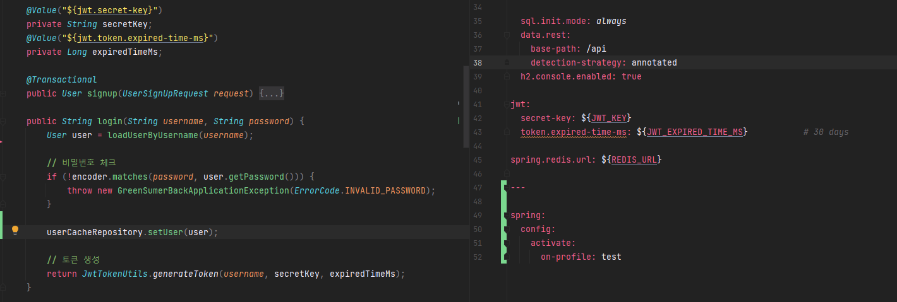
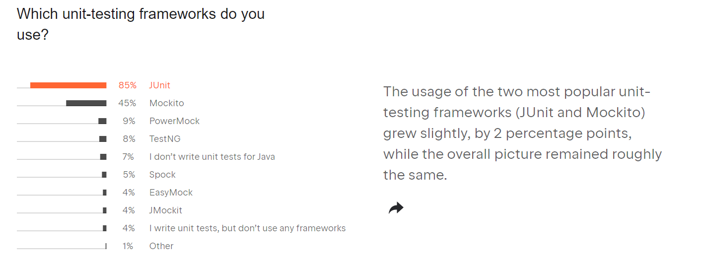
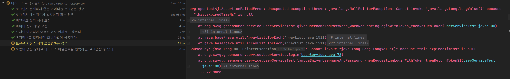
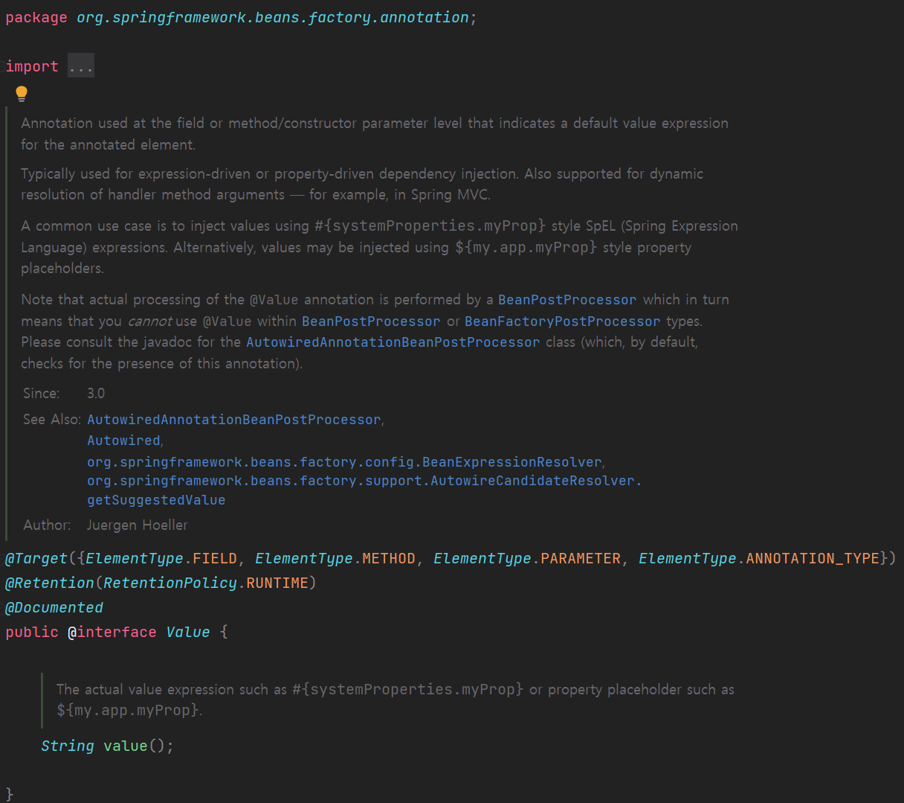
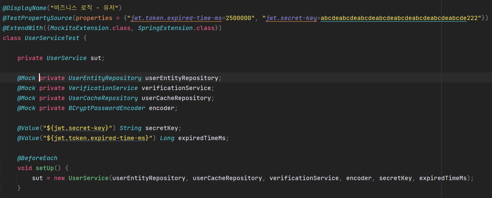
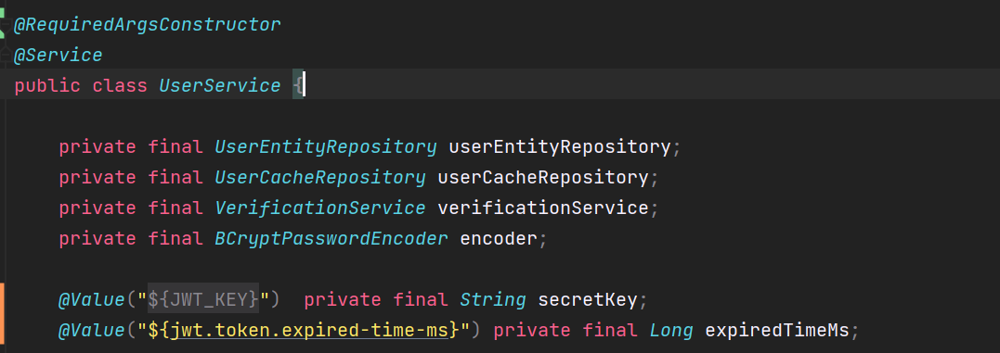

## Situation

로그인 기능에서 JWT 토큰 인증 방식을 사용하여 로그인 시 아이디가 존재하고, 패스워드가 일치할 경우 Redis에 저장되고 토큰이 생성되도록 구현하였다. 

회원 비즈니스 로직 테스트는 JUnit 5와 Mokito 기반의 단위 테스트를 진행하였다.

### **Why did you use Mokito?**

Mokito를 사용한  이유는 Mokito를 이용하면 좀더 작은 단위까지 테스트가 가능하기 때문에 선택하였다.

무엇보다 데이터를 컨트롤해야하는 상황에서 DB에 연결없이 임의로 주고받을 수 있기 때문에 유용하다.

### **What is Mokito?**

Mokito에 대해 이해하기 위해서는 Mock에 대한 이해가 필요하다.

#### **Mock**

> Mock Object 란 주로 객체 지향 프로그래밍으로 개발한 프로그램을 테스트할 경우 테스트를 수행할 모듈과 연결되는 외부의 다른 서비스나 모듈들을 실제 사용하는 모듈을 사용하지 않고 **실제의 모듈을 "흉내"내는 "가짜" 모듈을 작성하여 테스트의 효용성을 높이는 데 사용하는 객체**이다. 사용자 인터페이스(UI)나 데이터베이스 테스트 등과 같이 자동화된 테스트를 수행하기 여러운 때 널리 사용된다.   
> [출처 - [위치백과, Mock Object](https://ko.wikipedia.org/wiki/%EB%AA%A8%EC%9D%98_%EA%B0%9D%EC%B2%B4)]

mock 사용하는 이유는 매번 테스트할 때마다 DB에서 데이터를 읽어오는 작업은 부하가 많이 걸리고 비용(시간)이 많이 걸리기 때문이다. 또한 테스트에 내용이 DB에 반영되지 않도록 하여 안전성을 높일 수 있다.

#### **Mokito**

> Mockito 는 MIT 라이센스에 따라 출시된 Java 용 오픈 소스 테스트 프레임워크로 TDD(테스트 주도 개발) 또는 BDD(행동 주도 개발)을 위해 자동화된 단위 테스트에서 테스트 이중 객체(모의 객체)를 생성할 수 있다.

mock을 쉽게 만드는 mock의 행동을 정하는 stubbing, 정상적으로 작동하는지에 대한 verify 등 다양한 기능을 제공해주는 프레임워크다.

유닛 테스트할 때 사용하는데 JetBrains이 발표한 2021년 통계에 따르면 유닛 테스트를 하는 자바 개발자 중 45%가 mockito를 사용하고 있다고 한다. 

#### **Annotations**

Mokito에서 Mock를 생성하는 어노테이션이 4가지 있다. 

* **@Mock**  
  mokito에서 가장 많이 사용되는 어노테이션으로 수동으로 호출하지 않고도 mock을 사용하여 모의 인스턴스를 만들고 주입할 수 있다. 즉 @Mock 은 가짜 인스턴스
* **@Spy**  
  Spy 주석을 사용하여 기존 인스턴스를 감시하는 어노테이션으로 즉 기존 인스턴스를 의미한다. 즉 진짜 객체이며 메소드 싨행시 스터빙하지 않으면 기존 객체의 로직을 실행한 값을, 스터빙을 한 경우엔 스터빙 값을 리턴한다.
* **@Captor**  
  ArgumentCaptor 인스턴스를 생성하기 위해 사용되는 어노테이션이다.
* **@InjectMock** 테스트된 객체에 자동으로 주입해주는 어노테이션으로 즉 @Mock이나 @Spy로 생성된 목객체를 @InjectMocks이 붙은 객체에 자동으로 주입시켜주는 어노테이션이다. 실무에서는 @InjectMocks(Service), @Mock(DAO) 으로 Service 테스트 목객체에 DAO 목객체를 주입시켜 사용한다고 한다.

#### Reference

* [[baeldung] Mokito](https://www.baeldung.com/mockito-annotations)
* [[codechacha] Java - Mockito](https://codechacha.com/en/mockito-annotations/)

### So What's the problem?

Mokito를 사용한 Mock 객체를 사용할 경우 Service 코드에서 사용한 @Value 어노테이션을 사용할 수 없다.

이유는 Spring boot Application이 실행될 때 프로퍼티 셋팅을 읽어오는데 Mockito를 이용하여 테스트할 경우 해당 값을 잃어오지 않기 때문이다. 그래서 해당 값이 필요한 테스트를 진행할 경우 다음과 같은 에러가 발생한다.

원하는 것은 테스트 시에 @Value 어노테이션에 프로터티 설정 값이 전달되는 것을 원하는데 이것을 어떻게 해야할지 알수가 없었다. 필자는 이 문제를 해결하기 위해 엄청 많은 시간을 사용하였다. 많은 시간을 소비한 끝에 결국 해결할 수 있었다.

### How did you solve it?

문제를 해결하기 위해 @value, @BeforeEach와 @TestPropertySource를 사용하려 한다.

#### @Value

@Value 어노테이션은 Spring 프레임워크 어노테이션으로 JUnit4에서는 SpringRunner, JUnit5에서는 SpringExtension.class가 필요하다. @Value 어노테이션을 사용하여 테스트 코드에서 필요한 프로퍼티를 직접 설정하려 한다.

#### @BeforeEach

@BeforeEach 어노테이션을 사용하여 테스트 메소드가 실행되기 전에 Mock과 프로퍼티를 테스트 대상에 주입해주려 한다. @BeforeEach를 사용하여 UserService에 필요한 의존성을 직접 주입시켜주려 한다.

#### @TestPropertySource

테스트에 필요한 Property를 직접 설정하기 위해 필요한 어노테이션이다.

#### ServiceTest 코드

UserService 객체에 필요한 의존성을 테스트 메소드가 실행하기 전에 직접 주입해주었다.

#### Service 코드

Service 코드는 Service 테스트에 구애받지 않고 변경없이 작동한다.

### 정리

> 프로퍼티 값을 테스트에서 반영하기 위해 여러 가지 방법이 존재하는데  
> 해당 프로퍼티를 직접 넣어보고 싶어 위와 같이 작성하게 되었다.  
>   
> 가장 쉬운 방법으로는 Configuration에 환경 변수를 통해 주입하는 방식이 있다.  
> 하지만 필자는 위 방법을 찾으면서 다양한 것을 배우고 경험할 수 있었다.  
>   
> 어제보다 오늘이 오늘보다 내일이 더 나은 개발자  
> Mr.Bang  
>   
> 
