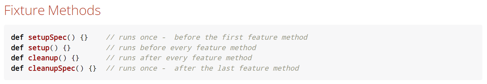
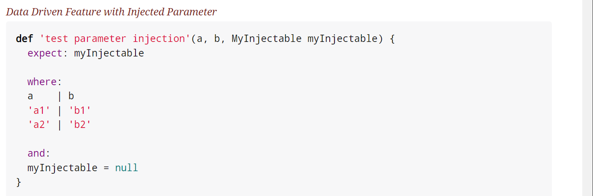
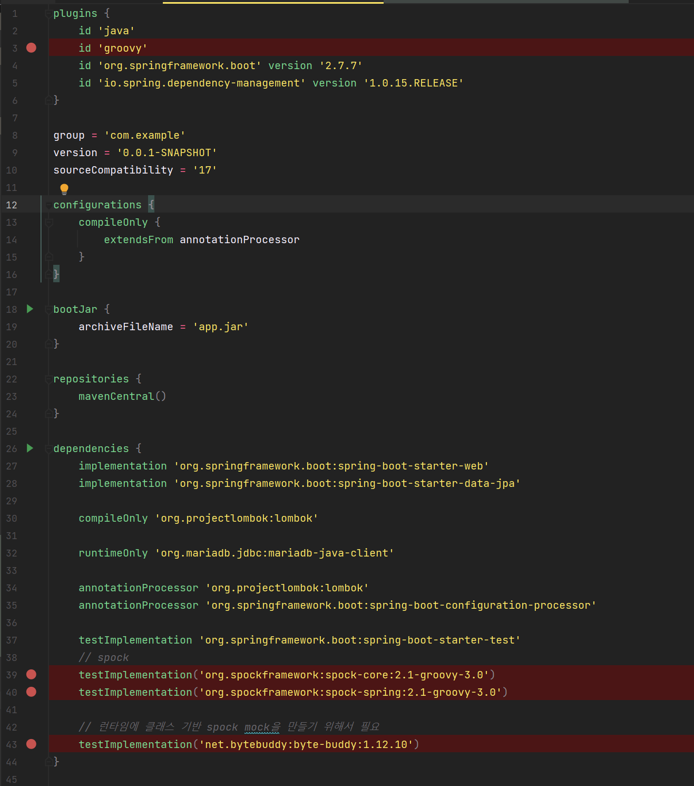
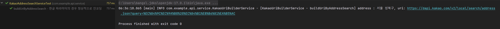

## 테스트 케이스 Spock 프레임워크

---

### 테스트 코드의 중요성

---

**테스트 코드는 기능에 대한 불확실성을 감소시킬 수 있으며, 개발자가 만든 기능을 안전하게 보호해준다.**

예시) A라는 기능을 추가로 개발하여 오픈했더니 기존에 잘 사용하던 B라는 기능이 문제 발생

**테스트 코드 작성은 개발 단계 초기에 문제 발견할 수 있도록 도움을 주기 때문에 개발 시간을 단축시켜준다.**

예시) 충분한 테스트 코드 없이 빠르게 배포하고 배포 후에 문제 확인하고 원인 파악 후 다시 테스트 및 코드 수정 작업을 반복한다.

### Spock 프레임워크

---

#### **Spock 프레임워크란?**

* Groovy 언어를 이용하여 테스트 코드를 작성할 수 있는 프레임워크로 Junit과 비교하여 코드를 더욱 간결하게 작성 가능하다.
* Groovy 언어는 동적 타입 프로그래밍 언어로 JVM 위에서 동작하며 Java 문법과 유사하다.
* 테스트 메소드 이름을 문자열로 작성할 수 있으며 given, when, then 코드 블록을 명확히 구분한다.
* JUnit의 경우 주석으로 블록을 구분하고 메소드 이름 또는 제약사항이 많이 존재한다.

#### **Spock 프레임워크 테스트 코드 작성 순서**

1. 테스트 클래스는 Groovy 클래스로 생성하고, Specification 클래스를 상속 받는다.
2. Feature(테스트 메서드)는 **def를 이용하여 메소드**로 선언하며, **하나 이상 블록이 존재**해야 한다.
3. **given** : 테스트에 필요한 값을 준비
4. **when** : 테스트할 코드를 실행
5. **then** : when과 함께 사용하며 예외 및 결과 값을 검증
6. **expect** : then과 같으며 when을 필요로 하지 않기 때문에 간단한 테스트 및 where과 같이 사용된다.
7. **where** : 데이터가 다르고 로직이 동일한 경우 동일한 테스트에 대한 **중복 코드 제거가 가능**하다.

#### **Spock 프레임워크 주요 기능**

* JUnit에서 제공하는 주요 요소들은 모두 Spock에서 제공하고 있다.

[](https://spockframework.org/spock/docs/1.3/all_in_one.html)

#### **Spock 프레임워크 장점**

* Where은 | 로 구분한 Data Table로 생성이 가능하며 파라미터, 결과 값을 보기 좋게 구분 가능하다.



#### **Spock 프레임워크 설정**

Spock 사용하기 위해 IDE에 플러그인 및 의존성 추가



**groovy 디렉토리 생성 및 spock 테스트 코드 생성**

```java
class KakaoAddressSearchServiceTest extends Specification {

    private KakaoUriBuilderService kakaoUriBuilderService

    void setup() {
        kakaoUriBuilderService = new KakaoUriBuilderService()
    }

    void "buildUriByAddressSearch - 한글 파라미터의 경우 정상적으로 인코딩"() {
        given:
        String address = "서울 성북구"
        def charset = StandardCharsets.UTF_8

        when:
        def uri = kakaoUriBuilderService.buildUriByAddressSearch(address)
        def decodedResult = URLDecoder.decode(uri.toString(), charset)

        then:
        decodedResult == "https://dapi.kakao.com/v2/local/search/address.json?query=서울 성북구"
    }
}
```

테스트 코드를 실행하여 정상 작동함을 확인할 수 있다.


