## **OneToMany 양방향 관계**

---

서점(BookStore), 책(Book)이 1:N 관계라고 했을 때, 즉 서점에는 여러 개 책이 있다.

만약 서점에 책을 보내야하는 상황이라면 어떻게 코드를 구현해야 하는가를 확인해보려 한다.

### **Case 1**

다음과 같이 서점에 책을 넣기 위한 메소드를 구성하였다.

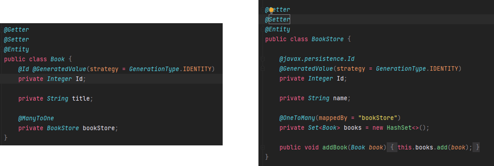

다음에 테스트 코드를 실행하면 어떻게 될까?

```java
@Test
void BookAndBookStore_TEST1() {
    BookStore bookStore = new BookStore();
    bookStore.setName("수근 문고");
    bookStoreRepository.save(bookStore);

    Book book = new Book();
    book.setTitle("누가 내 머리에 똥쌋어?");

    bookStore.addBook(book);
    bookRepository.save(book);
}
```

### **Case 2**

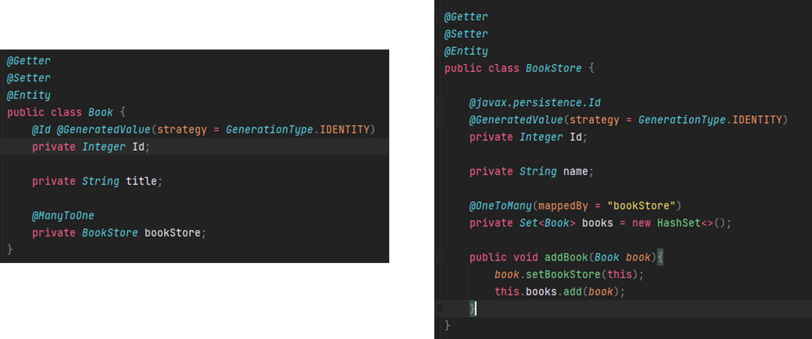

```java
@Test
void BookAndBookStore_TEST2() {
    BookStore bookStore = new BookStore();
    bookStore.setName("호동 문고");
    bookStoreRepository.save(bookStore);

    Book book = new Book();
    book.setTitle("아낌없이 주는 나무");

    bookStore.addBook(book);
    bookRepository.save(book);
}
```

### 비교

#### **Query**

Quey는 동일하게 작동한다.

```java
# TEST 1
Hibernate: insert into book_store (name) values (?)
Hibernate: insert into book (book_store_id, title) values (?, ?)

# TEST 2
Hibernate: insert into book_store (name) values (?)
Hibernate: insert into book (book_store_id, title) values (?, ?)
```

#### **Table**

실제 데이터에 들어간 데이터는 전혀 다르다.

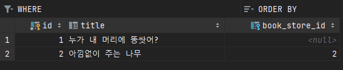

Case 1과 같이 책방에 책을 넣으면 서점에 분명이 책을 넣었는데 서점에 대한 정보가 들어가지 않는다. 이유는 양방향 맵핑 시 주인관계를 설정해주지 않고 있어 서로 다른 단방향 맵핑이기 때문이다.

다시 말해 관계에 주인은 Book인데 book에는 관계를 설정하지 않고 boostore 자신에게만 관계를 설정하고 있다. 이때문에 데이터베이스 Sync 할 것이 없어 맵핑되지 않는 것이다.

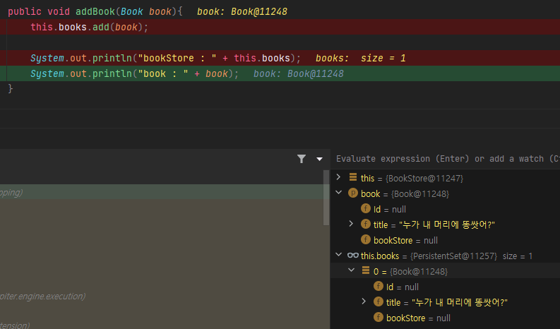

Case 2는 Case 1과 다르게 book에 주인 관계를 설정하여 book\_store\_id가 설정되는 것을 확인할 수 있다. 이처럼 양방향 바인딩하는 경우 주인 관계를 설정해주어야 한다.

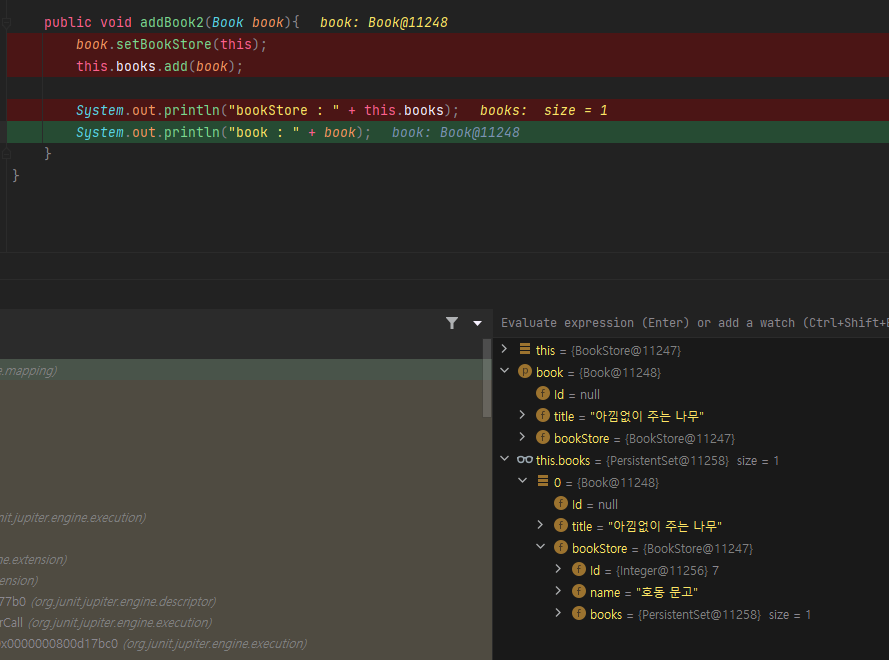

이처럼 양방향 맵핑 시 주의해야할 점은 주인 관계를 설정해야한다는 것이다.

## **@ManyToOne 단방향 관계**

---

ManyToOne 단방향 관계를 설정하면 생각한 것보다 select 쿼리가 더 많이 일어난다. 즉 N+1 문제가 발생한다.

이 문제를 코드를 통해 이해해보려 한다.

### **Setting**

현재 Member에서 Team으로 ManyToOne 단방향 관계가 형성되어 있다.

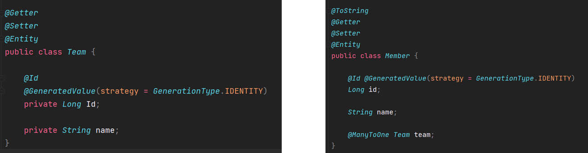

테스트 상황은 다음과 같이 1박 2일 팀 멤버들이 팀을 나눈 상황이다.


테스트 코드에서는 멤버 4명을 저장하고 모든 멤버를 조회하는 작업을 진행할 것이다.

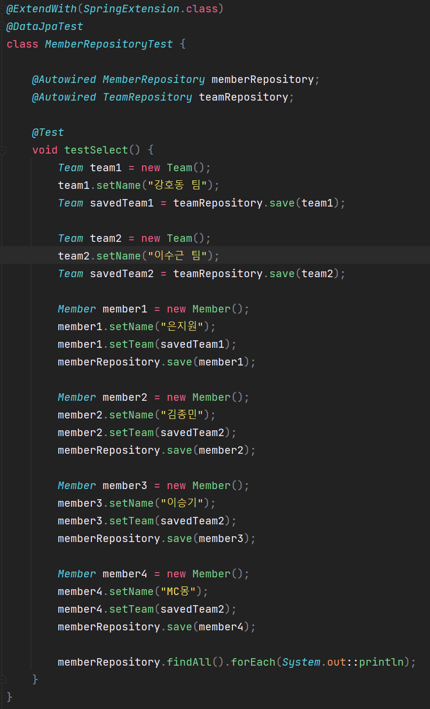

### Execution

먼저 테스트 코드를 실행해보려한다.

#### Expected

예상되는 Query는 다음과 같이 Select 회 실행이다.

```sql
Select * From member;
```

#### Actual

테스트를 실행하면 다음과 예상한 것과 유사하게 Select 문이 1번 실행된다.

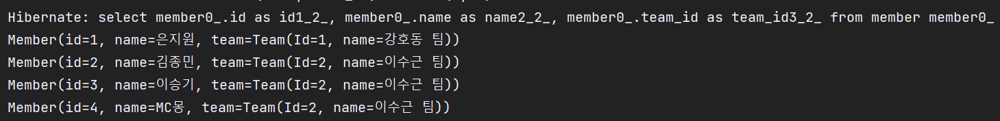

테스트 코드를 통해 문제 없음을 확인하고 동일한 작업을

Controller에서 호출해보면 동일한 결과가 이루어질 것이라고 예상할 수 있다.

실제 Query문은 전체 Member를 조회를 다음과 같이 이루어지고 있다.

1. Team1을 통해 멤버를 조회

2. Team2을 통해 멤버를 조회

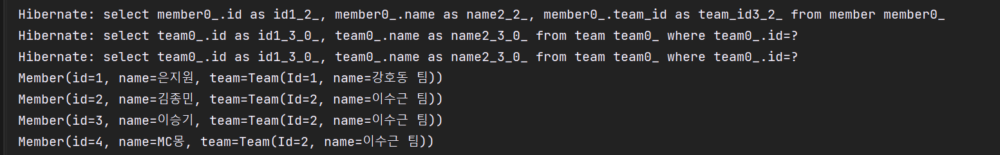

### Quiz

#### 🔥 왜 테스트 코드에서 Query가 1개일까?

테스트 코드를 실행하면 Member만 Select하는 Query가 실행된다.

Application에서 Controller을 통해 동일한 작업을 실행하면 멤버를 조회하는 Query 1개와 멤버를 가진 Team 개수만큼 Query가 발생한다.

이를 이해하기 위해서는 Transaction에 범위를 먼저 생각해야한다.

테스트 코드에서 Transaction 범위는 테스트 코드의 시작과 끝이다.

이유는 @DataJpaTest를 사용하고 있기 때문에 각각에 메소드에 Transaction 효과를 얻고 있어 Test 메소드에 Transcational 어노테이션이 붙은 것과 동일하다.

테스트 메소드가 하나의 트랜잭션이 되면 Spring이 아닌 Hibernate 관점에서 보면

 Spring이 하나의 트랜잭션으로 메소드를 묶어 놓고 내부에서 save를 하면 트랜잭션 안에는 Persistent Context 즉 영속성 컨텍스트가 있어 기본적으로 그 안에 캐싱(Hibernate 1차 캐시)이 된다. 즉 객체 6개(팀 2개와 멤버 4개 )가 캐싱이 된 상태이다.

findAll() 메소드를 실행하면 일단 영속성 컨텍스트에 캐싱되지 않은 데이터가 있는지 확인하기 위해 Select Query를 실행한다. 그런데 Team은 Select 하고 있지 않다.

기본적으로 Member에서 ManyToOne으로 Team을 Fetch.EAGER 전략으로 참조하고 있기 때문에 팀을 가져오기 위해 Select 해야한다. 그런데도 불구하고 테스트에서는 팀을 가져오지 않았다.

테스트 코드에서는 왜 가져오지 않았을까?

멤버들이 참조하고 있는 팀에 대한 정보가 1차 캐시에 캐싱이 이미 되어 있다. 이미 같은 트랜잭션 안에서 발생한 일이기 때문에 즉 이미 알고 있는 객체이므로 다시 Select를 실행할 이유가 없다.

정리하면 원래는 Select 해야하지만 영속성 컨텍스트에 캐싱되어 있기 때문에 Select를 하지 않은 것이다.

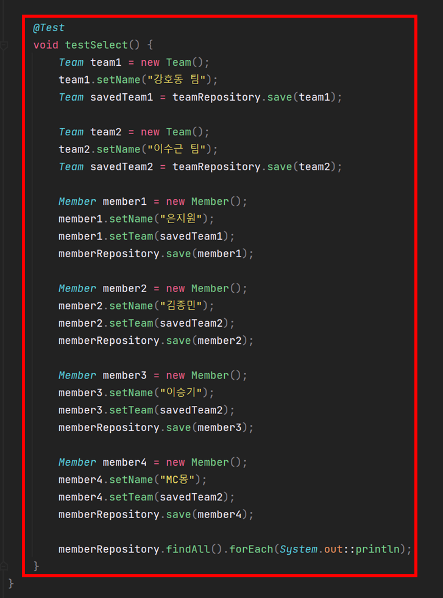

#### 🔥 왜 Select Query가 3개 발생할까?

컨트롤러는 Transaction이 없고 메소드가 Transaction 범위가 아니다.

```java
@Controller
public class MemberController {

    @Autowired MemberRepository memberRepository;

    @GetMapping("/members")
    @ResponseBody
    public List<Member> memberList(){
        return memberRepository.findAll();
    }
}
```

Transaction은 Repository에 findAll 안에만 즉 findAll 하나만 Transactional 이다.

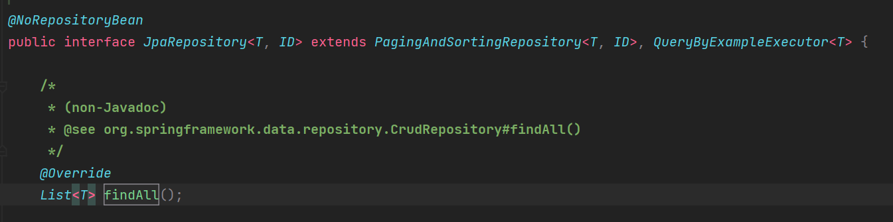

다시 말해 Controller에 memberList 메소드가 트랜잭션이 아니라 메소드에 내부에 findAll 메소드 하나만 트랜잭션인 상태다. 이는 Spring Data JPA가 제공해주는 JPA 구현체인 SimpleJpaRepository를 보면 알 수 있다.

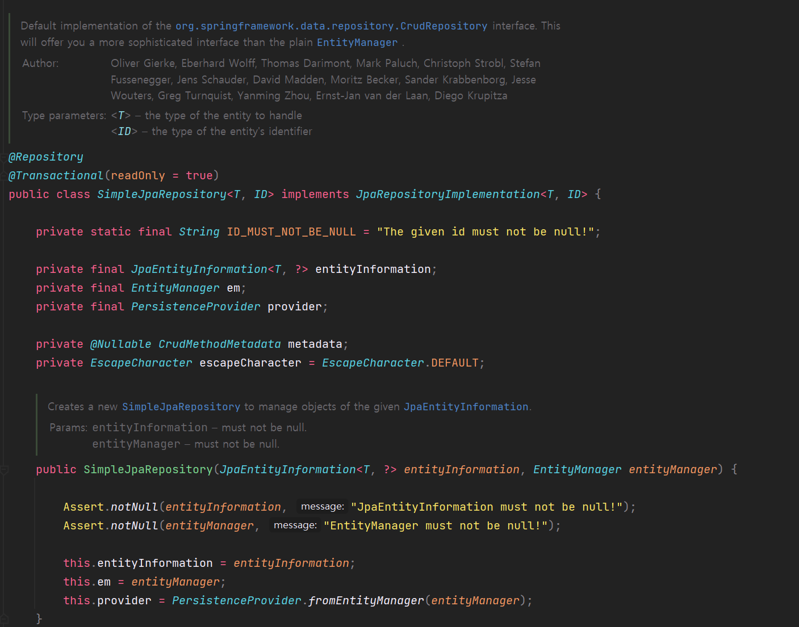

기본적으로 Repository가 제공하는 Method는 기본적으로 다 트랜잭션이다. 현재 상황에서는 findAll() 메소드 하나만 트랜잭션널이기 때문에 Pesistent Context에 아무것도 없다. 그렇기 때문에 Member 가 참조하고 있는 팀 정보도 Query를 실행한 것이다. 그렇기 때문에 Query 3개가 발생한 것이다.

#### 🔥 어떻게 해야할까?

1. Member만 Select 하는 방법

Member 에 대한 정보만 조회하고 팀에 대한 정보는 필요하지 않을 때는 Team에 대한 Query가 불필요하다.

현재 Member 클래스에 @ManyToOne 맵핑은 Fetch가 EAGER로 Default 되어있다. 즉 필요여부와 관계 없이 한번에 Query를 실행한다. 이때 Fetch를 LAZY로 설정하면 Member에 대한 조회가 먼저 이루어지고 팀에 대한 데이터를 참조할 때 Team에 대한 조회가 이루어진다. 이렇게 하더라도 Select Query는 발생할 수 있다.

```java
@ToString
@Getter
@Setter
@Entity
public class Member {

    @Id @GeneratedValue(strategy = GenerationType.IDENTITY)
    Long id;

    String name;

    @ManyToOne(fetch = FetchType.LAZY)
    Team team;
}
```

Controller 코드는 그대로인 상태에 Member를 반환하면 어떻게 될까?

```java
@Controller
public class MemberController {

    @Autowired MemberRepository memberRepository;

    @GetMapping("/members")
    @ResponseBody
    public List<Member> memberList(){
        return memberRepository.findAll();
    }
}
```

**Expected**

Member를 조회하고 Member를 Json으로 변환하는 작업이 이루어질 것이다.

Json으로 변환하려고 할 때 Member가 가지고 있는 Team에 대한 정보에 접근을 할 것이다.

Team이 가지고 있는 Member에 getName을 할 것이다. 그때 Team에 대한 Query가 발생해야 한다.

**Actual**

다음과 같이 "Class org.hibernate.proxy.pojo.bytebuddy.ByteBuddyInterceptor and no properties discovered to create BeanSerializer"라는 에러가 발생한다.

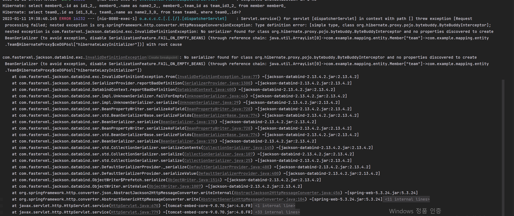

원인은 Lazy를 사용하면 Team에 대한 Reference가 ByteBuddyInterceptor라는 타입에 Proxy 객체로 바뀐다. Team에 본래 객체가 아닌데 Team 과 유사하게 생긴 무엇인가가 들어온다.

Hibernate 트랜잭션 안에 접근하게 되면 DB에서 Select 하여 Team으로 바꿔주는데 현재 상태에서는 Proxy 객체인 상태로 Json으로 변경하려고 하여 이러한 문제가 발생하는 것이다. 이때 가장 많이 사용하는 방법이 Dto를 만드는 것이다.

```java
@Getter @Setter
public class MemberDto {
    private Long id;
    private String name;
}
```

Dto는 ModelMapper를 이용하여 Entity에서 Dto로 변환해준다.

> ModelMapper 란 서로 다른 object 간의 필드 값을 자동으로 mapping 해주는 library

```java
@Controller
public class MemberController {

    @Autowired MemberRepository memberRepository;

    @GetMapping("/members")
    @ResponseBody
    public List<MemberDto> memberList(){
        ModelMapper modelMapper = new ModelMapper();

        return memberRepository.findAll().stream()
                .map(m -> modelMapper.map(m, MemberDto.class))
                .collect(Collectors.toList());
    }
}
```

Dto에 Team을 넣어주지 않았기 때문에 더 이상 Team을 Json으로 [Serialization](https://ko.wikipedia.org/wiki/%EC%A7%81%EB%A0%AC%ED%99%94)하지 않는다.

실행해보면 멤버 정보만 반환하고 Select가 1번만 발생하게 된다.

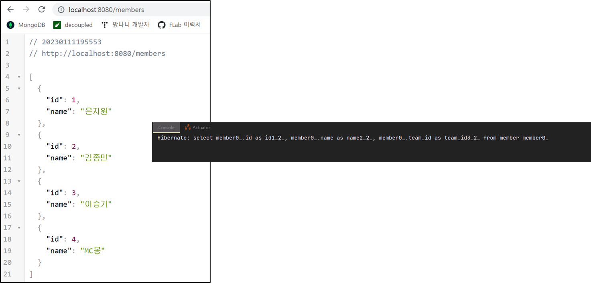

2. Member와 Team에 대한 정보를 함께 Select 하면서 Query를 1회 실행하는 방법

Member와 Team 정보 모두 필요한 상황에서 DB IO 한번만으로 해결 가능하다면 비용이 효과적일 것이다.

여러가지 방법이 존재하겠지만, NamedEntityGraph를 이용하여 해결하려 한다.

```java
@ToString @Getter @Setter
@Entity
@NamedEntityGraph(name = "MemberWithTeam", attributeNodes = @NamedAttributeNode("team"))
public class Member {

    @Id @GeneratedValue(strategy = GenerationType.IDENTITY)
    Long id;

    String name;

    @ManyToOne
    Team team;
}
```

> @NamedEntityGraph에서 **name**을 통해 graph 이름을 설정하고, **attributeNodes**에 Join할 연관관계을 설정한다.

```java
@Controller
public class MemberController {

    @Autowired MemberRepository memberRepository;

    @GetMapping("/members")
    @ResponseBody
    public List<Member> memberList(){
        ModelMapper modelMapper = new ModelMapper();

        return memberRepository.findAll();
    }
}
```

> Controller는 다시 Member를 반환해도록 하고 findAll() 메소드가 EntityGraph를 사용하도록 명시하기 위해 findAll()를 재정의해주어야 한다. 재정의하는 이유는 어노테이션을 붙이기 위함이다.

```java
public interface MemberRepository extends JpaRepository<Member, Long> {
    Member findByName(String name);

    @EntityGraph("MemberWithTeam")
    List<Member> findAll();
}
```

위와 같이 변경하고 실행하면 다음과 같이 1번만 Select해서 원하는 결과를 반환한다.

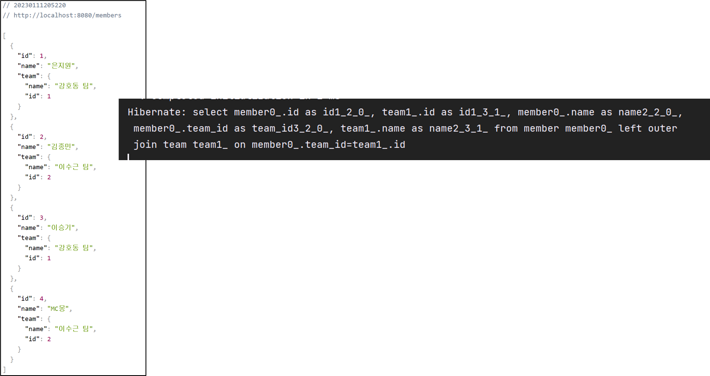

Query를 보면 Left Outer Join을 하여 원하는 결과를 반환하는 것을 볼 수 있다.
