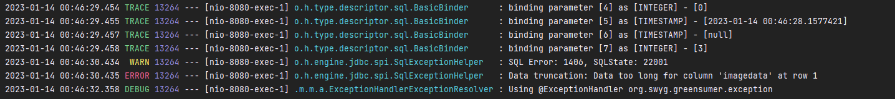
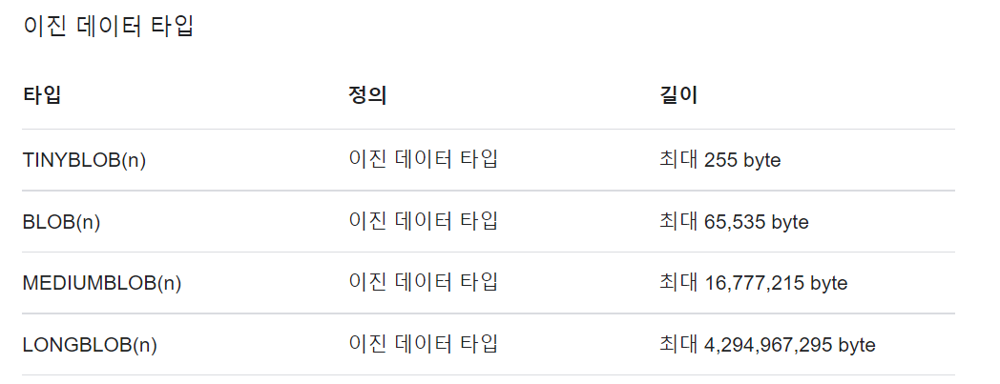
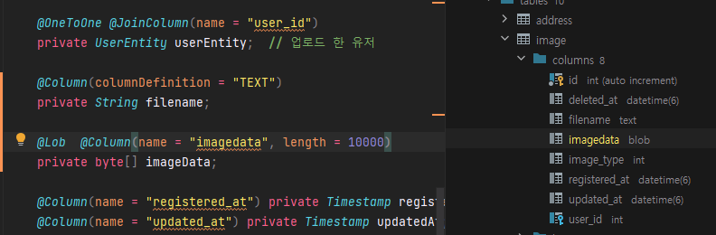
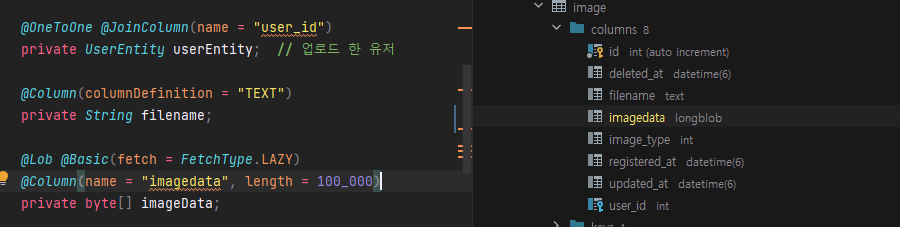

## Situation

### What's the matter?

이미지 업로드 기능 구현을 위해 이미지를 DB에 저장하면서 문제가 발생하였다. 디버깅을 통해 데이터가 제대로 전달되는 것을 확인하였는데 계속 문제가 발생하여 뭐지? 하고 로그를 유심히 보게되었다.



문제는 이미지 데이터에 용량이 너무 높아 문제가 된다고 한다. 단일 이미지를 테스트할 때 사용한 이미지는 문제가 없어 기능에 문제가 없을 것이라고 판단하고 다중 이미지 업로드 기능을 구현하서 해당 문제를 겪었다.

처음에는 파일이 많아서 발생한 에러인가 라는 생각을 하고 파일 개수를 1개, 2개, 3개 ... 로 늘렸다. 그런데 문제는 파일의 개수가 아닌 파일의 크기였다. 테스트 당시 사용한 파일의 일부는 13kb, 16kb, 25kb 에서는 문제가 발생하지 않았다. 84kb, 99kb와 같이 크기가 커지면 해당 파일을 저장하지 못한다.

### How did you solve it?

MySQL에 Blob 크기는 다음과 같다.



정리하면 65kb까지 밖에 저장할 수 없다는 문제를 발견할 수 있었다. 해결방법은 다양하다.

#### 데이터 타입 변경

blob에서 MEDIUMBLOB, LONGBLOB에 형태로 변경하는 방법이 있다.

MEDIUMBLOB는 16MB 까지 저장이 가능하고, LONGBLOB은 4G 까지 데이터 저장이 가능하다.

서비스에서 이미지만 관리하기 때문에 16MB로 설정하면 충분할 것으로 판단된다.

#### MySQL Strict Mode Off

컬럼에 데이터를 입력할 경우 컬럼 사이즈보다 큰 데이터가 입력되었을 때 당연히 DB 차원에서 Insert가 안될 것이라 생각했었다. sql\_mode를 통해 이를 해제해줄 수 있었다. 이를 통해 BLOB에 크기가 넘더라도 문제없이 작동할 수 있었다.

```java
spring.datasource.url=jdbc:mysql://localhost:3306/conweb?sessionVariables=sql_mode='NO_ENGINE_SUBSTITUTION'&jdbcCompliantTruncation=false
```

#### **Refer**

* [StackOverflow - #13567155](https://stackoverflow.com/questions/13567155/com-mysql-jdbc-mysqldatatruncation-data-truncation-data-too-long-for-column-c)

[com.mysql.jdbc.MysqlDataTruncation: Data truncation: Data too long for column 'column\_name'

I am using Java JDBC with MySQL and I get this error: com.mysql.jdbc.MysqlDataTruncation: Data truncation: Data too long for column 'column\_name' How do I remedy this error?

stackoverflow.com](https://stackoverflow.com/questions/13567155/com-mysql-jdbc-mysqldatatruncation-data-truncation-data-too-long-for-column-c)

#### JPA 를 이용한 방법

JPA 어노테이션을 통해 테이블을 만들었다면, 수동으로 조작할 필요가 없이 JPA를 이용하면 된다. JPA에 작성한 컬럼 길이에 따라 자동으로 MySQL에 타입이 결정되기 때문이다. 그러므로 변경에 대한 책임을 JPA에게 주도록하여 편하게 개발할 수 있다.

**변경 이전 상태**



**변경 이후 상태**



```
       0 < length <=      255  -->  `TINYBLOB`
     255 < length <=    65535  -->  `BLOB`
   65535 < length <= 16777215  -->  `MEDIUMBLOB`
16777215 < length <=    2³¹-1  -->  `LONGBLOB`
```

> 방법을 찾지 말고  
> 이유를 찾자!  
>   
> 방법은 이유를 알려 주지 않는다.
