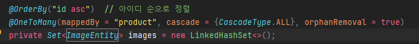
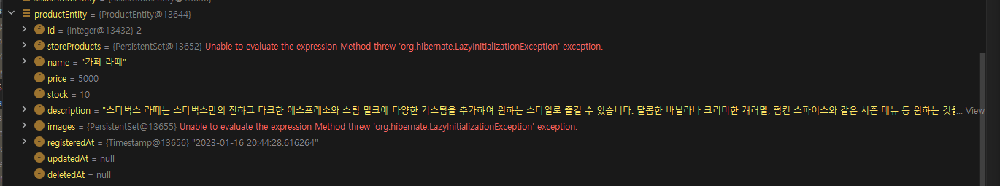
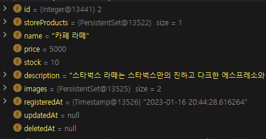
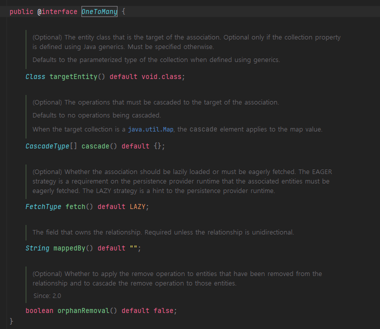

## Situation

---

프로젝트를 구현하면서 다음과 같이 계층 구조에 매핑 관계가 이루어지는 것을 볼 수 있었다. 

이 과정에서 Product 1을 삭제할 때 이미지 1, 2가 함께 삭제되도록 다음과 같이 설정을 완료하였다.

그런데 삭제할 대상인 Product을 조회할 때 다음과 같은 문제가 발생한다.

데이터를 조회할 때 다음과 같이 이미지와 storeProduct에 대한 정보를 가져오지 못하고 있었다.

이 정보가 없어 삭제시 RuntimeException이 발생하고 있다.

## Solution

### Fetch=Eager

Fetch를 Eager로 하여 데이터 조회시 모두 한번에 조회되도록 한다.

한 번에 성공하였다... 이유는 모르겠지만 기본적으로 Fetch Default 값은 Eager인데 직접적으로 명시하지 않았더니 Lazy상태로 값이 전달된것으로 보인다. 이유는 무엇일까?

이것은 나의 착각이었다.... OneToMany 일때 fetch는 default가 Lazy였다.... 나는 바보였던걸까??

그래서 이번에 정리해서 기억하려 한다.

| Annotation | Fetch Mode(Default) |
| --- | --- |
| OneToMany | LAZY |
| ManyToOne | EAGER |
| OneToOne | EAGER |

> 명시적으로 사용하여 개발을 하다가   
> 반복되는 코드를 줄이기 위해 디폴트 값을 잘못 기억하고 사용하는 문제를 겪었다.  
>   
> 이번 기회를 통해 제대로 기억하는 시간을 갖을 수 있었고   
> 연관관계 매핑 관계를 체계적으로 관리하기 위해 클래스를 분리하면서 다양한 문제를 경험할 수 있었다.
