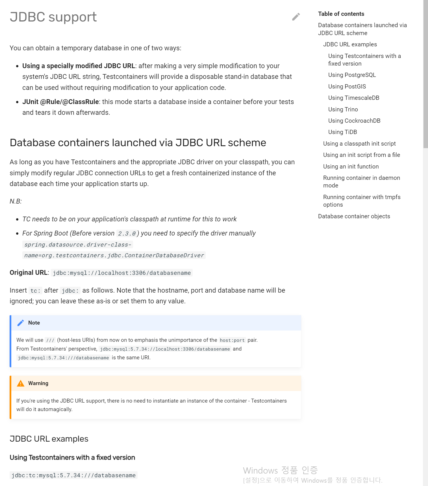
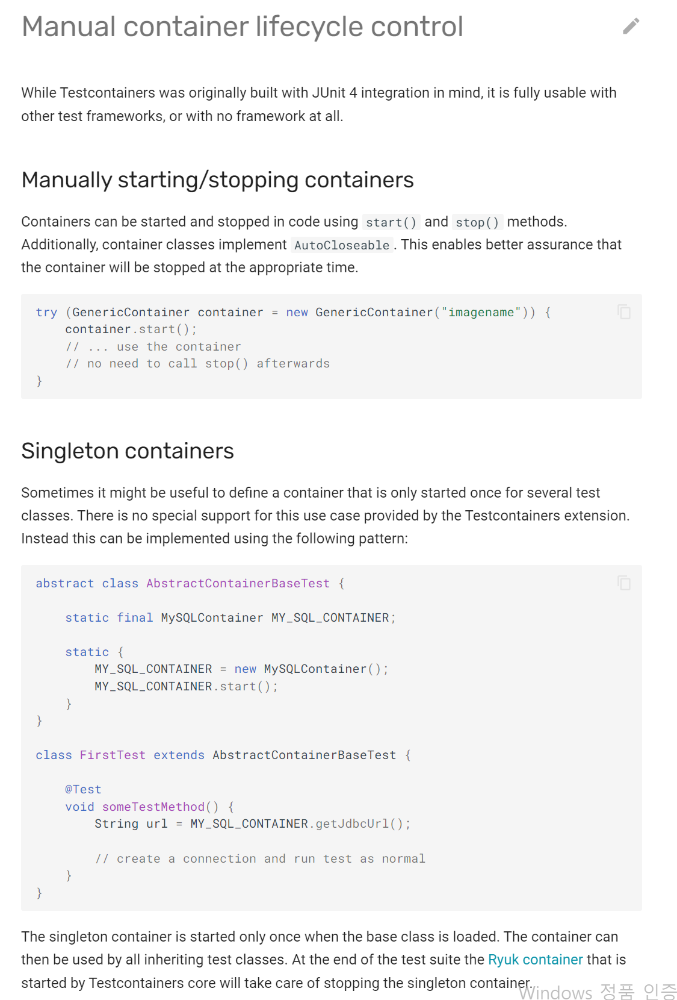
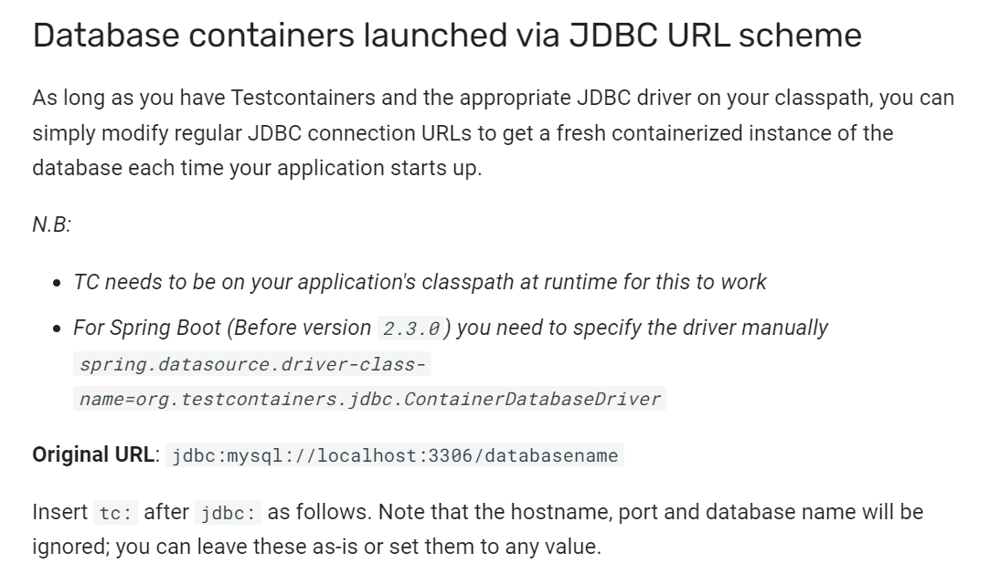
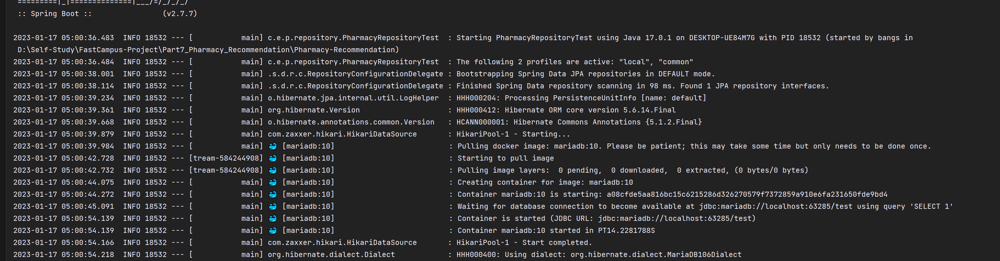
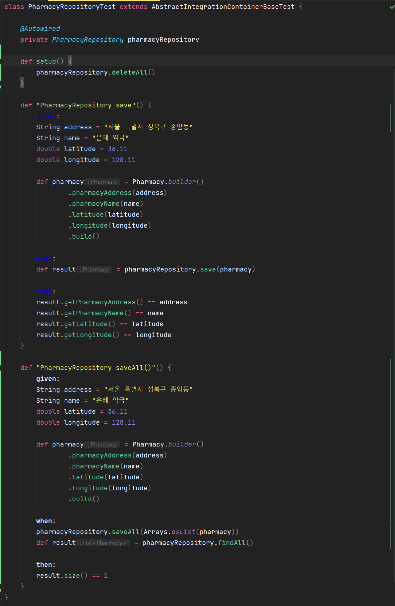
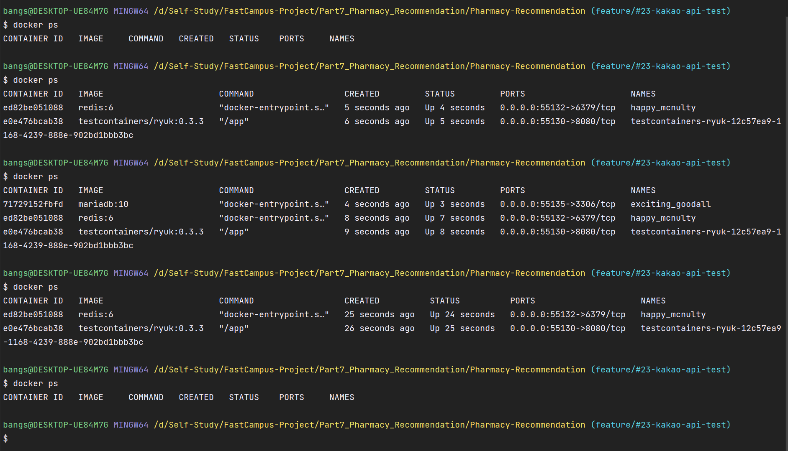
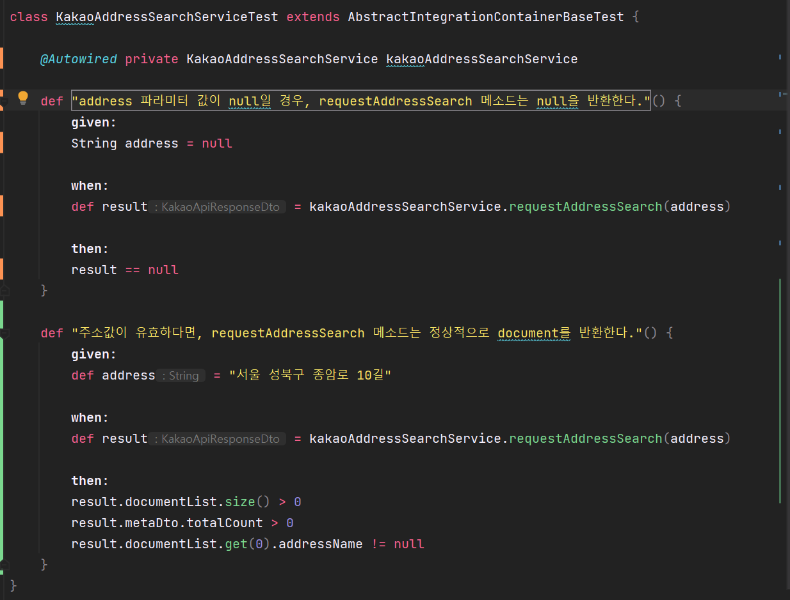
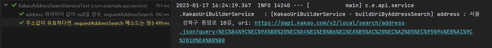

## Testcontainers

---

[이전](tistory-313.html)에 Spock를 이용하여 순수 자바 코드를 이용하여 Unit Test를 진행하였다. 이번에는 Spring Container를 띄워 통합 테스트를 진행해보려 한다.

[[약국 길찾기 서비스] Spock 프레임워크를 이용한 테스트 코드 작성

테스트 케이스 Spock 프레임워크 테스트 코드의 중요성 테스트 코드는 기능에 대한 불확실성을 감소시킬 수 있으며, 개발자가 만든 기능을 안전하게 보호해준다. 예시) A라는 기능을 추가로 개발

to-be-a-artist.tistory.com](tistory-313.html)

### **통합 테스트를 진행하는 이유**

#### **의존성 검증**

Unit 테스트는 Spring Container를 띄우지 않고 일부 작은 단위 테스트를 진행한 것이고,

전체 통합 테스트는 Spring Container를 띄우고 여러 Bean들 간에 의존성 주입을 통해 모듈간 검증을 하는 테스트다.

통합 테스트를 진행하는 이유는 개별적인 Unit 테스트에서 정상동작하지만 기능 간 의존성 문제 동작하지 않는 문제가 발생할 수 있기 때문에 통합 테스트를 진행해야한다. 예시로 개별적으로 정상작동하는 A, B 기능이 운영중에 A 기능으로 인해 B 기능이 동작하지 않는 경우가 있을 수 있기 때문에 통합 테스트가 필요하다.

JUnit으로 통합 테스트할 때 @SpringBootTest 어노테션을 추가하면 Spring Boot Container까지 같이 띄워주어 통합테스트를 진행할 수 있었다. 통합 테스트에서 사용되는 예는 JPA CRUD 테스트가 있다.

#### **외부 API 검증**

KakaoAddressSearchService에 대한 테스트를 진행하기 위해서 카카오 API를 실제 테스트 해보고 API 호출하고 받은 결과 값을 통해 테스트 코드를 작성해봐야 하는데 그럴려면 통합 테스트를 통해 실제로 Spring Container에 Bean을 주입을 받아서 테스트를 진행해봐야한다.

현재 서비스에서는 의존성 검증과 외부 API 검증을 위해 통합 테스트를 진행해보려 한다.

### Testcontainers 를 사용해야 하는 이유

> JPA 이용하여 CRUD 테스트 코드를 작성할 때  
> 어떤 DB 환경을 선택하는 것이 좋을까?

#### 운영환경과 유사한 스펙의 DB(개발 환경 DB) 사용하기

여러 개발자가 같이 사용할 수 있는 개발 환경을 구축하고 운영환경과 유사한 스펙의 데이터베이스를 SetUp하고 같이 테스트를 진행한다.

* **장점**
  + 운영환경과 유사하다는 장점이 있다.
* **단점**
  + 테스트 코드의 신뢰성이 깨질 수 있다.  
    테스트 코드는 항상 동일한 결과 값을 가져야하는데, 다른 개발자와 공용으로 데이터베이스를 사용할 경우 A는 등록하고 B는 삭제하는 테스트를 진행하고 있을 때, 테스트 코드를 실행할 때마다 다른 결과를 갖을 수 있다.   
    결국 테스트 코드를 신뢰하지 못하는 결과를 초래한다.

=> 보통 데이터베이스를 직접 조회하여 연산으로 데이터를 처리해야하는 경우는 독립적인 환경에서 테스트를 진행할 수 있는 환경을 구축해두고 사용하게 된다. 대안으로 **인메모리 DB(ex H2), Docker, TestContainer**를 이용한 방법이 있다.

#### 인메모리 DB(ex H2)

* **장점**
  + 독립적인 공간에서 테스트 코드를 인메모리 데이터베이스 즉 메모리에 의하여 실행되기 때문에 실행 속도가 빠르다.
* **단점**
  + 운영환경과 다른 스펙이기 때문에 데이터베이스에 특화된 테스트에 문제가 발생할 수 있다.
    1. 격리 레벨 또는 전파 레벨
    2. 특정 Query에 대해 인메모리 데이터베이스에서는 작동하지만 운영환경에서는 되지 않거나 반대에 일이 발생할 수 있다.

이러한 문제 때문에 보통 Docker를 이용하거나 TestContainers를 이용하여 통합 테스트 환경을 구축한다. Docker나 TestContiners를 사용하여 통합 테스트 환경을 구축하게 되면 운영환경과 유사한 DB 스펙을 사용하면서도 독립적인 환경에서 테스트 코드를 작성하고 테스트를 할 수 있게 된다.

#### Docker

* **장점**
  + 운영환경과 유사한 데이터베이스 이미지를 이용하여 Container를 띄우고 테스트 코드를 작성할 수 있다.
* **단점**
  + Docker 또는 Docker Compose를 이용해서 테스트 코드를 실행할텐데 Docker Compose에 대한 스크립트 작성과 테스트를 실행하고 끝날 때마다 Container를 정리하기 위한 스크립트를 작성하는 등에 관리 비용이 발생한다.

이러한 문제를 모두 해결할 수 있는 방법으로 TestContainers가 있다.

#### TestContainers

* **장점**
  + 운영환경과 유사한 DB 스펙을 사용하면서도 독립적인 환경에서 테스트 코드를 작성하여 테스트가 가능하다.
  + TestContainer는 Java 언어만으로 docker container를 활용한 테스트 환경 구성이 가능하다.
  + 도커를 이용하여 테스트할 때 컨테이너를 직접관리해야 하는 번거로움을 해결해주며, 운영환경과 유사한 스펙으로 테스트 가능하다. 즉 테스트 코드가 실행될 때 자동으로 도커 컨테이너를 실행하여 테스트하고 테스트가 끝나면 자동으로 컨테이너를 종료 및 정리해준다.
  + TestContainers는 데이터베이스뿐만 아니라 다양한 모듈(Elasticsearch container, LocalStack, Nginx 등)을 지원한다. 존재하지 않는 모듈은 도커 이미지를 받아와서 실행시킬 수 있다.
* **단점**
  + 테스트를 실행할 때마다 도커 컨테이너를 생성하고 세팅하는 작업이 추가되게 된다.
  + 아무리 가벼운 테스트라고 할지라도 도커 컨테이너를 생성하고 세팅하는 시간이 있어 시간이 더 소요되게 된다.

통합 테스트 환경을 구축하기 위해 MariaDB와 Redis를 독립된 환경에서 테스트 코드 작성을 위해 TestContainsers  적용하려 한다.

참고 - [TestContainers](https://www.testcontainers.org/)

[Testcontainers for Java

Testcontainers Not using Java? Here are other supported languages! About Testcontainers for Java Testcontainers for Java is a Java library that supports JUnit tests, providing lightweight, throwaway instances of common databases, Selenium web browsers, or

www.testcontainers.org](https://www.testcontainers.org/)

다음과 같이 공식 문서에서 사용 방법을 자세히 설명해주고 있다.

[](https://www.testcontainers.org/modules/databases/jdbc/)

## 통합 테스트

---

**참고한 TestContainers 공식 문서**

* [Spock](https://www.testcontainers.org/quickstart/spock_quickstart/)
* [MariaDB](https://www.testcontainers.org/modules/databases/mariadb/)
* [Singleton Testcontainers](https://www.testcontainers.org/test_framework_integration/manual_lifecycle_control/)
* [GenericContainer](https://www.testcontainers.org/features/creating_container/)
* [JDBC Support](https://www.testcontainers.org/modules/databases/jdbc/)

MariaDB같은 경우는 모듈에서 공식적으로 제공하여 의존성을  추가하여 사용할 수 있지만

Redis 같은 경우는 모듈을 공식적으로 제공하지 않고 있어 Docker 이미지를 이용하여 Testcontainers를 연동할 수 있다. 이때 사용하는 것이 GernericContinser이다.



Testcontainers 단점을 다시 정리해보면

* Docker Container를 직접 띄워서 테스트를 진행하고 테스트가 완료되면 자동으로 Container를 정리해줘야하기 때문에 테스트 실행 속도가 느리다.
* 테스트 메소드마다 각 Container를 띄우고 끄는 작업이 계속해서 반복되어 더 느려진다.

이를 위해 테스트 코드가 실행될 때 Container를 1번만 띄우고 테스트가 끝났을 때 Container를 정리해줄 수 있도록 Singleton container를 이용하려 한다.

### **통합 테스트 환경 구성**

#### **의존성 추가**

Redis는 testcontainer에서 제공하지 않고 있기 때문에 도커 이미지를 받아와서 연동할 것이다.

```java
// testcontainers
testImplementation 'org.testcontainers:spock:1.17.1'
testImplementation 'org.testcontainers:mariadb:1.17.1'
```

#### 테스트를 위한 프로퍼티 파일 생성

```java
spring:
  datasource:
    driver-class-name: org.testcontainers.jdbc.ContainerDatabaseDriver
    url: jdbc:tc:mariadb:10:///
  jpa:
    hibernate:
      ddl-auto: create
    show-sql: true

kakao:
  rest:
    api:
      key: ${KAKAO_REST_API_KEY}
```

기존과 다르게 port, username과 password는 작성해주지 않아도 자동으로 설정해준다.

통합테스트 환경에서 카카오 API를 호출해보고 응답 값을 받아 테스트 코드를 작성해볼 것이기 때문에 API Key를 주입해주어야 한다.



#### 싱글톤 컨테이너

```java
@SpringBootTest
abstract class AbstractIntegrationContainerBaseTest extends Specification {

    static final GenericContainer MY_REDIS_CONTAINER

    static {
        MY_REDIS_CONTAINER = new GenericContainer<>("redis:6")
                .withExposedPorts(6379)

        MY_REDIS_CONTAINER.start()

        System.setProperty("spring.redis.host", MY_REDIS_CONTAINER.getHost())
        System.setProperty("spring.redis.port", MY_REDIS_CONTAINER.getMappedPort(6379).toString())
    }
}
```

* GenericContatiner를 이용하여 Redis를 사용  
  port는 docker에서 expose한 포트이고 호스트에서 사용하는 포트는 Testcontainer가 충돌되지 않는 임의에 포트를 생성해서 해당 포트와 매핑해준다.

#### 테스트 코드 작성

```java
class PharmacyRepositoryTest extends AbstractIntegrationContainerBaseTest {

    @Autowired
    private PharmacyRepository pharmacyRepository

    def "PharmacyRepository save"() {
        given:
        String address = "서울 특별시 성북구 종암동"
        String name = "은혜 약국"
        double latitude = 36.11
        double longitude = 128.11

        def pharmacy = Pharmacy.builder()
                .pharmacyAddress(address)
                .pharmacyName(name)
                .latitude(latitude)
                .longitude(longitude)
                .build()

        when:
        def result = pharmacyRepository.save(pharmacy)

        then:
        result.getPharmacyAddress() == address
        result.getPharmacyName() == name
        result.getLatitude() == latitude
        result.getLongitude() == longitude
    }
}
```

테스트 코드를 실행하게 되면 다음과 같이 Mariadb 컨테이너가 실행되는 것을 확인할 수 있다.



### **카카오 주소검색 API 테스트 케이스 작성**

---

#### JPA 테스트

1. 약국 리스트를 저장하는 경우에 대한 테스트
2. 각 테스트 시작전 데이터베이스 초기화



테스트 실행 후 현재 실행중인 도커 컨테이너를 확인해보면 다음과 같다.



"testcontainers/ryuk:0.3.3"가 테스트 종료 후 컨테이너를 정리해주는 역할을 담당하고 있다.

#### 카카오 API 테스트 케이스 작성

비즈니스 로직을 바탕으로 테스트 케이스를 작성하였다.



정상적으로 비즈니스 로직이 작동함을 확인할 수 있다.


