오늘도 어김없이 나타났습니다.. (두둥 탁!)

웹개발 종합반 2주차? 끝내버렸습니다

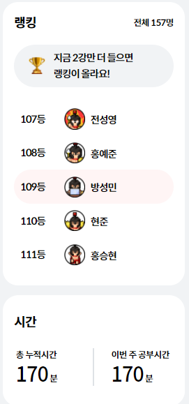

2주차는 109등..

(유의사항)

연습문제 풀이 시 먼저 풀이하고 강의를 듣기 때문에 코드가 다를 수 있습니다.

---

#### **오늘 공부한 내용**

**웹개발 종합반 - 2주차**

1. **2주차 오늘 배울 것**
2. **JQuery 시작하기**
3. **JQuery 다뤄보기**
4. **JQuery 적용하기(포스팅 박스)**
5. **Quiz\_JQuery 연습하기**
6. **서버-클라이언트 통신 이해하기**
7. **Ajax 시작하기**
8. **Ajax 함께 연습하기**
9. **Quiz\_Ajax 연습하기(1)**
10. **Quiz\_Ajax 연습하기(2)**
11. **2주차 끝 & 숙제 설명**

---

> **[ 수업 목표 ]**

**1. Javascript 문법에 익숙해진다.**

**2. JQuery로 간단한 HTML을 조작할 수 있다.**

**3. Ajax로 서버 API(약속)에 데이터 주고, 결과를 받아온다.**

---

#### 2-1. 2주차 배울 내용

    1) Javascript를 통해서 홈페이지에 움직임을 더해주는 방법

      (예시 1) Button을 클릭했을 때, 상자가 나왔다가 들어갔다가 하는 방법

      (예시 2) 서울시의 데이터를 받아와서 홈페이지에 이용하는 방법

    2) Javascript 복습 - 홀짝 판별 onclick 함수 만들기

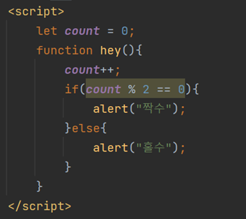

2.1 자바스크립트 복습 - 홀수 판별

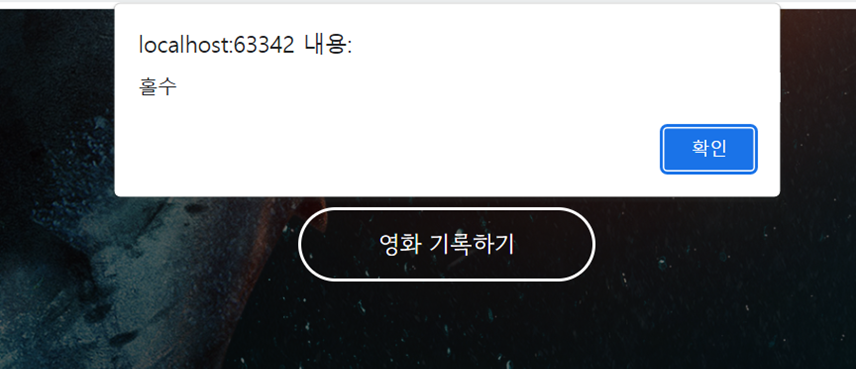

2.1 자바스크립트 복습 - 홀수 판별 페이지

    3) Javascript 만으로 충분할까?

      (예시 1) 버튼의 색을 바꾸고 싶다면?

      (예시 2) div 박스를 하나 감추고 싶다면?

      => 이런 것들을 쉽게 해주는 것이 JQuery이다.

---

#### 2-2. JQuery 시작하기

    1. JQuery란?

* HTML의 쇼소들을 조작하는, 편리한 Javascript를 미리 작성해둔 것(라이브러리)

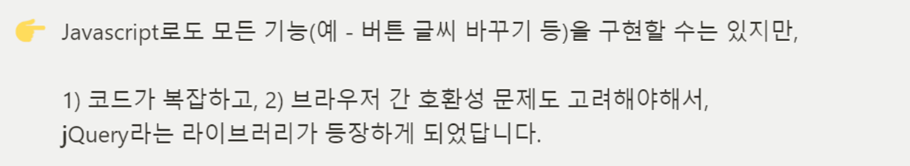

2-2. JQuery 대한 설명

* JQuery와 Javascript 코드 비교하기

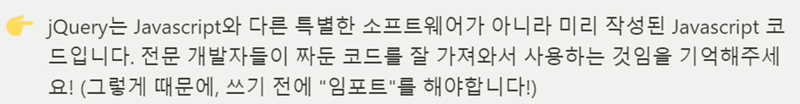

2.2 JQuery와 Javascript 개념 비교

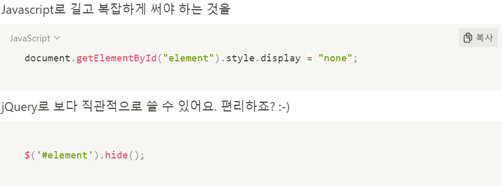

2.2 Javascript와 JQuery 코드 비교

    2. JQuery 사용하기

      (방법) 미리 작성된 JQuery를 import 해주어야 한다.

      (예시) 

---

#### 2-3. JQuery 다뤄보기

    1. 자주쓰는 JQuery 다뤄보기

      (예시 1) input 박스의 값을 가져오기

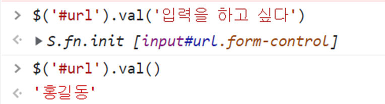

2.3.1 input박스의 값 가져오기

      (예시 2) div 보이기 / 숨기기

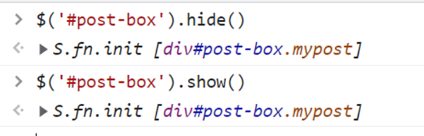

2.3.2 div 보이기 / 숨기기 (코드)

      (예시 3) 태그 내 html 입력하기

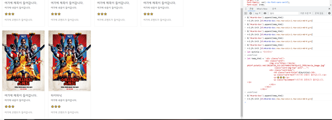

2.3.3 태그 내 html 입력하기 (코드)

    2. JQuery 사용 방법

      (예시) CSS는 class를 설정하여 불러온 것처럼, JQuery는 id값을 통해 불러온다.

---

#### 2-4. JQuery 다뤄보기

    1. 포스팅박스 열기/닫기 기능을 붙여보기

      (예시 1) 포스팅 박스 열고/닫기 구현

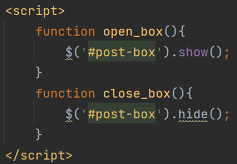

2.4.1 포스팅 박스 열기 / 닫기

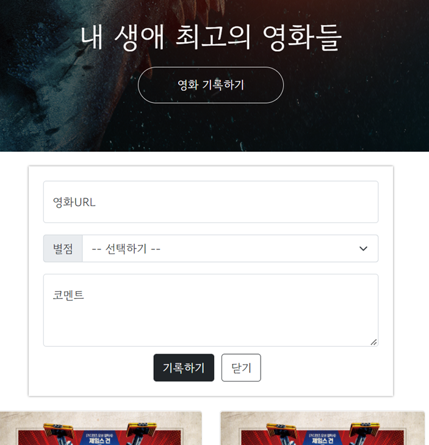

2.4.2 포스팅 박스 열기/닫기 구현

      (예시 2) 페이지 로딩 시 포스팅 박스 닫힌 상태

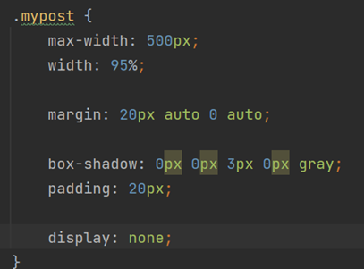

2.4.3 포스팅 박스 닫기

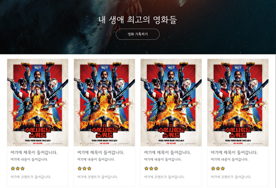

2.4.4 포스팅 박스 페이지 로딩 후 열기

---

#### 

#### 2-5. Quiz\_JQuery 연습하기

    1.JQeury + Javascript의 조합

      (예시 1) 빈칸 체크 함수

      (예시 2) 이메일 판별 함수 만들기

      (예시 3) HTML 붙이기/지우기 연습

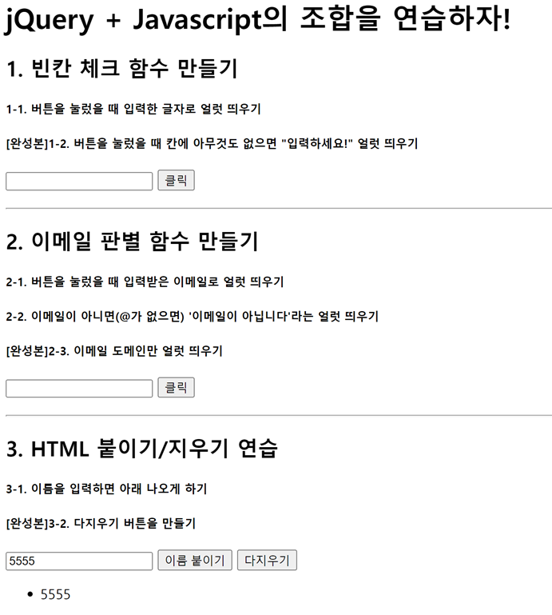

2.5.1 Quiz\_JQuery 페이지

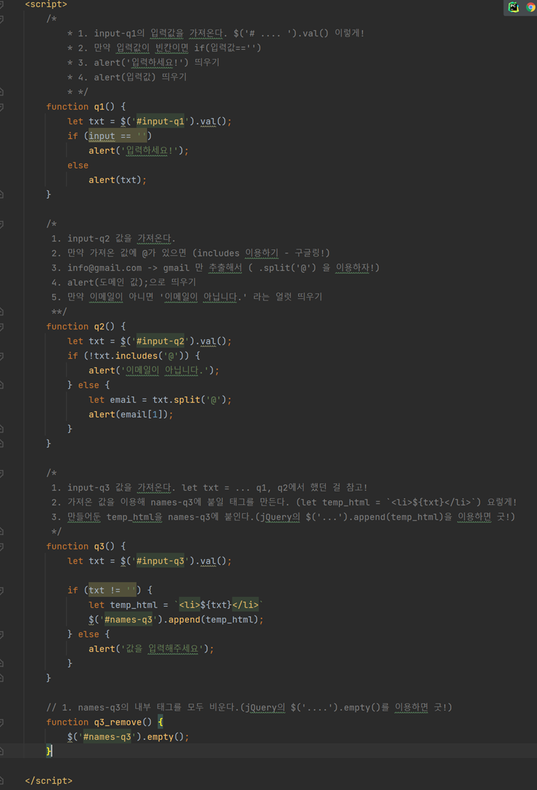

2.5.2 예제 별 코드 구현

---

#### 2-6. 서버 - 클라이언트 통신 이해하기

    1. 서버에서 데이터를 내려주는 형태를 파악해야 한다.

     → "JSON"을 이해하기

    2. 클라이언트 → 서버 : GET 요청하기

      (예시 1) API는 은행 창구와 같은 것

      같은 예금 창구에서도 개인 고객이냐 기업 고객이냐에 따라 가져와야 하는 것과 처리해주는 것이 다른 것처럼

      클라이언트가 요청할 때에도 "타입"이라는 것이 존재합니다.

      \* GET / POST

      (1) GET : 통상적으로 데이터 조회(Read)를 요청할때                                             (예) 영화 목록 조회

      (2) POST : 통상적으로 데이터 생성(Create), 변경(Update), 삭제(Delete) 요청할때        (예) 회원가입, 회원탈퇴, 비밀번호 수정

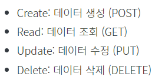

2.6.1 HTTP 메소드

    3. GET

      (예시 1) 아래 주소는 크게 두 부분으로 쪼개집니다. 바로 "?"가 쪼개지는 지점인데요.

                 "?" 기준으로 앞부분이 [서버 주소], 뒷부분이 [영화번호] 입니다.

                 (1) 서버 주소 : <https://movie.naver.com/movie/bi/mi/basic.nhn>

                 (2) 영화 정보 : code=161967

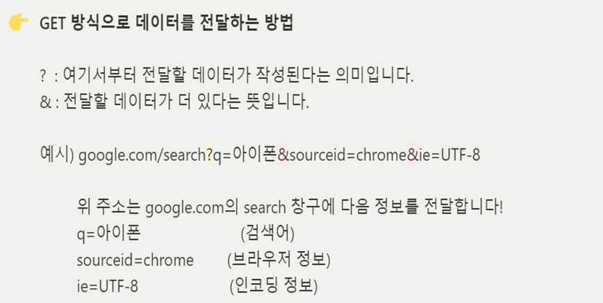

2.6.2 GET 메소드 요약

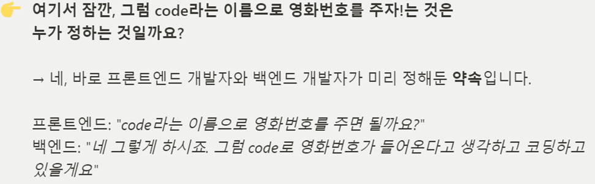

2.6.3 GET 메소드 정리

        (참고자료) <https://movie.naver.com/movie/bi/mi/basic.nhn?code=161967>

[기생충

전원백수로 살 길 막막하지만 사이는 좋은 기택(송강호) 가족.장남 기우(최우식)에게 명문대생 친구가 ...

movie.naver.com](https://movie.naver.com/movie/bi/mi/basic.nhn?code=161967)

---

#### 

#### 2-7. Ajax 시작하기

    (사용 방법)    1. Ajax 기본틀을 복사 붙여넣기 한다.

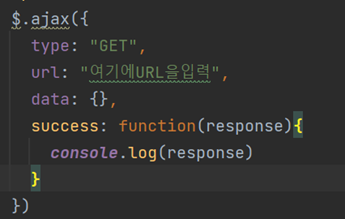

2.7.1 Ajax 기본틀

                      2. Type을 설정하고 URL에 url을 복붙하고, response 데이터를 확인하여 원하는 데이터를 추출한다.

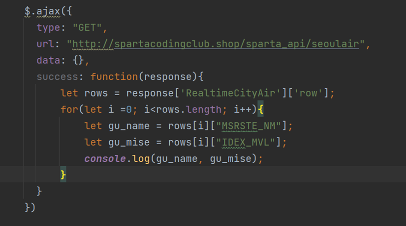

2.7.2 Ajax 사용 코드

---

#### 

#### 2-8. Ajax 함께하기

     예제 : 서울시 Open API(실시간 미세먼지 상태)

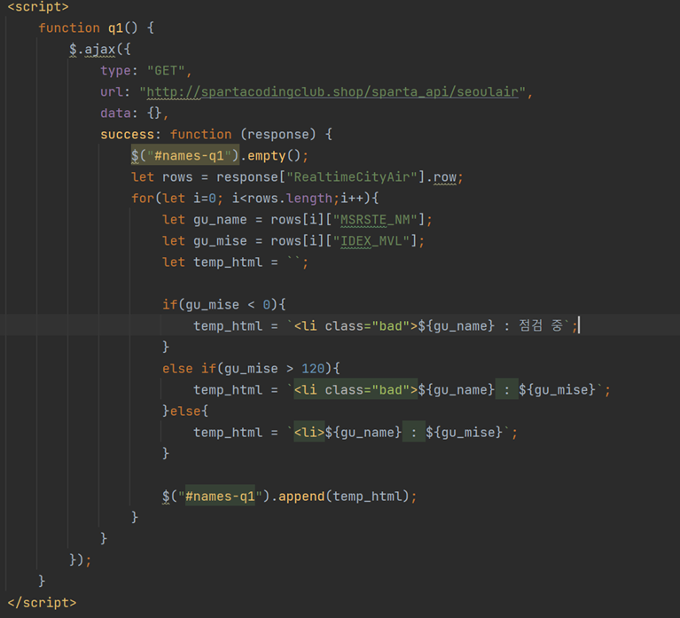

2.8.1 Javascript + JQuery 사용 예제

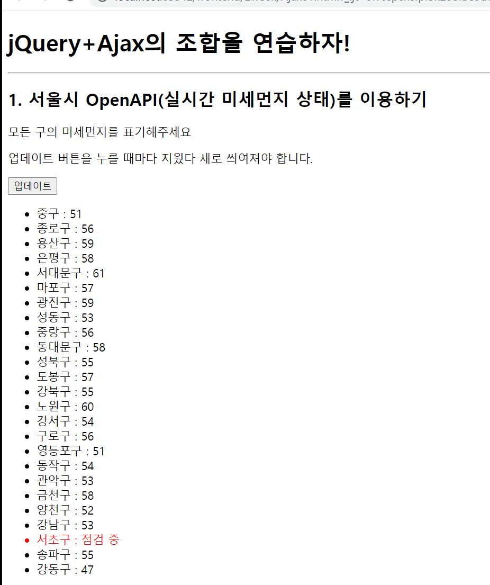

2.8.2 실시간 미세먼지 상태 조회

---

#### 

#### 2-9. Quiz\_Ajax 연습하기(1)

     주제 : 서울시 OpenAPI(실시간 따릉이 현황)를 이용하기

    - 이 연습문제를 해결할 때 무엇인가 더 해보고 싶은 마음에 전달받은 JSON 내부에 있는 상태 값을 확인한 후,

      데이터를 출력하는 방식으로 변경시켰습니다. 그래서 강사님 코드와 조금 다릅니다.

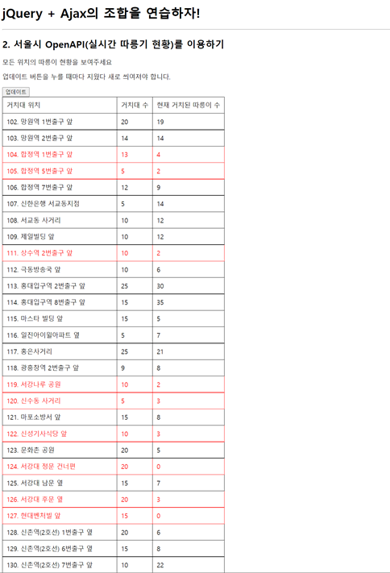

2.9.1 서울시 실시간 따릉이 현황

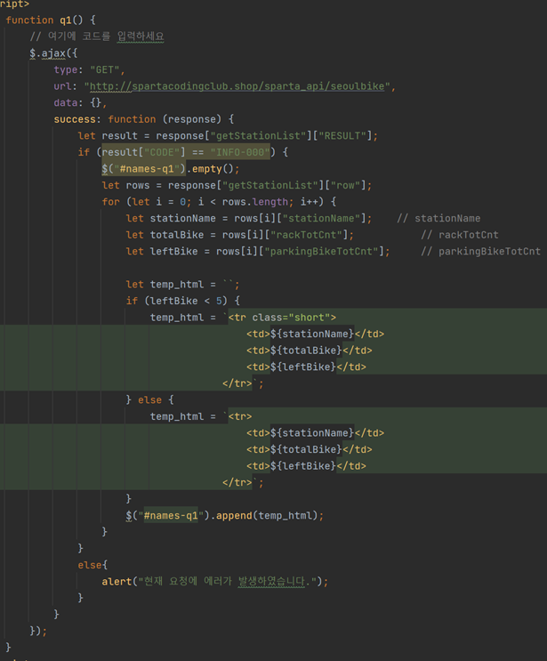

2.9.2 서울시 실시간 따릉이 현황 구현 코드

---

#### 2-10. Quiz\_Ajax 연습하기(2)

     주제 : 르탄이 API를 이용하기

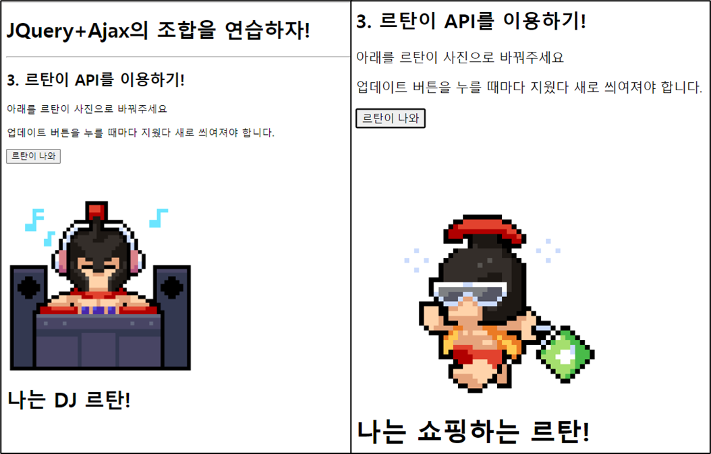

2.10.1 르탄이 API 조합

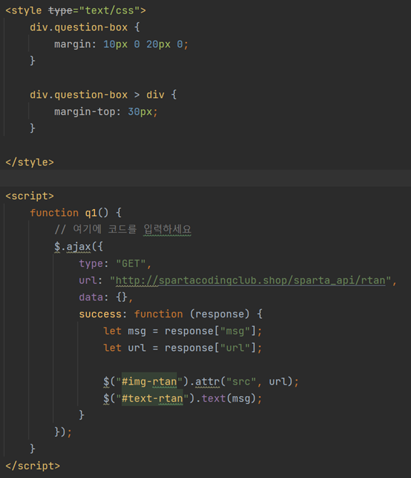

2.10.2 르탄이 API 활용 코드

---

#### 2-11. 2주차 끝 & 숙제 설명

      1) 날씨 API 적용

     2) 페이지 로딩 후 바로 적용하기

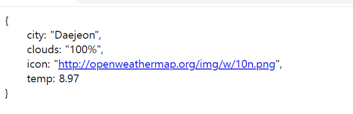

2.11.1 날씨 API(대전지역)

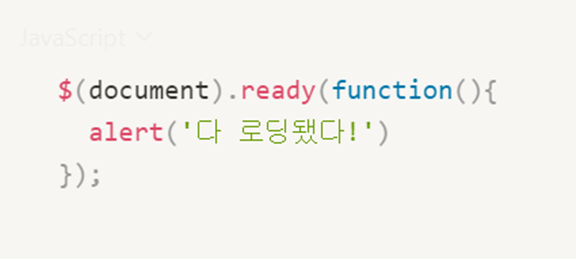

2.11.2 페이징 로딩 후 바로 적용 코드

2.11.3 팬명록에 날씨 API 적용

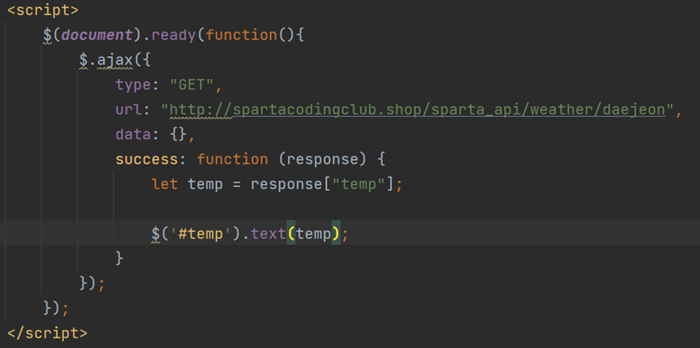

2.11.4 팬명록에 날씨 API 적용 구현 코드

---

#### 

#### 정리

오늘은 웹개발 종합반 2주차를 끝냈는데,

1주차에 아쉬웠던 내용이 적용되어 만족스럽다.

JS파일에서 Javascript로 대부분 많이 구현했는데,

JQuery를 연습문제로 많이 경험하니 더 간결하고 편리한 것 같았다.
