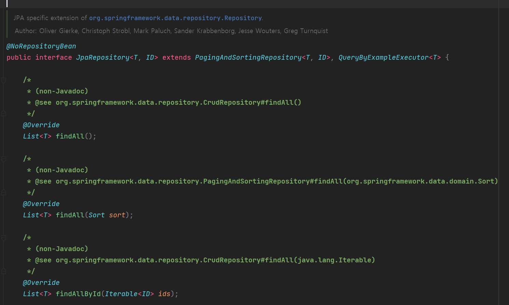
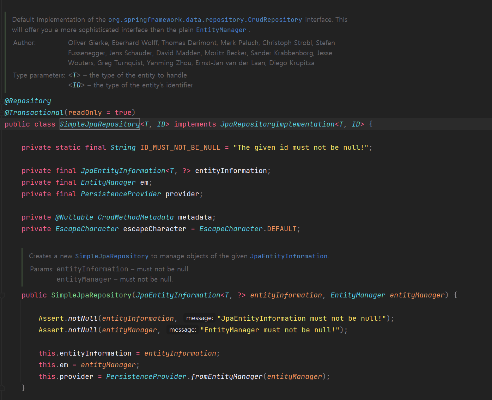
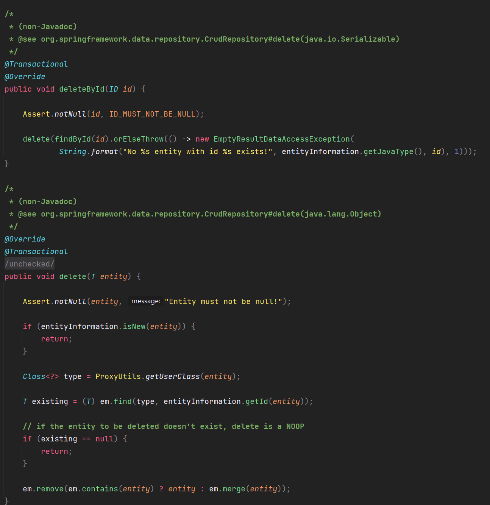
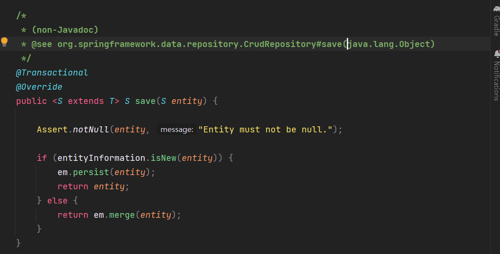
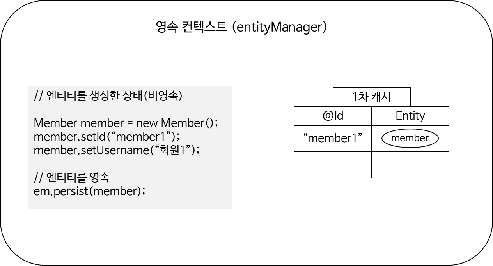
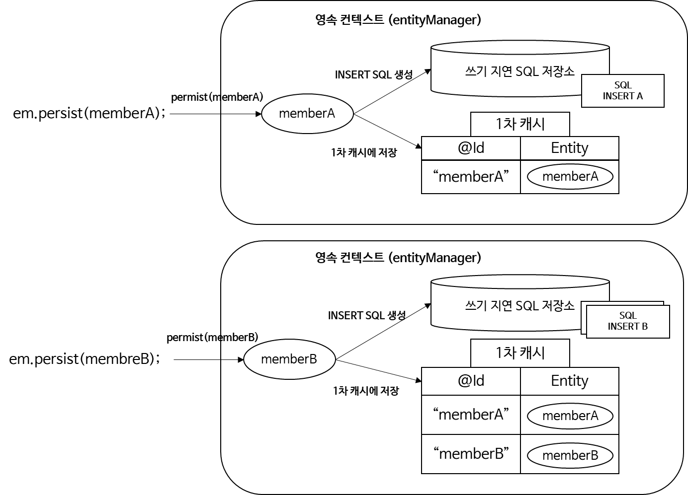
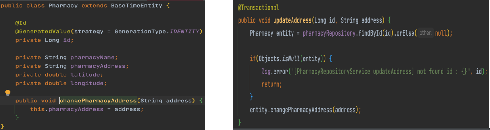
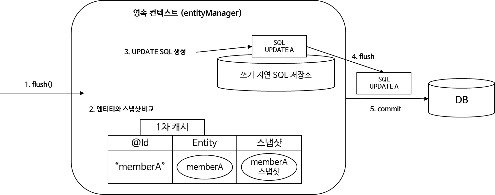

## Spring Data JPA

---

### Spring Data JPA는 무엇일까?

---

JPA는 자바 어플리케이션에서 관계형 데이터베이스 사용하는 방식을 정의한 인터페이스이다.

Spring Data JPA는 Spring 에서 제공하는 모듈 중 하나로, 개발자가 JPA를 더 쉽고 편하게 사용할 수 있도록 지원해주는 도구다.

**JPA를 한 단계 추상화시킨 Repository 인터페이스 제공**

의존성을 추가하고 인터페이스만 정의하면 JPA의 CRUD를 바로 사용가능하다.

**1. 의존성 추가**

```java
implementation 'org.springframework.boot:spring-boot-starter-data-jpa'
```

**2. JpaRepositry 인터페이스 상속**

아래와 같이 상속만으로 JPA 메소드를 사용할 수 있다.

```java
public interface PharmacyRepository extends JpaRepository<Pharmacy, Long> {
}
```

> 어떻게 이것이 가능할까?

다음은 JpaRepository는 인터페이스로 추상화된 모습을 알 수 있지만 자세한 구현 정보는 알 수 없으므로 구현체를 보아야한다.



JpaRepository 구현체인 SimpleJpaRepository를 살펴보면 그 이유를 알 수 있다.



다음과 같이 자주 사용되는 메소드들이 모두 구현되어 있기 때문에 인터페이스를 상속한 것만으로도 JpaRepository를 사용할 수 있다.



> 단, 영속성 컨텍스트 및 Dirty Checking 개념을  
> 잘 이해하고 사용하지 않으면 데이터 손실 및 성능 이슈가 있을 수 있다.

### Spring Data JPA 사용시 주의사항

---

#### JPA의 모든 데이터 변경은 트랜잭션 안에서 실행된다.

JPa의 모든 데이터 변경은 트랜잭션 안에서 실행된다 즉 트랜잭션 밖에서 데이터 변경은 반영되지 않는다.

아래 코드는 JPA가 어떻게 동작하는지 확인하기 위한 Native 코드이다.

```java
public class JpaMain {
    public static void main(String[] args) {
        EntityManagerFactory emf = Persistence.createEntityManagerFactory();
        EntityManger = emf.createEntityManager();

        EntityTransaction tx = em.getTransaction();
        tx.begin();

        try{
            Member member = new Member();
            member.setId(1L);

            em.persist(member);
            tx.commit();
        } catch(Exception e) {
            tx.rollback();
        } finally {
            em.close();
        }

        emf.close()
    }
}
```

1. EntityMangerFactory를 통해 EntityManger를 생성한다.
2. 비즈니스 로직 시작전에 Transaction이 시작된다.
3. Member 를 생성하고 Id를 설정한다.
4. em.persist를 통해 데이터를 저장한다.
5. 트랜잭션을 커밋한다.
6. 만약 예외가 발생한다면 트랜잭션을 롤백한다.
7. 생성된 순서에 역순으로 엔티티 매니저, 엔티티 매니저 팩토리 리소스를 제거한다.

Spring Data JPA 구현 코드를 살펴보면, **데이터 변경**이 일어나는 코드는 @Transactional이 이미 추가되어 있다.



즉 구현 코드를 정확히 이해하지 않고 사용시 문제가 발생할 수 있다.

#### 영속성 컨텍스트(Persistence Context)

영속성 컨텍스트는 Entity를 저장하고 관리하는 저장소이며, 어플리케이션과 데이터베이스 사이에 Entity를 보관하는 가상의 데이터베이스 같은 역할을 한다.

Spring Data JPA에서 제공하는 save 메소드 구현 코드를 보면 em.persist를 통해 영속성 컨텍스트에 저장한다.

이때 Entity는 영속상태가 되고 이미 영속상태인 경우 merge를 통해 덮어 쓴다.


1. Validation Check로 값이 널이 아닌지 확인하고 있다.
2. entityInformation에 존재하지 않는 새로운 엔티티인경우 persist하고 아닌 경우 merge하고 있다.

### 영속성 컨텍스트를 왜 사용할까?

---

데이터베이스와 어플리케이션 사이의 중간 계층에 있으면서 여러가지 이점이 있다.

#### 영속성 컨텍스트 내에 1차 캐시



* 영속성 컨텍스트 내부에 1차 캐시를 가지고 있다.
* persist를 하는 순간 PK 값(id)이 타입과 객체를 맵핑하여 1차 캐시에 가지고 있다.
* 한 트랜잭션 내에 1차 캐시에 이미 있는 값을 조회하는 경우 DB를 조회하지 않고 1차 캐시에 값을 그대로 가져온다.
* 1차 캐시는 어플리케이션 전체 공유가 아닌 한 트랜잭션 내에서만 공유한다.
* 조회했을 때 1차 캐시에 없다면 DB에서 가져와서 1차 캐시에 저장후 반환한다.

#### 영속성 컨텍스트 내에 쓰기 지연 SQL 저장소



* memberA를 persist 하면 1차 캐시에 넣고 쓰기 지연 SQL 저장소에 쿼리를 만들어 쌓는다.
* memberB도 persist 하면 동일한 과정을 거치며, commit 하는 순간 flush가 되면서 DB에 반영된다.
* flush란 영속성 컨텍스트의 변경 내용을 DB에 반영하며, 1차 캐시를 지우지는 않는다.

#### 엔티티 수정(Dirty Checking)

**1. JPA Dirty Checking**



* 코드에서 엔티티의 값을 변경하면 데이터베이스 업데이트 쿼리가 발생한다.  
  => Dirty Checking 덕분이며, Dirty란 상태의 변화가 생긴 정도를 의미한다.  
  **즉 Dirty Checking이란 Entity 상태 변화 검사이다.**
* JPA에서 트랜잭션이 끝나는 시점에 변화가 있는 모든 Entity 객체를 데이터 베이스에 자동으로 반영해준다.

**2. Dirty Chekcing 내부 구조**



* JPA는 commit 하는 순간 내부적으로 flush가 호출되고, 이떄 엔티티와 스냅샵을 비교한다.
* 1차 캐시에는 처음 들어온 상태인 엔티티 스냅샷을 넣어두고 commit 하는 순간 변경된 값이 있는지 비교하여 변경된 값이 있으면 update 쿼리를 쓰기 지연 SQL에 넣어둔다.

**3. JPA Dirty Chekcing 주의사항**

* **Dirty Checking**은 영속성 컨텍스트가 관리하는 Entity에만 적용된다.
* **영속성 컨텍스트에 처음 저장된 순간 스냅샷을 저장해놓고, 트랜잭션이 끝나는 시점에 비교하여 변경된 부분을 쿼리로 생성하여 데이터베이스로 반영한다.**  
  **즉 영속 상태가 아닐 경우 값을 변경해도 데이터베이스에 반영되지 않는다.**
* 트랜잭션이 없이 데이터 반영이 일어나지 않는다.

**4. Dirty Checking 검증 위한 테스트 코드 작성**

Dirty checking 검사를 위해 Transaction 어노테이션이 있는 경우와 없는 경우에 대한 업데이트 코드를 작성하였다.

```java
@Slf4j
@Service
@RequiredArgsConstructor
public class PharmacyRepositoryService {

    private final PharmacyRepository pharmacyRepository;

    @Transactional
    public void updateAddress(Long id, String address) {
        Pharmacy entity = pharmacyRepository.findById(id).orElse(null);

        if(Objects.isNull(entity)) {
            log.error("[PharmacyRepositoryService - updateAddress] not found id: {, id}");
            return;
        }

        entity.changePharmacyAddress(address);
    }

    public void updateAddressWithoutTransaction(Long id, String address) {
        Pharmacy entity = pharmacyRepository.findById(id).orElse(null);

        if(Objects.isNull(entity)) {
            log.error("[PharmacyRepositoryService - updateAddress] not found id: {, id}");
            return;
        }

        entity.changePharmacyAddress(address);
    }

}
```

다음과 같이 어노테이션이 있을 때와 없을 때 즉 Dirty Checking을 위한 테스트 코드를 작성하였다.

```java
class PharmacyRepositoryServiceTest extends AbstractIntegrationContainerBaseTest {

    @Autowired private PharmacyRepository pharmacyRepository;
    @Autowired private PharmacyRepositoryService pharmacyRepositoryService;

    def setup() {
        pharmacyRepository.deleteAll()
    }

    def "PharmacyRepository update - dirty checking success"() {
        given:
        String inputAddress = "서울 특별시 성북구 종암동"
        String modifiedAddress = "서울 특별시 광진구 구의동"
        String name = "은혜 약국"

        def pharmacy = Pharmacy.builder()
                .pharmacyAddress(inputAddress)
                .pharmacyName(name)
                .build()

        when:
        def entity = pharmacyRepository.save(pharmacy)
        pharmacyRepositoryService.updateAddress(entity.getId(), modifiedAddress)

        def result = pharmacyRepository.findAll()

        then:
        result.get(0).getPharmacyAddress() == modifiedAddress
    }

    def "PharmacyRepository update - dirty checking fail"() {
        given:
        String inputAddress = "서울 특별시 성북구 종암동"
        String modifiedAddress = "서울 특별시 광진구 구의동"
        String name = "은혜 약국"

        def pharmacy = Pharmacy.builder()
                .pharmacyAddress(inputAddress)
                .pharmacyName(name)
                .build()

        when:
        def entity = pharmacyRepository.save(pharmacy)
        pharmacyRepositoryService.updateAddressWithoutTransaction(entity.getId(), modifiedAddress)

        def result = pharmacyRepository.findAll()

        then:
        result.get(0).getPharmacyAddress() == inputAddress
    }
}
```

**실행 결과**

**1. Dirty Checking success**

Transaction 어노테이션이 있는 상태로 데이터 변경시 영속성 컨텍스트에 있는 1차 캐시 데이터에 스냅샵과 불일치하여 업데이트 쿼리가 발생한다.

```sql
Hibernate: select pharmacy0_.id as id1_0_, pharmacy0_.latitude as latitude2_0_, pharmacy0_.longitude as longitud3_0_, pharmacy0_.pharmacy_address as pharmacy4_0_, pharmacy0_.pharmacy_name as pharmacy5_0_ from pharmacy pharmacy0_
Hibernate: insert into pharmacy (latitude, longitude, pharmacy_address, pharmacy_name) values (?, ?, ?, ?)
Hibernate: select pharmacy0_.id as id1_0_0_, pharmacy0_.latitude as latitude2_0_0_, pharmacy0_.longitude as longitud3_0_0_, pharmacy0_.pharmacy_address as pharmacy4_0_0_, pharmacy0_.pharmacy_name as pharmacy5_0_0_ from pharmacy pharmacy0_ where pharmacy0_.id=?
Hibernate: update pharmacy set latitude=?, longitude=?, pharmacy_address=?, pharmacy_name=? where id=?
Hibernate: select pharmacy0_.id as id1_0_, pharmacy0_.latitude as latitude2_0_, pharmacy0_.longitude as longitud3_0_, pharmacy0_.pharmacy_address as pharmacy4_0_, pharmacy0_.pharmacy_name as pharmacy5_0_ from pharmacy pharmacy0_
```

**2. Dirty Checking fail**

Transaction 어노테이션이 없으므로 변화가 발생했음에도 불구하고 업데이트 쿼리가 발생하지 않는다.

1, 2번 쿼리는 테스트 메소드마다 데이터베이스에 일관성을 위해 모든 데이터를 지우기 위한 쿼리가 발생하여 발생한 쿼리이다.

```sql
Hibernate: select pharmacy0_.id as id1_0_, pharmacy0_.latitude as latitude2_0_, pharmacy0_.longitude as longitud3_0_, pharmacy0_.pharmacy_address as pharmacy4_0_, pharmacy0_.pharmacy_name as pharmacy5_0_ from pharmacy pharmacy0_
Hibernate: delete from pharmacy where id=?
Hibernate: insert into pharmacy (latitude, longitude, pharmacy_address, pharmacy_name) values (?, ?, ?, ?)
Hibernate: select pharmacy0_.id as id1_0_0_, pharmacy0_.latitude as latitude2_0_0_, pharmacy0_.longitude as longitud3_0_0_, pharmacy0_.pharmacy_address as pharmacy4_0_0_, pharmacy0_.pharmacy_name as pharmacy5_0_0_ from pharmacy pharmacy0_ where pharmacy0_.id=?
Hibernate: select pharmacy0_.id as id1_0_, pharmacy0_.latitude as latitude2_0_, pharmacy0_.longitude as longitud3_0_, pharmacy0_.pharmacy_address as pharmacy4_0_, pharmacy0_.pharmacy_name as pharmacy5_0_ from pharmacy pharmacy0_
```
