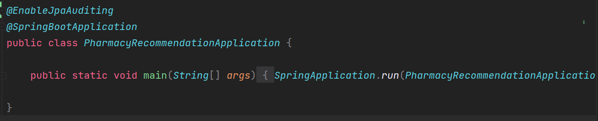
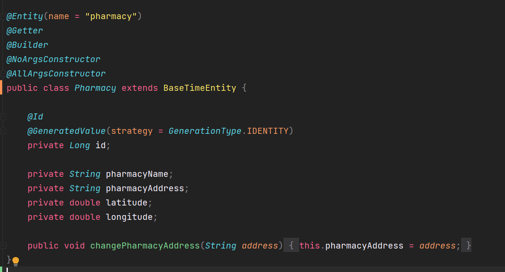
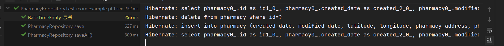

## JPA Auditing

---

### JPA  Auditing 사용 이유

---

* 엔티티 마다 공통적으로 필요한 값(등록일, 수정일) 등은 유지보수에 있어서 반드시 필요하다.
* 어떤 문제가 발생하였을 때 Tracking 하기 위한 정보로 반드시 필요하다.

경우에 따라 테이블 마다 생성자, 수정자 정보가 필요한 경우가 있는데 컬럼에 대한 정보를 엔티티에 넣어두고 엔티티를 생성하거나 수정할 때 직접 코드를 작성해야한다면 반드시 필요한 정보이므로 매번 세팅할때마다 작성해주어야한다.

매번 세팅을 하면서 실수가 발생할 가능성이 매우 크기 때문에 JPA Auditing을 통해 자동화를 시켜줄 것이다.

JPA Auditing을 이용하여 생성일자와 수정일자를 자동으로 등록되도록 할 것이다.

### JPA  Auditing 이란

---

* @EnableJpaAuditing : JPA Auditing 기능 활성화
* @MappedSuperclass : 엔티티의 공통 매핑 정보
* @EntityListeners : 해당 클래스에 auditing 기능을 포함
* @CreatedDate : Entity가 생성되어 저장될 때 시간이 자동 저장
* @LastModifiedDate : Entity 값을 변경할 때 시간이 업데이트

#### JPA  Auditing 기능 활성화



#### 추상 클래스 생성

공통적으로 사용할 매핑 정보를 갖은 추상 클래스를 등록하여 엔티티의 생성일자와 수정일자를 자동으로 관리되도록 할 수 있다.

```java
@Getter
@MappedSuperclass
@EntityListeners((AuditingEntityListener.class))
public abstract class BaseTimeEntity {

    @CreatedDate @Column(updatable = false)
    private LocalDateTime createdDate;

    @LastModifiedDate
    private LocalDateTime modifiedDate;
}
```

#### JPA Auditing 적용



#### 테스트 코드를 통한 검증

```java
def "BaseTimeEntity 등록"() {
    given:
    LocalDateTime now = LocalDateTime.now()
    String address = "서울 특별시 성북구 종암동"
    String name = "은혜 약국"

    def pharmacy = Pharmacy.builder()
            .pharmacyName(name)
            .pharmacyAddress(address)
            .build()

    when:
    pharmacyRepository.save(pharmacy)
    def result = pharmacyRepository.findAll()

    then:
    result.get(0).getCreatedDate().isAfter(now)
    result.get(0).getModifiedDate().isAfter(now)
}
```


