## Spring Transactional

---

### Spring Transactional은 무엇인가?

---

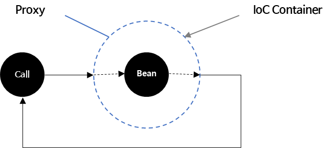

* Spring에서 트랜잭션 처리를 할때 @Transactional 어노테이션을 이용하여 처리한다.
  + @Transactional 은 Spring AOP 기반이며, Spring AOP는 Proxy 기반으로 동작한다.  
    **=> @Transactional이 포함된 메소드가 호출될 경우, 프록시 객체를 생성함으로써 트랜잭션 생성 및 커밋 또는 롤백 후 트랜잭션 닫는 부수적인 작업(트랜잭션, 로깅, 에러, 권한처리 등)을 프록시 객체에게 위임한다는 의미이다.**
  + 프록시의 핵심적인 기능은 지정된 메소드가 호출(Invocation)될 때 이 메소드를 가로채어 부가 기능들을 프록시 객체에게 위임한다. 즉 개발자가 메소드에 @Transactional만 선언하고 비즈니스 로직에 집중할 수 있게 된다.

### Spring Transaction 주의사항

---

Spring AOP 기반으로 하는 기능들(@**Transactional**, @**Cacheable**, @**Async**) 사용시 **Self Invocation 문제**로 인하여 장애가 발생할 수 있다. 즉 프록시 기반으로 동작하는 어노테이션은 **Self Invocation** 문제가 발생할 수 있다.

참고: [[TedBlob] - Spring AOP Proxy](https://tedblob.com/spring-aop-proxy/)

#### **Self Invocation** 발생하는 이유

Proxy에 대해 정확히 이해하지 않은 상태로 사용했기 때문이다.

**Proxy 동작**

메소드가 호출되는 시점에 프록시 객체를 생성하고, 프록시 객체는 부가 기능(트랜잭션)을 주입해준다. 

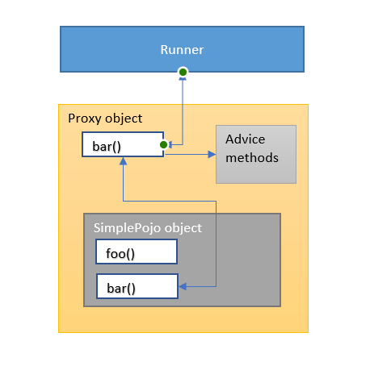

출처 : TedBlob

외부에 foo()와 bar() 메소드가 존재할 때, bar() 메소드 내부에서 foo() 라는 메소드를 호출하는 상황을 가정해보자. 

> 1. 외부에서 bar() 메소드 호출  
> 2. bar() 메소드 내부에서 foo() 메소드 호출  
>   
> 상황 1) bar() 메소드에 트랜잭션 어노테이션이 붙어있다면 Proxy가 생성되어 부가 기능들이 정상적으로 실행될 것이다.  
> 상황 2) foo() 메소드에 트랜잭션 선언이 되어있고, 호출되는 메소드 bar에는 트랜잭션이 없다면 트랜잭션이 발생하지 않는다.

#### **코드를 통해 이해하기**

```java
// self invocation test
public void bar(List<Pharmacy> pharmacyList) {
    log.info("bar CurrentTransactionName: " + TransactionSynchronizationManager.getCurrentTransactionName());
    foo(pharmacyList);
}

// self invocation test
@Transactional
public void foo(List<Pharmacy> pharmacyList) {
    log.info("bar CurrentTransactionName: " + TransactionSynchronizationManager.getCurrentTransactionName());
    pharmacyList.forEach(pharmacy -> {
        pharmacyRepository.save(pharmacy);
        throw new RuntimeException("error");    // 예외 발생
    });
}
```

외부에서 bar 메소드를 호출하면 약국 리스트를 받아서 내부에서 foo 메소드에 전달하는 구조다. 

foo 메소드는 약국 리스트를 데이터베이스 저장하고 있는데 @Transactional이 정상적으로 동작함을 확인하기 위해 명시적으로 RuntimeException을 발생시켰다. 

Spring에서 제공하는 @Transactional 은 default로 RuntimeException이 발생하게 되면 롤백되도록 롤백 정책을 갖고 있다.

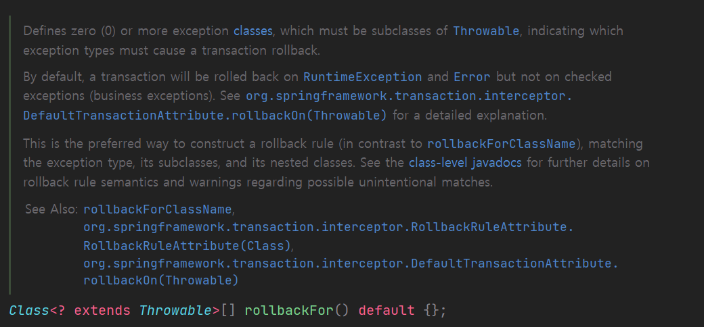

정상적으로 Transaction이 전달되었다고 하면 저장된 부분이 Rollback이 되어야 하고 그렇지 않다고 하면 Transaction이 정상적으로 동작하지 않았다고 판단할 수 있다. 

이를 검증하기 위한 테스트 코드를 작성하였다.

```java
def "self invocation"() {
    given:
    String address = "서울 특별시 성북구 종암동"
    String modifiedAddress = "서울 특별시 광진구 구의동"
    String name = "은혜 약국"
    double latitude = 36.11
    double longitude = 128.11

    def pharmacy = Pharmacy.builder()
            .pharmacyAddress(address)
            .pharmacyName(name)
            .latitude(latitude)
            .longitude(longitude)
            .build()

    when:
    pharmacyRepositoryService.bar(Arrays.asList(pharmacy))


    then:
    def e = thrown(RuntimeException.class)
    def result = pharmacyRepositoryService.findAll()
    result.size() == 1  // 트랜잭션이 적용되지 않는다(롤백 적용  X)
}
```

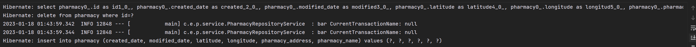

테스트 코드를 통해 알 수 있듯이 self invocation으로 인해 부가 기능들이 정상적으로 동작하지 않게 되어 Transaction이 정상적으로 동작하지 않는다. 즉 Rollback되지 않는다.

---

#### **Self Invocation 해결 방법**

**1. 트랜잭션 위치를 외부에서 호출하는 bar() 메소드로 이동**

```java
@Transactional
public void bar(List<Pharmacy> pharmacyList) {
    log.info("bar CurrentTransactionName: " + TransactionSynchronizationManager.getCurrentTransactionName());
    foo(pharmacyList);
}

// self invocation test
public void foo(List<Pharmacy> pharmacyList) {
    log.info("bar CurrentTransactionName: " + TransactionSynchronizationManager.getCurrentTransactionName());
    pharmacyList.forEach(pharmacy -> {
        pharmacyRepository.save(pharmacy);
        throw new RuntimeException("error");    // 예외 발생
    });
}
```

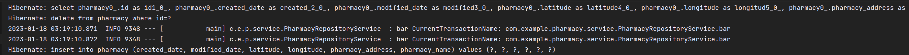

**2. 객체의 책임을 최대한 분리하여 외부 호출하도록 리팩토링**

즉 내부에서 내부를 호출하는 방식이 아닌 의존성을 분리하여 내부에서 외부로 호출하도록 하는 방법이다.

```java
@Service
@RequiredArgsConstructor
public class PharmacyRepositoryService {
    private final PharmacyService pharmacyService;

    public void bar(List<Pharmacy> pharmacyList) {
       log.info("bar CurrentTransactionName: " + TransactionSynchronizationManager.getCurrentTransactionName());
       pharmacyService.foo(pharmacyList);
       // foo(pharmacyList);
    }
}
```

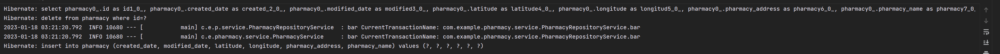

이외에도 다양한 방법이 존재한다.

---

#### **Spring Transactional 주의사항 (읽기 전용)**

* Transactional(readOnly = true) 스프링에서 트랜잭션을 읽기 전용으로 설정 가능하다.
* 읽기 전용으로 설정하게 되면 JPA에서 스냅샷 저장 및 Dirty Checking 작업을 수행하지 않기 때문에 성능적으로 이점을 갖는다.

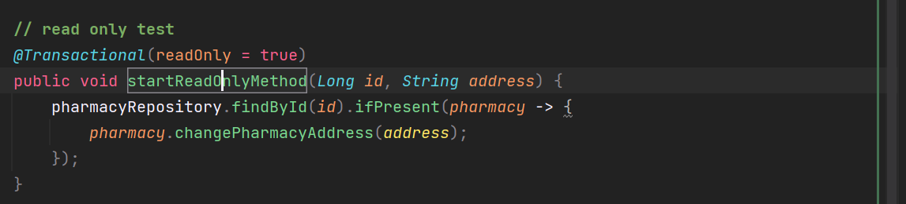
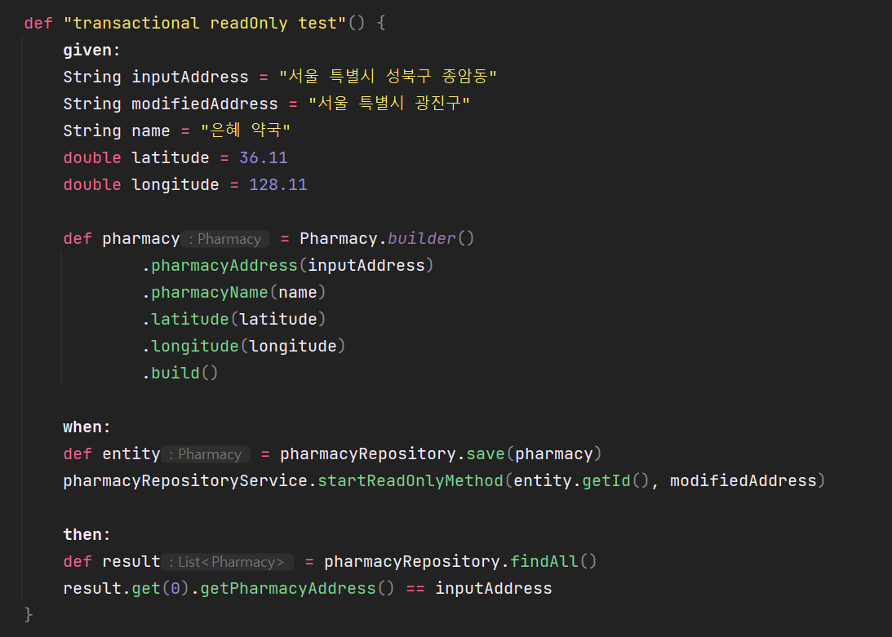

**실행 결과 : 정상 작동 🟢**

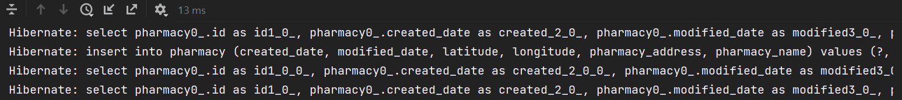

---

#### **Spring Transactional 주의사항 (우선순위)**

**@Transactional은 적용 우선 순위를 가지고 있으며, 클래스 보다 메소드가 우선순위가 높다.**

**클래스에 @Transactional(readOnly=true) (읽기 전용)으로 적용해 놓고, update가 발생하는 메소드에만 readOnly=false. 우선 적용(SimpleJpaRepository)**

**JpaRepository 구현체인 SimpleJpaRepository는 클래스에 @Transactional(readOnly=true)로 설정되어 있다.**

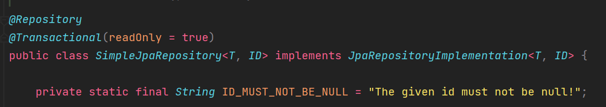

데이터 변경이 일어나는 메소드들에 한해서는 readOnly=false를 설정해두고 있다. 우선순위에 따라서 메소드에 우선순위가 더 높기 때문에 해당 메소드는 readOnly=false 로 동작하게 된다.

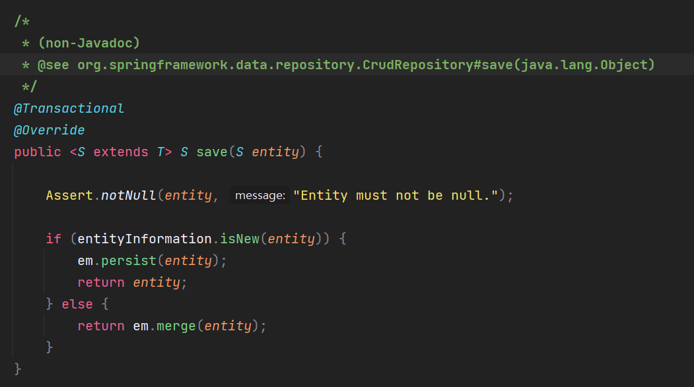

조회 작업에 경우 클래스에 설정된 readOnly=true로 작동하게 된다.

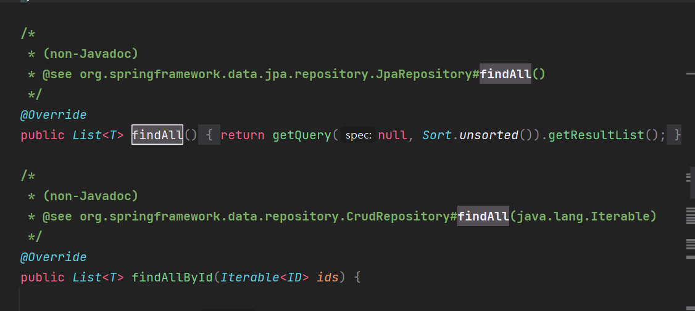
