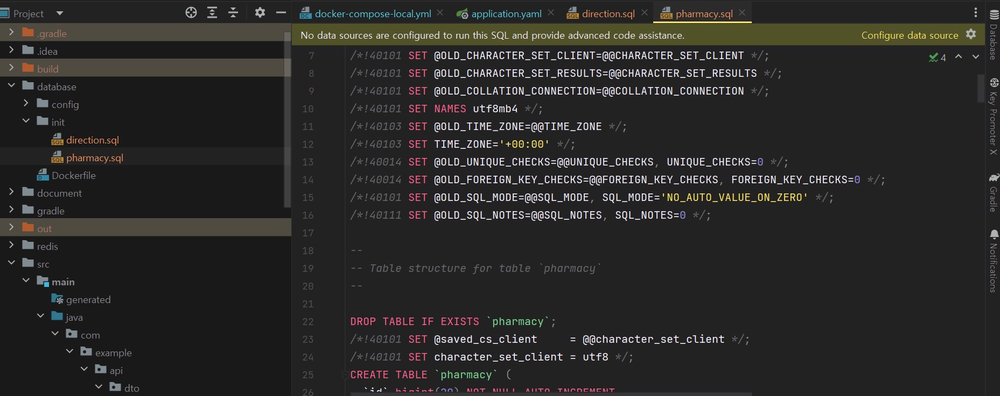
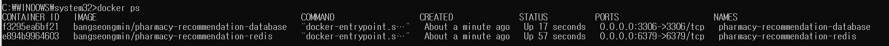
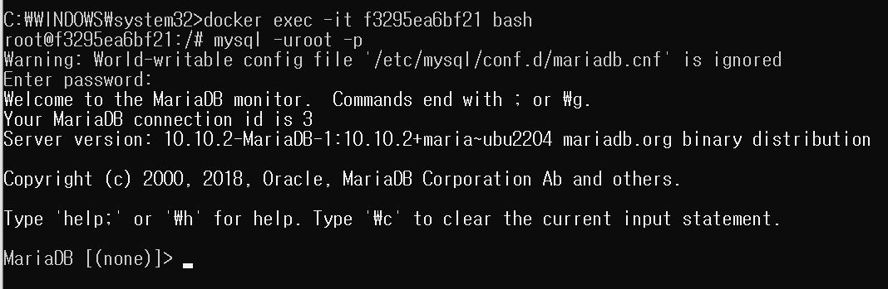
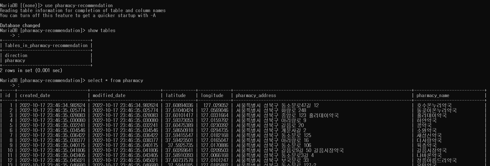
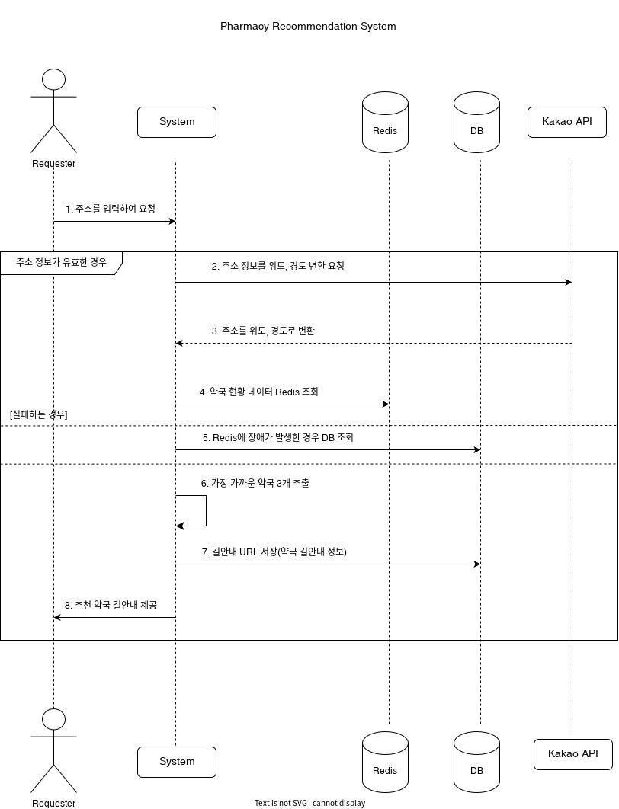

## 약국 데이터 셋업

---

### 공공기관 데이터 약국 데이터 셋업

---

현재 공공기관 제공해주는 데이터 타입은 CSV 타입으로 데이터를 저장하는 방법은 여러가지가 있을 수 있다.

#### **직접 SQL 생성하여 저장하는 방법**

도커 컨테이너 생성시 초기 데이터 저장하는 방법으로 도커 베이스 MariaDB를 사용하고 있기 때문에 MariaDB 같은 경우는 디렉토리 /docker-entrypoint-initdb.d/ 에 .sql 또는 .sh 파일을 넣어두면 컨테이너 실행 시 최초 1회 실행된다.

추가적으로 hibernate 옵션을 create에서 validate로 변경해준다.

```java
jpa.hibernate.ddl-auto:validate
```

**저장할 SQL Query를 다음과 같은 경로에 저장한다.**



**docker-compose 실행시 데이터가 셋업될수 있도록 volumes에 기입해준다.**


**현재 실행중인 Docker Container 확인**



**도커 컨테이너 접속 후 DB 접근**

docker exec -it {Container ID} bash



**데이터베이스에 접근하여 저장된 데이터 조회**



---

#### CSV파일을 읽어 사용하기

초기 데이터가 csv 파일이므로, 로드하여 DB에 저장하는 방법이 있다.

```java
@Slf4j
public class CsvUtils {

    public static List<PharmacyDto> convertToPharmacyDtoList() {

        String file = "./pharmacy.csv";
        List<List<String>> csvList = new ArrayList<>();
        try (CSVReader csvReader = new CSVReader(new FileReader(file))) {
            String[] values = null;
            while ((values = csvReader.readNext()) != null) {
                csvList.add(Arrays.asList(values));
            }
        } catch (IOException e) {
            log.error("CsvUtils convertToPharmacyDtoList Fail: {}", e.getMessage());
        }

        return IntStream.range(1, csvList.size()).mapToObj(index -> {
            List<String> rowList = csvList.get(index);

            String[] split = rowList.get(1).split(",");

            return PharmacyDto.builder()
                    .pharmacyName(rowList.get(0))
                    .pharmacyAddress(split[0])
                    .latitude(Double.parseDouble(rowList.get(4)))
                    .longitude(Double.parseDouble(rowList.get(5)))
                    .build();
        }).collect(Collectors.toList());
    }
}
```

## 거리 계산 알고리즘 구현

---

두 위도, 경도 사이의 거리 계산하기 위한 알고리즘으로 Haversine 알고리즘을 이용하기로 하였었다.

### 요구사항 살펴보기



1. 고객이 문자열 기반에 주소를 입력하면 시스템에 요청한다
2. 문자열 기반에 주소를 입력받아 카카오 API를 통해 위치 기반 데이터인 위도, 경도 변환 요청
3. 카카오 API를 통해 위도, 경도를 반환받는다.
4. 데이터 베이스를 이용하여 약국 데이터를 조회  
   [[약국 데이터 셋업]](tistory-323.html#toc-%EC%95%BD%EA%B5%AD%C2%A0%EB%8D%B0%EC%9D%B4%ED%84%B0%C2%A0%EC%85%8B%EC%97%85) 단계에서 공공기관에서 제공하는 약국 데이터를 데이터베이스 저장해두었다.
5. 6번 flow에서 고객 정보와 약국 데이터를 비교하여 가까운 약국을 추출한다.  
   가까운 약국을 찾기 위해 거리를 구하게 되는데 고객의 위도, 경도와 약국의 위도, 경도를 비교하여 가까운 위치를 찾아주면 된다. 이때 사용하는 알고리즘이 Haversine 알고리즘이다.

Haversine 알고리즘이 어떤 수학 공식을 가지고 있는지에 대해서는 이야기하지 않을 것이고 Haversine 알고리즘을 통해 두 위도와 경도 사이의 거리를 구할 것이다.

### 구현

---

#### Haversine formula

* 두 위도, 경도 사이의 거리를 계산하기 위한 알고리즘
* Haversine formula 알고리즘은 지구를 완전한 구라고 가정하고 계산하기 때문에 0.5 % 정도 오차가 발생할 수 있다.

```java
// Haversine formula
private double calculateDistance(double lat1, double lon1, double lat2, double lon2) {
    lat1 = Math.toRadians(lat1);
    lon1 = Math.toRadians(lon1);
    lat2 = Math.toRadians(lat2);
    lon2 = Math.toRadians(lon2);

    double earthRadius = 6371; //Kilometers
    return earthRadius * Math.acos(Math.sin(lat1) * Math.sin(lat2) + Math.cos(lat1) * Math.cos(lat2) * Math.cos(lon1 - lon2));
}
```

#### 엔티티

```java
@Entity(name = "direction")
@AllArgsConstructor
@NoArgsConstructor
@Builder
@Getter
public class Direction extends BaseTimeEntity {
    @Id
    @GeneratedValue(strategy = GenerationType.IDENTITY)
    private Long id;

    // 고객
    private String inputAddress;
    private double inputLatitude;
    private double inputLongitude;

    // 약국
    private String targetPharmacyName;
    private String targetAddress;
    private double targetLatitude;
    private double targetLongitude;

    // 고객 주소 와 약국 주소 사이의 거리
    private double distance;
}
```

#### 거리 계산 비즈니스 로직

```java
@Slf4j
@Service
@RequiredArgsConstructor
public class DirectionService {

    private static final int MAX_SEARCH_COUNT = 3; // 약국 최대 검색 갯수
    private static final double RADIUS_KM = 10.0; // 반경 10 km

    private final PharmacySearchService pharmacySearchService;

    public List<Direction> buildDirectionList(DocumentDto documentDto) {

        if(Objects.isNull(documentDto)) return Collections.emptyList();

        return pharmacySearchService.searchPharmacyDtoList()
                .stream().map(pharmacyDto ->
                        Direction.builder()
                                .inputAddress(documentDto.getAddressName())
                                .inputLatitude(documentDto.getLatitude())
                                .inputLongitude(documentDto.getLongitude())
                                .targetPharmacyName(pharmacyDto.getPharmacyName())
                                .targetAddress(pharmacyDto.getPharmacyAddress())
                                .targetLatitude(pharmacyDto.getLatitude())
                                .targetLongitude(pharmacyDto.getLongitude())
                                .distance(
                                        calculateDistance(documentDto.getLatitude(), documentDto.getLongitude(),
                                                pharmacyDto.getLatitude(), pharmacyDto.getLongitude())
                                )
                                .build())
                .filter(direction -> direction.getDistance() <= RADIUS_KM)
                .sorted(Comparator.comparing(Direction::getDistance))
                .limit(MAX_SEARCH_COUNT)
                .collect(Collectors.toList());
    }

    // Haversine formula
    private double calculateDistance(double lat1, double lon1, double lat2, double lon2) {
        lat1 = Math.toRadians(lat1);
        lon1 = Math.toRadians(lon1);
        lat2 = Math.toRadians(lat2);
        lon2 = Math.toRadians(lon2);

        double earthRadius = 6371; //Kilometers
        return earthRadius * Math.acos(Math.sin(lat1) * Math.sin(lat2) + Math.cos(lat1) * Math.cos(lat2) * Math.cos(lon1 - lon2));
    }
}
```

> 고객으로부터 문자열 기반 주소 정보를 입력받아 카카오 API를 통해 위도, 경도 기반에 위치정보로 변환할 때 사용한 Dto에서 위도 경도 정보만을 가진 Dto 정보인 DocumentDto를 재사용한다.  
>   
> 1. 고객에 주소 정보 기반에 위도, 경도 정보가 담겨있는 파라미터를 전달받아 유효성 검사를 실시한다.  
> 2. 약국정보 리스트를 조회한다.  
> 3. 약국정보와 고객에 위치 정보를 가진 Direction 인스턴스으로 맵핑한다.  
> 4. 반경 10KM 이내인 경우로 리스트를 줄이고, 정렬 순서는 거리순으로 오름차순 정렬시킨다.  
> 5. 최대 검색 개수를 3개로 줄여 거리 정보를 가진 리스트를 반환한다.

#### 약국 검색 비즈니스 로직

약국 데이터 조회시 이전에 작성한 PharmacyRepositoryService를 동일하게 사용해도 되지만, 나중에 Redis로 전환할 예정이기 때문에 의존성 분리를 통해 유연하게 사용하기 위해 PharmacySearchService를 사용한다.

```java
@Slf4j
@Service
@RequiredArgsConstructor
public class PharmacySearchService {

    private final PharmacyRepositoryService pharmacyRepositoryService;

    public List<PharmacyDto> searchPharmacyDtoList() {
        // redis

        // db
        return pharmacyRepositoryService.findAll()
                .stream()
                .map(this::convertToPharmacyDto)
                .collect(Collectors.toList());
    }

    private PharmacyDto convertToPharmacyDto(Pharmacy pharmacy) {

        return PharmacyDto.builder()
                .id(pharmacy.getId())
                .pharmacyAddress(pharmacy.getPharmacyAddress())
                .pharmacyName(pharmacy.getPharmacyName())
                .latitude(pharmacy.getLatitude())
                .longitude(pharmacy.getLongitude())
                .build();
    }
}
```

> PharmacySearchService는 약국 데이터를 모두 조회하여 Dto로 변환해주는 로직을 가진다.  
>   
> \* 데이터베이스에 있는 데이터는 PhamacyRepositoryService를 통해 사용한다.  
> \* Redis를 사용할 때 엔티티는 데이터베이스와 밀접한 관계가 있기 때문에 Dto를 생성하여 사용할 것이다.

현재는 데이터베이스 기준으로 정보를 조회하여 사용한다. 데이터베이스 IO가 빈번하게 발생할 것이고, 데이터에 변경이 적을 것으로 판단되기 때문에 해당 정보는 Redis에 저장하여 사용하는 것이 효율적으로 판단되기 때문에 추후 Redis로 전환할 것이다.

**왜 Dto로 변환하는데?**

**1. 엔티티는 데이터베이스와 밀접하게 연관되어 있다.**  
엔티티를 변경하는 순간 데이터베이스를 변경하는 것과 동일하므로 Dto로 분리하여 컨트롤러나 프론트엔트로 전달할 때는 Dto로 변환하여 전달하는 것이 유지보수 측면에서 용이하다.

**2. Redis와 데이터베이스를 동일한 Dto에 담아 한 메소드에서 관리하기 위함이다.**

---

### 테스트

테스트는 단일 테스트인 Unit Test로 진행하려 한다.

```java
class DirectionServiceTest extends Specification {

    private PharmacySearchService pharmacySearchService = Mock()

    private DirectionService directionService = new DirectionService(pharmacySearchService)

    private List<PharmacyDto> pharmacyList

    def setup() {
        pharmacyList = new ArrayList<>()
        pharmacyList.addAll(
                PharmacyDto.builder()
                        .id(1L)
                        .pharmacyName("돌곶이온누리약국")
                        .pharmacyAddress("주소1")
                        .latitude(37.61040424)
                        .longitude(127.0569046)
                        .build(),
                PharmacyDto.builder()
                        .id(2L)
                        .pharmacyName("호수온누리약국")
                        .pharmacyAddress("주소2")
                        .latitude(37.60894036)
                        .longitude(127.029052)
                        .build()
        )
    }

    def "buildDirectionList - 결과 값이 거리 순으로 정렬이 되는지 확인"() {
        given:
        def addressName = "서울 성북구 종암로10길"
        double inputLatitude = 37.5960650456809
        double inputLongitude = 127.037033003036

        def documentDto = DocumentDto.builder()
                .addressName(addressName)
                .latitude(inputLatitude)
                .longitude(inputLongitude)
                .build()

        when:
        pharmacySearchService.searchPharmacyDtoList() >> pharmacyList

        def results = directionService.buildDirectionList(documentDto)

        then:
        results.size() == 2
        results.get(0).targetPharmacyName == "호수온누리약국"
        results.get(1).targetPharmacyName == "돌곶이온누리약국"
    }

    def "buildDirectionList - 정해진 반경 10 km 내에 검색이 되는지 확인"() {
        given:
        pharmacyList.add(
                PharmacyDto.builder()
                        .id(3L)
                        .pharmacyName("경기약국")
                        .pharmacyAddress("주소3")
                        .latitude(37.3825107393401)
                        .longitude(127.236707811313)
                        .build())

        def addressName = "서울 성북구 종암로10길"
        double inputLatitude = 37.5960650456809
        double inputLongitude = 127.037033003036

        def documentDto = DocumentDto.builder()
                .addressName(addressName)
                .latitude(inputLatitude)
                .longitude(inputLongitude)
                .build()

        when:
        pharmacySearchService.searchPharmacyDtoList() >> pharmacyList

        def results = directionService.buildDirectionList(documentDto)

        then:
        results.size() == 2
        results.get(0).targetPharmacyName == "호수온누리약국"
        results.get(1).targetPharmacyName == "돌곶이온누리약국"
    }
}
```

> DirectionService는 PharmacySearchService를 의존성 주입 받고 있었다.   
> => 단위 테스트를 하기 위해 PharmacySearchService를 Mocking 할 것이다.  
> => JUnit과 마찬가지로 Mock 객체로 사용하면 되는데 Spock에서는 Mock() 키워드를 사용하여 Mock 객체를 만들 수 있다.  
>   
> 약국 데이터를 조회하는 부분은 직접 지정하여 테스트를 해보려한다.  
>   
> 테스트1. 거리순으로 정렬되는지 확인  
> 테스트2. 반경 10km 내에 검색이 되는지 확인  
>   
> 테스트할 데이터는 테스트 메소드 실행 전에 실행되는 setup() 메소드를 통해 설정하였다.  
>   
> 단일 테스트이기 때문에 실제로 Spring Container가 띄워져있지 않기 때문에 PharmacySearchService를 Mock 객체로 만들어서 실제 행위를 하는 것처럼 지정해야하는데 필요한 부분은 PharmacySearchService에서 전체 약국 Dto를 조회하는 부분이다. 이를 위해 setup에서 약국 정보 Dto를 미리 만들어두었다.  
>   
> 아래 코드와 같이 Mock 객체가 Dto 리스트를 조회하여 가져오는 것처럼 행위를 지정(**stub**)하였다.  
> pharmacySearchService.searchPharmacyDtoList() >> pharmacyList
