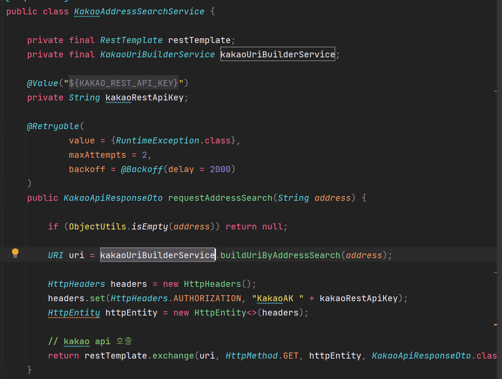
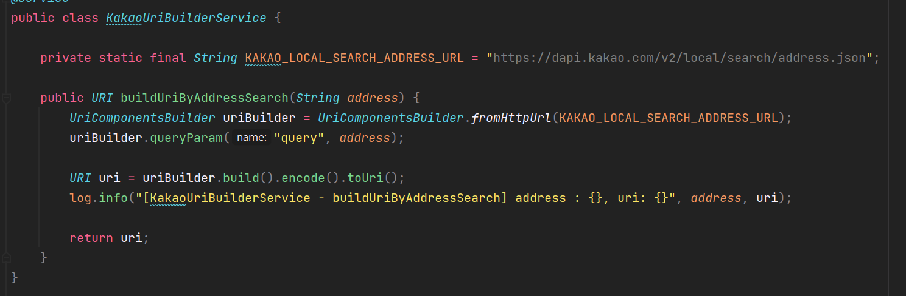
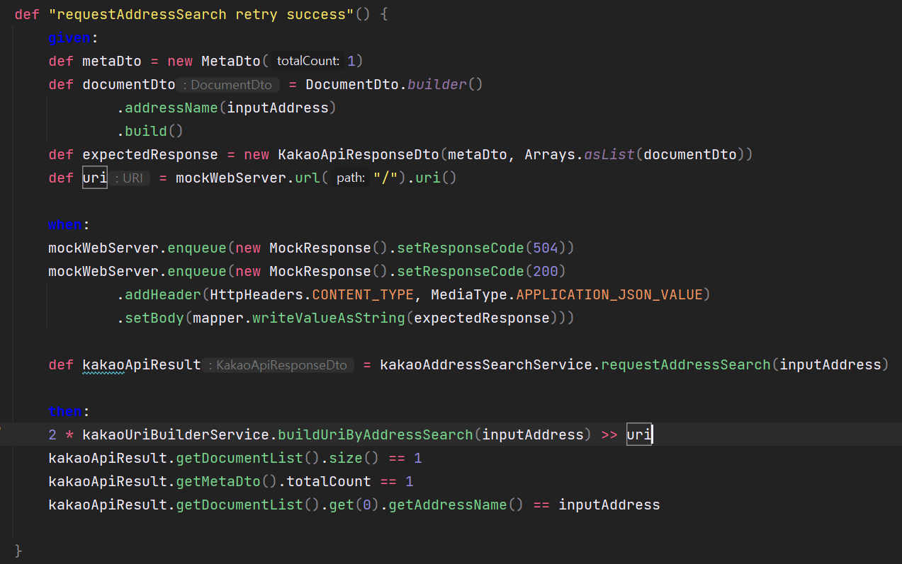
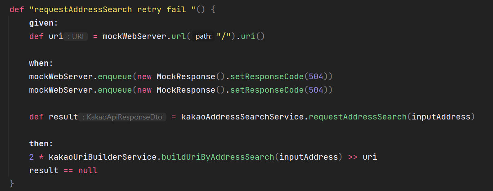
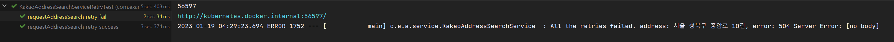

## Spring Retry

---

### Spring Retry 사용하는 이유

---

실무에서는 시스템 안정성을 높이기 위해서 어떻게 하면 스마트하게 할 수 있을까라는 고민을 많이 하게 된다. 하나의 예로 여러 가지 Flow가 이어지는 시스템이 있고 일시적인 Read Timeout 에러가 발생했을 때 이러한 1번에 네트워크 호출 실패로 여러 Flow를 모두 실패처리 했을 때 리소스 낭비가 될 수 있다. 시스템에 따라 다르겠지만 고객 경험에 있어서도 안 좋은 경험이 될 수 있다.

일시적인 장애가 발생한다고 했을 때 약간의 딜레이를 주어 재처리를 한다고 했을 때는 Flow 들을 실패처리하는 것을 막을 수 있고 리소스 낭비를 막을 수 있다. 고객 경험 관점에서도 좋아질 수 있다.

이처럼 상황에 따라 재처리하는 부분은 굉장히 중요하다.

**참고**

* [개인블로그] [Spring Retry](https://wonyong-jang.github.io/spring/2021/02/18/Spring-Retry.html)
* [Github - Spring projects] [Spring retry](https://github.com/spring-projects/spring-retry)

서비스 로직에서 외부 API로 카카오 API를 사용하고 있는데 일시적인 오류 부분에 대해서 이러한 시스템 안정성을 높이는 작업이 중요하다.

Spring에서 재시도 기능을 사용하기 위한 방법으로 Resilience4j, Spring Retry 라이브러리를 많이 사용한다. 이 중에서 Spring Retry를 사용하려 한다.

재처리를 할 때 크게 3가지를 먼저 생각해보아야한다.

1. **재시도를 몇 번 실행할 것인가?**재시도를 1번만 처리했을 경우 동일하게 실패처리가 될 가능성이 있기 때문에 반복적으로 호출해 주는 것이 좋다.
2. **재시도하기 전에 지연시간을 얼마나 줄 것인가?**  
   일시적인 장애 Read Timeout이 발생했을 때 딜레이를 주지 않고 계속 반복해서 5번을 호출한다고 가정하면 딜레이 없이 서버에 5번을 호출하게 되면 대부분 다 실패처리가 될 가능성이 높을 것이다. 이 부분을 약간의 딜레이를 주어 호출하는 전략을 갖는 것이 좋다.
3. **재시도를 모두 실패했을 경우 어떻게 처리할 것인가?**재시도를 모두 실패했을 경우 로그만 남길지 아니면 다른 부분으로 대응해서 리턴 값을 넘겨줄지 대한 부분도 결정해야 한다.

이러한 재처리 과정을 직접 순수 자바 코드로 구현할 수 있다. 하지만 비즈니스 로직에 집중이 가능하도록 스프링에서 제공하는 라이브러리를 사용했을 때 코드를 간결하고 유지보수하기 쉽다는 장점이 있다.

라이브러리 중에서도 어노테이션을 이용하는 방법과 RetryTemplate를 이용하여 재시도하는 방법이 있는데 그중 어노테이션을 이용한 방법을 사용할 것이다.

어노테이션을 이용하는 방법을 사용하는 이유는 어노테이션을 이용하는 방법은 유지보수가 쉽고 코드에 가독성이 높아지기 때문이다.

### Spring Retry 사용방법

---

#### **의존성 추가**

```java
implementation 'org.springframework.retry:spring-retry'
```

#### **Spring Retry 활성화**

1. 클래스에 **@EnableRetry을** 이용하여 Spring Retry를 활성화시킨다.

```java
@EnableRetry
@Configuration
public class RetryTemplateConfig {
    //...
}
```

2. 재처리할 메서드에 **@Retryable을** 추가한다.

어노테이션을 추가하고 어떤 에러가 발생할 때 처리할 것인지 명시만 해주면 간편하게 사용할 수 있다.

```java
@Service
@RequiredArgsConstructor
public class KakaoAddressSearchService {

    @Retryable(value = {RuntimeException.class})
    public KakaoApiResponseDto requestAddressSearch(String address) {
        // ...
    }
}
```

**@Retryable에** 재시도를 몇 번 할 것인지 딜레이는 몇 초로 할 것인지 정의한 것이 없다. 위와 같이 설정하지 사용하면 Default로 재시도는 최대 3번, 재시도 딜레이는 1초로 되어 있다.

만약 재설정을 통해 커스터마이징 하고 싶다면 아래와 같이 설정할 수 있다.

```java
@Service
@RequiredArgsConstructor
public class KakaoAddressSearchService {

    @Retryable(
            value = {RuntimeException.class},   // 여러 exception 선택 가능
            maxAttempts = 2,                    // 재시도 반복 횟수
            backoff = @Backoff(delay = 3000)    // 지연시간 설정
    )
    public KakaoApiResponseDto requestAddressSearch(String address) {
        // ...
    }
}
```

3. **Fallback** 처리는 **@Recover을** 통해 할 수 있다.

* Fallback 처리는 재시도 처리가 모두 실패했을 경우에 대한 처리를 의미한다.
* retryable 메서드와 recover 메소드 반환 타입을 맞춰주지 않으면 Cannot locate recovery method 에러가 발생한다.
* recover 메서드에서는 특정 값을 리턴해줄 수 있고, Exception을 throw 할 수 있다.

```java
@Recover
public KakaoApiResponseDto recover(RuntimeException e, String address) {   
    log.error("All the retries failed. address: {}, error : {}", address, e.getMessage());    
    return null;    
}
```

```java
@Service
class Service {
    @Retryable(RemoteAccessException.class)
    public void service(String str1, String str2) {
        // ... do something
    }
    @Recover
    public void recover(RemoteAccessException e, String str1, String str2) {
       // ... error handling making use of original args if required
    }
}
```

### Spring Retry 구현 및 검증

---

Spring Retry는 RetryTemplate을 사용하는 방법과 어노테이션을 이용하여 구현이 가능하다. 그중에서 어노테이션을 이용하여 구현할 것이다.

#### **의존성 추가**

Spring Retry 구현하고 카카오 API를 검증하는 작업은 까다롭다. 카카오 API는 외부 서버이고 컨트롤하는 것이 까다롭기 때문에 Spring Retry에 대해 테스트해 보려면 서버에서 실패를 응답값으로 보내줘야 테스트를 해볼 수 있다.

mockWebServer를 사용하여 Server를 Mocking 하여 Mocking 된 서버에서 실패 응답값을 보내줘서 재처리가 정상적으로 동작함을 검증하려 한다.

```java
// spring-retry
implementation 'org.springframework.retry:spring-retry'

// mockWebServer
testImplementation 'com.squareup.okhttp3:okhttp:4.10.0'
testImplementation 'com.squareup.okhttp3:mockwebserver:4.10.0'
```

#### Retry 활성화

```java
@EnableRetry
@Configuration
public class RetryConfig {

}
```

#### @Retryable과 @Recover

```java
@Slf4j
@Service
@RequiredArgsConstructor
public class KakaoAddressSearchService {

    private final RestTemplate restTemplate;
    private final KakaoUriBuilderService kakaoUriBuilderService;

    @Value("${kakao.rest.api.key}")
    private String kakaoRestApiKey;

    @Retryable(
            value = {RuntimeException.class},
            maxAttempts = 2,
            backoff = @Backoff(delay = 2000)
    )
    public KakaoApiResponseDto requestAddressSearch(String address) {

        if (ObjectUtils.isEmpty(address)) return null;

        URI uri = kakaoUriBuilderService.buildUriByAddressSearch(address);

        HttpHeaders headers = new HttpHeaders();
        headers.set(HttpHeaders.AUTHORIZATION, "KakaoAK " + kakaoRestApiKey);
        HttpEntity httpEntity = new HttpEntity<>(headers);

        // kakao api 호출
        return restTemplate.exchange(uri, HttpMethod.GET, httpEntity, KakaoApiResponseDto.class).getBody();
    }

    @Recover
    public KakaoApiResponseDto recover(RuntimeException e, String address) {
        log.error("All the retries failed. address: {}, error: {}", address, e.getMessage());

        return null;
    }

}
```

카카오 API를 호출하는 KakaoAddressSearchService에 재처리를 사용한다.

@Retryable을 설정하면 해당 메서드가 설정한 정책에 의해서 재처리가 될 것이다. 재처리가 모두 실패했을 경우에는 어떻게 처리할 것인지에 대한 @Recover 메서드를 함께 작성해주어야 한다.

* **@Retryable** 은 호출하는 코드인 requestAddressSearch() 메서드에 위와 같이 설정하였다.  
  + **When?** RuntimeException이 발생했을 때
  + **How Many times?** 2번
  + **How long to wait?** 2초
* **@Recover** 은 requestAddressSearch()가 설정한 정책에 최대 횟수만큼 재처리했을 때 모두 실패할 경우 실행된다.
  + **Param :** @Retryable에 설정한 예외를 파라미터로 받고, 해당 메서드에 파라마터를 함께 전달
  + **Return** : @Retryable 메서드와 동일하게 KakaoResponseDto로 반환
  + **Context** : 에러 로그를 남기고 null 값을 반환

#### **검증**

```java
class KakaoAddressSearchServiceRetryTest extends AbstractIntegrationContainerBaseTest {

    @Autowired  private KakaoAddressSearchService kakaoAddressSearchService

    @SpringBean private KakaoUriBuilderService kakaoUriBuilderService = Mock()

    private MockWebServer mockWebServer

    private ObjectMapper mapper = new ObjectMapper()

    private String inputAddress = "서울 성북구 종암로 10길"

    def setup() {
        mockWebServer = new MockWebServer()
        mockWebServer.start()
        println mockWebServer.port
        println mockWebServer.url("/")
    }

    def cleanup() {
        mockWebServer.shutdown()
    }

    def "requestAddressSearch retry success"() {
        given:
        def metaDto = new MetaDto(1)
        def documentDto = DocumentDto.builder()
                .addressName(inputAddress)
                .build()
        def expectedResponse = new KakaoApiResponseDto(metaDto, Arrays.asList(documentDto))
        def uri = mockWebServer.url("/").uri()

        when:
        mockWebServer.enqueue(new MockResponse().setResponseCode(504))
        mockWebServer.enqueue(new MockResponse().setResponseCode(200)
                .addHeader(HttpHeaders.CONTENT_TYPE, MediaType.APPLICATION_JSON_VALUE)
                .setBody(mapper.writeValueAsString(expectedResponse)))

        def kakaoApiResult = kakaoAddressSearchService.requestAddressSearch(inputAddress)

        then:
        2 * kakaoUriBuilderService.buildUriByAddressSearch(inputAddress) >> uri
        kakaoApiResult.getDocumentList().size() == 1
        kakaoApiResult.getMetaDto().totalCount == 1
        kakaoApiResult.getDocumentList().get(0).getAddressName() == inputAddress

    }


    def "requestAddressSearch retry fail "() {
        given:
        def uri = mockWebServer.url("/").uri()

        when:
        mockWebServer.enqueue(new MockResponse().setResponseCode(504))
        mockWebServer.enqueue(new MockResponse().setResponseCode(504))

        def result = kakaoAddressSearchService.requestAddressSearch(inputAddress)

        then:
        2 * kakaoUriBuilderService.buildUriByAddressSearch(inputAddress) >> uri
        result == null
    }
}
```

통합 테스트 환경에서 KakaoAddressSearchService에 재처리를 등록한 requestAddressSearch 메서드를 테스트하였다.

**테스트 케이스**

1. requestAddressSearch 메서드에서 RuntimeException이 발생했을 때, 정상적으로 재처리가 발생하는지 확인하는 테스트
2. 재처리가 모두 실패했을 경우에 @Retry 메서드가 실행되는지 확인하는 테스트

**setup()**

실제로 카카오 API를 호출하여 응답값을 받는 것이 아니라 서버를 Mocking 할 수 있는 MockWebServer를 사용한다.

테스트 메소드가 실행되기 전에 실행되는 setup 메서드에 MockWebServer를 실행하면 동적으로 포트가 할당되고 url은 localhost에서 실행되게 된다.

**cleanup()**

테스트가 종료되고 나면 MockWebServer를 종료시킨다.

**@SpringBean**

Spock에서는 Mocking 할 때 @SpringBean을 사용한다.

Mokito에서는 Spring Container 내에 Bean을 Mocking 할 때 @MockBean을 사용한다.



KakaoAddressSearchService에서 URI 부분에서 kakaoUriBuilderService를 Mocking 하는데 서비스에서 리턴한 URI는 실제 Kakao API를 호출하기 위한 URI다.



실제 카카오 API를 호출하는 것이 아니라 로컬호스트에 떠있는 Mocking 서버를 호출해야 하므로 KakaoUriBuilderService를 Mocking 해서 URI 자체를 로컬호스트에 떠있는 Mocking 서버를 응답해 주도록 Mocking 하기 위해 Spring Container 내에 있는 kakaoUriBuilderService를 Mocking 하기 위해 @SpringBean 어노테이션을 사용한다.

mockWebServer에서 사용하고 있는 url에 uri를 Mocking 하고 있다. 그래서 builderUriByAddressSearch 메서드를 실행하면 카카오 API Uri가 아닌 MockWebServer를 호출하기 위한 uri를 반환하도록 지정하였다.



**테스트 케이스 1번**


> **when**mockWebServer에 응답값을 순차적으로 조작하고 있다.  
> 첫 번째 호출되었을  때는 504 에러를 응답하도록 하였고, 두 번째 호출되었을 때는 정상적으로 상태값을 반환하도록 하였다. 카카오 API가 응답한 것처럼 Header와 Body를 지정하여 내려주도록 하였다.  
>   
> **given**expectedResponse을 보면 알 수 있듯이 카카오 API에서 내려준 것처럼 응답값을 직접 만들어주었다.   
>   
> **then**  
> 응답 값이 직접 만든 응답값과 동일한지 확인하고 있다.   
> 2 \* 를 한 이유는 kakaoUriBuilderService.buildUriByAddressSearch(inputAddress)가 2번 호출되는 것이 맞는지 확인하기 위한 것이다. 왜냐하면 첫 번째 응답 값을 실패하게 하고 두 번째 응답값은 정상 처리되도록 하였기 때문에 정상 응답 값을 받기 위해서는 2번 실행되어야 하기 때문이다.

**테스트 케이스 2번**



> **when**첫 번째 실행시 504 에러를 발생시키고, 두 번째 실행시 504 에러를 발생시키도록 지정하고 requestAddressSearch 메소드가 발생되도록 하였다.  
>   
> **then** kakaoUriBuilderService.buildUriByAddressSearch(inputAddress) 메소드를 2회 실행하여 지정한 **@Recover** 에 결과 값과 동일한 null인지 검증하고 있다.

테스트 코드를 실행하면 다음과 같이 정상적으로 테스트가 성공한다. 테스트 케이스 2번은 @Recover에 작성한 로그가 정상 작동한다.


