## 최종 길안내 개발

---

### Kakao 지도 API을 이용한 길 안내 개발

---

카카오에서 제공하는 지도 URL에서 **지도 바로가기**와 **로드뷰 바로가기**를 사용할 것이다.

#### **지도 바로가기**

URL Pattern 중 이름, 위도, 경도를 사용하는 패턴을 이용할 것이다.

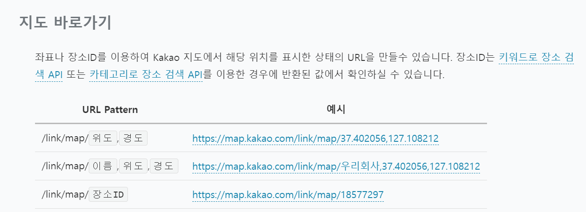

#### 로드뷰 바로가기

URL Pattern 중 위도, 경도를 사용하는 패턴을 이용할 것이다.

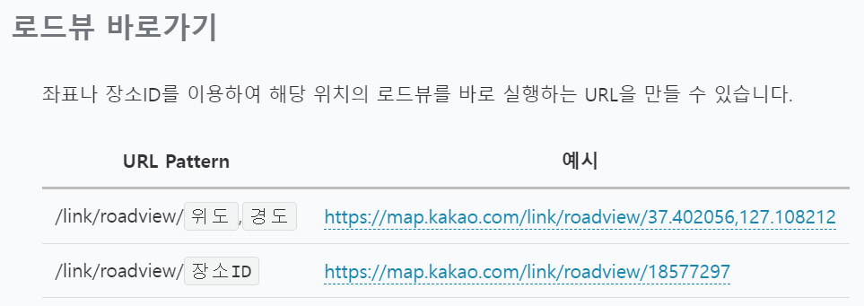

#### 구현

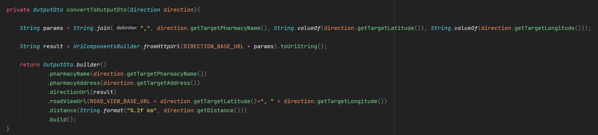

convertToOutpoutDto에서 지도 바로가기 URL에 들어가는 이름은 한글이 들어가므로 인코딩하여 String 형태로 전달해주고 있다. 그런데 KakaoUriBuilderService에서는 RestTemplate를 이용하여 URL을 전달할 때는 URI로 인코딩하여 전달하였는데 현재는 String으로 인코딩하여 전달하고 있는 이유는 RestTemplate와 관계 없기 때문이다.

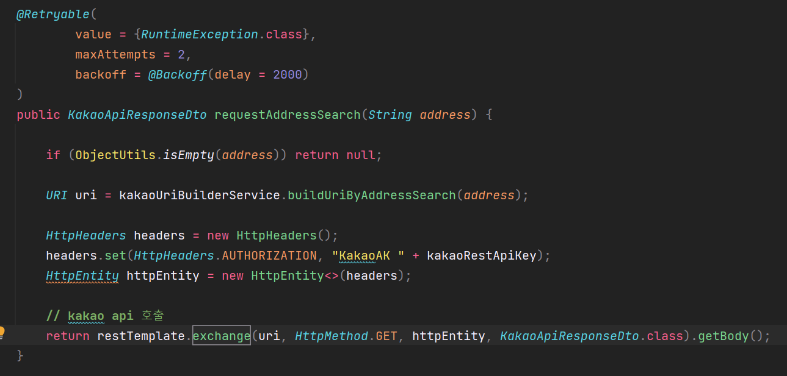

그 이유는 RestTemplate에 String으로 인코딩할 경우 내부적으로 URI로 인코딩하는 작업이 추가적으로 발생하여 문제가 될 수 있으므로 RestTemplate를 사용할 때 URI로 인코딩한 것이다.

#### 실행 결과

길안내 링크와 로드뷰 링크가 정상적으로 잘 처리됨을 확인할 수 있다.

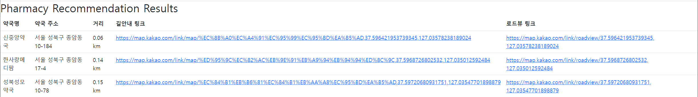

로그를 통해 알 수 있듯이 정상적으로 동작함을 확인할 수 있다.

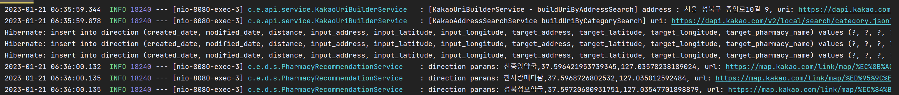

### shorten url 개발

---


길안내 링크는 한글이 인코딩되면서 길어지는 문제가 있다. 이를 shorten url로 변경하여 url에 길이를 줄이려고 한다.

#### shorten url 개발

주로 모바일 등으로 URL을 공유하고자 할 때, 긴 URL을 줄여서 제공한다.

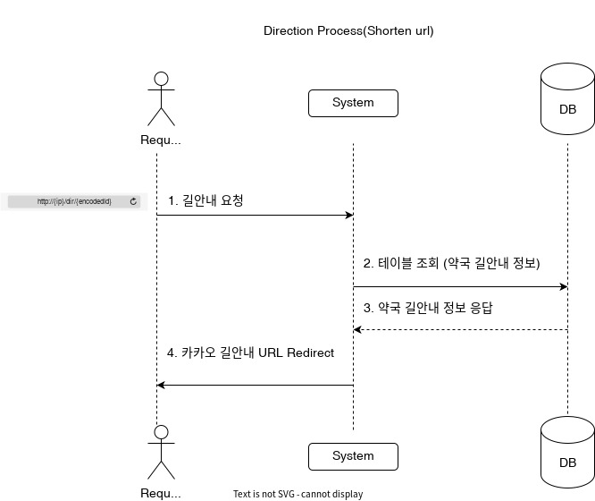

'

고객에게 shorten url로 제공하고 shorten url에 대응하는 긴 url이 있을 것이다. 고객에게 shorten url로 제공하면 고객은 shorten url로 길안내 요청을 할 것이다. 시스템에 Direction이라는 테이블에 고객이 요청한 주소와 대응하는 약국 데이터가 존재할 것이다. 그결과물에 대응하는 Sequence 값을 찾아서 고객에게 카카오 길안내 url을 redirect 해주는 방식으로 개발해보려 한다.

* 요청 URL에 대응하는 Unique한 식별자가 필요하다.
  1. **DB에 길안내 정보(위도, 경도와 약국정보)를 저장하고 PK를 사용하는 방법**  
     Ex) http://localhost:8080/dir/10000000000...  
     10진수이기 때문에 더 길어질 수 있고 10진수 보다 더 간결한 64진수 또는 62진수로 표현하는 것이 낫다.
  2. **base 64 사용**  
     "=" 등은 URL 예약어이기 때문에 부적절
  3. **base 62 사용**  
     Ex) http://localhost:8080/dir/raad21

#### 구현

**라이브러리 추가**

base62를 사용하기 위한 라이브러리가 필요하다. 함께 첨부한 링크를 통해 base62 사용 방법을 확인할 수 있다.

```java
// https://github.com/seruco/base62
implementation 'io.seruco.encoding:base62:0.1.3'
```

**base url 설정**

shorten url로 전달하기 위해 base url을 포함하는 url을 shorten url과 매핑시켜 저장하기 위해 base url을 프로퍼티에 저장한다.

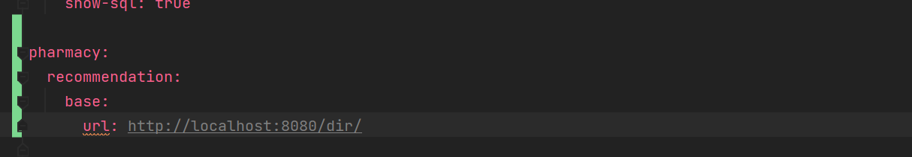

**Base62을 이용한 인코딩과 디코딩**

Base62 인스턴스를 생성하고 DB에 저장된 PK 값을 인코딩하고, 인코딩된 값을 디코딩하여 PK 값을 반환하는 로직을 갖는다. PK를 인코딩하는 이유는 10진수이기 때문에 길어질 수 있기 때문이다.

Base64가 아닌 Base62를 사용한 이유는 Base64로 인코딩할 경우 '=' 등 예약어가 사용될 수 있기 때문이다.

```java
@Slf4j
@Service
@RequiredArgsConstructor
public class Base62Service {

    private static final Base62 base62Instance = Base62.createInstance();

    public String encodeDirectionId(Long directionId) {
        return new String(base62Instance.encode(String.valueOf(directionId).getBytes()));
    }

    public Long decodeDirectionId(String encodedDirectionId) {
        String resultDirectionId = new String(base62Instance.decode(encodedDirectionId.getBytes()));
        return Long.valueOf(resultDirectionId);
    }
}
```

**인코딩된 ID값을 요청하였을 때 데이터베이스 조회**

인코딩된 ID값은 PK 값이 아니므로 디코딩하여 PK 값을 통해 조회하는 작업이 이루어진다. Controller에서는 findById를 통해 Direction 정보를 사용할 수 있다.

```java
package com.example.direction.service;

@Slf4j
@Service
@RequiredArgsConstructor
public class DirectionService {

    private final Base62Service base62Service;

    public Direction findById(String encodedId) {
        Long decodeId = base62Service.decodeDirectionId(encodedId);
        return directionRepository.findById(decodeId).orElse(null);
    }
}
```

**DirectionController**

길안내 Base Url을 약국추천서비스에서 직접 만들어서 사용하였었는데 사용자에게 Shorten url 넘겨주고 Shorten url로 요청이 왔을 때 Direction Url을 만들어서 제공해주면 된다.

Direction정보를 통해 DirectionUrl을 만드는 작업은 약국추천 서비스 로직에서 이미 구현하였었던 것으로 가져와서 사용만 사용된다.

```java
@Slf4j
@Controller
@RequiredArgsConstructor
public class DirectionController {

    private final DirectionService directionService;
    private static final String DIRECTION_BASE_URL = "https://map.kakao.com/link/map/";

    @GetMapping("/dir/{encodedId}")
    public String searchDirection(@PathVariable("encodedId") String encodedId) {
        Direction resultDirection = directionService.findById(encodedId);
        String params = String.join(",", resultDirection.getTargetPharmacyName(), String.valueOf(resultDirection.getTargetLatitude()), String.valueOf(resultDirection.getTargetLongitude()));
        String result = UriComponentsBuilder.fromHttpUrl(DIRECTION_BASE_URL + params).toUriString();

        log.info("direction params: {}, url: {}", params, result);

        return "redirect:"+result;
    }
}
```

**약국 추천 서비스**

약국 추천 서비스에서 사용자에게 Direction 정보를 제공해줄 때 shorten Url로 전달해주어야한다.

```java
@Slf4j
@Service
@RequiredArgsConstructor
public class PharmacyRecommendationService {

    private final KakaoAddressSearchService kakaoAddressSearchService;
    private final DirectionService directionService;
    private final Base62Service base62Service;

    @Value("${pharmacy.recommendation.base.url}")
    private String baseUrl;

    private static final String ROAD_VIEW_BASE_URL = "https://map.kakao.com/link/roadview/";

    private OutputDto convertToOutputDto(Direction direction){

        return OutputDto.builder()
                .pharmacyName(direction.getTargetPharmacyName())
                .pharmacyAddress(direction.getTargetAddress())
                .directionUrl(baseUrl + base62Service.encodeDirectionId(direction.getId()))
                .roadViewUrl(ROAD_VIEW_BASE_URL + direction.getTargetLatitude()+", " + direction.getTargetLongitude())
                .distance(String.format("%.2f km", direction.getDistance()))
                .build();
    }
}
```

#### **실행결과**

**1. Docker Container에 DB를 실행시킨다.**

$ docker-compose -f docker-compose-local.yml up

**2. Spring Boot를 실행시킨다.**

**3. 브라우저를 통해 접근한다.**

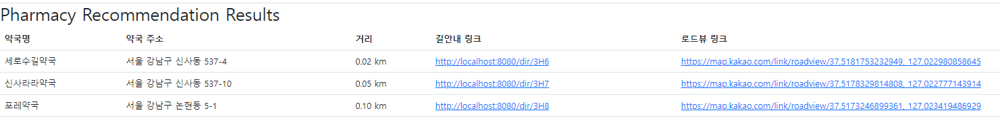

**4. 로그 확인**

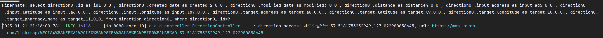

### 테스트 케이스 작성

---

테스트 케이스를 작성하고 shorten url를 검증해보려 한다.

#### **리팩토링**

1. DirectionController에서 고객이 Shorten Url로 요청
2. DirectionController에 searchDirection 메소드 호출
3. searchDirection 메소드에서 인코딩된 Id 값을 디코딩하여 Direction 정보를 조회  
   \* Direction은 고객이 입력한 주소를 기준으로 추천된 약국이 전달되어있다.
4. Direction 정보를 이용하여 길안내 Url을 만들어준다.
5. 최종적으로 길안내 Url을 리다이렉트시켜준다.

```java
@Slf4j
@Controller
@RequiredArgsConstructor
public class DirectionController {

    private final DirectionService directionService;
    private static final String DIRECTION_BASE_URL = "https://map.kakao.com/link/map/";

    @GetMapping("/dir/{encodedId}")
    public String searchDirection(@PathVariable("encodedId") String encodedId) {
        Direction resultDirection = directionService.findById(encodedId);

        String params = String.join(",", resultDirection.getTargetPharmacyName(), String.valueOf(resultDirection.getTargetLatitude()), String.valueOf(resultDirection.getTargetLongitude()));

        String result = UriComponentsBuilder.fromHttpUrl(DIRECTION_BASE_URL + params).toUriString();

        log.info("direction params: {}, url: {}", params, result);

        return "redirect:"+result;
    }
}
```

위 비즈니스 로직을 Service Layer로 분리시키려 한다.

1. 해당 로직은 비즈니스 로직이기 때문에 Controller에서 처리하는 것보다는 서비스 Layer에서 처리하는 것이 바람직하다.
2. Direction 정보는 데이터베이스와 연관된 Entity인데 Controller까지 나와있다. Entity를 Controller에서 사용하는 것보다는 Dto로 변환하여 의존관계를 최소화시켜 사용하는 것이 바람직하다.

엔티티를 Controller Layer에서 API로 제공하거나 화면으로 그대로 전달할 경우 문제가 발생할 수 있다.

(예시) 엔티티가 변경이 되는 순간 DB에 변경이 발생하게 되면 API SPEC이 변경되게 되고 화면으로 전달하고 있었다면 화면이 변경되게 된다. → 의존관계가 형성되게 되는 문제가 발생한다.

Direction을 반환하는 것이 아닌 전체 Url를 반환하도록 변경하면 된다.

```java
@Slf4j
@Controller
@RequiredArgsConstructor
public class DirectionController {

    private final DirectionService directionService;

    @GetMapping("/dir/{encodedId}")
    public String searchDirection(@PathVariable("encodedId") String encodedId) {
        String result = directionService.findDirectionUrlById(encodedId);

        log.info("[DirectionController searchDirection] direction url: {}", result);

        return "redirect:"+result;
    }
}
```

```java
public class DirectionService {

    private final DirectionRepository directionRepository;
    private final Base62Service base62Service;
    private static final String DIRECTION_BASE_URL = "https://map.kakao.com/link/map/";

    public String findDirectionUrlById(String encodedId) {
        Long decodeId = base62Service.decodeDirectionId(encodedId);
        Direction direction = directionRepository.findById(decodeId).orElse(null);

        String params = String.join(",", direction.getTargetPharmacyName(), String.valueOf(direction.getTargetLatitude()), String.valueOf(direction.getTargetLongitude()));

        return UriComponentsBuilder.fromHttpUrl(DIRECTION_BASE_URL + params).toUriString();
    }
}
```

#### 테스트 케이스

1. **Base62ServiceTest**

인코딩과 디코딩이 정상적으로 잘되는지 확인하는 Unit 테스트를 진행한다.

```java
class Base62ServiceTest extends Specification {

    private Base62Service base62Service;

    def setup() {
        base62Service = new Base62Service()
    }

    def "check base62 encoder/decoder"() {
        given:
        long id = 5L

        when:
        def encodedId = base62Service.encodeDirectionId(id)
        def decodedId = base62Service.decodeDirectionId(encodedId)

        then:
        id == decodedId
    }

}
```

2. DirectionController

DirectionController에서 리다이렉트가 정상적으로 이루어지는에 대한 Unit 테스트를 진행한다.

```java
class DirectionControllerTest extends Specification {

    private MockMvc mockMvc
    private DirectionService directionService = Mock()

    def setup() {
        mockMvc = MockMvcBuilders.standaloneSetup(new DirectionController(directionService))
                .build()
    }

    def "GET /dir/{encodedId}"() {
        given:
        String encodedId = "r"

        String redirectURL = "https://map.kakao.com/link/map/pharmacy,38.11,128.11"

        when:
        directionService.findDirectionUrlById(encodedId) >> redirectURL
        def result = mockMvc.perform(get("/dir/{encodedId}", encodedId))

        then:
        result.andExpect(status().is3xxRedirection()) // 리다이렉트 발생 확인
                .andExpect(redirectedUrl(redirectURL))    // 리다이렉트 경로 검증
                .andDo(print())
    }

}
```

### 전체 통합 테스트

---

통합 테스트를 검증하면서 클라우드 서비스에 배포하기 위한 준비를 해보려고한다.

서비스를 배포하기 위해 jar 파일이 필요하다. jar 파일 생성은 gradle wrapper를 이용하여 jar 파일을 생성할 수 있다.

```bash
(MAC OS) ./gradlew clean build
(Window) gradlew clean build
```

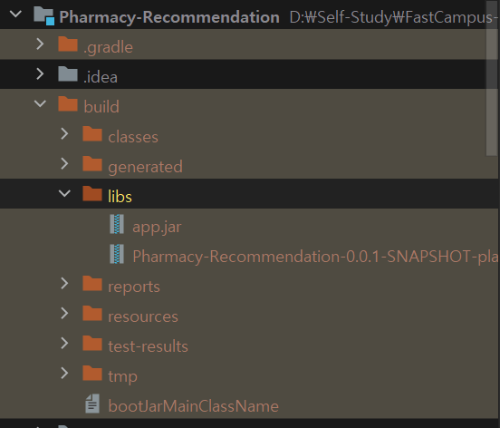

gradle wrapper을 이용하여 빌드하게 되면 jar 파일을 만들면서 전체 테스트 코드도 검증을 해준다.

#### **전체 통합 테스트**

전체 통합 테스트를 위해 다음 2가지 작업이 필요하다.

**1. 테스트 패키지에 application.yml 파일에 application base url이 필요하다.**

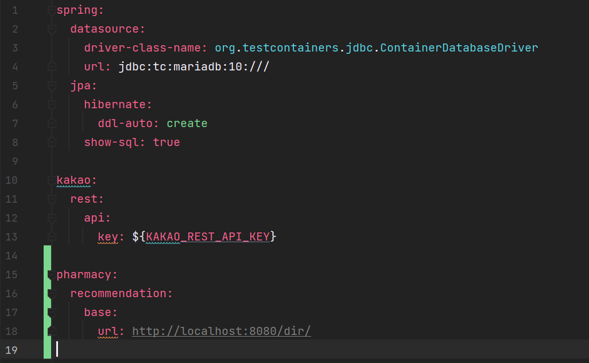

**2. 통합 테스트를 위해 KAKAO\_REST\_API\_KEY를 파라미터로 넘겨주고 매핑 시켜주어야 한다.**

gradle wrapper를 통해 gradle build를 하고 테스트 코드를 실행시킬 때 argument로 함께 넣어줄 것이다.

```bash
(MAC OS) ./gradlew clean build -PKAKAO_REST_API_KEY=1234 
(Window) gradlew clean build -PKAKAO_REST_API_KEY=1234
```

build.gradle에 매핑을 위한 설정 추가해주어야한다. Gradle Build 할 때 키 값을 -P 옵션을 붙여 넣어주면 해당 Task에서 Gradle Build 할 때 옵션에 넣은 Key값을 넘겨 받을 수 있다.  전체 통합테스트를 진행할 때는 테스트 패키지에 application.yml을 보고 실행하고 있기 때문에 application.yml에 있는 Key 값을 매핑시켜주어야한다. 매칭시켜주는 부분이 위에 filesMathcing 부분이다. 이를 검증하기 위해 boolean으로 해당 프로퍼티가 있는지 확인하고 결과를 출력하도록 하였다.

```bash
// $ gradlew clean build -PKAKAO_REST_API_KEY={api key 값} 명령어로 전체 테스트 및 빌드하여 jar 파일 생성
processTestResources {
	boolean hasProperty = project.hasProperty("KAKAO_REST_API_KEY")
	System.out.println("Set kakao rest api key: $hasProperty")
	filesMatching('**/application.yml') {
		expand(project.properties)
	}
}
```

빌드를 실행시키면 다음과 같이 모든 테스트가 실행되게 된다.

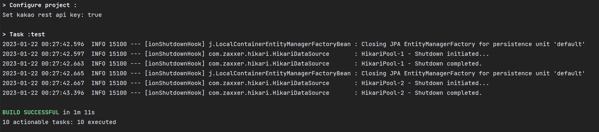
