## Redis로 성능 개선

---

### Reids 소개

---

[Redis](https://redis.io/docs/data-types/tutorial/)는 오픈소스 인메모리 데이터베이스로 단순하게 Key, Value 형태로만 저장하는 것이 아닌 다양한 자료구조를 제공한다.

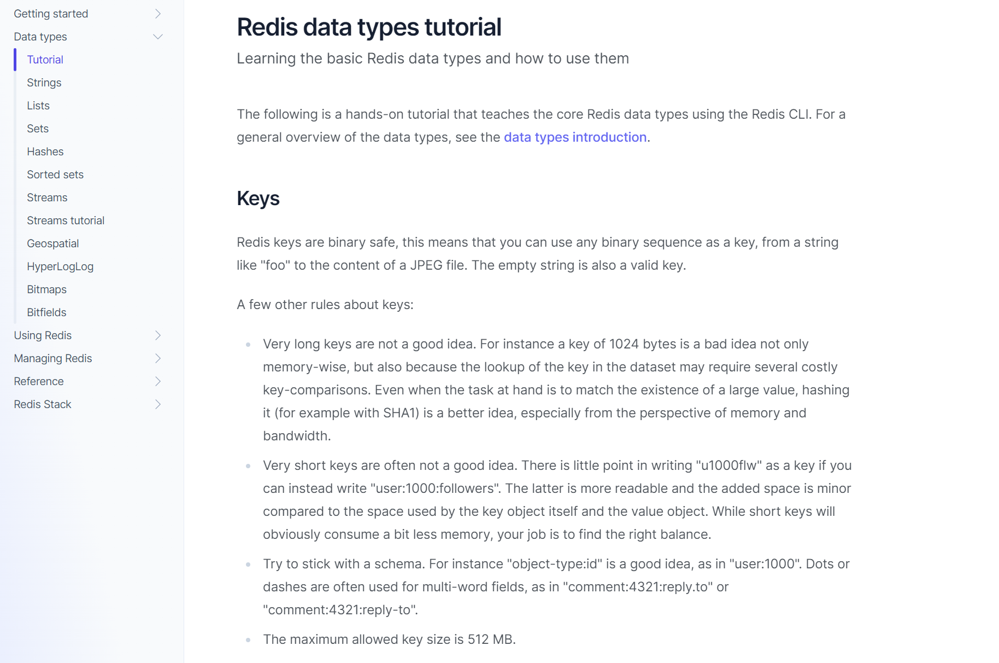

* 메모리 접근이 디스크 접근보다 빠르기 때문에 데이터베이스(Mysql, Oracle 등)보다 빠르다.  
  **자주 사용하는 데이터이면서 크게 변하지 않는 데이터를 메모리에 올려두고 사용하게 되면 성능 향상이 가능하다.**  

  예를들면, 현재 약국 데이터는 매번 고객이 요청할 때마다 데이터베이스에서 조회하고, 거리계산 알고리즘 계산 및 정렬 후 결과값 반환하고 프로세스가 매번 반복되고 있다.  

  약국 데이터는 변하지 않는 정적 데이터이고 앞으로 거의 변하지 않는 데이터가 될 것이다. 이러한 데이터같은 경우는 매번 데이터베이스에서 조회하는 것보다 메모리에 캐싱해두고 사용하게 되면 매번 데이터베이스에서 조회하는 것이 아니라 Redis를 통해 메모리 접근하여 성능을 개선해볼 수 있다.   

  현재 약국 도메인 데이터가 크지 않기 때문에 redis 사용은 큰 변화가 없겠지만, **데이터가 큰 경우 매번 DB 조회하는 부분을 메모리에 캐싱하여 성능 향상이 가능하다.**

#### Redis(REmote DIctionary Server) 사용시 주의사항

* Redis 캐싱을 이용하여 성능을 개선하고자 할때, **캐싱 데이터는 update가 자주 일어나지 않는 데이터가 효과적**이다.  
  예들들어, 메모리에 어떤 데이터를 캐싱해두고 사용하게 되는데 이 데이터가 계속해서 업데이트가 발생하는 데이터라면 데이터베이스를 업데이트해야하고, 데이터베이스가 변경이 될때마다 캐싱해놓은 데이터를 업데이트를 해주어야한다. 그렇지 않으면 Sync 문제가 발생하여 비용이 더 많이 발생할 수 있다.  
  => **update가 자주 일어나는 데이터일 경우, DB와의 Sync 비용이 발생한다.**
* Redis 사용시 반드시 failover(장애)에 대한 고려가 필요하다.  
  예를들어, AWS에 Elasticache, Ramcache 서비스를 사용하게 되었을 때 보통 이런 서비스들은 이중화 및 백업이 제공된다. Docker를 이용하여 사용하기 때문에 이러한 부분에 대해 고려를 해줘야한다.   
  Ex) Redis 장애시 데이터베이스에서 조회, 레디스 이중화 및 백업

#### Redis cli

1. Redis CLI

```bash
// redis cli로 접속(raw: 한글깨짐 방지)
$ docker exec -it {Container id} redis-cli --raw
```

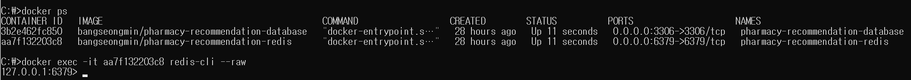

2. String 자료 구조key - value)

```bash
$ set id 10 // key(id)의 value를 10으로 저장
$ get id // key 조회
$ del id // key 삭제
$ scan 0 // key 들을 일정 단위 개수 만큼씩 조회
```

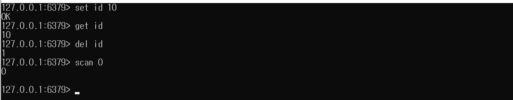

3. Hash 자료 구조(key - subKey - value)

```bash
$ hgetall USER           // Key(User)의 매핑되는 모든 필드와 값들을 조회
$ hset USER subkey value // Key(User)의 subkey의 값을 지정
$ hget USER subkey       // Key(User)의 subkey의 값을 조회
```

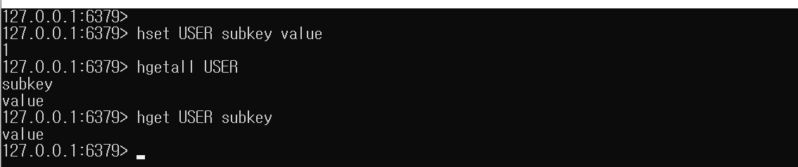

4. Geospatial 자료구조

위도, 경로 정보를 가진 자료구조다.

geospatial 자료구조 내부적으로 거리를 구할 때 Haversine formula 알고리즘을 이용해서 거리를 구한다.

```bash
// Test Code 1 : geopoint1 라는 자료구조에 pharmacy 1, 2 각각 경도, 위도를 추가
$ geoadd geopoints1 127.0817 37.5505 pharmacy1
$ geoadd geopoints1 127.0766 37.541 pharmacy2

// 두 지역의 거리를 리턴한다. 단위는 km
$ geodist geopoints1 pharmacy1 pharmacy2 km

// Test Code 2 : geopoint2 이름의 자료구조에서 주어진 경도, 위도 기준으로 반경 10km 이내에 가까운 약국 찾기
$ geoadd geopoints2 127.0569046 37.61040424 pharmacy1
$ geoadd geopoints2 127.029052 37.60894036 pharmacy2
$ geoadd geopoints2 127.236707811313 37.3825107393401 pharmacy3

$ georadius geopoints2 127.037033003036 37.596065045809 10 km withdist withcoord asc count 3
```

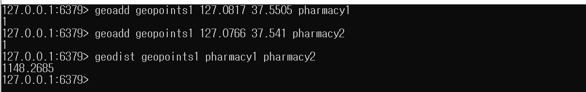
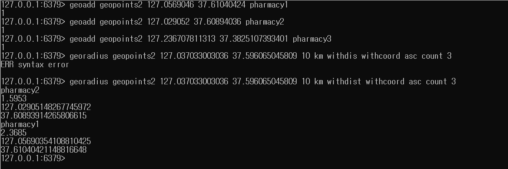

hash 자료구조를 이용하여 약국 데이터를 캐싱하고 성능 개선을 해보려한다.

### Redis 자료구조를 이용하여 구현

---

#### 의존성 추가

```bash
implementation 'org.springframework.boot:spring-boot-starter-data-redis'
```

#### 빈 등록

Redis를 사용하기 위해 RedisTemplate를 이용해서 사용하려고 한다. 이를 위해 RedisTemplate를 빈으로 등록해야 한다.

Redis를 사용하기 위한 클라이언트로 Lettuce와 jedis를 많이 사용하고 jedis보다는 Lettuce가 성능적으로 우수하다.

```java
@Configuration
public class RedisConfig {

    @Value("${spring.redis.host}") private String redisHost;
    @Value("${spring.redis.port}") private int redisPort;

    @Bean
    public RedisConnectionFactory redisConnectionFactory() {
        return new LettuceConnectionFactory(redisHost, redisPort);
    }

    @Bean
    public RedisTemplate<String, Object> redisTemplate() {
        RedisTemplate<String, Object> redisTemplate = new RedisTemplate<>();
        redisTemplate.setConnectionFactory(redisConnectionFactory());
        redisTemplate.setKeySerializer(new StringRedisSerializer());
        redisTemplate.setHashKeySerializer(new StringRedisSerializer());
        redisTemplate.setHashValueSerializer(new StringRedisSerializer());
        return redisTemplate;
    }

}
```

redisTemplate를 주입받아서 사용하고자 하는 자료구조를 사용할 것이다. 직접 구현하기 전에 테스트 코드를 통해 redisTemplate에서 제공하고 있는 여러가지 자료구조를 확인하고 구현하려고 한다.

---

#### RedisTemplate 테스트

redis를 실제로 사용해야 하므로 통합테스트 환경에서 테스트를 진행해야 한다.

1. String 자료구조 테스트

```java
class RedisTemplateTest extends AbstractIntegrationContainerBaseTest {

    @Autowired
    private RedisTemplate redisTemplate;

    def "RedisTemplate String operations"() {
        given:
        def valueOperations = redisTemplate.opsForValue()
        def key = "stringKey"
        def value = "stringValue"

        when:
        valueOperations.set(key, value)

        then:
        def result = valueOperations.get(key)
        result == value
    }
}
```

1. def valueOperation = redisTemplate.opsForValue() 를 통해 String 자료구조를 이용할 수 있다.
2. valueOperation.set(key, value) : Key, value 저장

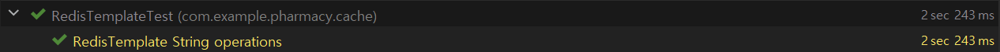

2. Set 자료구조 테스트

```java
class RedisTemplateTest extends AbstractIntegrationContainerBaseTest {

    @Autowired
    private RedisTemplate redisTemplate;

    def "RedisTemplate Set operations"() {
        given:
        def setOperations = redisTemplate.opsForSet()
        def key = "setKey"

        when:
        setOperations.add(key, "h", "e", "l", "l", "o")

        then:
        def size = setOperations.size(key)
        size == 4
    }
}
```

1. def setOperations = redisTemplate.opsForSet() 를 통해 Set 자료구조를 이용할 수 있다.
2. setOperations.add(key, "h", "e", "l", "l", "o") : 값을 여러 개 저장 -> Set은 중복을 필터링해준다.
3. def size = setOperations.size(key), size == 4 : 중복이 제거되었는지 확인

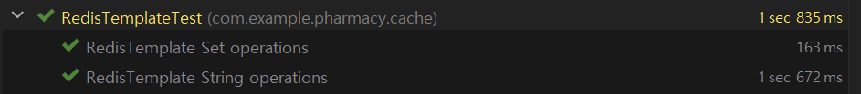

3. Hash 자료구조 테스트

```java
class RedisTemplateTest extends AbstractIntegrationContainerBaseTest {

    @Autowired
    private RedisTemplate redisTemplate;

    def "RedisTemplate Hash operations"() {
        given:
        def hashOperations = redisTemplate.opsForHash()
        def key = "hashKey"
        def subKey = "subKey"
        def value = "value"

        when:
        hashOperations.put(key, subKey, value)

        then:
        def result = hashOperations.get(key, subKey)
        result == value

        def entries = hashOperations.entries(key)
        entries.keySet().contains(subKey)
        entries.values().contains(value)

        def size = hashOperations.size(key)
        size == entries.size()
    }
}
```

1. def hashOperations = redisTemplate.opsForHash() : Hash 자료구조를 이용하는 방법
2. hashOperations.put(key, subKey, value) : Hash 자료구조에 subKey, value로 데이터 삽입

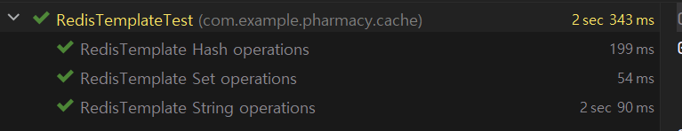

실무에서는 다양한 자료구조를 사용하므로 구글링을 통해 더 많은 자료구조를 사용해보는 것을 권장한다.

### Redis를 이용한 성능 개선

---

#### 목표

1. **캐싱**  
   매번 약국 데이터를 데이터베이스를 통해 조회하는 것이 아니라 Redis로 캐싱을 해두고 조회를 할 때 캐싱한 데이터를 조회하여 사용할 수 있도록 개선해보려고 한다.
2. **Redis Failover에 대한 해결책**  
   Redis에 장애가 발생하거나 문제가 있을 경우에는 데이터베이스 조회를 해서 가져올 수 있도록 동기처리를 해보려고 한다.

#### PharmacyRedisTemplateService

서비스 클래스를 만들고 캐시 자료구조를 이용해서 약국 데이터를 저장해보고 저장된 약국 데이터를 조회해보는 메소드를 만들 것이다.

```java
@Slf4j
@Service
@RequiredArgsConstructor
public class PharmacyRedisTemplateService {

    private static final String CACHE_KEY = "PHARMACY";

    private final RedisTemplate<String, Object> redisTemplate;
    private final ObjectMapper objectMapper;

    private HashOperations<String, String, String> hashOperations;  // Key, 약국 DB PK, 약국 Dto 를 Json 형태로 저장

    @PostConstruct
    public void init() {
        this.hashOperations = redisTemplate.opsForHash();
    }

    public void save(PharmacyDto pharmacyDto) {
        if(Objects.isNull(pharmacyDto) || Objects.isNull(pharmacyDto.getId())) {
            log.error("Required Values must not be null");
            return;
        }

        try{
            hashOperations.put(CACHE_KEY, pharmacyDto.getId().toString(), serializePharmacyDto(pharmacyDto));
            log.info("[PharmacyRedisTemplateService save - success]  id: {}", pharmacyDto.getId());
        } catch (Exception e) {
            log.error("[PharmacyRedisTemplateService save - error] {}", e.getMessage());
        }
    }

    public List<PharmacyDto> findAll() {
        try {
            List<PharmacyDto> list = new ArrayList<>();
            for(String value : hashOperations.entries(CACHE_KEY).values()) {
                PharmacyDto pharmacyDto = deserializePharmacyDto(value);
                list.add(pharmacyDto);
            }
            return list;

        } catch (Exception e){
            log.error("[PharmacyRedisTemplateService findAll - error] {}", e.getMessage());
            return Collections.emptyList();
        }
    }

    public void delete(Long id) {
        hashOperations.delete(CACHE_KEY, String.valueOf(id));
        log.info("[PharmacyRedisTemplateService delete - success]  id: {}", id);
    }

    private String serializePharmacyDto(PharmacyDto pharmacyDto) throws JsonProcessingException {
        return objectMapper.writeValueAsString(pharmacyDto);
    }

    private PharmacyDto deserializePharmacyDto(String value) throws JsonProcessingException {
        return objectMapper.readValue(value, PharmacyDto.class);
    }

}
```

* objectMapper를 빈으로 등록하여 싱글톤으로 사용한다.
* Redis에 Hash 자료구조를 이용하여 약국 데이터를 관리한다.
* **@PostConstruct**를 이용하여 생성자 주입이 일어난 이후에 redisTemplate에서 제공하는 Hash 자료구조를 이용한다.
* Redis에 Hash에는 Key, subKey, value 형태를 이루는데 Key(PHARMACY), 약국 DB PK, 약국 Dto를 ObjectMapper를 이용하여 Serialize해서 Json 형태로 저장한다.
* 위 작업을 위해 Serialize, DeSerialize를 할 수 있는 메소드를 생성하였다.
* save 시에는 Serialize 해서 저장하고, findAll 즉 조회시에는 DeSerialize해서 데이터를 반환한다.

#### PharmacySearchService

```java
@Slf4j
@Service
@RequiredArgsConstructor
public class PharmacySearchService {

    private final PharmacyRepositoryService pharmacyRepositoryService;
    private final PharmacyRedisTemplateService pharmacyRedisTemplateService;

    public List<PharmacyDto> searchPharmacyDtoList() {
        // redis
        List<PharmacyDto> pharmacyDtoList = pharmacyRedisTemplateService.findAll();

        if(!pharmacyDtoList.isEmpty()) {
            log.info("redis findAll success!");
            return pharmacyDtoList;
        }

        // db
        return pharmacyRepositoryService.findAll()
                .stream()
                .map(this::convertToPharmacyDto)
                .collect(Collectors.toList());
    }
}
```

* 데이터베이스에서 바로 데이터를 조회하는 것이 아니라 Redis Failover 또는 값이 없을 때에만 DB에서 조회하도록 함.

#### PharmacyController

DB에 있는 데이터를 임시적으로 Redis에 저장하여 동기화를 시켜주는 메소드이다.

```java
@Slf4j
@RestController
@RequiredArgsConstructor
public class PharmacyController {

    private final PharmacyRepositoryService pharmacyRepositoryService;
    private final PharmacyRedisTemplateService pharmacyRedisTemplateService;

    @GetMapping("/redis/save")
    public String save() {

        List<PharmacyDto> pharmacyDtoList = pharmacyRepositoryService.findAll()
                .stream().map(pharmacy -> PharmacyDto.builder()
                        .id(pharmacy.getId())
                        .pharmacyName(pharmacy.getPharmacyName())
                        .pharmacyAddress(pharmacy.getPharmacyAddress())
                        .latitude(pharmacy.getLatitude())
                        .longitude(pharmacy.getLongitude())
                        .build()
                ).toList();

        pharmacyDtoList.forEach(pharmacyRedisTemplateService::save);

        return "success";
    }
}
```

### Redis 테스트 코드 작성

---

매 요청마다 DB에서 약국 데이터를 접근하지 않고 Redis를 통해 조회되는지 검증해보려고 한다.

#### **약국 검색 서비스 테스트**

분기 처리를 했었는데 Redis에서 장애가 발생하거나 빈 컬렉션이 반환되게 되면 데이터베이스를 통해 조회되는지를 단위 테스트로 검증하려고 한다.

```java
class PharmacySearchServiceTest extends Specification {

    private PharmacySearchService pharmacySearchService;

    private PharmacyRepositoryService pharmacyRepositoryService = Mock()
    private PharmacyRedisTemplateService pharmacyRedisTemplateService = Mock()

    private List<Pharmacy> pharmacyList

    def setup() {
        pharmacySearchService = new PharmacySearchService(pharmacyRepositoryService, pharmacyRedisTemplateService)

        pharmacyList = Lists.newArrayList(
                Pharmacy.builder()
                        .id(1L)
                        .pharmacyName("돌곶이온누리약국")
                        .latitude(37.61040424)
                        .longitude(127.0569046)
                        .build(),
                Pharmacy.builder()
                        .id(2L)
                        .pharmacyName("호수온누리약국")
                        .latitude(37.60894036)
                        .longitude(127.029052)
                        .build()
        )
    }

    def "레디스 장애시 DB를 이용하여 약국 데이터 조회"() {
        when:
        pharmacyRedisTemplateService.findAll() >> []
        pharmacyRepositoryService.findAll() >> pharmacyList

        def result = pharmacySearchService.searchPharmacyDtoList()

        then:
        result.size() == 2
    }
}
```

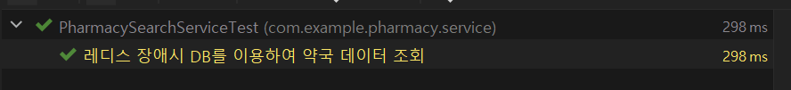

---

#### **약국 Redis 서비스**

Redis CURD 기능이 정상 작동함을 테스트하기 위해 통합 테스트로 진행해보려고 한다.

```java
class PharmacyRedisTemplateServiceTest extends AbstractIntegrationContainerBaseTest {

    @Autowired
    private PharmacyRedisTemplateService pharmacyRedisTemplateService;

    def setup() {
        pharmacyRedisTemplateService.findAll()
                .forEach(dto -> {
                    pharmacyRedisTemplateService.delete(dto.getId())
                })
    }

    def "save success"() {
        given:
        String pharmacyName = "name"
        String pharmacyAddress = "address"
        PharmacyDto dto = PharmacyDto.builder()
                .id(1L)
                .pharmacyName(pharmacyName)
                .pharmacyAddress(pharmacyAddress)
                .build()

        when:
        pharmacyRedisTemplateService.save(dto)
        List<PharmacyDto> result = pharmacyRedisTemplateService.findAll()

        then:
        result.size() == 1
        result.get(0).id == 1L
        result.get(0).pharmacyName == pharmacyName
        result.get(0).pharmacyAddress == pharmacyAddress
    }

    def "success fail"() {
        given:
        PharmacyDto dto = PharmacyDto.builder().build()

        when:
        pharmacyRedisTemplateService.save(dto)
        List<PharmacyDto> result = pharmacyRedisTemplateService.findAll()

        then:
        result.size() == 0
    }

    def "delete"() {
        given:
        String pharmacyName = "name"
        String pharmacyAddress = "address"
        PharmacyDto dto = PharmacyDto.builder()
                                        .id(1L)
                                        .pharmacyName(pharmacyName)
                                        .pharmacyAddress(pharmacyAddress)
                                        .build()

        when:
        pharmacyRedisTemplateService.save(dto)
        pharmacyRedisTemplateService.delete(dto.getId())
        def result = pharmacyRedisTemplateService.findAll()

        then:
        result.size() == 0
    }
}
```

* setup() : 각 테스트마다 영향을 주지 않기 위해 테스트 메소드 실행전 데이터를 초기화시키는 작업을 진행한다.

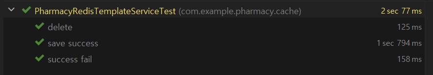

#### 서비스 테스트

실제 docker compose를 띄우고 Spring boot를 통해 서비스를 테스트해보려고 한다.

**1. 임시 저장**

데이터베이스에 있는 약국 리스트를 정상적으로 레디스에 저장되고 있다.

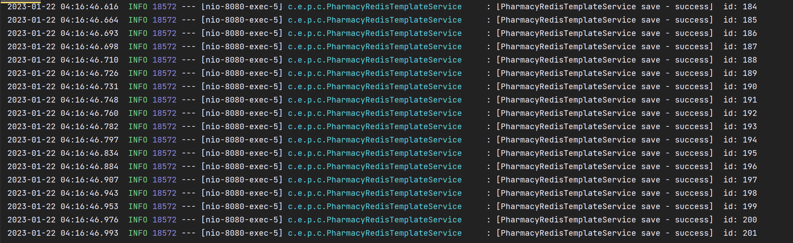

약국 리스트 정보를 Redis CLI를 통해서도 확인할 수 있다.

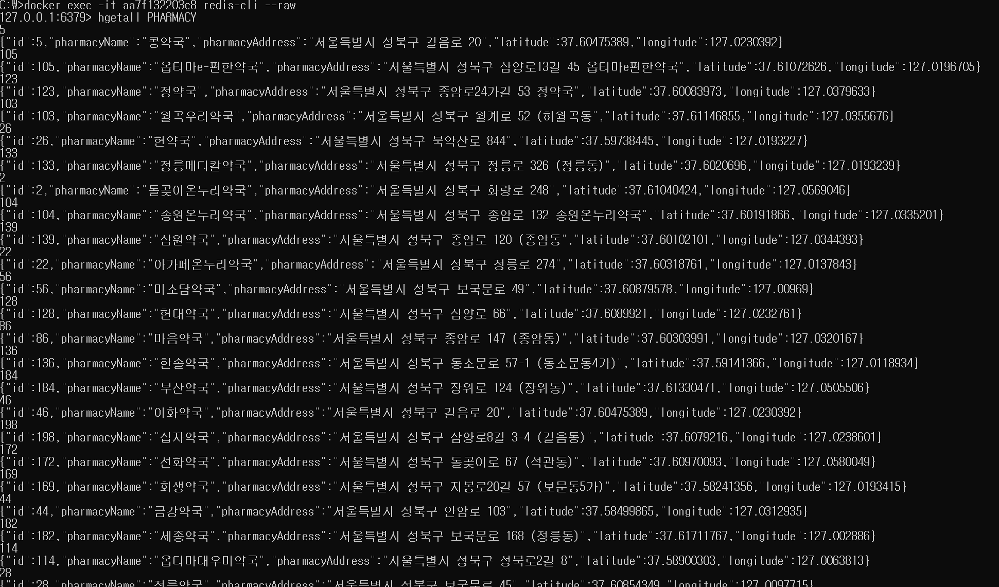

**2. 조회**

데이터베이스가 아닌 레디스를 통해 조회되는지 확인한다.

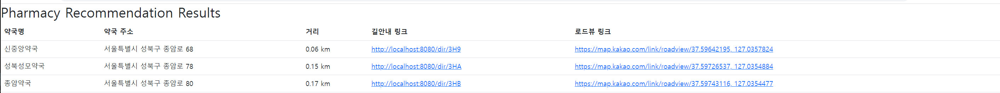

DB에 조회가 발생하지 않는 것을 확인할 수 있다.

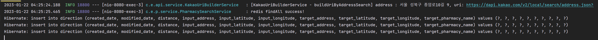
