오늘은 웹개발 종합반 3주차를 마무리 했다.... 

마지막 숙제에서 strip()에만 집중하다가

시간을 30분이상 낭비하고 말았다.... 

이걸 보신 분은 그런일 절대 없으실거에요 ㅎㅎ

등수가 드디어.. 두자리가 된 날이다..

**109 → 96** 등으로 상승!!

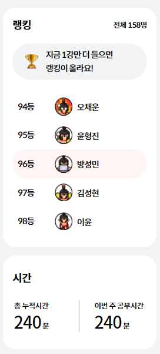

3주차 완강 시 순위

---

#### 

#### **과목 : 웹개발 종합반 (3주차)**

**[수업 목표]**

**1. 파이썬 기초 문법을 안다.**

**2. 원하는 페이지를 크롤링 할 수 있다.**

**3. pymongo를 통해 mongoDB를 제어할 수 있다.**

**( 시작 전.. 이미 파이썬 강의를 학습하여 빠르게 진행할 수 있었다. )**

#### **오늘 공부한 내용**

**3- 1. 3주차 설치**

**3- 2. 연습 겸 복습 - 스파르타피디아에 OpenAPI 붙여보기**

**3- 3. 파이썬 시작하기**

**3- 4. 파이썬 기초공부**

**3- 5. 파이썬 패키지 설치하기**

**3- 6. 패키지 사용해보기**

**3- 7. 웹스크래핑(크롤링) 기초**

**3- 8. Quiz\_웹스크래핑(크롤링) 연습**

**3- 9. DB 개괄**

**3-10. mongoDB 연결하기**

**3-11. mongoDB 연결하기**

**3-12. pymongo로 DB조작하기**

**3-13. 웹스크래핑 결과 조작하기**

**3-14. Quiz\_웹스크래핑 결과 이용하기**

**3-15. 3주차 끝 & 숙제 설명**

---

#### **01. 3주차 설치**

**1) 이번주 수업을 위해 설치/가입 할 것들!**

**(1) [Python(3.8.6)](https://www.python.org/) : Pycharm을 설치하면 자동으로 설치되는데 강의 버전과 동일하게 유지하기 위해 삭제후 재설치 필요**

[Welcome to Python.org

The official home of the Python Programming Language

www.python.org](https://www.python.org/)

**(2) [Git Bash](https://git-scm.com/downloads) **: Git Bash를 설치하면, 우리가 사용하는 운영체제인 Windows 운영체제 환경에서도 리눅스 커맨드를**** ****사용할 수 있게 된다. 또한 간편하게 gitgub 를 사용할 수 있다.****

[Git - Downloads

Downloads macOS Windows Linux/Unix Older releases are available and the Git source repository is on GitHub. GUI Clients Git comes with built-in GUI tools (git-gui, gitk), but there are several third-party tools for users looking for a platform-specific exp

git-scm.com](https://git-scm.com/downloads)

**2) 오늘 배울 것 이야기 : Python, 크롤링, mongoDB**

****- 네이버 영화를 크롤링하여 데이터베이스에 저장하여 조작할 예정이다.****

---

#### **02. 연습 겸 복습 - 스파르타피디아에  OpenAPI 붙여보기**

**1) 스파르타가 만들어둔 OpenAPI 파악하기**

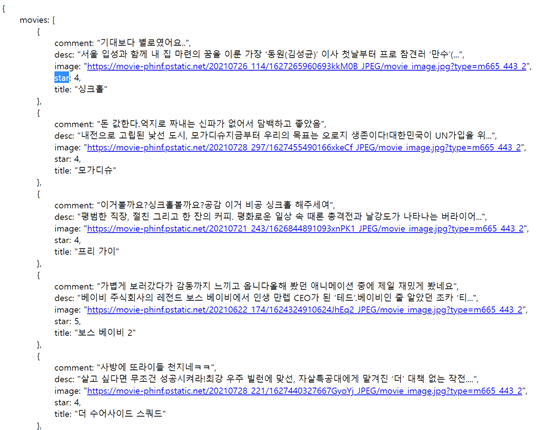

02-1. 스파르타 OpenAPI 파악

**2) 네이버 영화 포스팅 정보 가져오기**

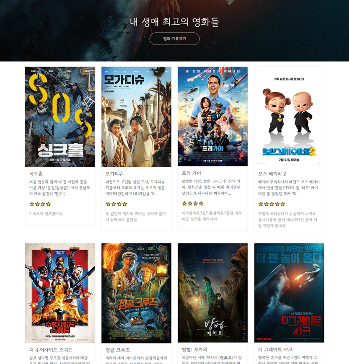

02-2. 네이버 영화 포스팅한 페이지

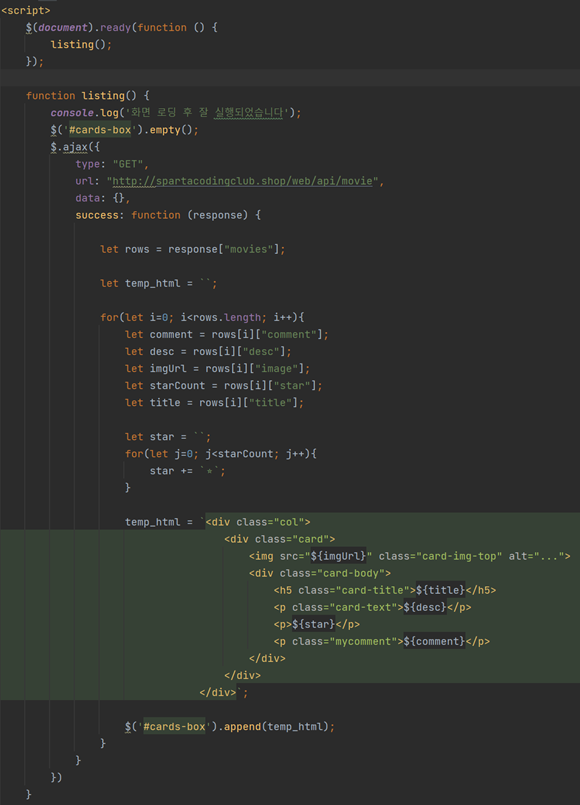

02-3. OpenAPI 포스팅 구현코드

---

#### **03. 파이썬 시작하기**

**1. 파이썬을 설치한다는 것의 의미**

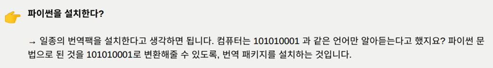

03-1. 파이썬 설치의 의미

    [[항해99 - 7기] 사전준비 2일차 - 파이썬 문법뽀개기](tistory-29.html)

[[항해99-7기] 사전준비 2일차 - 파이썬 문법뽀개기

오늘은 사전학습 2일차!! 목표한 양만큼 수강을 못할까봐 조마조마 했는데... 그래도 원하는 양만큼 수강완료했어요!! 파이썬 언어를 어제에 이어서 마무리부터 하였습니다.(알고 있어도 학습하

to-be-a-artist.tistory.com](tistory-29.html)

**/\* 파이썬에 대한 설명은 이전 포스팅에서 자세히 기록하였었다. \*/**

---

#### **04. 파이썬 기초공부**

**1. 파이썬 기초 문법**

****1) 스파르타가 만들어둔 OpenAPI 파악하기****

************▶ 변수 & 기본연산************

************▶ 자료형************

************▶ 함수************

************▶ 조건문************

************▶ 반복문************

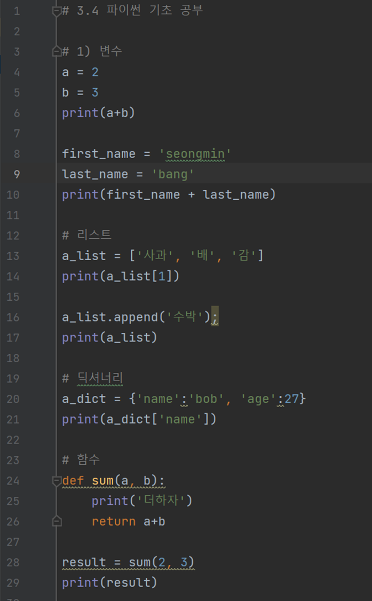

4-1.&nbsp;&nbsp;파이썬 기본 문법 학습 코드1

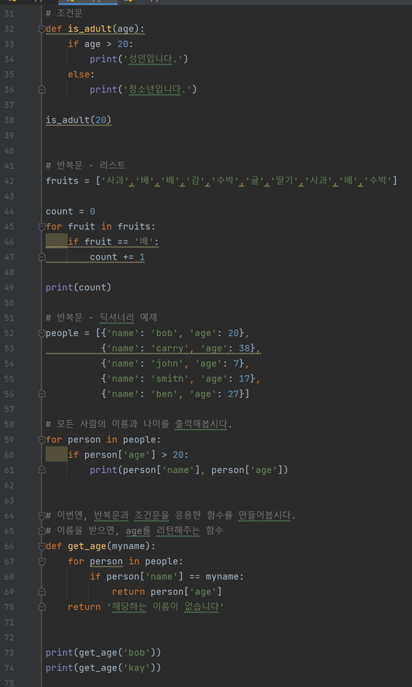

4-2. 파이썬 기본 문법 학습 코드2

---

#### **05.  파이썬 패키지 설치하기**

**1. 파이썬 패키지란?**

****- 패키지는 라이브러리이다. Python에서 패키지는 모듈(일종의 기능들 묶음)을 모아 놓은 단위입니다. 이런 패키지의****

**묶음을 라이브러리라고 볼 수 있습니다.**

**즉, 패키지 설치 == 외부 라이브러리 설치**

**2. 가상 환경**

**- 가상환경(virtual enviroment)은 같은 시스템에서 실행되는 다른 파이썬 응용 프로그램들의 동작에 영향을 주지 않기**

**위해, 파이썬 배포 패키지들을 설치하거나 업그레이드하는 것을 가능하게 하는 격리된 실행 환경**

**[출처 : 파이썬 공식 용어집 - 가상환경](https://docs.python.org/ko/3/glossary.html#term-virtual-environment)**

**3. 파이썬 패키지 설치방법**

****1) 파이참에서 파일 - 설정 - 프로젝트 - Python 인터프리터 클릭****

****2) '+' 버튼을 클릭하여 원하는 패키지를 선택하고 "패키지 설치"버튼을 클릭한다.****

---

#### **06. 파이썬 패키지 사용해보기**

**1. Request 라이브러리 사용해보기 + (List . Dictionary, 함수, 조건문, 반복문 연습)**

**(OpenAPI) : 서울시 미세먼지**

**(설치 패키지) : request**

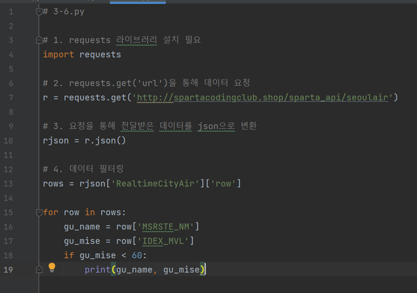

6-1 서울시 미세먼지 OpenAPI 사용 코드

---

#### **07. 웹 스크래핑(크롤링) 기초**

**1. 웹 스크래핑(크롤링) 기초**

**(OpenAPI) : 네이버영화 페이지**

**(설치 패키지) : request(이미 설치), beautifulsoup4**

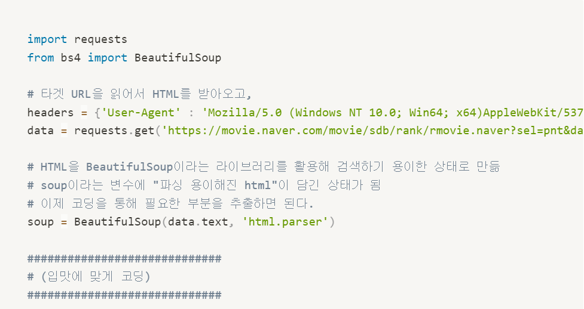

7-1. 스크래핑 뼈대

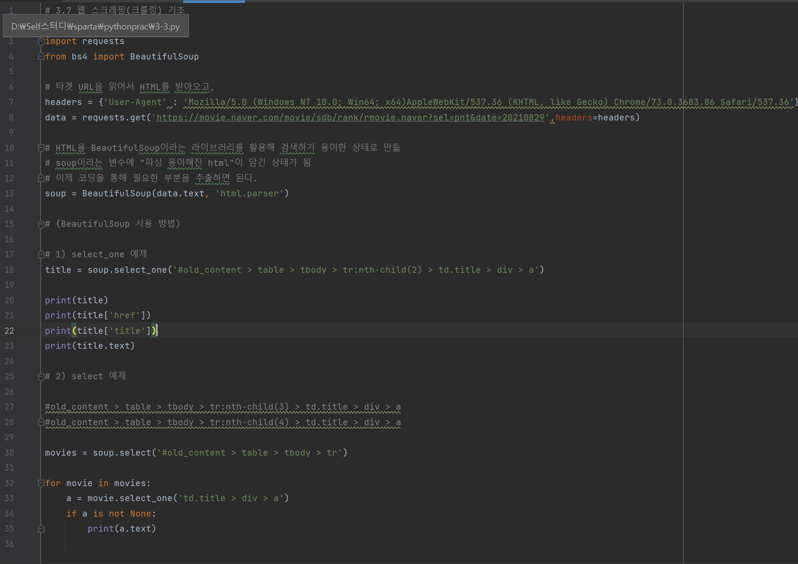

7-2. 네이버 영화 스크래핑 코드

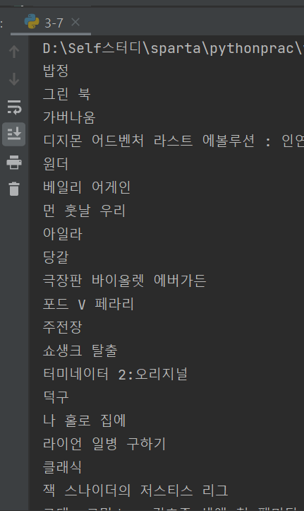

7-3. 네이버 영화 스크래핑 실행 결과

---

#### **08. Quiz\_웹스크롤링(크롤링) 연습**

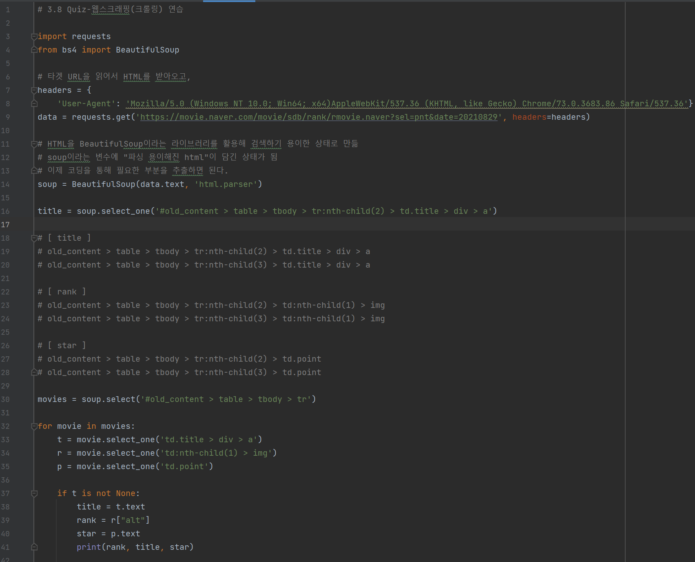

8-1. 네이버 영화 스크랩핑 퀴즈 풀이

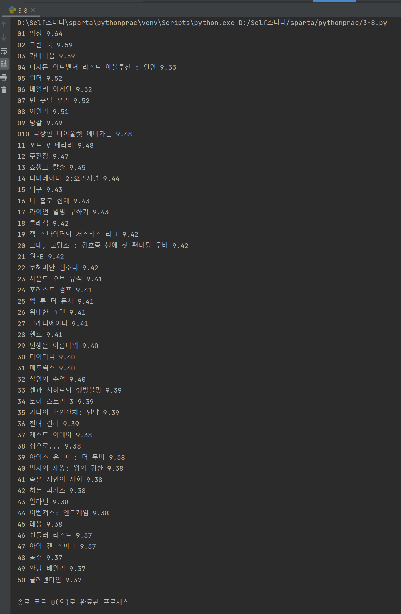

8-2. 퀴즈 실행 결과

**(참고 자료 : [네이버 영화](https://movie.naver.com/movie/sdb/rank/rmovie.naver?sel=pnt&date=20210829) )**

[랭킹 : 네이버 영화

영화, 영화인, 예매, 박스오피스 랭킹 정보 제공

movie.naver.com](https://movie.naver.com/movie/sdb/rank/rmovie.naver?sel=pnt&date=20210829)

---

#### **09. DB개괄**

****1. DB는 왜 쓰는 것일까?****

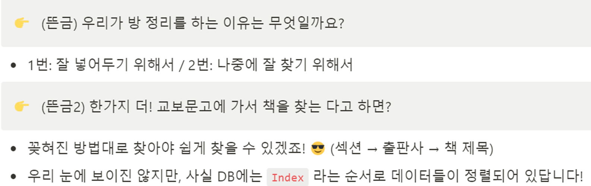

9-1. 데이터베이스를 사용하는 이유

  → **"결론적으로 데이터베이스는 데이터를 잘 뽑아쓰기 위해서 사용하는 것이다"라고 말씀해주셨습니다.**

****2. DB의 종류****

********1) RDBMS(SQL) : Orcale, MS-SQL, MySQL, MariaDB 등********

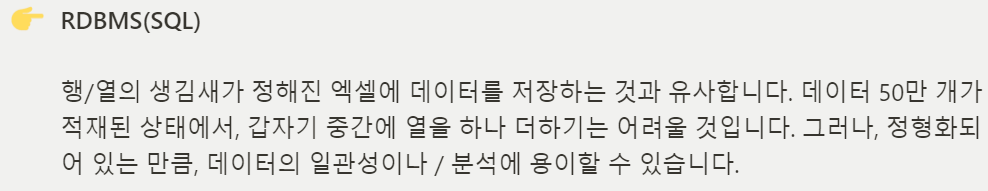

9.2 RDBMS에 대한 설명

************2) No-SQL : MongoDB************

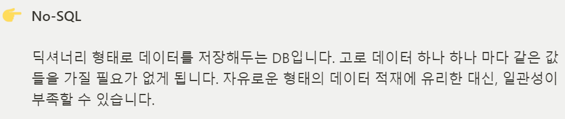

9.3 NoSQL에 대한 설명

---

#### **10. MongoDB 시작하기**

****1. [MongoDB - Atlas 가입하기](https://account.mongodb.com/account/register "MongoDB - Atlas")****

****- 가입 및 데이터베이스 생성 과정은 생략****

[Cloud: MongoDB Cloud

account.mongodb.com](https://account.mongodb.com/account/register)

---

#### **11. MongoDB 연결하기**

****1. MongoDB - Atlas 연결하고 테스트하는 과정****

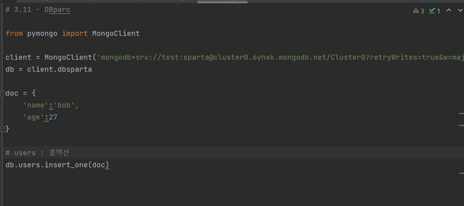

11-1. 파이썬으로 MongoDB 연결 후, 데이터 삽입

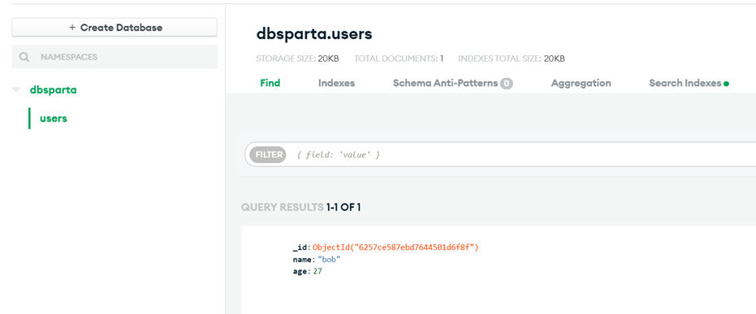

11-2. Mongo-Atlas에서 데이터 조회

---

#### **12. pymongo로 DB 조작하기**

****1. pymongo로 MongDB 조작하기****

**(설치 패키지) : pymongo, dnspython**

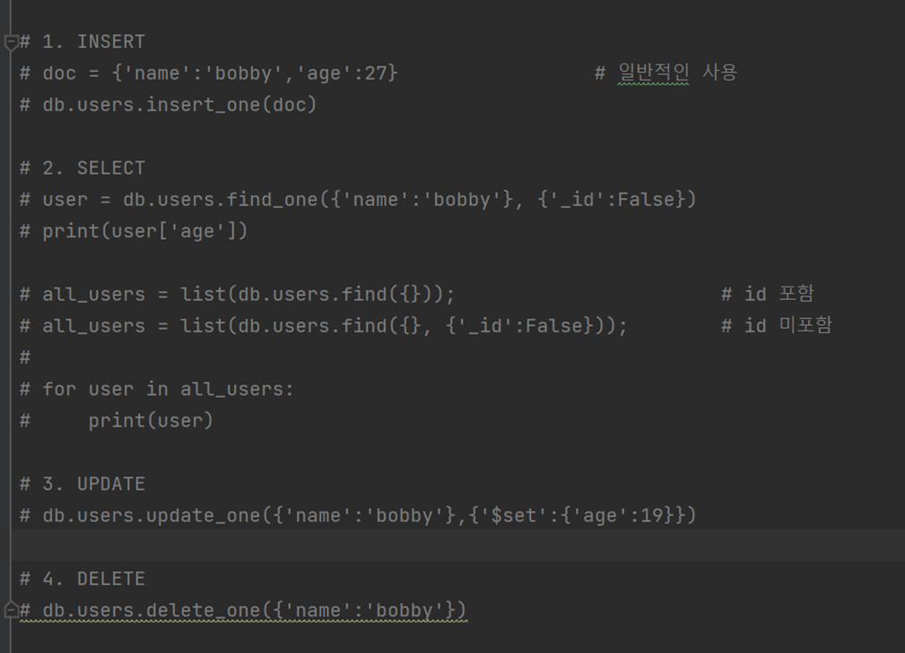

12-1. pymango를 사용한 CRUD 사용법

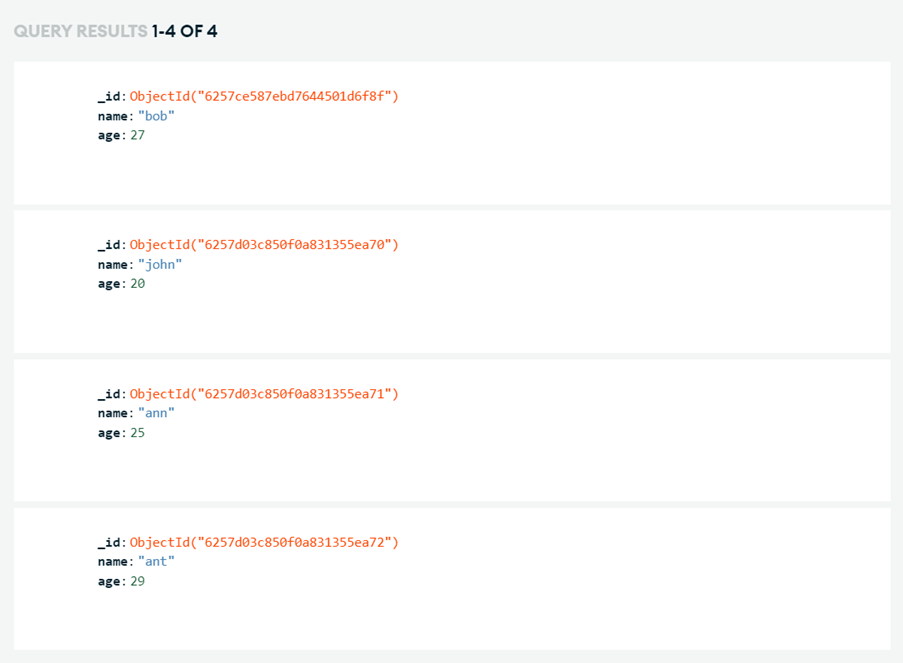

12-2. MongoDB-Atlas CRUD 테스트 결과

---

#### **13. 웹 스크래핑 결과 저장하기**

****1. Insert 연습하기 - 웹스크래핑 결과를 DB에 저장하기****

****참고: 네이버 영화****

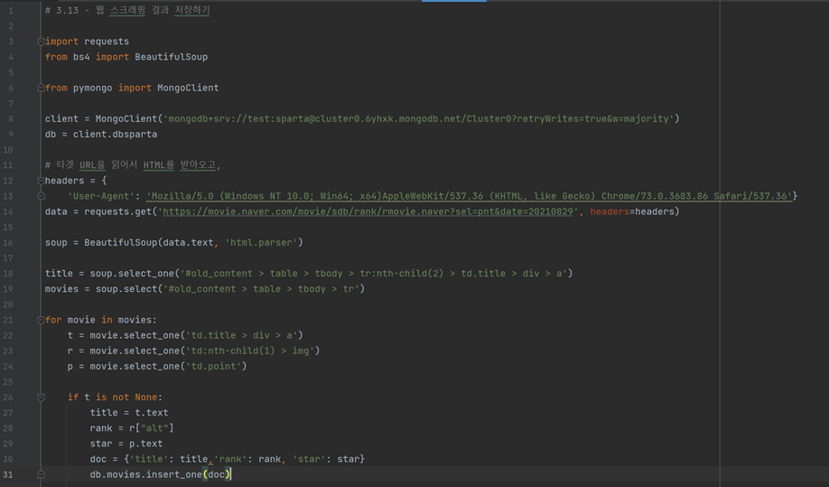

13-1. 웹스크래핑 Insert 코드

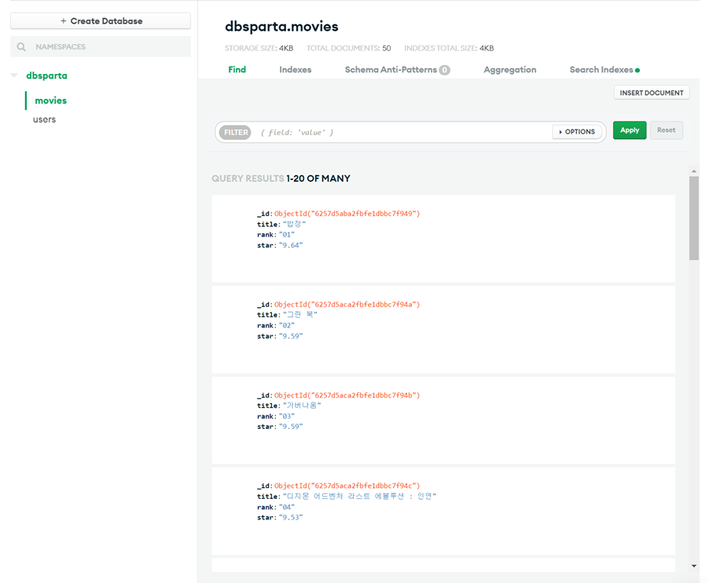

13-2. 웹스크래핑 Insert 결과 확인

---

#### **14. Quiz\_웹스크래핑 결과 이용하기**

****1. Insert 연습하기 - 웹스크래핑 결과를 DB에 저장하기****

****1) 영화제목 '가버나움'의 평점을 가져오기****

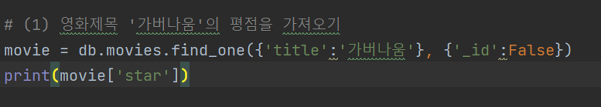

14-1. Quiz 1단계 구현 코드

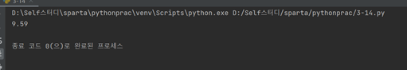

14-2. Quiz 1단계 구현 결과

****2) '가버나움'의 평점과 같은 평점의 영화 제목들을 가져오기****

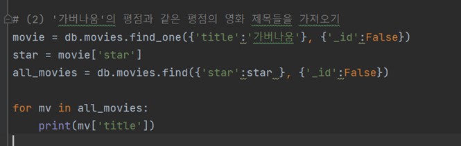

14-3. Quiz 2단계 구현 코드

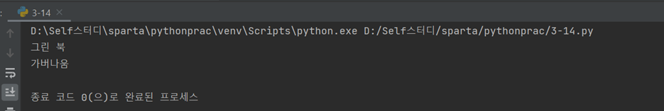

14-4. Quiz-2단계 구현 결과

****3) '가버나움' 영화의 평점을 0으로 만들기****

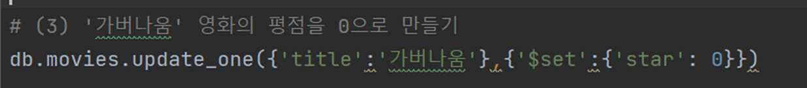

14-5. Quiz-3단계 구현 코드

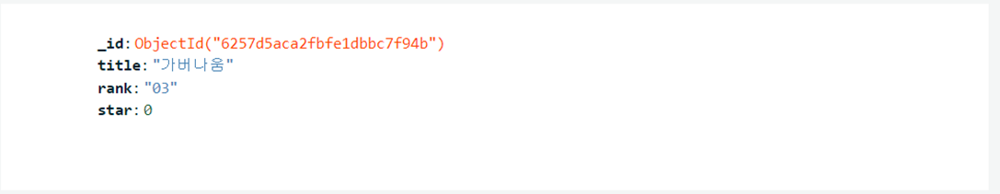

14-6. Quiz-3단계 구현 결과

---

#### **15. 3주차 끝 & 숙제**

****1. 지니뮤직 인기차트에서 순위/곡 제목/가수를 스크래핑하기****

****- 스크래핑 하는 과정에서 노래 제목이 가장 오래 고민했다. 이유는 스크래핑하게 되면 19금 아이콘이 글자로 같이 되기****

****때문이다. 모든 제목을 받아오면 여백이 크게 존재하기 때문이다. 이를 위해서 다른 제목은 strip()  메소드를 사용하여****

****해결하였지만, 아래 노래 제목은 위 방법을 사용해도 해결되지 않았습니다...****

****계속 ****strip()  메소드****을 사용하다가 split() 메소드를 통해서 쉽게 해결하였습니다.****

****(30분 넘게 strip()으로 싸운 것은 비밀...)****

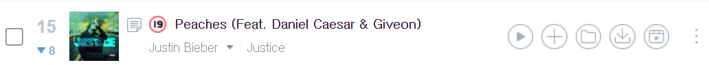

15-1. 지니뮤직 차트

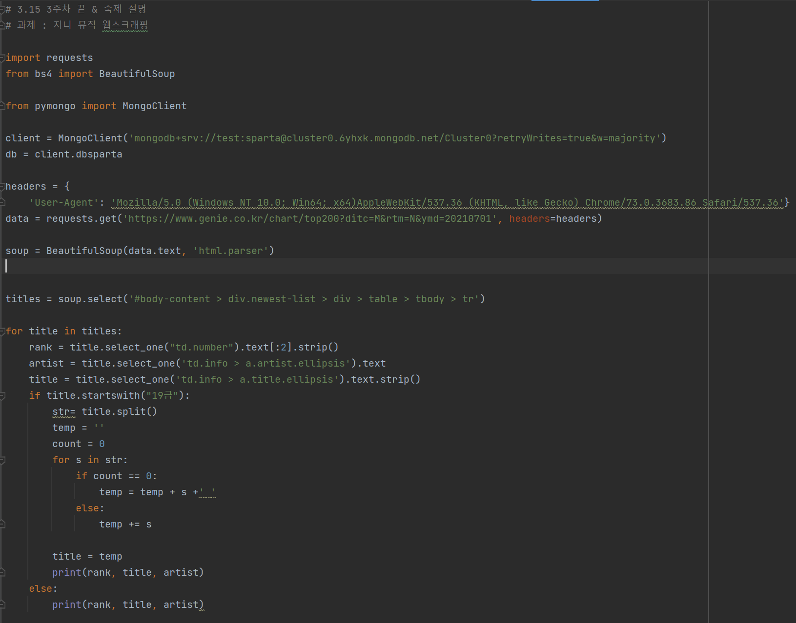

15-2. 지니뮤직 스크랩핑 파이썬 구현 코드

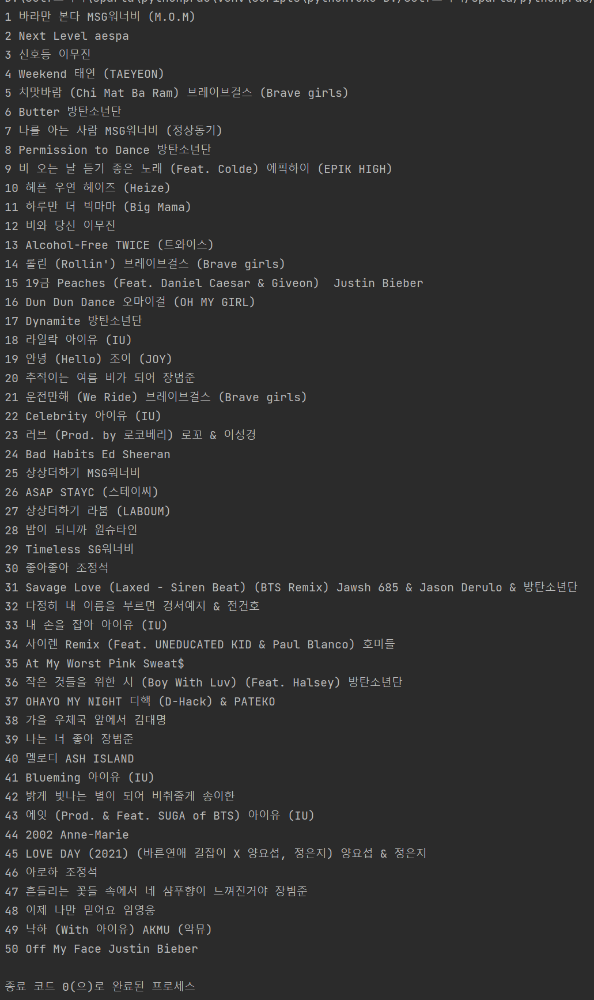

15-3. 지니뮤직 스크랩핑 실행 결과

****(참고) 작성자는 해설코드와 다를 수 있습니다.****

---

#### 

#### 

#### **정리**

간단한 숙제 문제를 너무 오래걸렸습니다..

코드 작성 후, 해설지를 확인하였을 때 해설지에는 19금 처리가 되어지 있지 않았습니다.

그래서 저는 다른 분들은 어떻게 했나 확인하고 싶지만... 오늘 사전 스터디 그룹이 형성되어서

오늘 사전 스터디 그룹방에 들어가서 다른 분들의 코드를 구경해봐야겠습니다!!

이상으로 오늘 일기장 끝!!

