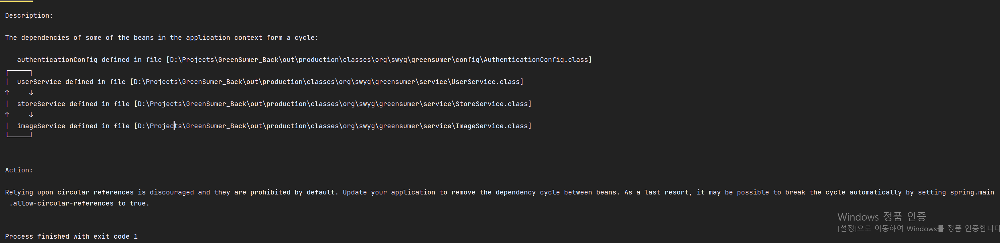

## **스프링 빈의 순환 종속성 문제**

---

기능을 구현할 때마다 UserService에 작성한 유저 조회 작업이 이루어지도록 하였다. UserRepository에 직접 접근하는 것보다 Service를 통해 접근하는 것이 더 나을 것이라고 판단되어 UserService를 접근하도록 변경하였다.

그런데 다음과 같이 **스프링 빈의 순환 종속성 문제**가 발생하였다.




### **스프링 빈의 순환 종속성**

---

스프링 프레임워크의 DI 에서 생성자 주입을 사용하는 경우, 이미 사용하는 코드에서 구현의 필요성 때문에 해결할 수 없는 순환 종석성 시나리오가 발생할 수 있다.

예를 들어,

클래스 A에는 생성자 주입을 통해 클래스 B의 인스턴스가 필요하고

클래스 B에는 생성자 주입을 통해 클래스 A의 인스턴스가 필요한 상황이 발생하였다.

클래스 A와 B의 Bean이 서로 주입되도록 구성하면 Spring IoC 컨테이너는 런타임시 순환 참조를 감지하고 **BeanCurrentlyInCreationException** 을 발생시킨다.

### **해결책**

---

그렇다면 해결책은 무엇일까? 해결책은 간단하다. 순환 참조를 끊어주면 되는 것이다.

#### **재설계**

사실 객체지향에서 순환 참조는 매우 좋지 않는 형태이다. 서로 간의 호출하는 빈을 추가로 만들어 주는 것이 좋다.

#### @Lazy

@Lazy 어노테이션을 사용하여 시작 시에는 null로 할당되게 하고 사용할 때 불리도록 하는 방법이다.

```java
@Component
public class AComponent {
    private final BComponent bComponent;

    public AComponent(@Lazy BComponent bComponent) {
        log.info( "bComponent is {}", bComponent);
        this.bComponent = bComponent;
    }
}
```

문제는 bComponent는 final 이기 때문에 이후에도 어떻게 변경할 수 없다. 그래서 Spring Framework는 AComponent 전체를 프록시로 만들어서 처리한다.

#### Setter, field Injection

setter 나 field 주입을 사용하는 방법이 있다.

필자에 경우 재설계를 통해 순환 종속성 문제를 해결해주었다.

UserEntity에 UserEntityRepository를 접근하는 Service를 따로 생성하여 해당 서비스에서 유저 정보를 조회하는 작업을 실행하도록 하여 문제를 해결하였다.

### 결론

---

1. 객체지향 설계에서는 상호 참조를 만들면 안된다. 분리할 수 없는 모듈은 1개의 모듈과 같기 때문이다.
2. Circular Dependencies가 발생했을 때 왜 발생했는지를 알아 두어야 한다.
3. 상호간 의존성을 잘 관리하고 **단방향 의존성을 가지도록 꾸준히 관리** 해야 한다.

> Repository에서 매번 직접 접근하도록 하다가  
> 이번에 새롭게 변경해봤는데 새로운 문제를 만날 수 있었다.  
>   
> 새로운 도전은 나를 성장하게 만든다.  
> 
