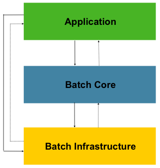

## PT 이용권 서비스

---

PT 이용권 서비스 프로젝트는 현업에서와 같이 Spring Batch를 활용해볼 수 있는 Bacth 프로젝트다.

서비스 개발을 해본적이 있다면 Batch 작업은 어느 서비스에서나 필요하다. 

정해진 시간에 메시지를 발송하기도 하고 정산 작업을 하거나 하루동안 쌓인 데이터로 통계 보고서를 만들기도 한다.

사용자에게 빠른 응답을 준 다음에 대량의 데이터를 다루어야할 때도 Batch를 활용할 수 있다. 

PT 이용권 서비스 프로젝트에서는 서비스 요구 조건에 따라 다양한 방식으로 Batch를 개발하고 수행해볼 것이다.

단, Batch 작업으로 들어가는 서비스 로직은 복잡하지 않게 구성하여 Batch에 중점을 두고 개발을 진행할 것이다.

### 이용권 시스템 이해하기

---

이용권 시스템을 개발하기 전에 요구사항을 이해하고 이를 기반으로 시스템 구조도를 그려보려 한다.

먼저 시스템을 그려보기 전에 Batch는 무엇이고 Batch를 언제 사용하는 것이 좋은지 왜 Spring Batch를 사용해서 Batch를 구현할 것인지에 대해 알아보려고 한다. 

#### Batch 란 무엇인가?

Batch(= 일괄 처리)

최종 사용자의 개입 없이 또는 (자원이 허가한다면) 실행을 스케줄링할 수 있는 작업(job)의 실행을 의미한다. [출처 - [위키백과](https://ko.wikipedia.org/wiki/%EC%9D%BC%EA%B4%84_%EC%B2%98%EB%A6%AC)]

배치 작업은 데이터를 실시간으로 처리하는 것이 아니라 **일괄적으로 모아서 처리하는 작업**을 의미한다.

하루동안 쌓인 데이터를 배치작업을 통해 특정 시간에 한꺼번에 처리하는 경우가 이에 해당한다. 은행의 정산작업과 같은 업무에서 이런 일괄처리를 수행하게 되며 사용자에게 빠른 응답이 필요하지 않은 서비스에 적용할 수 있다. 특정 시간이후에는 자원을 거의 소비하지 않는 것이 특징이다.

백업, 필터링 및 정렬과 같은 특정 데이터 처리 작업은 계산 집약적이며 개별 데이터 트랜잭션에서 실행하기에 비효율적일 수 있습니다. 대신 데이터 시스템은 대개 하루가 끝날 때나 야간과 같이 컴퓨팅 리소스를 더 일반적으로 사용할 수 있는 사용량이 적은 시간에 이러한 작업을 배치로 처리합니다. 하루 종일 주문을 수신하는 전자 상거래 시스템을 예로 들어 보겠습니다. 시스템에서 주문을 그때그때 처리하는 대신 하루가 끝날 때 모든 주문을 수집하고 주문 처리 팀과 하나의 배치로 공유할 수 있습니다.

배치에 반해서 사용자와 DB가 지속적으로 상호작용하는 경우에는 OLTP 방식으로 서비스를 개발해야한다. DB에 CRUD 작업을 하는 행위가 곧 트랜잭션을 수행하는 작업인데 금융업무나 고객망 관리(CRM)과 같은 프로그램의 작업은 주로 OLTP 방식으로 제공을 해주어야한다.

> **OLTP(Online Transaction Processing)**OLTP란 트랜잭션 지향 애플리케이션을 손쉽게 관리할 수 있도록 도와주는 정보 시스템의 한 계열로서, 일반적으로 데이터 기입 및 트랜잭션 처리를 위해 존재한다. [출처 - [위키백과](https://ko.wikipedia.org/wiki/%EC%98%A8%EB%9D%BC%EC%9D%B8_%ED%8A%B8%EB%9E%9C%EC%9E%AD%EC%85%98_%EC%B2%98%EB%A6%AC)]  
>   
> OLTP는 동시에 발생하는 다수의 트랜잭션을 실행하는 데이터 처리 유형이다. OLTP는 쿼리를 실행하고, 데이터 무결성을 유지하는 것을 목표로 한다.    
>    
> 예를 들어 은행의 ATM 기계는 OLTP 과정을 거친다. ATM 기계로 돈을 통장에 입금한다고 하자. 가장 먼저 카드를 삽입하면 ATM이 카드 정보를 인식한다. 카드를 인식했으면 돈을 기계에 넣는다. ATM은 돈을 세면서 잘못된 돈은 없는지 확인한다. 확인이 끝나면 돈을 보관하고 통장에 돈을 입금한다.  
>    
> 이러한 과정 중 하나라도 오류가 발생하면 모든 과정을 취소(rollback)하고 처음으로 돌아가게 된다.  
>    
> 이처럼 OLTP는 데이터 무결성을 유지하기 위한 과정이다. 이러한 OLTP는 다음과 같은 특징을 갖는다.  
>    
> 1. 작은 양의 데이터를 포함한 트랜잭션을 사용한다.  
> 2. 많은 사용자를 가질 수 있다.  
> 3. 빠른 응답 시간을 갖는다.  
> 4. 미리 정의된 연산만 실행한다.  
> 5. ACID를 준수한다.

---

#### Batch 처리가 중요한 이유는 ?

조직에서는 사람의 개입을 최소화하고 반복 작업을 보다 효율적으로 실행할 수 있기 때문에 배치 처리를 사용합니다.

컴퓨팅 성능을 가장 쉽게 사용할 수 있을 때 함께 처리할 수백만 개의 레코드로 구성된 작업 배치를 설정하여 시스템에 주는 부담을 줄일 수 있습니다. 또한 최신 배치 처리에는 최소한의 인적 감독이나 관리가 필요합니다.

문제가 있는 경우 시스템은 자동으로 관련 팀에 문제를 해결하도록 알립니다. 관리자는 배치 처리 소프트웨어가 작업을 수행할 것이라고 믿고 자동 접근 방식을 취합니다.

[출처 - [AWS BATCH](https://aws.amazon.com/ko/what-is/batch-processing/)]

---

#### Batch 는 언제 사용하는 것이 좋을까?

Batch 작업은 데이터를 실시간으로 처리하는 것이 아닌 일괄적으로 처리하는 작업이다.

아래와 같이 정해진 시간에 작업해야하는 작업들을 Batch를 사용하여 처리할 수 있다.

* 예약 시간에 광고성 메시지 발송
* 결제 정산 작업
* 운영을 위해 필요한 통계 데이터 구축
* 대량 데이터를 필요로 하는 모델 학습 작업

---

#### 왜 Batch를 사용하여 일괄로 처리해야할까?

**1. 정해진 시간내에 작업을 진행해야하기 때문이다.**

메시지 예약처럼 기능 스펙상 실시간으로 처리할 수 없는 경우가 있다. 정해진 시간에 메시지를 발송해야하므로 사용자가 대기하고 있다가 전송하지 않는 이상 발송을 할수 없다.

**2. 리소스를 효율적으로 사용할 수 있기 때문이다.**

**(예시1)** 데이터에 요구사항에 따라서 서비스에 일간, 주간, 월간으로 통계 보고서를 받고자 한다면 실시간으로 데이터 갱신하여 보고서를 작성하기 보다는 일간에 경우는 자정 이전에, 해당 주에 주말,  해당 월에 월말에 모아서 처리하는 것이 보다 합리적이다.

**(예시2)** 대량에 데이터를 다루는 경우를 생각해보자. 대량에 데이터를 추출(Export)를 해야하는 기능이 있다고 했을 때, 만약 사용자가 웹 서비스내에서 대량에 데이터를 추출(Export)하는 버튼을 눌러 100만 건이 넘는 데이터를 CSV 파일로 추출한다고 하면 데이터를 DB로 부터 읽어와서 100만 row를 사용하고 있는 동안 사용자가 아무런 작업을 할 수 없다면 문제가 될 것이다. 이때 Batch 작업을 사용하면 사용자에게 빠른 응답을 주고 뒤에서 진행하고 시간이 오래걸리는 작업이 완료되면 이후에 사용자가 파일을 다운받을 수 있게 구성할 수 있다. 

**(예시3)** 한정된 서버에서 여러 사람이 엄청난 데이터를 가지고 모델 학습을 진행하려고 한다. 만약 한대에 서버에서 1번에 1개에 작업만 돌릴 수 있고 작업이 오래걸린다면 어떻게 될까? 이미 특정 작업이 진행되고 있다면 많은 사람들이 작업을 실행해보지도 못한다. 주기적으로 접속하여 확인해보는 시간 낭비가 발생할 것이다.

이런 경우에 사용하는 시간을 예약해두고 내 예약 시간에 이전 작업이 종료되고 내 작업이 실행되도록 한다면 서버가 낭비되는 시간 없이 효율적으로 사용할 수 있다.

이와 같이 주변에 서비스들은 Batch를 통해 많은 작업들을 수행하고 있다. 

---

#### **왜 Spring Batch를 사용할까?**

출처 : 허원철의 개발 블로그

**1. Spring에서 제공하는 특성 그대도 사용 가능**

**(1) 유연성**

Spring을 사용하는 이유와 Java를 사용하는 이유로 특정 환경에 종속되지 않는 JVM에 유연성을 가장 먼저 떠올릴 수 있다. 플랫폼에 관계 없이 서버, 클라우드, Docker 등 각각에 플랫폼만에 개발이 필요 없이 하나의 개발로 가능하다.

**(2) 유지보수**

Spring Framework는 DI를 통해서 객체 간에 결합을 구성할 수 있고 AOP로 반복적인 코드를 쉽게 줄일 수 있다.

만약 DB를 호출한다고 했을 때에도 직접 low한 부분까지 개발하지 않고도 구현된 라이브러리를 활용하면 쉽게 짧은 코드로 완성할 수 있다. 테스트도 용이하기 때문에 유지보수 시 많은 시간을 절약할 수 있다. 

**(3) 데이터 신뢰성**

데이터 신뢰성을 높일 수 있다. Spring Batch에 경우 굉장히 많은 수치 데이터가 있는데 이 데이터와 코딩을 하면서 남긴 로깅을 통해서 어떤 이슈가 발생했을 때 어떤 부분이 잘못되어서 왜 이렇게 처리가 되었는지 이런 부분을 파악하고 데이터를 신뢰성 있기 보정할 수 있다. 

**2. Spring Batch != 스케줄러**

이러한 장점을 갖은 Spring Batch를 스케쥴러와 동일하게 생각할 수 있는데 스케줄러와는 다르다.

Spring Batch에는 특정 시간 또는 특정 이벤트에 따라서 job이 실행되는 스케줄링 기능이 없다. 프로젝트 내에서 Spring이 제공하는 **Spring scheduler** 나 **Spring Quartz** 와 같은 Scheduler를 추가해서 함께 사용할 수 있다. 정리하면 Spring Batch는 Job을 관리는 하지만 실행시키는 주최가 아니다.

**3. Application: 사용자 코드 및 구성**

Spring Batch는 크게 3 가지 Layer로 구분된다.

(1) **Application Layer**

Application Layer는 Batch 처리를 위한 모든 사용자의 코드와 설정이 포함된다. 

그림에서 3개 Layer가 분리되어 나타나서 각 Layer들이 별개에 부분으로 생각할 수 있는데 Batch Core와 Batch Infrastructure도 직접 커스텀하게 코딩할 수 있기 때문에 어찌보면 Application Layer가 Batch Core와 Batch Infrastructure를 포함하는 개념으로 생각하면 이해가 쉬울 것이다.

(2) **Batch Core Layer**

Batch Core는 Batch를 정의하는 Job, Step과 실행에 사용되는 JobLauncher, JobParameters 등을 말한다. 

(3) **Batch Infrastructure**

File, DB 등에서 데이터를 읽고 쓸수 있는 ItemReader, ItemWriter 등을 포함한다. 

---

#### 용어 정리

* **Job**  
  배치처리 과정을 하나의 단위로 만들어 놓은 객체로 배치처리 과정에 있어 전체 계층 최상단에 위치하고 있다.
* **JobInstance**  
  **JobInstance**는 **Job**의 실행의 단위를 나타내고 Job을 실행시키게 되면 하나의 **JobInstance** 가 생성된다.  
  예를들어 1월 1일 실행, 1월 2일 실행을 하게 되면 각각의 **JobInstance**가 생성되며 1월 1일에 실행한 **JobInstance**가 실패하여 다시 실행을 시키더라도 이 **JobInstance**는 1월 1일에 대한 데이터만 처리한다.
* **JobParameters**  
  **JobInstance**는 **Job**의 실행 단위이라면 **JobParameters**는 ****JobInstance****를 구분하는 객체다.  
  **JobParameters**는 **JobInstance** 구별 외에도 개발자 **JobInstance**에 전달되는 매개변수 역할도 한다.  
  **JobParameters**는 String. Double, Long, Date 4가지 형식만을 지원한다.
* **JobExecution****JobExecution**은 **JobInstance**에 대한 실행을 시도하는 객체다.  
  1월 1일에 실행한 **JobInstacne**가 실패하여 재실행을 하여도 동일한 **JobInstance**를 실행시키지만 이 2번에 실행에 대한 **JobExecution**은 개별로 생기게 됩니다. **JobExecution**는 이러한 **JobInstance** 실행에 대한 **상태,시작시간, 종료시간, 생성시간** 등의 **정보를 담고 있다.**
* **Step**  
  **Step**은 **Job**의 배치처리를 정의하고 순차적인 단계를 **캡슐화** 한다.   
  **Job**은 최소한 1개 이상의 **Step**을 가져야 하며 **Job**의 실제 일괄 처리를 제어하는 모든 정보가 들어있다.
* **StepExecution**  
  **StepExecution**은 **JobExecution**과 동일하게 **Step** 실행을 시도하는 객체다.   
  하지만 **Job**이 여러개의 **Step**으로 구성되어 있을 경우 이전 단계의 **Step**이 실패하게 되면 다음 단계가 실행되지 않음으로 실패 이후 **StepExecution**은 생성되지 않습니다. **StepExecution** 또한 **JobExecution**과 동일하게 실제 시작이 될 때만 생성된다.   
  **StepExecution**에는 **JobExecution**에 저장되는 정보 외에 **read 수, write 수, commit 수, skip 수** 등의 **정보**를 담고 있다.
* **ExecutionContext****ExecutionContext**는 **Job**에서 데이터를 공유 할 수 있는 데이터 저장소다.   
  **Spring Batch**에서 제공하는 **ExecutionContext**는 **JobExecutionContext**, **StepExecutionContext** 2가지 종류가 있으나 이 두 가지는 지정되는 범위가 다르다. 
  + **JobExecutionContext**은 Commit 시점에 저장된다.
  + **StepExecutionContext**는 실행 사이에 저장된다.  

    **ExecutionContext**를 통해 **Step**간 데이터 공유가 가능하며 **Job** 실패시 **ExecutionContext**를 통한 마지막 실행 값을 재구성 할 수 있습니다.
* **JobRepository**  
  **JobRepository**는 위에서 말한 모든 배치 처리 정보를 담고있는 매커니즘이다.  
  **Job**이 실행되게 되면 **JobRepository**에 **JobExecution**과 **StepExecution**을 생성하고 **JobRepository**에서 **Execution** 정보들을 저장하고 조회하여 사용한다.
* **JobLauncher**  
  **JobLauncher**는 **Job**과 **JobParameters**를 사용하여 **Job**을 실행하는 객체다.
* **ItemReader**  
  **ItemReader**는 **Step**에서 **Item**을 읽어오는 인터페이스다.   
  **ItemReader**에 대한 다양한 인터페이스가 존재하며 다양한 방법으로 **Item**을 읽어 올 수 있다.
* **ItemWriter**  
  **ItemWriter**는 처리 된 데이터를 **Writer** 할 때 사용한다.   
  **Writer**는 처리 결과물에 따라 **Insert**가 될 수도 **Update**가 될 수도 **Queue**를 사용한다면 **Send**가 될 수도 있다. **Writer** 또한 **Read**와 동일하게 다양한 인터페이스가 존재한다. **Writer**는 기본적으로 **Item**을 **Chunk**로 묶어 처리하고 있다.
* **ItemProcessor**  
  **ItemProcessor**는 **Reader**에서 읽어온 **Item**을 데이터를 처리하는 역할을 한다.  
  **Processor**는 배치를 처리하는데 필수 요소는 아니며 **Reader**, **Writer**, **Processor** 처리를 분리하여 각각의 역할을 명확하게 구분하고 있습니다.

---

#### 전체 시스템 구조

크게 용도에 따라 컴포넌트를 정해놓고 누가 누구를 호출하는지에 대해 나타내었다. 

### 이용권 서비스 요구사항 이해하기

---

여러 Batch 작업을 할 수 있는 서비스를 떠올리다가 시간 단위로 구성할 수 있는 이용권과 예약을 컨텐츠로 가져오게 되었다.

#### 이용권을 등록하는 스토리

헬스장에 가서 PT를 등록하는 과정을 상상해보자.

PT를 등록하기 위해 헬스장가서 직원에게 여러 프로그램를 설명 들었다. 각 프로그램들은 유효기간과 횟수가 달랐다. 설명을 듣고 3개월 20회 PT 이용권을 구매하였다. 오픈 기념으로 3개월 헬스장 이용권을 함께 주었다.

이와 같이 서비스 관리되고 있다보니까 예약한 수업 전에는 알림을 받고 수업이 끝난 다음에는 이용권이 1회씩 차감되는 것을 확인할 수 있었다. 이렇게 운동을 하다가 헬스장 내에 필라테스 수업이 생기면서 모든 회원에게 1회 필라테스 이용권을 일괄로 주었다.

#### 이용권 서비스 요구사항 - 이용권, 수업, 통계

위 시나리오를 다음과 같이 정리할 수 있다.

**이용권**

* 사용자는 N개의 이용권을 가질 수 있다.
* 이용권은 횟수가 모두 소진되거나 이용기간이 지나면 만료된다.
* 이용권 만료 전 사용자에게 알림을 제공해준다.
* 업체에서 원하는 시간을 설정하여 일괄로 사용자에게 이용권을 지급할 수 있다.

**수업**

* 예약된 수업 10분 전 출석 안내 알림을 준다.
* 수업 종료 시간 시점 수업을 예약한 학생의 이용권 횟수를 일괄로 차감한다.

**통계**

* 사용자의 수업 예약, 출석, 이용권 횟수 등의 데이터로 유의미한 통계 데이터를 만든다.

업체 측에서 이러한 데이터를 보고 어떤 수업을 늘리고 어떻게 효율적으로 관리할 수 있을지 알 수 있게 된다.

#### 이용권 서비스 요구사항 - 기능

**Batch**

* 이용권 만료
* 이용권 일괄 지급
* 수업 전 알림
* 수업 후 이용권 차감
* 통계 데이터 구축

**View**

* 사용자 이용권 조회 페이지
* 관리자 이용권 등록 페이지
* 관리자 통계 조회 페이지

**API**

* 사용자 이용권 조회 API
* 관리자 이용권 등록 API
* 관리자 통계 조회 API

### 정리

---

시스템 구조를 다시 한번 살펴보자.

* **Batch**는 DB에 데이터를 읽고 업데이트하는 역할
* **API**는 Web에 데이터를 제공하기 위해 **DB**와 통신하여 제공해주는 역할
* **Batch**는 **Spring Batch**를 사용할 것이고 **DB**는 **MySQL**을 사용할 것이다.
