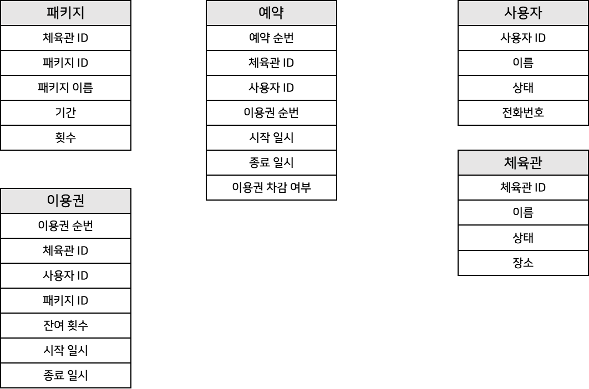
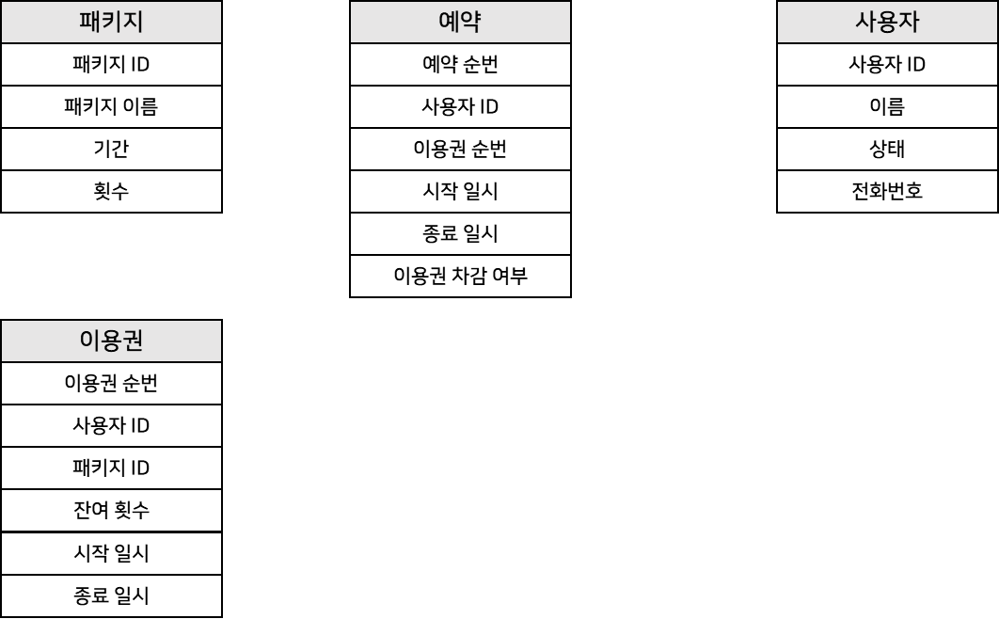
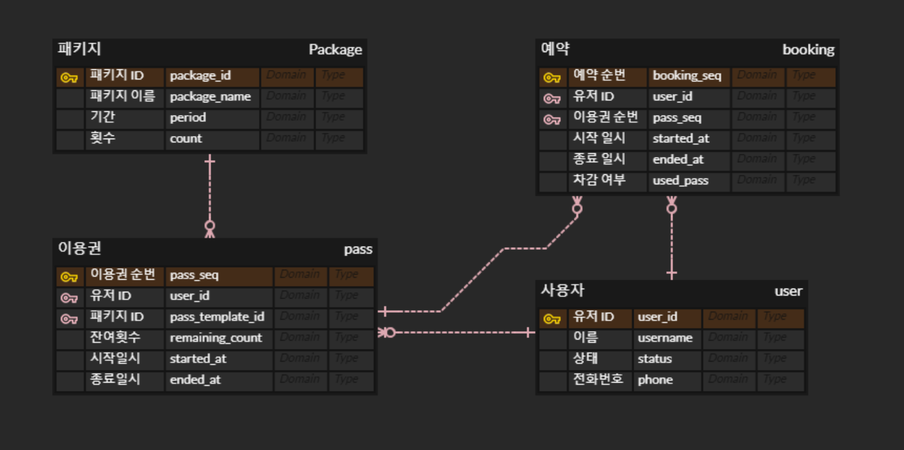
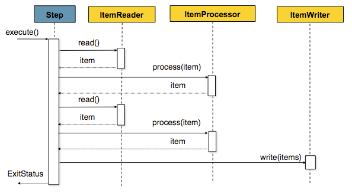
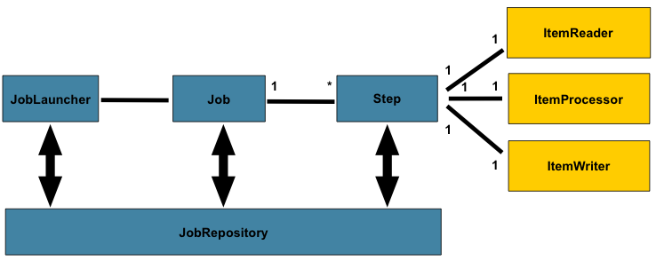
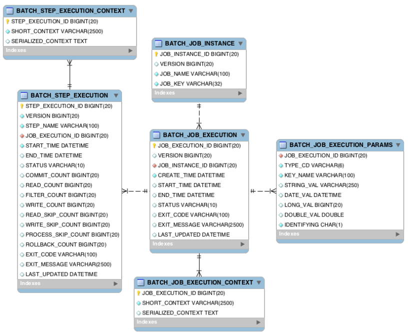
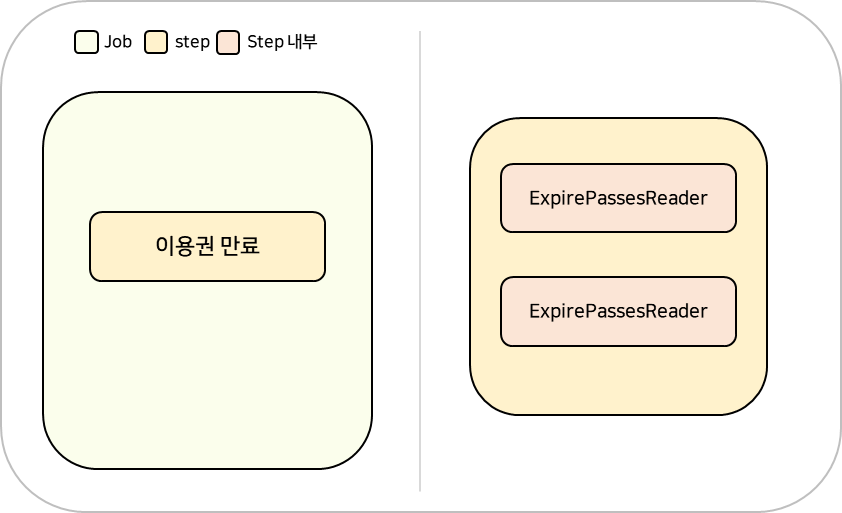
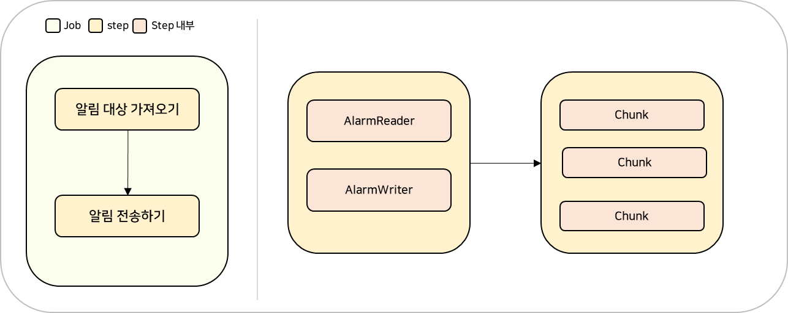
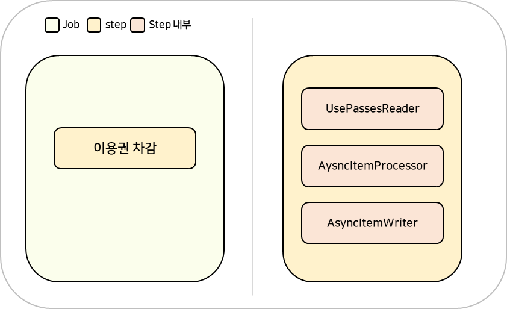
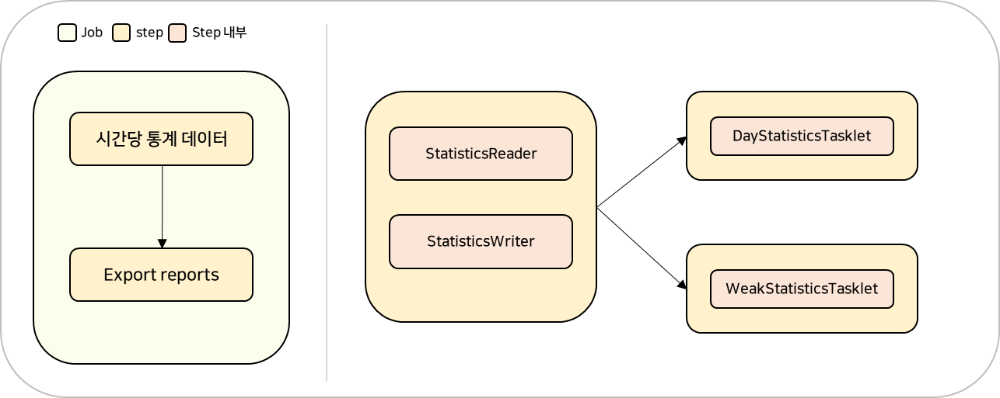

## Batch 프로젝트 설계

---

모든 프로젝트를 설계하기 전에 데이터 설계가 필수 이므로 데이터 설계를 진행하도록 하겠습니다.

### 데이터 설계

---

PT 이용권 관리 서비스를 여러 개에 체육관이 사용하고 있다는 전제 하에 구성한 테이블이다.

모든 테이블을 나타낸 것이 아니고 모든 필드를 나타낸 것도 아니다. 간단하게 보기 쉽게 꼭 필요한 정보들만 가진 테이블 정보다.

실제 개발을 할때는 1개의 체육관을 기준으로 단순화시켜 개발할 것이다. 

복잡도가 올라갈 수 있기 때문에 복잡도를 낮추고 핵심 비즈니스 로직에 관심을 두고 개발하기 위해서이다.

컬럼들을 다시 정리하면 다음과 같은 테이블 구조가 만들어진다.

위 테이블은 전체 컬럼이 아니기 때문에 개발을 하면서 테이블이 추가될 수 있다.

예시

1. 통개를 만들다가 통계 테이블 필요
2. 알람을 만들다가 알람 메시지 테이블 필요
3. 일괄 등록을 하기 위해 업체들이 등록하기 위한 정보들 저장하기 위한 테이블 필요

### Batch 구조에 대한 이해

---

Batch 하나하나에 구도를 설계를 해보려고 한다.

Batch 프로젝트에서 만든 Feature 들을 설계하기 전에 개념를 먼저 살펴보고 Batch 구도를 어떻게 해야하는지 그리고 Batch는 어떻게 동작하는지를 알아보고 여러 구현 방법들이 있다고 하는데 각각 어떤 장점들이 있고 실제 구현해야하는 Feature들은 여러 가지 방법 중에 어떤 방법을 선택해야 하는지 이야기해보려고 한다.

Batch Featrue 하나하나를 Job 으로 정의할 수 있다.

* 이용권 만료하는 Job
* 이용권 일괄 지급 Job
* 수업 전 알림 Job
* 수업 후 이용권 차감 Job
* 통계 데이터 구축 Job

Job들은 Step 별로 구성되어 있다.

수업 전 알림 Job 을 예시로 들면

1. 알림 대상을 뽑아주는 Step
2. 알람을 전송하는 Step

으로 구성된다. Job 안에 있는 작은 단위에 Step 을 먼저 살펴보도록 하겠다.

#### **Step**

**배치 처리를 정의하고 제어하는 독립된 작업의 단위**를 말한다. 순차적으로 이루어지는 작업을 캡슐화한 도메인 객체로 생각하면 된다. 

Step은 주요하게 **Tasklet 기반 Step**, **Chunk 기반 Step** 으로 나눌 수 있다. 

**Tasklet 기반 Step : 단일 작업을 처리할 때 사용한다.**

오래된 데이터를 삭제하거나 이미 정의된 알람을 전송과 같이 간단한 하나의 작업을 **Tasklet** 으로 표현할 수 있다.

물론 **Chunk 기반 Step**은 아이템을 기반으로 읽고 처리하고 쓰는 작업들도 **Tasklet** 안에 구현할 수 있다. 하나에 Tasklet 안에 로직으로 데이터를 읽고 처리하고 쓰고 이런식으로 구성하게 되면 **Chunk**와 동일하게 구현할 수 있다.

=> 간단히 정의한 하나의 작업 처리

**Chunk 기반 Step : 배치 처리를 정의하고 제어하는 독립적인 단위**

아이템 기반에 처리를 하게 되서 **ItemReader**, **ItemProcessor**, **ItemWriter** 라는 부분으로 구성된다. 

이때 **ItemProcessor** 는 필수 요소가 아니기 때문에 필요한 경우에만 사용해도 된다.

ItemReader, ItemProcessor, ItemWriter를 하나의 Chunk 로 정의할 수 있다.

아래에 Sequence Diagram을 보면 이해를 도울 수 있다. Chunk 기반 Step은 3가지에 Loop를 수행한다. 

1. **ItemReader** 에서 Chunk 단위로 처리할 Item을 반복해서 읽어온다.(Chunk 개수 만큼 반복)
2. **ItemProcessor**에서 **ItemReader**와 동일한 방식으로 가져온 Item 개수 만큼 Procss 처리한다.  
   process 작업이 모두 마치게 되면 Item 들을 한 번에 ItemWriter로 Write하여 전달한다.
3. 위 작업이 하나의 Chunk인데 이러한 Chuck가 읽을 item이 없을 때까지 전체가 반복한다.

Chunk 단위로 Transaction이 있기 때문에 Chunk 단위로 Commit이 이루어지고 Rollback도 이루어진다. 

출처 : Spring docs

#### **Job**

Job은 유일하고, 고유하고 순서를 가진 Step 들에 목록이고 외부 의존성 영향을 받지않고 실행할 수 있는 독립적인 작업이다. 정의한 Step 작업한 순서대로 이루어져야한다.

아래 그림을 통해 Spring Batch가 어떻게 Job을 실행하는지 확인할 수 있다. 

JobLauncher 을 통해 Job 을 실행하면 정해진 Step 이 실행되게 된다.

Step 은 Chunk 기반 Step으로 수행하면서 현재 상태, 읽고 쓰는 건수 등에 데이터를 JobRepostory에 업데이트한다.

출처 : Spring docs

* **JobLauncher** : Job 실행하는 역할을 맡는다. 이외에도 Job을 현재 스레드에서 수행할지 스레드 풀을 이용할지 Job 실행할때 필요한 파라미터는 유효한지와 같은 작업들도 함께 실행한다.
* **JobRepository** : 배치 수행과 관련된 데이터를 가지고 있는데 시간(시작, 종료), 읽기 쓰기 횟수, 상태를 관리하고 JobRepository는 일반적으로 RDB를 사용한다

---

#### **JobRepository**

아래 그림은 JobRepository 테이블이다. 기본적으로 RDB를 제공한다고 했는데 RDB에 붙였을 때 생성되는 테이블이고 총 6개로 이루어져있다. Spring 설정을 통해서 어플리케이션을 실행할 때 없으면 자동적으로 생성되도록 할 수 있다. 

테이블을 살펴보면 

1. **BATCH\_JOB\_INSTANCE**   
   Job을 처음 실행하게 되면 단일 Job 인스턴스 데이터가 **BATCH\_JOB\_INSTANCE** 테이블에 등록된다. JOB\_KEY가 고유한 Key가 된다.
2. **BATCH\_JOB\_EXECUTION**Job에 실제 실행 기록을 나타내는 테이블이다. Job이 실행될 때마다 새로운 데이터가 생성되고 실행되는 동안에도 주기적으로 상태 값이나 다른 값이 업데이트가 된다.   

   **BATCH\_JOB\_EXECUTION** 과 관련된 테이블이 3개가 있다.  
   1. **BATCH\_JOB\_EXECUTION\_CONTEXT**EXECUTION\_CONTEXT는 재시작처럼 batch를 여러번 수행할 때 유용하게 사용할 수 있다.
   2. **BATCH\_JOB\_EXECUTION\_PARAMS**Job이 매번 실행될때마다 Job 파라미터를 기록하는 테이블이다.
   3. **BATCH\_STEP\_EXECUTION**Step에 시작, 완료에 대한 상태를 저장하고 읽고 처리하고 쓰고 건너뛰고 이러한 것들도 계산해서 저장된다.
      1. **BATCH\_STEP\_EXECUTION\_CONTEXT**BATCH\_JOB\_EXECUTION\_CONTEXT과 동일하게 STEP에도 EXECUTION CONTEXT라는 개념이 있고 동일한 용도로 사용한다.

기본동작은 RDB에서 구성되지만 개발환경이나 테스트 환경에서 사용할 수 있는 인메모리 방식도 존재한다. 외부 DB가 구성되지 않은 상태에서 구성하는데 시간을 사용하는 것 보다는 H2 DB를 올려서 사용하는 인메모리 데이터베이스를 사용하면 리소스를 줄일 수 있는 좋은 방법이 될 수 있다.

### Batch 구조 설계

---

Batch Feature로 정의한 Job들을 어떤 Step으로, 몇개에 Step으로 정의할지 고민해보려고 한다. 

#### **이용권 만료 Job**

이용권 만료 Job은 Reader와 Writer가 있는 **Chunk** **기반 Step** 1개 이용한다.

1. 이용권 만료 대상 조회
2. 이용권 만료 대상 업데이트

---

#### **이용권 일괄 지급 Job**

이용권 일괄 지급은 업체에서 회원에게 일괄로 주는 방식으로 어드민에 등록하게 되면 정해진 시간에 이용권이 사용자들에게 전달되는 방식이다. 이 부분도 단순하기 때문에 Step 1개를 이용하였다.

여기서도 당연히 등록한 정보를 읽어서 이용권을 등록하는 작업이 있어서 Chunk 기반 Step으로 구성할 수 있지만, 여러 가지 방식을 경험해보기 위해 이용권 일괄 지급은 **Tasklet 기반 Step 1개**를 사용하려 한다.

---

#### **예약 수업 전 알람 Job**

앞에서 다루었던 단순한 Batch 구조는 Job 내에서 Step을 정의된 순서대로 단일 Thread로 실행하는 것이었다.

하지만 점점 대량에 데이터를 다루게 되면서 병렬 처리는 굉장히 중요한 기능이 되었다. 기업에 사업이 잘되면 데이터 양은 자연스럽게 증가하게 되는데 더 많은 고객이 더 많은 접근을 하여 더 많은 데이터를 쌓이게 되어도 Batch 작업은 정상적으로 이루어져야 한다. 이러한 이유로 확장할 수 있는 방식으로 병렬 처리를 해야하는데 Spring Batch 에서 제공하는 병렬 처리 방식을 적용해보려고 한다. 

예약 수업 전 알람 Job에서 적용할 방식은 **다중 Thread Chunk**를 사용하는 방식이고 2개의 Step으로 이루어져 있다.

1. 알람 대상을 가져오는 Step
2. 알람 전송하는 Step(병렬 처리 되는 부분)  
   Chunk 기반에 Step에서는 Chunk 단위로 처리되고 각자 독립적인 트랜잭션이 적용된다.  
   1만 건에 데이터가 있다고 했을 때 Commit 수를 100개로 설정한다면  
   100개가 실행되고 종료되고 100개가 실행되고 종료되고... 이러한 작업이 계속 반복된다.  
   이와 같이 순차적으로 진행할 경우 시간이 오래 걸린다.   
   이를 병렬로 처리하게 되면 3개로 나누어 작업하면 한번에 300개를 처리할 수 있다. 자연스럽게 처리량이 늘어날 수 있다.   

   주의해야할 점은 Spring Batch 뿐이 아닌 다른 모든 프로그래밍에서도 멀티 스레드를 사용하게 되면 주의해야할 점이 있다.

---

#### **수업 종료 후 이용권 차감 Job**

수업 종료 후 이용권 차감 Job 은 **Chunk 기반 Step** 1개로 이루어져 있다.

특이한 점은 **AsyncItemProcessor, AsyncItemWriter** 비동기적으로 처리를 하게 된다.

어떤 작업에서 ItemProcessor 작업이 굉장히 복잡하고 굉장히 복잡한 수학적 계산이 있거나 호출하는 외부 서비스가 많아 시간이 오래 걸리는 작업이 있을 수 있다. 그런 경우에 비동기로 사용하게 되면 각 호출에 대해서 **Future**로 반환해서 **AsyncItemWriter** 으로 전달되고 **AsyncItemProcessor** 가 끝나는대로 **AsyncItemWriter** 에 최종 결과값을 넘겨주고 실행을 위임한다.

이용권 차감 작업은 단순한 작업이라 비동기로 할 필요가 없는데 다양한 구현 방식을 익히기 위한 구조이다.

---

#### **통계 데이터 생성 Job**

통계 데이터 생성 Job 은 2개에 Step으로 구성된다. 

1. 시간당 통계 데이터 Step - Chunk 기반 Step
2. Export reports Step - 2개의 Tasklet Step으로 구성  
   서로 관련이 없는 작업을 할 때 Step 을 병렬로 처리하는 방식을 사용할 수 있다.  
   시간별 통계 자료가 있었을 때 일별 보고서를 만드는 작업과 주간 보고서를 만드는 작업을 서로 다른 작업이다. 그래서 이 작업을 동시에 수행하여 효율양을 높일 수 있다.

### 정리

---

> Spring Batch 를 처음 경험해보았다. 아닌가?...  
>   
> Job 과 Step를 이해하는데 많은 시간이 필요하였다.  
>   
> 더 정확하고 자세한 내용을 경험해보기 위해   
> 구글링을 통해 많은 자료를 찾아보았지만  
> 대부분 개념적인 접근보다는 코드적으로 설명하는 분들이 많았다.   
>   
> 필자는 코드보다 개념이 더 중요하다고 생각하여 개념적인 내용만으로 구성해보았다.  
>   
> 부족하지만 오늘도 성장한 하루가 되었다.  
>   
> 
