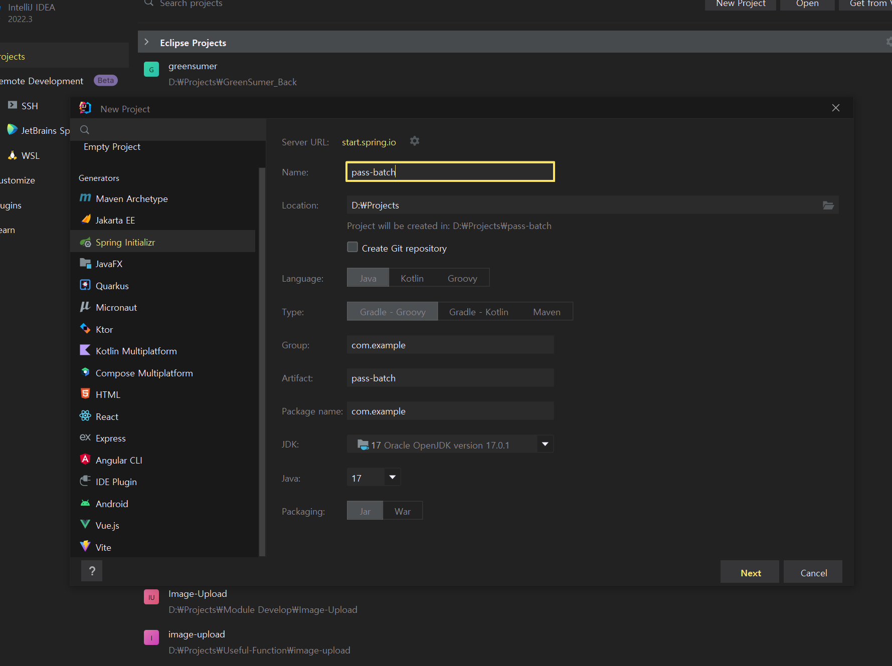
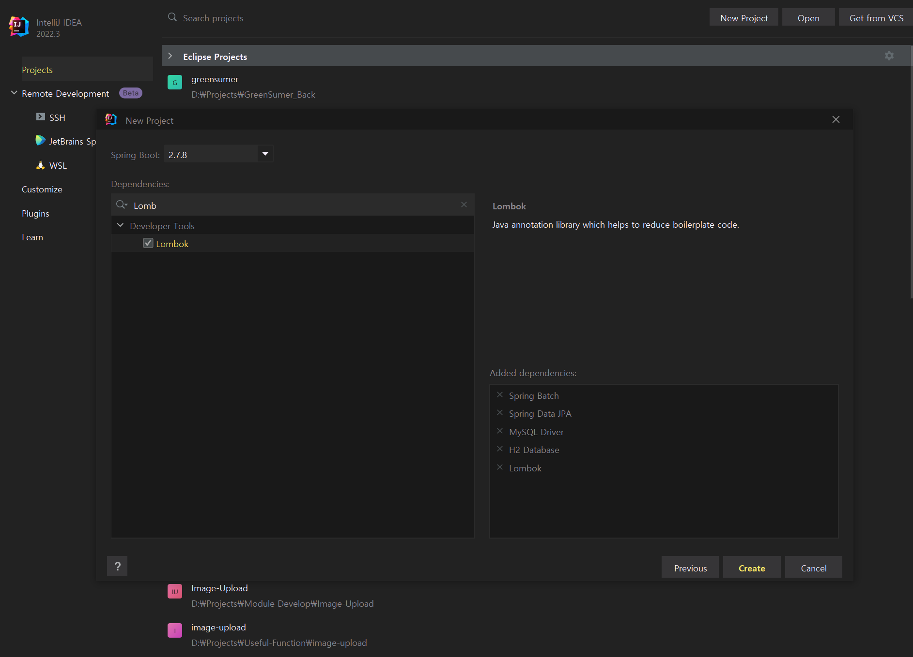
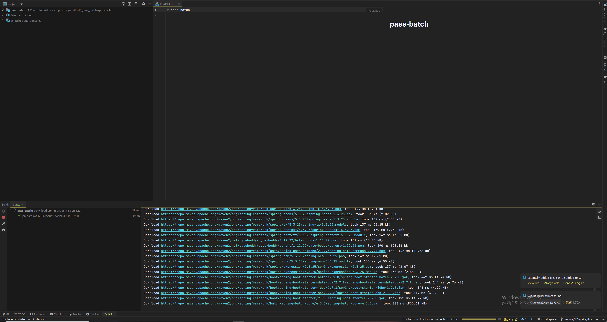

## 프로젝트 생성 및 Git 설정

---

### Git-flow 전략

---

main 브랜치에서 시작하여 develop으로 생성한 다음 추가해야할 기능이 있다면 develop에서 Feature 브랜치를 생성하여  develop에 반영하고 이를 main 브랜치에 반영하는 구조를 사용하기로 하였다.


### 프로젝트 생성

---

#### 프로젝트 구성

* Spring Boot
* Gradle
* Spring Batch
* MySQL 8
* JPA
* Lombok
* ModelMapper
* OpenJDK 17
* Windows 10
* Docker Desktop
* MySQL WorkBench
* Intellij IDEA Ultimate

#### 프로젝트 생성

1. 프로젝트 명과 파일 위치 버전 등을 설정한다.



2. 의존성 추가



3. 프로젝트 생성



4. git 연동

**터미널을 통해 Git repo 연동하는 방법**

```java
# git 초기화
$ git init

# 현재 모든 파일을 stage에 올린다.
$ git add --all

# 커밋 stage에 올린 파일에 대한 커밋 메시지 작성
$ git commit -m "Spring Boot Project Init"

# 원격 Repo 설정
$ git remote add orgin https://github.com/bang-star/pass-batch.git

# 원격 Repo에 모든 커밋에 대해 Push
$ git push -u origin main
```

### 프로젝트 실행

---

#### H2 DB 설정

```java
spring:
  datasource:
    url: jdbc:h2:mem:testdb
    username: sa
    password:
    [REDACTED]: org.h2.Driver
```

#### Spring Batch 테스트

간단하게 Spring Boot Application을 실행하여 정상적으로 실행되는지 확인하기 위함이다.

```java
@EnableBatchProcessing
@SpringBootApplication
public class PassBatchApplication {

	private final JobBuilderFactory jobBuilderFactory;
	private final StepBuilderFactory stepBuilderFactory;

	public PassBatchApplication(JobBuilderFactory jobBuilderFactory, StepBuilderFactory stepBuilderFactory) {
		this.jobBuilderFactory = jobBuilderFactory;
		this.stepBuilderFactory = stepBuilderFactory;
	}

	@Bean
	public Step passStep() {
		return this.stepBuilderFactory.get("passStep")
				.tasklet((contribution, chunkContext) -> {
					System.out.println("Execute PssStep");
					return RepeatStatus.FINISHED;
				}).build();
	}

	@Bean
	public Job passJob() {
		return this.jobBuilderFactory.get("passJob")
				.start(passStep())
				.build();
	}

	public static void main(String[] args) {
		SpringApplication.run(PassBatchApplication.class, args);
	}

}
```

실행 결과


[참고] Spring 3버전 이상에서, Spring Batch의 JobBuilderFactory, StepBuilderFactory가 사용되지 않게 된다.

```java
package org.example.passbatch;

import org.springframework.batch.core.Job;
import org.springframework.batch.core.Step;
import org.springframework.batch.core.configuration.annotation.EnableBatchProcessing;
import org.springframework.batch.core.job.builder.JobBuilder;
import org.springframework.batch.core.repository.JobRepository;
import org.springframework.batch.core.step.builder.StepBuilder;
import org.springframework.batch.repeat.RepeatStatus;
import org.springframework.boot.SpringApplication;
import org.springframework.boot.autoconfigure.SpringBootApplication;
import org.springframework.context.annotation.Bean;
import org.springframework.transaction.PlatformTransactionManager;

@EnableBatchProcessing
@SpringBootApplication
public class PassBatchApplication {

    private final JobRepository jobRepository;
    private final PlatformTransactionManager transactionManager;

    public PassBatchApplication(JobRepository jobRepository, PlatformTransactionManager transactionManager) {
        this.jobRepository = jobRepository;
        this.transactionManager = transactionManager;
    }

    @Bean
    public Step passStep() {
        return new StepBuilder("passStep", jobRepository)
                .tasklet((contribution, chunkContext) -> {
                    System.out.println("Execute PassStep");
                    return RepeatStatus.FINISHED;
                }, transactionManager)
                .build();
    }

    @Bean
    public Job passJob() {
        return new JobBuilder("passJob", jobRepository)
                .start(passStep())
                .build();
    }

    public static void main(String[] args) {
        SpringApplication.run(PassBatchApplication.class, args);
    }

}
```
