## 데이터베이스 연동

---

### **Docker MySQL 설치 및 테이블 생성**

---

docker를 올리는 방법은 여러가지가 있겠지만 그중 Docker-compose 파일을 이용하려고 한다.

#### **Docker-Compose를 사용하려는 이유**

* docker-compose는 다중 컨테이너 어플리케이션을 정의하고 공유할 수 있다.
* docker-compose를 사용해서 서비스를 정의하는 파일을 만들면 단일 명령으로 모든 서비스를 실행하거나 내릴수 있다.

현재는 MySQL 컨테이너만 다룰 예정이지만 명령어를 입력하는 편의성을 위해 Docker-compose를 사용하려고 한다.

#### **Docker-compose 파일 정의**

파일 생성하는 방법은 여러가지가 있겠지만 커맨드를 이용하여 생성할 수 있다.

```java
$ touch docker-compose.yml
```

1. Docker hub에서 사용할 서비스를 검색

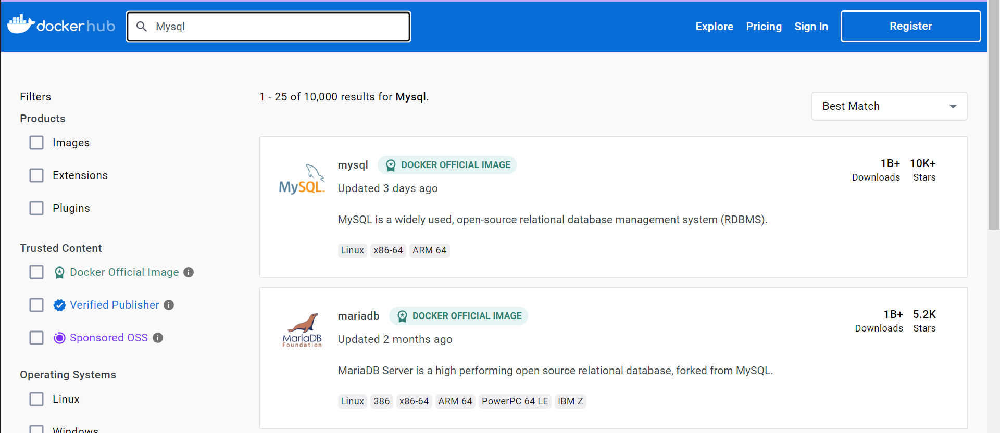

2. 사용할 서비스에 도커 이미지 선택

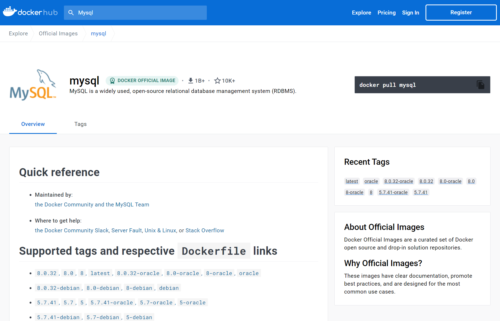

3. 도커 이미지 문서에 docker-compose 사용법 확인

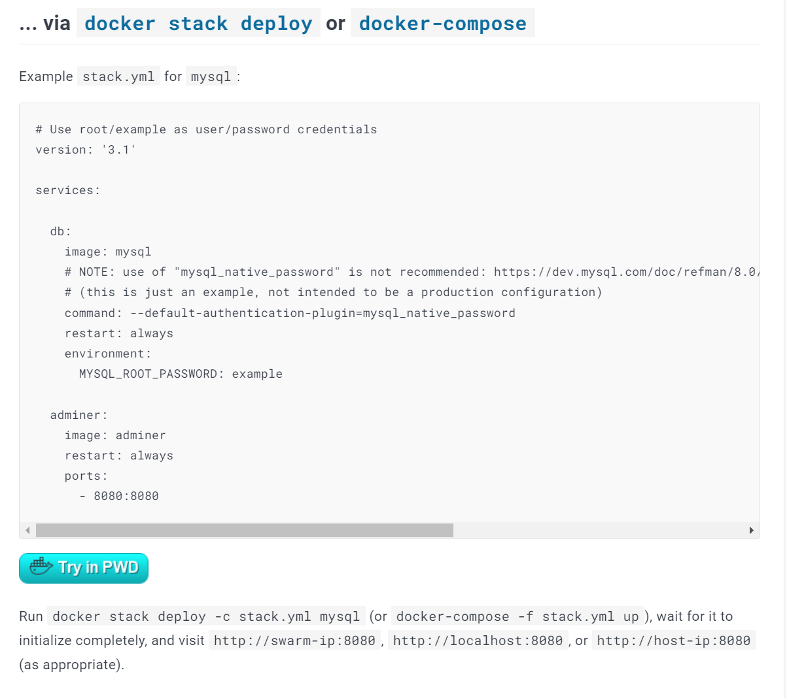

4. 위 내용을 바탕으로 docker-compose 파일 작성

```java
version: '3.8'           # Docker-compose 파일 버전

services:
  mysql:                 # 사용할 서비스 명
    container_name: mysql_local
    image: mysql:8.0.30  # mysql 버전
    volumes:

    restart: always
    environment:
      MYSQL_ROOT_PASSWORD: example
```

* **command 속성 제거**인증 플러그인 암호방식을 변경하는 것인데 설정과 관련된 내용은 따로 분리하여 작성할 예정이다.
* **volumes 속성 추가**도커 컨테이너는 기본적으로 컨테이너가 삭제될 때 데이터가 함께 사라지게 되는데 이러한 생명주기와 상관없이 데이터를 유지할 수 있도록 하는 방법 중 하나가 volume이다.  

  아래 그림과 같이 myapp:/home/node/app → 호스트 디렉토리: 컨테이너 디렉토리로 구성하면 호스트가 그대로 컨테이너가 생성되어 연결된다. 이러한 정보를 가지고 있게 되면 컨테이너를 올렸다가 내려도 호스트에 정의한 데이터가 변함없이 들어가게 된다.

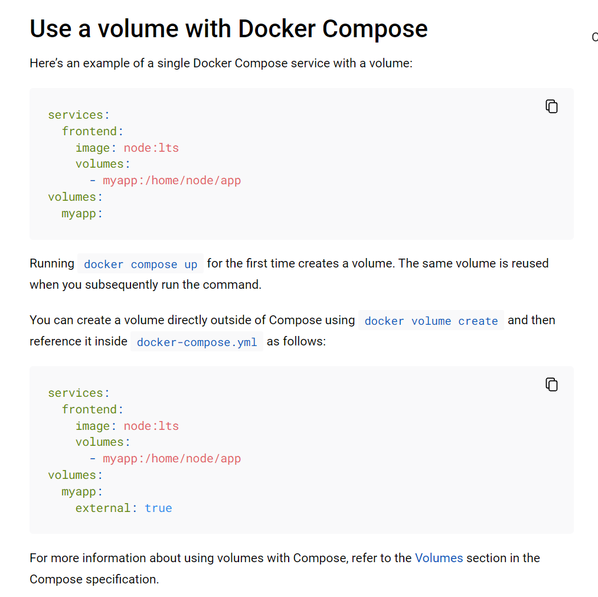

---

#### MySQL를 구성하는데 volumes 설정이 왜 필요할까?

호스트에서 설정 파일과 초기 실행할 Query 를 동일하게 정의하여 Docker 컨테이너에서도 사용할 수 있게 하기 위해서다. 

#### Volumes 설정

```java
version: '3.8'           # Docker-compose 파일 버전

services:
  mysql:                 # 사용할 서비스 명
    container_name: mysql_local
    image: mysql:8.0.30  # mysql 버전
    volumes:
      - ():/etc/mysql/conf.d
      - ():/docker-entrypoint-initdb.d
    restart: always
    environment:
      MYSQL_ROOT_PASSWORD: example
```

* **():/etc/mysql/conf.d**  
  MySQL 서버를 설치하게 되면 기본적으로 my.cnf 파일이 기본 설정 파일로 따르게 된다. 설정하고 싶은 커스텀한 설정은 아래에 넣어주면 된다.
* **():/docker-entrypoint-initdb.d**  
  컨테이너가 시작되면 해당 폴더 내에 있는 sh파일과 sql 파일을 실행한다.   
  create table query가 추가되면 테이블이 생성되고, Insert가 추가되면 초기 데이터를 설정할 수 있다.  

  🔥 **주의**: 파일명에 따라서 알파벳 순으로 실행되기 때문에 먼저 create가 되도록 설정해주어야 한다.

---

#### **호스트 디렉토리 설정**

1. 설정 파일

```java
[client]
default-character-set = utf8mb4

[mysqld]
authentication-policy = mysql_native_password
```

* **default-character-set은 utf8mf4로 설정**  
  클라이언트를 정의하지 않고 사용하면 character set에 일부가 latin1으로 설정되는 것을 볼 수 있다. 이를 해결하기 위해 직접 설정하였다.
* Docker-hub에 MySQL 이미지에 command에서 **"--default-authentication-plugin=mysql\_native\_password"**로 정의되어 있다. **--default-authentication-plugin** 은 **deprecated** 된 용어이기 때문에 **authentication-policy** 로 변경해주었다.  

  MySQL 8 버전이 되면서 기본 인증 암호화 플러그인이 `**mysql\_native\_password**`에서 `**caching\_sha2\_password**` 으로 변경되었다. 접속하는 클라이언트에서 지원하지 않는 경우가 있어 기존 암호화 방식인 `mysql\_native\_password`을 그대로 사용하면 클라이언트로 문제 없이 접근할 수 있다.

이전 버전과의 호환성을 위한 설정이라고 생각하면 된다. 실제로 위와 같이 설정하면 root와 pass\_local\_user에 플러그인이 mysql\_native\_password로 변경된 것을 확인할 수 있다. 

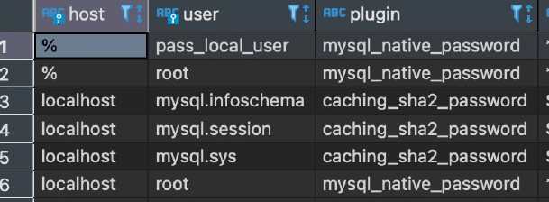

Query 파일

**테이블 생성**

```sql
CREATE TABLE `package`
(
    `package_seq`  int         NOT NULL AUTO_INCREMENT COMMENT '패키지 순번',
    `package_name` varchar(50) NOT NULL COMMENT '패키지 이름',
    `count`        int                  DEFAULT NULL COMMENT '이용권 수, NULL인 경우 무제한',
    `period`       int                  DEFAULT NULL COMMENT '기간(일), NULL인 경우 무제한',
    `created_at`   timestamp   NOT NULL DEFAULT CURRENT_TIMESTAMP COMMENT '생성 일시',
    `modified_at`  timestamp            DEFAULT NULL COMMENT '수정 일시',
    PRIMARY KEY (`package_seq`)
) ENGINE=InnoDB DEFAULT CHARSET=utf8mb4 COMMENT='패키지';

CREATE TABLE `pass`
(
    `pass_seq`        int         NOT NULL AUTO_INCREMENT COMMENT '이용권 순번',
    `package_seq`     int         NOT NULL COMMENT '패키지 순번',
    `user_id`         varchar(20) NOT NULL COMMENT '사용자 ID',
    `status`          varchar(10) NOT NULL COMMENT '상태',
    `remaining_count` int                  DEFAULT NULL COMMENT '잔여 이용권 수, NULL인 경우 무제한',
    `started_at`      timestamp   NOT NULL COMMENT '시작 일시',
    `ended_at`        timestamp            DEFAULT NULL COMMENT '종료 일시, NULL인 경우 무제한',
    `expired_at`      timestamp            DEFAULT NULL COMMENT '만료 일시',
    `created_at`      timestamp   NOT NULL DEFAULT CURRENT_TIMESTAMP COMMENT '생성 일시',
    `modified_at`     timestamp            DEFAULT NULL COMMENT '수정 일시',
    PRIMARY KEY (`pass_seq`)
) ENGINE=InnoDB DEFAULT CHARSET=utf8mb4 COMMENT='이용권';

CREATE TABLE `booking`
(
    `booking_seq`  int         NOT NULL AUTO_INCREMENT COMMENT '예약 순번',
    `pass_seq`     int         NOT NULL COMMENT '이용권 순번',
    `user_id`      varchar(20) NOT NULL COMMENT '사용자 ID',
    `status`       varchar(10) NOT NULL COMMENT '상태',
    `used_pass`    tinyint(1) NOT NULL DEFAULT '0' COMMENT '이용권 사용 여부',
    `attended`     tinyint(1) NOT NULL DEFAULT '0' COMMENT '출석 여부',
    `started_at`   timestamp   NOT NULL COMMENT '시작 일시',
    `ended_at`     timestamp   NOT NULL COMMENT '종료 일시',
    `cancelled_at` timestamp            DEFAULT NULL COMMENT '취소 일시',
    `created_at`   timestamp   NOT NULL DEFAULT CURRENT_TIMESTAMP COMMENT '생성 일시',
    `modified_at`  timestamp            DEFAULT NULL COMMENT '수정 일시',
    PRIMARY KEY (`booking_seq`)
) ENGINE=InnoDB DEFAULT CHARSET=utf8mb4 COMMENT='예약';

CREATE TABLE `user`
(
    `user_id`     varchar(20) NOT NULL COMMENT '사용자 ID',
    `user_name`   varchar(50) NOT NULL COMMENT '사용자 이름',
    `status`      varchar(10) NOT NULL COMMENT '상태',
    `phone`       varchar(50)          DEFAULT NULL COMMENT '연락처',
    `meta`        TEXT                 DEFAULT NULL COMMENT '메타 정보, JSON',
    `created_at`  timestamp   NOT NULL DEFAULT CURRENT_TIMESTAMP COMMENT '생성 일시',
    `modified_at` timestamp            DEFAULT NULL COMMENT '수정 일시',
    PRIMARY KEY (`user_id`)
) ENGINE=InnoDB DEFAULT CHARSET=utf8mb4 COMMENT='사용자';
```

데이터 삽입

```sql
INSERT INTO package (package_name, count, period, created_at)
VALUES ('Starter PT 10회', 10, 60, '2022-08-01 00:00:00'),
       ('Starter PT 20회', 20, 120, '2022-08-01 00:00:00'),
       ('Starter PT 30회', 30, 180, '2022-08-01 00:00:00'),
       ('무료 이벤트 필라테스 1회', 1, NULL, '2022-08-01 00:00:00'),
       ('바디 챌린지 PT 4주', NULL, 28, '2022-08-01 00:00:00'),
       ('바디 챌린지 PT 8주', NULL, 48, '2022-08-01 00:00:00'),
       ('인바디 상담', NULL, NULL, '2022-08-01 00:00:00');

INSERT INTO `user` (user_id, user_name, status, phone, meta, created_at)
VALUES ('A1000000', '우영우', 'ACTIVE', '01011112222', NULL, '2022-08-01 00:00:00'),
       ('A1000001', '최수연', 'ACTIVE', '01033334444', NULL, '2022-08-01 00:00:00'),
       ('A1000002', '이준호', 'INACTIVE', '01055556666', NULL, '2022-08-01 00:00:00'),
       ('B1000010', '권민우', 'ACTIVE', '01077778888', NULL, '2022-08-01 00:00:00'),
       ('B1000011', '동그라미', 'INACTIVE', '01088889999', NULL, '2022-08-01 00:00:00'),
       ('B2000000', '한선영', 'ACTIVE', '01099990000', NULL, '2022-08-01 00:00:00'),
       ('B2000001', '태수미', 'ACTIVE', '01000001111', NULL, '2022-08-01 00:00:00');
```

#### 호스트 설정

위와 같이 호스트 디렉토리에 설정과 SQL 파일들을 원하는 위치에 설정하였으므로 연동해주고 필요한 나머지 설정을 해주면 된다.

```sql
version: '3.8'           # Docker-compose 파일 버전

services:
  mysql:                 # 사용할 서비스 명
    container_name: mysql_local
    image: mysql:8.0.30  # mysql 버전
    volumes:
      - ./db/conf.d:/etc/mysql/conf.d
      - ./db/initdb.d:/docker-entrypoint-initdb.d
    ports:
      - "3306:3306"
    environment:
      - MYSQL_DATABASE=pass_local
      - MYSQL_USER=pass_local_user
      - MYSQL_PASSWORD=passlocal123
      - MYSQL_ROOT_PASSWORD=passlocal123
      - TZ=Asia/Seoul
```

* restart 설정 삭제  
  로컬에서 사용하므로 불필요하여 삭제함.
* enviroment  
  DB 에 필요한 환경 변수 설정이다.

위 정보를 이제 도커 컨테이너로 실행시켜주면 된다. 이때 명령어를 지속적으로 작성하는 방법도 있겠지만 Makefile을 통해 쉽게 관리할 수 있다.

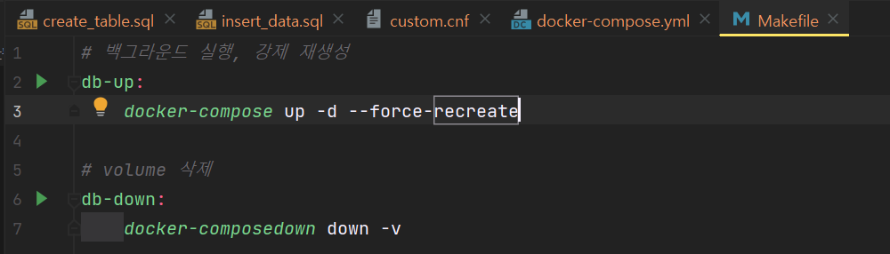

**실행 결과**

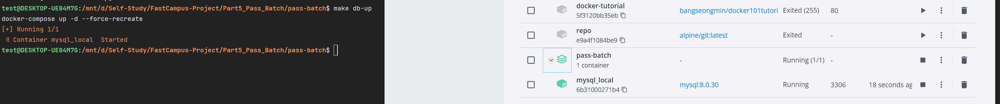

DB 클라이언트를 이용하여 접속해보려고 한다.

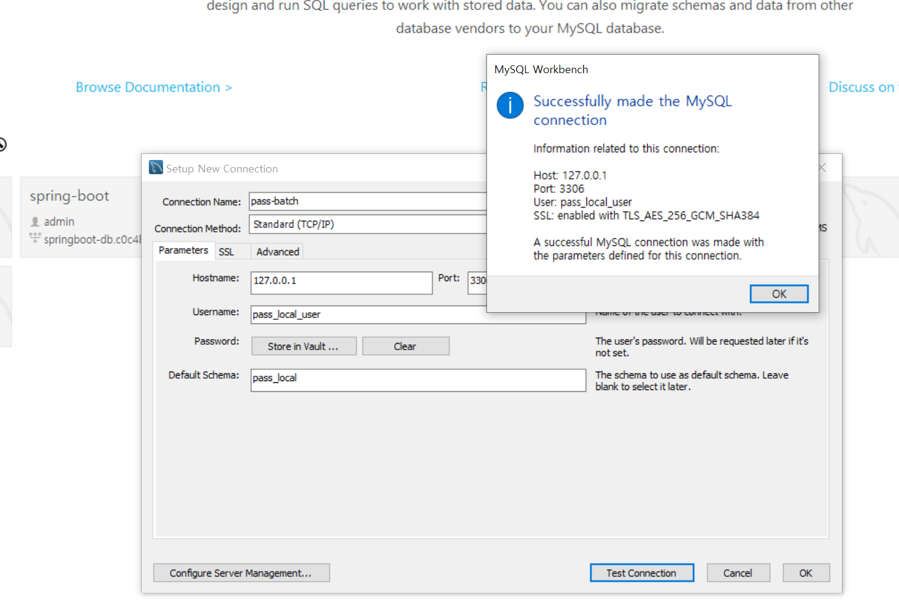

테이블이 정상적으로 생성된 것을 확인할 수 있다.

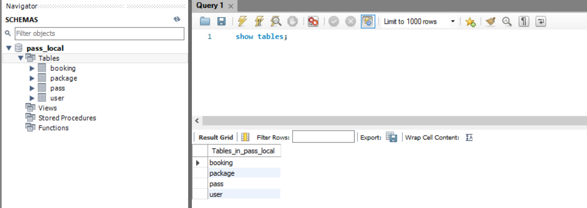

테이블 간에 관계를 간단하게 그려보면 다음과 같다.

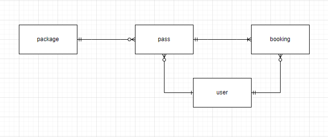

### JPA를 사용한 MySQL 연동

---

이전에 H2 인메모리 데이터베이스를 설정하여 Batch에 대한 정보를 담았었는데 이 부분을 MySQL로 변경하려고 한다.

```java
spring:
  datasource:
    url: jdbc:h2:mem:testdb
    username: sa
    password:
    [REDACTED]: org.h2.Driver
```

#### Config 설정

**1. BatchConfig**

PassBatchApplication에 @EnableBatchProcessing 은 BatchConfig 파일로 분리한다.

```java
@EnableBatchProcessing
@Configuration
public class BatchConfig {
}
```

**2. JPAConfig**

@EnableJpaAuditing은 JPA를 사용하여 엔티티를 테이블에 매핑할 때 엔티티가 공통적으로 가지고 있는 생성일시, 수정일시와 같은 필드, 컬럼들이 존재한다.

Audit은 감시하다라는 의미로 Spring Data JPA에서는 시간에 대해서 자동으로 값을 넣어주는 기능이다. 엔티티를 Insert 나 Update 하는 경우 매번 시간 데이터를 설정해주어야 하는데 Jpa Auditing 을 사용하면 자동으로 매핑해서 DB 테이블에 입력해준다.

```java
@EnableJpaAuditing
@Configuration
public class JpaConfig {
}
```

설계한 테이블을 보면 알수 있듯이 모든 테이블에서 **created\_at**과 **modified\_at** 필드를 갖는다. 공통적인 두 개에 필드를 자동적으로 채워준다면 중복적인 코드를 줄일 수 있다.

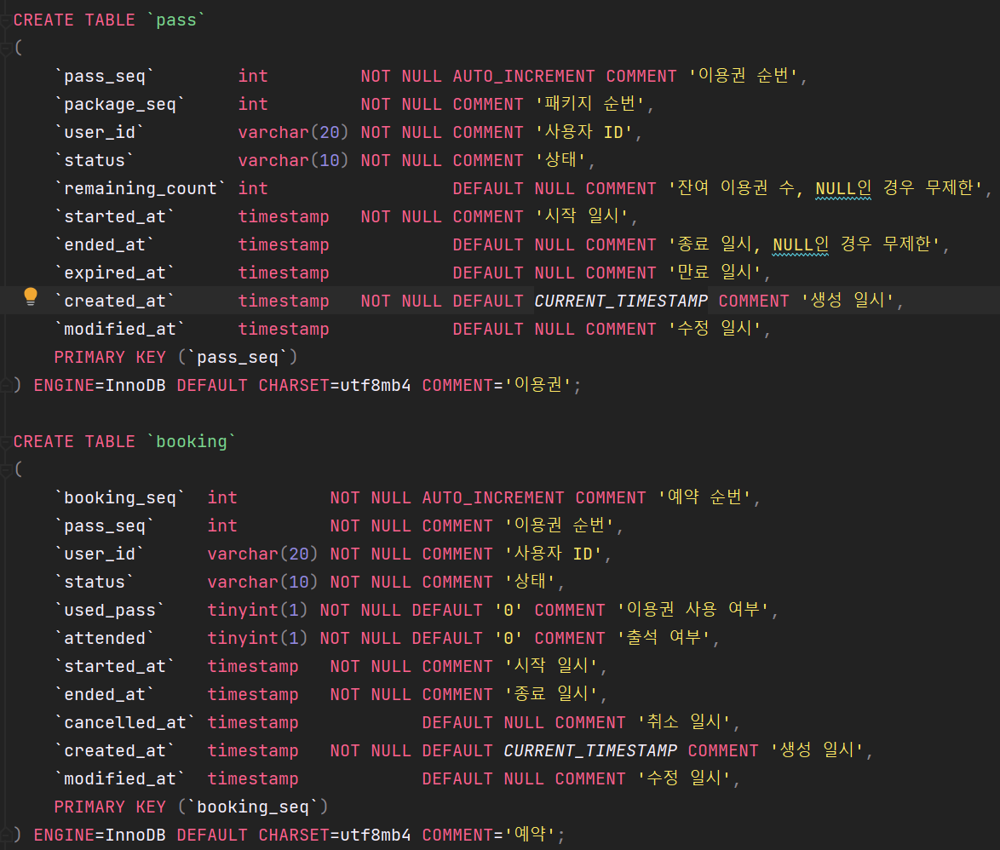

예시를 통해 살펴보자.

PassEntity에는 created\_at, modified\_at이 없고 BaseEntity를 상속받고 있다.

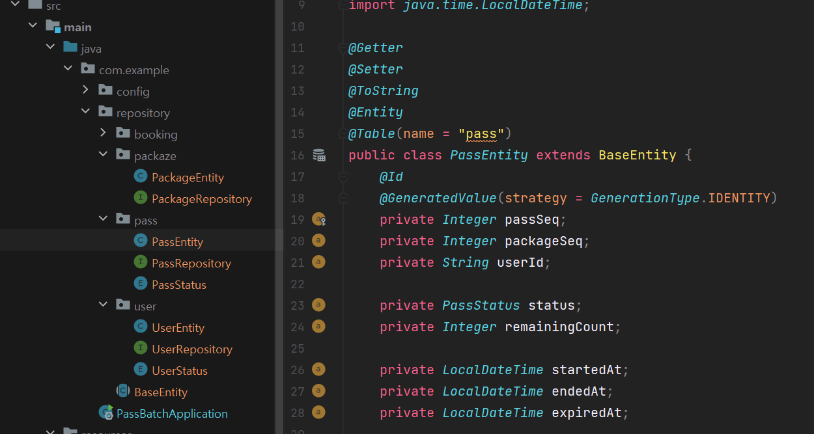

**BaseEntity**는  **created\_at**, **modified\_at**으로 필드가 구성되었고 어노테이션들이 선언되어 있다.

* **@MappedSuperclass**엔티티가 **BaseEntity** 클래스를 상속받게 되면 **BaseEntity** 클래스에 선언된 필드들을 컬럼으로 인식하게 된다.
* **@EntityListeners**JPA 엔티티에 이벤트가 발생할 때 콜백 처리하고 코드를 실행하는 방법이다. 인자로 커스텀 콜백 처리할 클래스를 지정해주면 되는데 Auditing을 수행할 때에는 JPA에서 제공하는 **AuditingEntityListener.class** 를 사용한다.
* **@CreatedDate**엔티티가 생성될때 자동으로 생성일시가 반영된다.
* **@LastModifiedDate**엔티티가 수정될때 자동으로 수정일시가 반영된다.

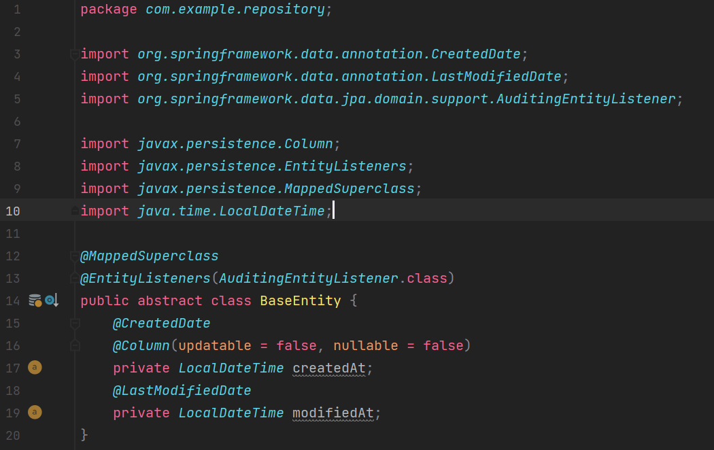

AuditingEntityListener 클래스를 보면 **touchForCreate**와 **touchForUpdate** 가 존재하는데 두 메소드를 통해 엔티티의 생성 또는 수정이 발생했을 때 콜백이 실행되어 시간을 자동으로 입력해준다.

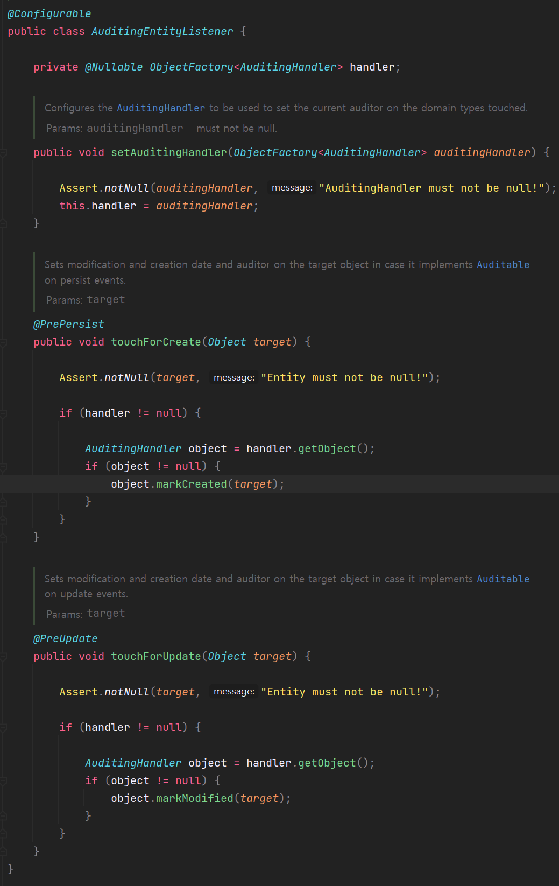

이러한 설정들을 사용할 수 있도록 Enable 해주는 부분이 JpaConfig 클래스에 **@EnableJpaAuditing** 이다.

```java
@EnableJpaAuditing
@Configuration
public class JpaConfig {
}
```

추가적인 도메인에 대해서도 BaseEntity를 상속만 해주면 간편하게 생성일시와 수정일시 필드를 자동으로 JPA가 관리해준다.

---

#### Application.yml 파일 설정

Application.yml 파일에서 mysql 설정하고 Repository를 생성해보자.

```java
spring:
  datasource:
    url: jdbc:mysql://127.0.0.1:3306/pass_local?zeroDateTimeBehavior=convertToNull&characterEncoding=UTF-8&serverTimezone=Asia/Seoul
    username: pass_local_user
    password: passlocal123
    driver-class-name: com.mysql.cj.jdbc.Driver
    hikari:
      maximum-pool-size: 20

  batch:
    jdbc:
      initialize-schema: always
```

* **zeroDateTimeBehavior=convertToNull**  
  로컬 Datetime 과 같은 값들이 0일 경우 Null로 변경
* **characterEncoding=UTF-8**  
  JDBC를 통해 DB로 보내는 값은 인코딩으로 UTF-8로 지정
* **serverTimezone=Asia/Seoul**  
  서버 시간대는 서울로 설정
* **hikari**  
  SpringBoot 2.0을 기점으로 기본 DBCP이 Tomcat DBCP에서 hikariCP로 변경되었다. hikariCP는 Tomcat DBCP와 다르게 사용하지 않는 커넥션을 회수하도록 설계되어 있다.   
  + **maximum-pool-size**기본 값은 10이고 minimum-pool-size도 동일하다.
* **batch-jdbc-initialize-schema: always**  
  batch job 인스턴스로 시작해서 여러가지 batch 정보를 담은 테이블은 외부 DB로 연결하는 경우 테이블을 직접 만들어주거나 이와 같이 설정을 통해 자동으로 설정해줄 수 있다. 이를 **always** 로 설정하여 자동 생성하도록 하였다.

---

#### Batch 테이블 생성 확인

어플리케이션을 실행하여 Job Repopsitory에 테이블이 생성되는 것을 확인할 수 있다.

1. 어플리케이션이 실행되고 Step이 정상실행됨이 확인

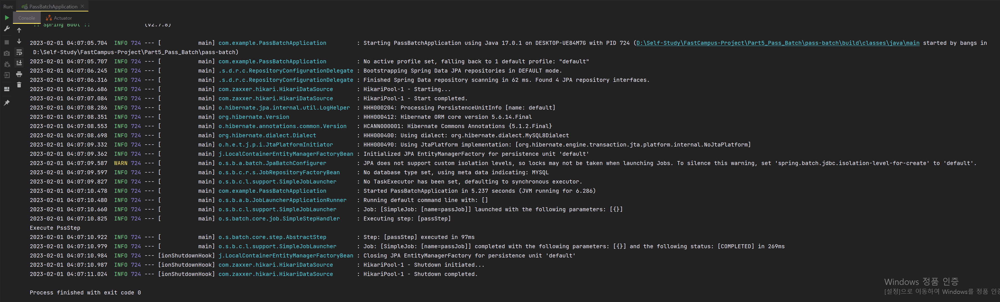

2. DB 테이블 확인

**BATCH\_JOB\_INSTANCE**

테이블 생성된 것을 확인할 수 있으며 내부 값을 통해 방금 실행했던 Job 인스턴스가 저장되어 있는 것을 확인할 수 있다.

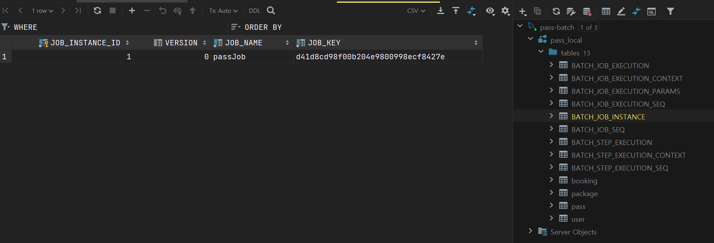

**BATCH\_JOB\_EXECUTION**

Job이 생성되어 시작되고 끝난 시점 확인가능하다.

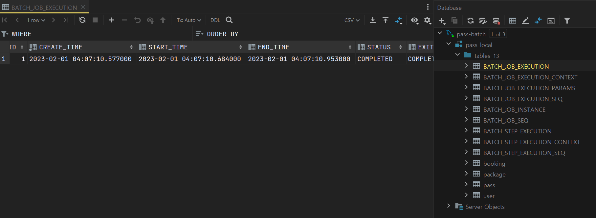

**BATCH\_STEP\_EXECUTION**

Step이 시작되고 끝난 시점 확인 가능하다.

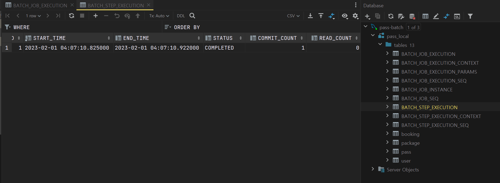

이와 같이 자동적으로 생성되는 것을 통해 외부 DB와 연결되었다는 것을 확인할 수 있다.

---

#### JPA Repository 구현

테스트를 먼저 작성하고 그에 맞게 Repository를 작성해보려고 한다.

테스트 코드를 작성하기 이전에 build.gradle에 테스트를 위해 Lombok과 JUnit 5를 추가해주었다.  
JUnit 5를 설치한 이유는 Java 8에 기능을 잘 활용할 수 있는 장점이 있기 때문에 추가해주었다.

```java
// lombok
testCompileOnly 'org.projectlombok:lombok'
testAnnotationProcessor 'org.projectlombok:lombok'

// junit5
testImplementation 'org.junit.jupiter:junit-jupiter-api:5.9.0'
testRuntimeOnly 'org.junit.jupiter:junit-jupiter-engine:5.9.0'
```

어플리케이션과 관계 없이 테스트를 진행시키기 위해 application-test.yml 파일을 따로 생성해주었다.

```java
# profile=test에서 사용하는 application 파일입니다.
# 로깅 프레임워크의 어떠한 최적화도 없이 출력하기 때문에 환경에 따라 사용 여부를 결정해야 합니다.
spring:
  jpa:
    show-sql: true         # 쿼리를 표준 출력
    properties:
      hibernate:
        format_sql: true   # 가독성 있게 출력
logging:
  level:
    org.hibernate.type.descriptor.sql: trace # 바인딩되는 모든 파라미터를 찍습니다.
```

Repository 테스트를 할때 @**DataJpaTest**를 많이 사용하는데 직접 DB와 연결하여 롤백없이 테스트를 실행하여 실행된 결과를 확인하려한다. @**DataJpaTest**에 추가적인 설정을 통해서도 가능하다. 보통은 서비스에 사용되는 DB를 직접 붙이지 않고 @**DataJpaTest** 를 통해서 임베디드 데이터베이스를 사용하는 것이 일반적이다.

**1. 저장 기능 테스트**

로깅을 설정하였기 때문에 로그를 통해 데이터가 저장되는 쿼리와 값을 확인할 수 있다.

추가적으로 create\_at과 modifed\_at를 따로 설정해주지 않았지만 데이터가 자동으로 삽입되고 있는 것을 볼 수 있다.

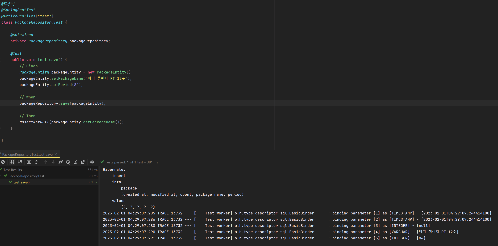

**2. 조회 기능 테스트**

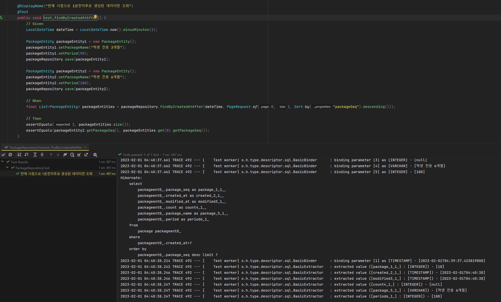

**3. 업데이트 테스트**

엔티티에 Setter를 통해 변경하면 데이터에 업데이트가 발생하게 되는데 이보다 구체적인 조건을 제공하기 위해 JPQL을 사용한다. JPQL 어노테이션 외에도 추가적으로 2개에 어노테이션을 추가해주어야 한다.

1. **@Modifying**데이터의 변경이 발생하는 INSERT, UPDATE, DELETE 시 사용되고, 선언되지 않을 경우 에러가 발생하여 DML이 발생되지 않는다.
2. **@Transactional**UPDATE, DELETE 쿼리에 경우 트랜잭션이 없는 경우 **Transaction required exception** 에러가 발생한다.

```java
public interface PackageRepository extends JpaRepository<PackageEntity, Integer> {
    List<PackageEntity> findByCreatedAtAfter(LocalDateTime dateTime, Pageable pageable);

    @Transactional
    @Modifying
    @Query(value = "UPDATE PackageEntity p " +
            "          SET p.count = :count," +
            "              p.period = :period" +
            "        WHERE p.packageSeq = :packageSeq"
    )
    int updateCountAndPeriod(Integer packageSeq, Integer count, Integer period);
}
```

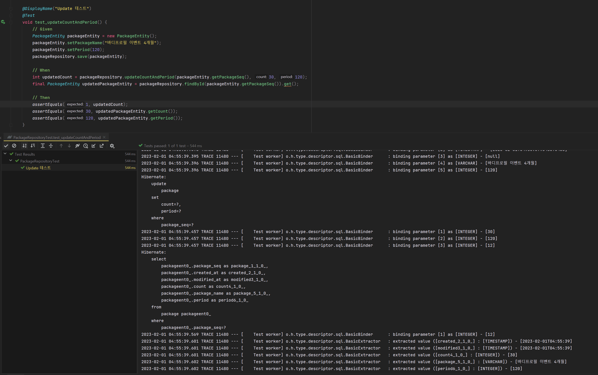

**4. 삭제 테스트**

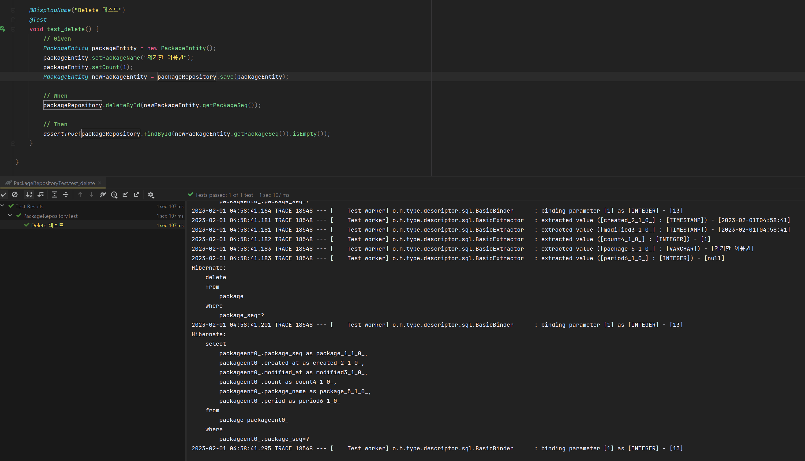

#### **정리**

> Spring Batch 프로젝트에 MySQL를 연동하여   
> Job Repository 테이블 생성된 것을 확인하였고  
>   
> JPA Repository를 간단하게 구현하여  
> CRUD 테스트를 진행해보았다.  
>   
> JPQL에 대한 이해와 Batch Job Repository에 대한  
> 이해를 높일 수 있었다.
